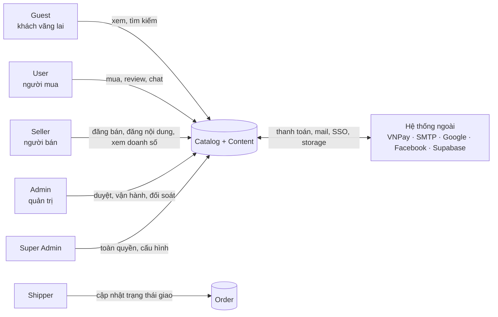
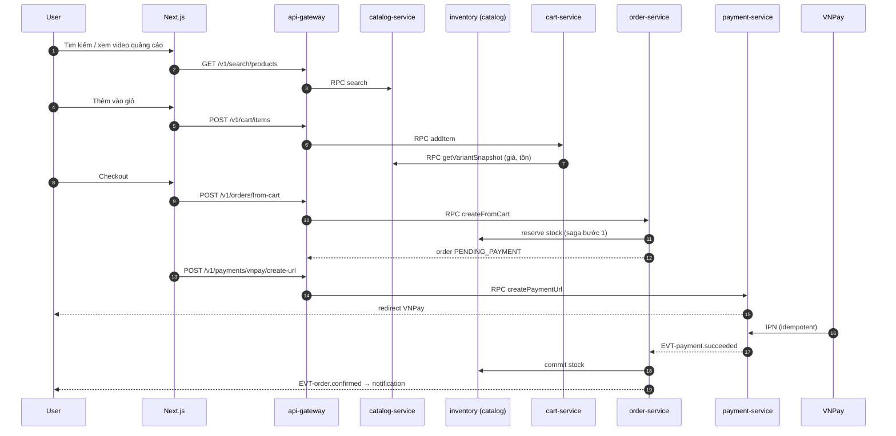

# Tổng quan sản phẩm TimmyHub

## 1. Một câu định nghĩa

> TimmyHub là sàn thương mại điện tử đa người bán, nơi **seller** vừa bán hàng vừa làm nội dung (post, video quảng cáo),
> **user** vừa mua vừa tương tác nội dung, và **admin** vận hành – kiểm duyệt – đối soát; ba bên trao đổi trực tiếp với
> nhau trong cùng một nền tảng thay vì qua kênh rời rạc bên ngoài.

Điểm khác biệt so với một sàn TMĐT thông thường nằm ở chữ **Hub**: mọi tương tác giữa ba vai (đơn hàng, khiếu nại,
duyệt sản phẩm, duyệt nội dung, thanh toán cho seller, chat hỗ trợ) đều có một đường đi rõ ràng, có lịch sử, có SLA và
có audit log — không tồn tại trao đổi "ngoài hệ thống".

## 2. Bài toán cần giải

| Nhóm | Vấn đề hiện tại | TimmyHub giải quyết bằng |
|---|---|---|
| Seller nhỏ | Bán hàng một nơi, làm nội dung một nơi (TikTok/Facebook), không đo được nội dung nào ra đơn | Post/video gắn trực tiếp sản phẩm, đo impression → click → add-to-cart → đơn |
| Seller nhỏ | Không biết tiền về khi nào, đối soát thủ công | `wallet-settlement`: ví seller, kỳ đối soát, yêu cầu rút minh bạch |
| User | Mua hàng thiếu bối cảnh; review rời rạc, khó tin | Nội dung + review + chat trực tiếp với seller trong cùng trang sản phẩm |
| User | Khiếu nại rơi vào khoảng trống giữa seller và sàn | Ticket có trạng thái, có SLA, admin tham gia được vào hội thoại ba bên |
| Admin | Kiểm duyệt thủ công, không truy vết được ai đã làm gì | Hàng đợi kiểm duyệt thống nhất + audit log bất biến |
| Admin | Không có số liệu vận hành theo thời gian thực | `analytics-service` với GMV, funnel, cohort, top sản phẩm, tồn kho |

## 3. Actor

| Actor | Mô tả | Quyền cốt lõi |
|---|---|---|
| `GUEST` | Chưa đăng nhập | Xem sản phẩm, danh mục, post/video công khai, tìm kiếm |
| `USER` | Người mua đã đăng ký | Giỏ hàng, đặt hàng, thanh toán, review, wishlist, chat, theo dõi shop |
| `SELLER` | Người bán đã được duyệt | Quản lý sản phẩm/tồn kho/đơn, đăng post & video quảng cáo, xem doanh số, ví & rút tiền |
| `ADMIN` | Quản trị viên sàn | Duyệt seller/sản phẩm/nội dung, xử lý ticket, quản lý voucher & campaign, xem báo cáo toàn sàn |
| `SUPER_ADMIN` | Quản trị cấp cao | Toàn bộ quyền admin + quản lý role/permission, cấu hình hệ thống, feature flag |
| `SHIPPER` | Đơn vị/nhân sự giao hàng | Cập nhật trạng thái giao của đơn được gán |

Chi tiết ma trận quyền: [roles-and-permissions.md](roles-and-permissions.md).

## 4. Hành trình chính

### 4.1 User mua hàng

### 4.2 Seller bán hàng + làm nội dung

1. Đăng ký bán hàng → admin duyệt (`seller-onboarding`).
2. Tạo sản phẩm + biến thể + tồn kho → admin duyệt sản phẩm (`catalog-product`, `inventory`).
3. Đăng post/video gắn sản phẩm → admin duyệt nội dung (`content-post`).
4. Tạo chiến dịch quảng cáo, nạp ngân sách, đặt chỗ hiển thị (`video-ads`).
5. Nhận đơn → xử lý → giao (`order-fulfillment`).
6. Xem doanh số, funnel, hiệu quả quảng cáo (`analytics-sales`).
7. Tiền về ví theo kỳ đối soát → yêu cầu rút (`wallet-settlement`).

### 4.3 Admin vận hành

Hàng đợi công việc thống nhất: duyệt seller → duyệt sản phẩm → duyệt nội dung → xử lý ticket → xử lý yêu cầu rút tiền.
Mọi hành động ghi audit log với `actorId`, `action`, `entity`, `before/after diff`, `traceId`.

## 5. Phạm vi

### 5.1 Trong phạm vi (MVP)

Chín domain lõi, theo thứ tự triển khai:

| Thứ tự | Domain | Lý do vào MVP |
|---|---|---|
| 1 | `identity-auth` | Nền tảng mọi thứ |
| 2 | `rbac-permission` | Không có RBAC thì không phân tách được ba vai |
| 3 | `user-profile` | Địa chỉ giao hàng là điều kiện để đặt đơn |
| 4 | `seller-onboarding` | Không có seller thì không có hàng |
| 5 | `catalog-product` | |
| 6 | `inventory` | **Bắt buộc trong MVP** — bản cũ trừ kho trực tiếp nên oversell khi flash sale |
| 7 | `cart-checkout` | |
| 8 | `order-fulfillment` | |
| 9 | `payment-vnpay` | Đóng vòng tiền |

### 5.2 Trong phạm vi (sau MVP)

`wallet-settlement`, `promotion-voucher`, `campaign-flashsale`, `content-post`, `video-ads`, `review-rating`,
`chat-support`, `notification`, `search-discovery`, `media-upload`, `analytics-sales`, `audit-log`, `master-data`,
`admin-console`.

> `audit-log` tuy xếp sau MVP về mặt **giao diện tra cứu**, nhưng **cơ chế ghi log phải có ngay từ service đầu tiên** —
> xem [ADR-0011](../01-architecture/adr/ADR-0011-audit-log-strategy.md).

### 5.3 Ngoài phạm vi (phiên bản này)

| Hạng mục | Lý do |
|---|---|
| Ứng dụng mobile native | Web responsive trước; PWA cân nhắc ở v1.5 |
| Livestream bán hàng | Chi phí hạ tầng streaming lớn; `video-ads` là bước đệm |
| Đa tiền tệ / đa quốc gia | Chỉ VND, chỉ thị trường Việt Nam |
| Cổng thanh toán ngoài VNPay | Bản cũ có khai báo `STRIPE_*` nhưng chưa từng dùng — xem [migration-from-legacy.md](../08-handoff/migration-from-legacy.md) |
| Tự vận hành logistics | Trạng thái giao hàng cập nhật thủ công/qua webhook đối tác |
| Gợi ý bằng ML | v1.5; MVP dùng ranking theo quy tắc trong Elasticsearch |

## 6. Ràng buộc

| Loại | Ràng buộc |
|---|---|
| Kỹ thuật | Next.js 16 (App Router), NestJS 11, Prisma 7, PostgreSQL 16, Node 22 LTS, pnpm workspace |
| Kiến trúc | Full microservices, **database-per-service** — không service nào đọc trực tiếp DB của service khác |
| Hạ tầng | Upstash Redis (REST cho cache/rate-limit, TCP cho BullMQ & socket adapter), Supabase Storage cho media |
| Thanh toán | VNPay; IPN **phải idempotent** — đây là điểm rủi ro cao nhất hệ thống |
| Ngôn ngữ giao diện | `vi` mặc định, `en` thứ hai; locale nằm trong cookie `NEXT_LOCALE`, URL không đổi theo ngôn ngữ |
| Khả năng truy cập | WCAG 2.2 AA, vùng chạm tối thiểu 44×44 px |
| Bảo mật | Không có token/secret trong repo; mọi secret qua biến môi trường hoặc secret manager |

## 7. Chỉ số thành công

| Nhóm | Chỉ số | Mục tiêu v1 |
|---|---|---|
| Nghiệp vụ | Tỉ lệ checkout thành công | ≥ 92% |
| Nghiệp vụ | Tỉ lệ đơn bị huỷ do hết hàng | ≤ 1% (hiện tại bản cũ không đo được) |
| Nghiệp vụ | Thời gian duyệt sản phẩm trung bình | ≤ 4 giờ làm việc |
| Nội dung | Tỉ lệ đơn phát sinh từ post/video | ≥ 8% GMV |
| Kỹ thuật | p95 API đọc | ≤ 300 ms |
| Kỹ thuật | p95 API ghi | ≤ 800 ms |
| Kỹ thuật | Uptime gateway | ≥ 99.5% |
| Kỹ thuật | Sai lệch đối soát thanh toán | 0 giao dịch/tháng |
| Vận hành | SLA phản hồi ticket lần đầu | ≤ 2 giờ trong giờ hành chính |

Định nghĩa đo lường chi tiết: [analytics-sales/requirements.md](../03-specs/analytics-sales/requirements.md) và
[observability.md](../01-architecture/observability.md).

## 8. Quan hệ với bản cũ

`timmy-hub` **không phải bản copy** của `TimmyHub`. Nghiệp vụ được kế thừa, còn nền tảng kỹ thuật viết lại:

| Khía cạnh | Bản cũ | Bản mới |
|---|---|---|
| Backend | 1 NestJS monolith, 1 Postgres, 29 module | 17 service, database-per-service, RabbitMQ |
| UI | Mantine 8 + AG Grid Enterprise | shadcn/ui + Tailwind + TanStack Table |
| Auth FE | Cookie non-HttpOnly (`user_roles`, `user_permissions` lộ ra client) | NextAuth, session mã hoá |
| Validation | Lẫn `class-validator` và `zod`, DTO thực tế **không được validate** | Chỉ zod + `nestjs-zod` |
| Migration DB | `prisma db push --accept-data-loss`, không có lịch sử | `prisma migrate`, có lịch sử |
| Tồn kho | Trừ trực tiếp, không reserve | Có reserve/commit/release |
| Ví seller | Có model `Wallet`, `WalletTransaction` nhưng **không có API nào** | `wallet-settlement` đầy đủ |
| Tài liệu | Không có `docs/` | Bộ `docs/` này |

Danh sách ánh xạ từng module/route/thư viện và các lỗi cần khắc phục:
[migration-from-legacy.md](../08-handoff/migration-from-legacy.md).

## 9. Giả định

1. Lưu lượng mục tiêu năm đầu: ≤ 50.000 MAU, ≤ 2.000 đơn/ngày — đủ để chạy microservices trên một cụm k8s nhỏ (3 node).
2. Seller tự chịu trách nhiệm vận chuyển; sàn chỉ ghi nhận trạng thái.
3. VNPay là phương thức thanh toán trực tuyến duy nhất; COD được hỗ trợ ở tầng đơn hàng.
4. Dữ liệu bản cũ **không migrate sang** bản mới (khởi tạo dữ liệu mới, seed lại master data). Nếu quyết định ngược lại,
   cần một domain `data-migration` bổ sung.
