# TimmyHub — Tổng quan kế hoạch dự án

> **Tài liệu này là bản tổng quan đứng độc lập.** Đọc hết file này là nắm được: làm cái gì, cho ai, bằng công nghệ gì,
> kiến trúc ra sao, chia bao nhiêu giai đoạn, ai làm, mất bao lâu, rủi ro ở đâu, và đọc tiếp file nào để đi sâu.
> Mọi con số và bảng ở đây đều trỏ tới tài liệu chi tiết tương ứng.
>
> Cập nhật theo [ADR-0015](../01-architecture/adr/ADR-0015-modular-monolith.md): backend không còn là 17 đơn vị
> triển khai microservices mà là **một app NestJS** (`backend/apps/api`) chứa 16 module domain + module `platform`,
> cộng **hai process worker** (`backend/apps/worker` cho job nhẹ, và `worker-media` cùng codebase khác entrypoint
> cho ffmpeg), cộng **một** database Postgres chung. Tên gọi `<domain>-service` được giữ nguyên xuyên suốt tài liệu
> này (khớp tên file `docs/02-domain/schemas/*.prisma.md` đã tồn tại) nhưng đọc là **tên module trong một process**,
> không phải một service/deployment riêng — xem [domain-model.md §2](../02-domain/domain-model.md) và
> [service-catalog.md](../01-architecture/service-catalog.md).

---

## Mục lục

| § | Nội dung |
|---|---|
| 1 | Tóm tắt điều hành |
| 2 | Bối cảnh: vì sao làm lại |
| 3 | Mục tiêu và phi mục tiêu |
| 4 | Người dùng và vai trò |
| 5 | Phạm vi tính năng — 23 domain, 251 feature |
| 6 | Kiến trúc tổng thể — modular monolith, 3 đơn vị triển khai |
| 7 | Công nghệ sử dụng (đầy đủ, kèm lý do) + đề xuất bổ sung |
| 8 | Dữ liệu và sự kiện |
| 9 | Yêu cầu phi chức năng (NFR) |
| 10 | Bảo mật và tuân thủ |
| 11 | Kế hoạch triển khai — 6 phase, 18 sprint |
| 12 | Cột mốc và tiêu chí ra mắt |
| 13 | Nhân sự và ước lượng công sức |
| 14 | Rủi ro và biện pháp giảm thiểu |
| 15 | Chất lượng và quy trình |
| 16 | Vận hành và chi phí |
| 17 | Bộ tài liệu `docs/` |
| 18 | Nợ kỹ thuật kế thừa phải xử lý |
| 19 | Giả định và câu hỏi mở |
| 20 | Bước tiếp theo |
| A | Phụ lục A — Danh sách đầy đủ 251 tính năng |
| B | Phụ lục B — Bản đồ màn hình frontend |
| C | Phụ lục C — Bản đồ API theo service |
| D | Phụ lục D — Bản đồ dữ liệu theo database |
| E | Phụ lục E — Máy trạng thái |
| F | Phụ lục F — Danh mục 86 domain event |
| G | Phụ lục G — Biến môi trường |
| H | Phụ lục H — Quy trình làm việc |
| I | Phụ lục I — Lịch trình tổng |
| J | Phụ lục J — Việc phải xong trước sprint 1 |

---

## 1. Tóm tắt điều hành

**TimmyHub là sàn thương mại điện tử đa vai trò kiêm trung tâm trao đổi giữa admin – user – seller.**
Seller đăng bán sản phẩm, đăng bài post và video quảng cáo, quản lý doanh số và dòng tiền; user mua hàng và tương tác
nội dung; admin kiểm duyệt và vận hành toàn sàn. Ba vai trao đổi với nhau qua một hệ thống chat/ticket, một luồng
kiểm duyệt thống nhất, và một bộ thông báo chung.

| Hạng mục | Con số |
|---|---|
| Tính năng đặc tả | **251** (`FEAT-*`) trên **23 domain**, cộng 6 tính năng loại bỏ có chủ đích |
| Trong đó kế thừa từ bản cũ | 76 giữ nguyên + 27 mở rộng + 18 kế thừa nhưng **phải sửa lỗi** |
| Tính năng mới | **130** |
| Tính năng loại bỏ có chủ đích | 6 |
| Đơn vị triển khai | **3** (`api` + `worker` + `worker-media`), **16 module domain** trong một app NestJS, một Postgres chung ([ADR-0015](../01-architecture/adr/ADR-0015-modular-monolith.md)) |
| Domain event | **86** (`EVT-*`) |
| Quyết định kiến trúc ghi nhận | **14** ADR |
| Thời gian dự kiến | **36 tuần** (18 sprint × 2 tuần) |
| Quy mô đội | **~9 FTE** (chi tiết §13) |
| Mốc GA (v1.0) | Tuần **26** |

**Điểm khác biệt lớn nhất so với bản cũ:** bản cũ là monolith NestJS + Mantine đã chạy được nhưng có lỗ hổng phân
quyền và không có lịch sử migration. Bản này là **viết lại**, đổi toàn bộ tầng UI, tổ chức lại backend thành
**modular monolith** có ranh giới module rõ ràng ngay từ đầu ([ADR-0015](../01-architecture/adr/ADR-0015-modular-monolith.md)),
và bổ sung ba mảng nghiệp vụ mà bản cũ thiếu hẳn: **tồn kho có reserve**, **ví & đối soát cho seller**,
**quảng cáo trả phí có đo lường**.

**Bốn rủi ro lớn nhất** (chi tiết §14): xói mòn ranh giới module theo thời gian nếu không thực thi bằng lint;
tính đúng đắn của luồng thanh toán VNPay IPN; nhất quán dữ liệu giữa các module trong cùng transaction; và việc
`worker-media` (ffmpeg) trở thành điểm nghẽn CPU nếu không tách deployment kịp thời.

---

## 2. Bối cảnh: vì sao làm lại

`D:\IT\2026\Projects\TimmyHub` (bản cũ) đã chạy được: ~29 module NestJS, 42 model Prisma, ~50 route Next.js.
Nhưng có những vấn đề không sửa vá được:

| # | Vấn đề ở bản cũ | Hệ quả | Cách xử lý ở bản mới |
|---|---|---|---|
| 1 | Cookie `access_token`, `user_roles`, `user_permissions` **không HttpOnly**; `proxy.ts` phân quyền ở edge dựa trên chính các cookie đó | Bất kỳ script nào cũng sửa được `user_roles` để vượt guard phía client | NextAuth, session mã hoá, bỏ hoàn toàn 3 cookie ([ADR-0005](../01-architecture/adr/ADR-0005-nextauth.md)) |
| 2 | Thiếu seed permission (`product:approve`, `users:create`, `rbac:permissions:*`) | Một loạt endpoint admin **không ai gọi được**, kể cả super admin | Kiểm tra nhất quán lúc khởi động, service **từ chối boot** nếu thiếu (`FEAT-RBAC-011`) |
| 3 | CASL `mapSubject` có nhánh fallback sai | Rule phân quyền theo bản ghi lưu trong DB **vô hiệu hoàn toàn** | Viết lại ánh xạ subject, có test cho từng subject |
| 4 | DTO khai bằng `class-validator` nhưng chỉ đăng ký `ZodValidationPipe` | Decorator `@IsEmail()`, `@IsString()`… **không bao giờ chạy** — API nhận dữ liệu bẩn | zod là nguồn validation **duy nhất**; ESLint chặn import `class-validator` ([ADR-0010](../01-architecture/adr/ADR-0010-zod-single-validation-source.md)) |
| 5 | `prisma db push --accept-data-loss`, không có thư mục migration | Không rollback được, không tái lập được schema production | `prisma migrate` + kiểm tra drift trong CI ([ADR-0009](../01-architecture/adr/ADR-0009-prisma-migrate.md)) |
| 6 | Model `Wallet`/`WalletTransaction` tồn tại nhưng **không có một API nào** | Doanh số không có đường về tiền cho seller | Domain `wallet-settlement` đầy đủ (§5) |
| 7 | Trừ kho trực tiếp khi tạo đơn, không có reserve | Oversell khi flash sale | Domain `inventory` với reserve/commit/release trong cùng transaction |
| 8 | `strict: false`, `no-explicit-any: 'off'` ở backend; không Husky, không test, không Storybook | Lỗi kiểu chỉ lộ ra lúc chạy | TypeScript strict, Husky + lint-staged + commitlint, chiến lược test 4 tầng |
| 9 | AG Grid **Enterprise** dùng làm mặc định | Rủi ro giấy phép thương mại | TanStack Table mặc định ([ADR-0007](../01-architecture/adr/ADR-0007-tanstack-table-over-aggrid.md)) |
| 10 | Không có `error.tsx` / `not-found.tsx` ở bất kỳ route nào; 2 route chết (`/admin/customers`, `/seller/orders`); 2 trang stub | Lỗi runtime làm trắng trang | Bắt buộc có trang lỗi/rỗng cho mọi route group |
| 11 | Bí mật bị commit (Sentry token, Supabase connection string, Vercel token, Google API key) | Rò rỉ hạ tầng | Xoay toàn bộ trước khi tái sử dụng — xem §18 |
| 12 | Không có `docs/`, chỉ 1 file kế hoạch 2.397 dòng | Không ai onboard được | Bộ `docs/` ~95 file có truy vết ID |

**Quyết định:** đây là **viết lại**, không phải nâng cấp. Dữ liệu bản cũ **không migrate** — bản mới khởi động với
dữ liệu sạch (xem giả định A4 ở §19).

---

## 3. Mục tiêu và phi mục tiêu

### 3.1 Mục tiêu sản phẩm

| # | Mục tiêu | Đo bằng |
|---|---|---|
| G1 | Người mua tìm và mua được hàng trong ≤ 5 bước từ trang chủ | Tỷ lệ hoàn tất checkout ≥ 60% |
| G2 | Seller tự phục vụ hoàn toàn: đăng ký → bán → nhận tiền, không cần admin can thiệp | ≥ 90% đơn seller xử lý không phát sinh ticket |
| G3 | Admin kiểm duyệt được mọi loại nội dung từ một hàng chờ duy nhất | Thời gian duyệt trung bình ≤ 4 giờ |
| G4 | Seller thấy được doanh số và dòng tiền gần thời gian thực | Dashboard trễ ≤ 5 phút |
| G5 | Nội dung (post/video) dẫn được ra đơn hàng và đo được | Có attribution cho ≥ 95% đơn đến từ nội dung |
| G6 | Quảng cáo trả phí có thể mua, chạy và tính phí tự động | Sai lệch tính phí = 0 |

### 3.2 Mục tiêu kỹ thuật

| # | Mục tiêu |
|---|---|
| T1 | Ranh giới module rõ ràng, thực thi bằng lint (`@nx/enforce-module-boundaries`), để tách deployment sau này nếu cần mà không phải viết lại |
| T2 | Không mất dữ liệu nghiệp vụ khi Redis/BullMQ hoặc `worker`/`worker-media` chết (outbox cho hiệu ứng phụ ra ngoài process + đường suy giảm) |
| T3 | Không oversell trong mọi kịch bản, kể cả flash sale |
| T4 | Không sai tiền: 0 chênh lệch khi đối soát với VNPay |
| T5 | Mọi thao tác ghi đều có audit log truy vết được tới actor và request |
| T6 | Dev mới dựng được toàn hệ thống trên máy cá nhân trong ≤ 30 phút |

### 3.3 Phi mục tiêu (lần này **không** làm)

| Không làm | Lý do |
|---|---|
| App mobile native (iOS/Android) | Web responsive + PWA đủ cho giai đoạn này |
| Livestream bán hàng | Chi phí hạ tầng lớn, chưa có nhu cầu được xác nhận |
| Đa tiền tệ, đa quốc gia | Chỉ VND, chỉ thị trường Việt Nam |
| Cổng thanh toán ngoài VNPay | Thêm sau khi luồng VNPay ổn định |
| Hệ thống logistics riêng | Seller tự vận chuyển hoặc dùng đơn vị bên ngoài |
| Gợi ý sản phẩm bằng machine learning | Giai đoạn đầu dùng luật + độ phổ biến |
| Migrate dữ liệu từ bản cũ | Xem §19 |

---

## 4. Người dùng và vai trò

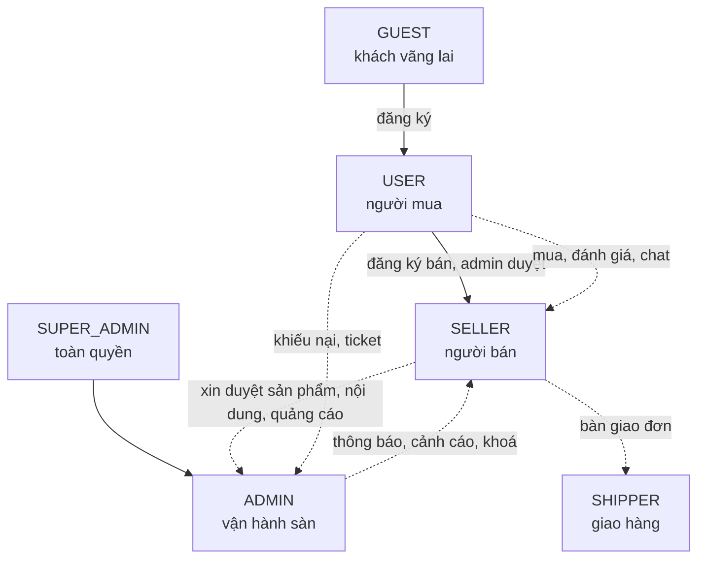

| Vai | Ai | Làm được gì | Số lượng dự kiến năm 1 |
|---|---|---|---|
| `GUEST` | Chưa đăng nhập | Xem sản phẩm, xem post/video, tìm kiếm | — |
| `USER` | Người mua | Mua, đánh giá, wishlist, chat với seller, tương tác nội dung, ví cá nhân | ~50.000 |
| `SELLER` | Chủ shop | Tất cả của `USER` + quản lý shop, sản phẩm, tồn kho, đơn, khuyến mãi, nội dung, quảng cáo, doanh số, rút tiền | ~1.500 |
| `ADMIN` | Nhân viên vận hành | Kiểm duyệt, quản lý người dùng/seller/danh mục, xử lý ticket, xem báo cáo toàn sàn | ~20 |
| `SUPER_ADMIN` | Chủ hệ thống | Toàn quyền, gán quyền, cấu hình hệ thống, feature flag | 1–3 |
| `SHIPPER` | Đối tác giao hàng | Cập nhật trạng thái vận chuyển (phạm vi hẹp, sau MVP) | ~50 |

Phân quyền dùng **3 tầng ghép bằng AND**: `UserRole` (vai) → `Permission` dạng `module:resource:action` (chức năng)
→ CASL (theo từng bản ghi). Chi tiết: [roles-and-permissions.md](roles-and-permissions.md).

---

## 5. Phạm vi tính năng

Nguồn sự thật đầy đủ: [feature-inventory.md](feature-inventory.md) — 251 feature có ID `FEAT-<DOMAIN>-<nnn>`.
Bảng dưới là bản tóm tắt theo domain.

> Cột **Service chứa** giữ tên `<domain>-service` như tài liệu domain đã dùng, nhưng từ ADR-0015 đây là **tên
> module trong `backend/apps/api`**, không phải một service triển khai riêng — xem §6.

| # | Domain | Mã | Feature | P0 | P1 | P2 | Trạng thái | Service chứa |
|---|---|---|---|---|---|---|---|---|
| 1 | `identity-auth` | IDN | 19 | 10 | 6 | 3 | kế thừa + sửa lỗi | `identity-service` |
| 2 | `rbac-permission` | RBAC | 11 | 7 | 4 | 0 | kế thừa + sửa lỗi | `identity-service` |
| 3 | `user-profile` | USR | 10 | 4 | 4 | 2 | kế thừa | `identity + order` |
| 4 | `seller-onboarding` | SEL | 9 | 3 | 4 | 2 | kế thừa | `seller-service` |
| 5 | `catalog-product` | CAT | 15 | 8 | 4 | 3 | kế thừa + mở rộng | `catalog-service` |
| 6 | `inventory` | INV | 10 | 6 | 3 | 1 | **mới** | `catalog-service` |
| 7 | `cart-checkout` | CRT | 11 | 8 | 1 | 2 | kế thừa | `cart-service` |
| 8 | `order-fulfillment` | ORD | 16 | 10 | 5 | 1 | kế thừa + mở rộng | `order-service` |
| 9 | `payment-vnpay` | PAY | 11 | 7 | 4 | 0 | kế thừa + sửa lỗi | `payment-service` |
| 10 | `wallet-settlement` | WAL | 8 | 0 | 5 | 3 | **mới** | `payment-service` |
| 11 | `promotion-voucher` | VCH | 9 | 0 | 8 | 1 | kế thừa | `promotion-service` |
| 12 | `campaign-flashsale` | CPG | 7 | 0 | 5 | 2 | kế thừa | `promotion-service` |
| 13 | `content-post` | PST | 12 | 0 | 7 | 5 | kế thừa + mở rộng | `content-service` |
| 14 | `video-ads` | ADS | 12 | 0 | 9 | 3 | **mới** | `content-service` |
| 15 | `review-rating` | REV | 10 | 0 | 8 | 2 | kế thừa | `engagement-service` |
| 16 | `chat-support` | CHT | 10 | 0 | 5 | 5 | kế thừa + mở rộng | `chat-service` |
| 17 | `notification` | NTF | 9 | 4 | 2 | 3 | kế thừa + mở rộng | `notification-service` |
| 18 | `search-discovery` | SRC | 10 | 0 | 7 | 3 | kế thừa | `search-service` |
| 19 | `media-upload` | MED | 14 | 4 | 7 | 3 | kế thừa + **viết lại đường xử lý video** | `media-service` + worker |
| 20 | `analytics-sales` | ANA | 13 | 0 | 8 | 5 | kế thừa + mở rộng nhiều | `analytics-service` |
| 21 | `audit-log` | AUD | 8 | 3 | 3 | 2 | kế thừa + mở rộng | `audit-service` |
| 22 | `master-data` | MDT | 7 | 2 | 4 | 1 | kế thừa | `master-data-service` |
| 23 | `admin-console` | ADM | 10 | 3 | 6 | 1 | kế thừa | `frontend + nhiều service` |
| | **Tổng** | | **251** | **79** | **119** | **53** | | |

### 5.1 Ba mảng nghiệp vụ trọng tâm

**a. Seller đăng bán** — `seller-onboarding` + `catalog-product` + `inventory`:
đăng ký bán hàng có duyệt, hồ sơ shop có slug riêng, sản phẩm nhiều biến thể (variant) với SKU/giá/tồn riêng,
thuộc tính động theo danh mục, kiểm duyệt trước khi hiển thị, nhập/xuất hàng loạt, cảnh báo sắp hết hàng,
giữ tồn (reserve) khi checkout và tự nhả sau 15 phút nếu không thanh toán.

**b. Post và video quảng cáo** — `content-post` + `video-ads`:

| Nhóm | Nội dung |
|---|---|
| Post/video hữu cơ | Soạn bài có ảnh/video, gắn thẻ sản phẩm, feed cuộn dọc, like/comment realtime, lưu bài, chia sẻ, kiểm duyệt trước khi lên feed |
| Quảng cáo trả phí | Tạo chiến dịch, chọn mục tiêu (hiển thị / lượt xem / click), đặt ngân sách ngày và tổng, chọn đối tượng (danh mục, khu vực, thiết bị), lịch chạy |
| Vị trí hiển thị | Banner trang chủ, chèn giữa feed, gợi ý dưới sản phẩm, kết quả tìm kiếm được tài trợ |
| Đo lường | Impression, view (≥ 3 giây), click, CTR, CPM/CPC, chuyển đổi ra đơn hàng (attribution 7 ngày) |
| Tính phí | Gom sự kiện theo cửa sổ 60 giây, đối soát mỗi giờ, trừ ví quảng cáo, tự dừng khi hết ngân sách |
| Kiểm duyệt | Duyệt nội dung quảng cáo trước khi chạy; báo cáo vi phạm; gỡ và hoàn ngân sách còn lại |

**c. Quản lý doanh số** — `analytics-sales` + `wallet-settlement`:

| Nhóm | Nội dung |
|---|---|
| Chỉ số | GMV, doanh thu thuần, số đơn, giá trị đơn trung bình, tỷ lệ huỷ, tỷ lệ hoàn |
| Chiều phân tích | Theo thời gian, sản phẩm, danh mục, kênh (tìm kiếm / nội dung / quảng cáo), khu vực |
| Phễu | Lượt xem → thêm giỏ → bắt đầu thanh toán → đặt đơn → thanh toán thành công |
| Nâng cao | So sánh kỳ, cohort khách quay lại, top sản phẩm/khách hàng, vòng quay tồn kho |
| Xuất dữ liệu | CSV và Excel qua job nền, gửi link tải qua thông báo |
| Dòng tiền | Ví seller, sổ giao dịch, kỳ đối soát, hoa hồng sàn, yêu cầu rút tiền có duyệt + OTP |

### 5.2 Trung tâm trao đổi admin – user – seller

Đây là phần "hub" trong tên sản phẩm, trải trên `chat-support`, `notification`, `admin-console`, `audit-log`:

| Luồng trao đổi | Cơ chế |
|---|---|
| User ↔ Seller | Chat realtime theo hội thoại, gắn ngữ cảnh sản phẩm/đơn hàng |
| User ↔ Admin | Ticket khiếu nại có SLA, trạng thái, phân công nhân viên |
| Seller ↔ Admin | Hàng chờ kiểm duyệt (sản phẩm, nội dung, quảng cáo, hồ sơ shop), phản hồi lý do từ chối, kháng nghị |
| Ba bên | Tranh chấp đơn hàng: user mở → seller phản hồi → admin phân xử, có mốc thời gian và bằng chứng đính kèm |
| Hệ thống → mọi vai | Thông báo in-app / email / web push, có tuỳ chọn bật tắt theo loại (trừ nhóm giao dịch bắt buộc) |
| Trợ lý tự động | Bot trả lời bước đầu cho ticket hỗ trợ, ngừng khi có nhân viên nhận |

### 5.3 Tính năng loại bỏ có chủ đích

| ID | Bỏ | Lý do |
|---|---|---|
| `FEAT-DEP-001` | Tích hợp Stripe | Khai báo ở bản cũ nhưng không dùng; chỉ VNPay |
| `FEAT-DEP-002` | Cookie `user_roles` / `user_permissions` phía client | Lỗ hổng phân quyền |
| `FEAT-DEP-003` | DTO `class-validator` | Trùng vai trò với zod, và không hề chạy ở bản cũ |
| `FEAT-DEP-004` | AG Grid Enterprise làm mặc định | Giấy phép thương mại |
| `FEAT-DEP-005` | i18next | Thay bằng next-intl có locale trên URL |
| `FEAT-DEP-006` | `db push --accept-data-loss` | Thay bằng migration có lịch sử |

---

## 6. Kiến trúc tổng thể

> Theo [ADR-0015](../01-architecture/adr/ADR-0015-modular-monolith.md): backend là **một** app NestJS
> (`backend/apps/api`) chứa 16 module domain dưới `src/modules/<domain>/` + module `platform` (biên HTTP/WS,
> trước gọi là `api-gateway`), gọi nhau bằng **dependency injection trực tiếp** trong cùng process — không RPC.
> Sự kiện nội bộ dùng **EventEmitter2** trong process; outbox + BullMQ chỉ còn phục vụ hiệu ứng phụ đi ra **ngoài**
> process (mail, webhook, audit sink bất biến). Có **hai** process worker riêng: `backend/apps/worker` (BullMQ,
> job nhẹ) và `worker-media` (cùng codebase, entrypoint ffmpeg riêng, deployment tách vì ăn CPU 100%).

### 6.1 Bức tranh chung

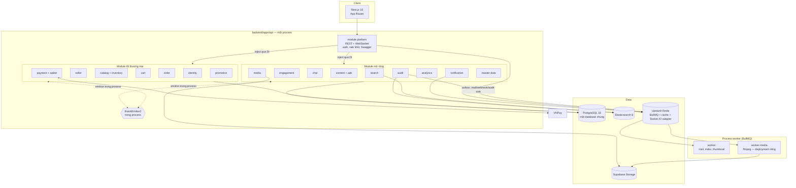

### 6.2 3 đơn vị triển khai, 16 module domain

| # | Module (`src/modules/<domain>/`) | Trong process nào | Trách nhiệm chính |
|---|---|---|---|
| — | `platform` | `api` | Điểm vào HTTP/WS duy nhất (trước là `api-gateway`), guard, rate limit, gộp Swagger |
| 1 | `identity` | `api` | Auth, user, device, RBAC, permission, CASL, SSO |
| 2 | `seller` | `api` | Hồ sơ shop, đơn đăng ký bán, thương hiệu |
| 3 | `catalog` | `api` | Danh mục, sản phẩm, biến thể, **tồn kho**, kiểm duyệt sản phẩm |
| 4 | `cart` | `api` | Giỏ hàng, kiểm tra tính hợp lệ của giỏ |
| 5 | `order` | `api` | Đơn hàng, state machine, địa chỉ giao, phí ship |
| 6 | `payment` | `api` | VNPay, ví, giao dịch ví, đối soát, rút tiền |
| 7 | `promotion` | `api` | Voucher, chiến dịch, flash sale |
| 8 | `content` | `api` | Post, video, **chiến dịch quảng cáo**, kiểm duyệt nội dung |
| 9 | `engagement` | `api` | Đánh giá, bình luận, wishlist, like |
| 10 | `chat` | `api` | Hội thoại đa bên, ticket, khiếu nại |
| 11 | `notification` | `api` (phát job) + `worker` (gửi mail/push) | In-app, email, web push, template, tuỳ chọn nhận |
| 12 | `search` | `api` | Index Elasticsearch, truy vấn, gợi ý, reindex |
| 13 | `media` | `api` (upload, điều phối) + `worker-media` (transcode) | Upload nối lại được (tus), quét mã độc, điều phối transcode |
| 14 | `analytics` | `api` | Doanh số, dashboard, báo cáo, xuất dữ liệu |
| 15 | `audit` | `api` | Audit log, system log, tra cứu |
| 16 | `master-data` | `api` | Tỉnh/huyện/xã, cấu hình hệ thống, feature flag |

Ba đơn vị triển khai thật sự (đóng image, scale độc lập):

| # | Đơn vị | Port dev | Database | Ghi chú |
|---|---|---|---|---|
| 1 | `backend/apps/api` | 3000 | Postgres 16 (1 database chung) | Web process, mọi module ở trên trừ phần chạy trong worker |
| 2 | `backend/apps/worker` | — | dùng chung Postgres | BullMQ, entrypoint mặc định: mail, index, thumbnail, dispatch outbox |
| 3 | `worker-media` | — | dùng chung Postgres | Cùng codebase với `worker`, entrypoint/image riêng chạy ffmpeg; scale theo độ sâu hàng đợi, không theo CPU trung bình |

Chi tiết từng module (hàm export qua `index.ts`, event phát/nhận, job nền, rủi ro):
[service-catalog.md](../01-architecture/service-catalog.md). Đường xử lý video:
[media-video-pipeline.md](../01-architecture/media-video-pipeline.md). Quyết định và đánh đổi đầy đủ:
[ADR-0015](../01-architecture/adr/ADR-0015-modular-monolith.md).

### 6.3 Mười quy tắc kiến trúc bắt buộc

| # | Quy tắc |
|---|---|
| 1 | Một module **chỉ** đụng bảng Prisma của chính nó; muốn dữ liệu module khác thì gọi hàm qua DI (`index.ts` export) hoặc nghe event `EventEmitter2` — không import thẳng service/repository nội bộ của module khác |
| 2 | Giao dịch nghiệp vụ chạm nhiều module dùng `Prisma.$transaction` thật trong cùng process; không saga, không bù trừ — chỉ luồng thanh toán VNPay còn cần xử lý bất đồng bộ (IPN) |
| 3 | Outbox (`outbox_events`) **chỉ** áp dụng cho hiệu ứng phụ đi ra **ngoài** process (mail, webhook, audit sink bất biến), ghi trong cùng transaction với thay đổi nghiệp vụ, dispatch bằng BullMQ ở `worker` |
| 4 | Consumer đọc từ outbox/BullMQ phải **idempotent** (bảng `processed_events`); listener `EventEmitter2` trong process **không cần** vì cùng transaction/process, không giao at-least-once |
| 5 | Đồ thị phụ thuộc gọi hàm đồng bộ giữa module **không được có chu trình**, thực thi bằng ESLint chặn import chéo module |
| 6 | `notification`, `analytics`, `audit` là **sink toàn cục** — không module nào được phụ thuộc ngược vào chúng |
| 7 | Dữ liệu tham chiếu chéo module: hoặc **snapshot bất biến** (ghi một lần, không cập nhật) trong cùng transaction, hoặc **read model** cập nhật bằng event và **tái dựng được** |
| 8 | Tiền luôn là `Decimal(14,2)` qua `Prisma.Decimal`; truyền qua API là **chuỗi** |
| 9 | `worker-media` phải khai báo **đường suy giảm** khi hàng đợi đầy (backpressure, thông báo "đang xử lý"); `api` chịu được `worker`/`worker-media` chậm hoặc chết vì hiệu ứng phụ đã nằm an toàn trong outbox |
| 10 | Thêm module mới phải trả lời được 5 câu hỏi cổng ở [service-catalog.md](../01-architecture/service-catalog.md), gồm cả câu "module này có nên tách deployment ngay từ đầu không" |

---

## 7. Công nghệ sử dụng

### 7.1 Frontend

| Hạng mục | Lựa chọn | Vì sao |
|---|---|---|
| Framework | **Next.js 16** (App Router, RSC) | SEO cho trang sản phẩm, streaming, server action |
| Ngôn ngữ | TypeScript 5.x `strict` | Bắt lỗi trước khi chạy |
| UI kit | **shadcn/ui** + **Radix** | Sở hữu code component, không khoá vào thư viện ([ADR-0006](../01-architecture/adr/ADR-0006-shadcn-over-mantine.md)) |
| CSS | **Tailwind CSS v4** | Token hoá design system, không CSS-in-JS runtime |
| State cục bộ | **Zustand** | Nhẹ, không boilerplate; chỉ dùng cho UI state |
| State máy chủ | **TanStack Query v5** | Cache, invalidation, optimistic update |
| Bảng | **TanStack Table + TanStack Virtual** | Mặc định; AG Grid Community chỉ cho 2–3 grid admin phức tạp |
| Biểu đồ | **Recharts** | Đủ cho dashboard doanh số, API khai báo |
| Form | **react-hook-form + zod** (`zodResolver`) | Cùng schema với backend |
| HTTP | **axios** + interceptor | Refresh token, chuẩn hoá lỗi, gắn `X-Request-Id` |
| Auth | **NextAuth (Auth.js v5)** | Session mã hoá HttpOnly, SSO Google/Facebook |
| i18n | **next-intl** | Locale trên URL `/[locale]/...`, dịch được ở server component |
| Realtime | **socket.io-client** | Khớp với gateway |
| Storybook | **Storybook 8** (CSF3) | Bắt buộc có story cho component dùng chung |
| Test | Vitest + Testing Library + Playwright | Unit / component / e2e |
| Chất lượng | ESLint, Prettier, **Husky + lint-staged + commitlint** | Chặn lỗi trước khi commit |

### 7.2 Backend

| Hạng mục | Lựa chọn | Vì sao |
|---|---|---|
| Runtime | **Node.js 22 LTS** | Ổn định, hỗ trợ dài hạn |
| Framework | **NestJS 11** (modular monolith, một app) | DI xuyên module trong cùng process, không cần transport RPC ([ADR-0015](../01-architecture/adr/ADR-0015-modular-monolith.md)) |
| ORM | **Prisma 7** + `@prisma/adapter-pg` | Kiểu an toàn, migration có lịch sử, client extension cho audit; schema multi-file `prisma/schema/<domain>.prisma`, mỗi module chỉ đụng bảng của mình |
| CSDL | **PostgreSQL 16** | **Một** database chung cho `api`/`worker`/`worker-media`, ranh giới dữ liệu giữa module thực thi bằng quy ước + lint, không bằng database riêng |
| Nền tảng bổ trợ | **Supabase** (Postgres quản lý + Storage) | Giảm việc vận hành, Storage cho media |
| Event nội bộ | **EventEmitter2** (`@nestjs/event-emitter`) trong process | Domain event giữa module, cùng process nên không cần broker, không cần idempotency riêng ([ADR-0015](../01-architecture/adr/ADR-0015-modular-monolith.md), thay cho [ADR-0003](../01-architecture/adr/ADR-0003-rabbitmq-event-bus.md) đã superseded) |
| Job queue | **BullMQ** trên **Upstash Redis (TCP)** | Hàng đợi cho `worker`/`worker-media` (mail, media, index, báo cáo, tính phí quảng cáo…) và dispatch outbox cho hiệu ứng phụ ra ngoài process |
| Cache / rate limit | **Upstash Redis (REST)** | Không giữ kết nối, hợp môi trường serverless ([ADR-0004](../01-architecture/adr/ADR-0004-upstash-redis.md)) |
| Realtime | **Socket.IO** + `@socket.io/redis-adapter` | Nhiều pod gateway đồng bộ qua Redis pub/sub |
| Tìm kiếm | **Elasticsearch 8** | Full-text tiếng Việt, facet, gợi ý |
| Validation | **zod** + `nestjs-zod` | Một nguồn schema dùng chung FE/BE |
| Auth | **Passport** (JWT, Google, Facebook) + **bcrypt** (cost 12) | Chuẩn quen thuộc |
| Bảo mật HTTP | **Helmet**, CORS danh sách trắng, `@nestjs/throttler` | Header bảo mật, chống lạm dụng |
| Mail | **Nodemailer** + template MJML/Handlebars | Gửi qua job, có retry |
| API docs | **Swagger** (`@nestjs/swagger` + `patchNestJsSwagger`) | Sinh từ chính schema zod |
| Thanh toán | **VNPay** (create URL, return, IPN) | Yêu cầu nghiệp vụ |
| Log ứng dụng | **pino** + `pino-http`, redact trường nhạy cảm | JSON có cấu trúc |
| Audit log | **`nestjs-cls`** + **Prisma Client Extension** → emit `audit.recorded` qua EventEmitter2 → module `audit` ghi outbox (đi ES) | Xem §7.4 |
| Trace | **OpenTelemetry** | `traceId` xuyên request (qua module, qua job BullMQ), nối vào audit record |
| Lỗi runtime | **Sentry** (FE + BE) | Gom lỗi, source map |
| Metrics | **Prometheus** + Grafana | RED metrics, độ sâu hàng đợi |
| Test | Jest + Supertest + **Testcontainers** | Integration chạy với Postgres thật (không cần container broker vì event nội bộ là in-process) |

### 7.3 Hạ tầng và vận hành

| Hạng mục | Lựa chọn |
|---|---|
| Đóng gói | **Docker** multi-stage, tối ưu cache pnpm workspace, ảnh chạy non-root — 3 image: `api`, `worker`, `worker-media` (hai cái sau chung Dockerfile, khác `CMD`) |
| Dev local | **docker compose** (postgres, redis, elasticsearch, kibana, mailhog) — không còn RabbitMQ |
| Điều phối | **Kubernetes** — Deployment, Service, Ingress, HPA (theo CPU cho `api`, theo độ sâu hàng đợi cho `worker-media`), PDB, probe, Secret, ConfigMap |
| CI/CD | **GitHub Actions** — Turborepo phát hiện package thay đổi (`--filter='...[origin/main]'`) → lint/test/build → build lại đúng image nào đổi trong 3 → deploy |
| Migration | k8s Job chạy `prisma migrate deploy` **trước** khi rollout `api` |
| Bí mật | GitHub Secrets (CI), Kubernetes Secret + External Secrets Operator (prod) |
| Monorepo | **pnpm workspace + Turborepo**: `backend/apps/{api,worker}`, `backend/src/modules/<domain>/`, `backend/libs/`, `frontend/`, `shared/` |

### 7.4 Chốt thư viện audit log

So sánh và kết luận đầy đủ ở [observability.md](../01-architecture/observability.md) và
[ADR-0011](../01-architecture/adr/ADR-0011-audit-log-strategy.md). Tóm tắt:

| Hạng | Giải pháp | Đánh giá |
|---|---|---|
| ✅ **Chọn** | `nestjs-cls` (AsyncLocalStorage giữ actor/requestId/traceId) + **Prisma Client Extension** `$extends` sinh audit record → emit `audit.recorded` qua EventEmitter2 trong process → module `audit` ghi outbox → `worker` đẩy vào Postgres partition theo tháng + index Elasticsearch | Bắt được cả thay đổi ngoài controller, diff chính xác, không phụ thuộc thư viện bị bỏ rơi, tách tải khỏi luồng xử lý request |
| ✅ Bổ sung | `@nestjs-cls/transactional` | Gắn audit vào cùng transaction nghiệp vụ |
| ✅ Bổ sung | `pino` + `pino-http` có redact | Log **ứng dụng**, tách bạch với audit log **nghiệp vụ** |
| ✅ Bổ sung | `@opentelemetry/sdk-node` | Nối `traceId` xuyên request/job vào audit record |
| ⚪ Tuỳ chọn | `pgaudit`, hoặc bảng append-only + chuỗi hash | Khi cần bằng chứng chống sửa |
| ❌ Không dùng | `audit-log-nestjs`, `typeorm-auditing`, `prisma-audit` | Ít bảo trì, hoặc sai stack (TypeORM) |

### 7.5 Công nghệ đề xuất bổ sung

Bản rà soát stack theo mặt bằng công nghệ web quý 3/2026 — lỗ hổng, đề xuất, chi phí phải trả — nằm ở
[technology-radar.md](../01-architecture/technology-radar.md). Bốn đề xuất làm **thay đổi phạm vi** và cần quyết định
trước phase P2: domain vận chuyển `shipping-logistics`, sổ cái kép cho ví seller, đường xử lý/transcode video,
và kho dữ liệu riêng cho event quảng cáo.

---

## 8. Dữ liệu và sự kiện

### 8.1 Phân bổ dữ liệu

**Một** database Postgres chung cho `api`/`worker`/`worker-media`. Ranh giới dữ liệu giữa 16 module là **quy ước
Prisma schema multi-file** (`prisma/schema/<domain>.prisma`, mỗi module chỉ được migrate/query bảng của mình) +
lint chặn import Prisma client xuyên module — không phải database riêng như bản kiến trúc microservices trước đó
(xem [ADR-0015](../01-architecture/adr/ADR-0015-modular-monolith.md), [domain-model.md §2](../02-domain/domain-model.md)).
Ước tính năm 1, theo nhóm bảng do từng module sở hữu:

| Nhóm bảng (module) | Bảng lớn nhất | Ước tính bản ghi năm 1 |
|---|---|---|
| `catalog` | `product_variants` | ~400.000 |
| `order` | `order_items` | ~1.800.000 |
| `content` | `ad_event_rollups` | ~30.000.000 (partition theo tháng) |
| `audit` | `audit_logs` | ~20.000.000 (partition theo tháng) |
| `chat` | `chat_messages` | ~5.000.000 (partition theo tháng) |
| `engagement` | `reviews` | ~300.000 |

Chi tiết: [data-architecture.md](../01-architecture/data-architecture.md); schema từng module:
[02-domain/schemas/](../02-domain/schemas/).

### 8.2 Sự kiện

**86 domain event**, tên theo `<domain>.<entity>.<hành động ở thì quá khứ>`. Phần lớn là event **nội bộ trong
process**, phát/nghe qua `EventEmitter2` (đồng bộ, cùng transaction đã commit, không cần outbox/idempotency).
Chỉ event dẫn tới hiệu ứng phụ **ra ngoài process** (mail, webhook, audit sink) mới đi qua outbox + BullMQ. Những
event quan trọng nhất:

| Event | Nơi phát (module) | Ai nghe | Kênh |
|---|---|---|---|
| `order.created` | `order` | catalog (giữ tồn), promotion, notification, analytics | EventEmitter2 |
| `payment.succeeded` | `payment` — **chỉ từ IPN**, không bao giờ từ return URL | order, wallet, notification, analytics | EventEmitter2 |
| `order.completed` | `order` | payment (chia tiền), engagement (mở quyền đánh giá), analytics, content (attribution), notification, seller, audit | EventEmitter2 |
| `product.approved` | `catalog` | search (index), notification, analytics | EventEmitter2 |
| `inventory.reserved` / `inventory.reserve-failed` | `catalog` | order (tiếp tục hoặc rollback transaction) | gọi hàm trực tiếp trong `$transaction`, không qua event |
| `ad.impression.batched` | `content` (gom 60 giây, tối đa 1000 mục) | analytics, payment (tính phí) | EventEmitter2 |
| `audit.recorded` | mọi module | `audit` → outbox → `worker` ghi Postgres/ES | outbox + BullMQ (ra ngoài process) |
| `notification.mail-requested` | `notification` | `worker` gửi mail thật | outbox + BullMQ (ra ngoài process) |

Danh mục đầy đủ kèm schema zod: [event-catalog.md](../01-architecture/event-catalog.md).

### 8.3 Luồng checkout

Không còn saga với hành động bù trừ qua RPC — checkout chạm nhiều module (`cart`, `catalog`/`inventory`, `order`,
`promotion`) trong **một** `Prisma.$transaction`, nên hoặc tất cả cùng thành công hoặc tự động rollback. Chỉ bước
xác nhận thanh toán VNPay là thật sự bất đồng bộ (IPN có thể đến muộn, đến nhiều lần):

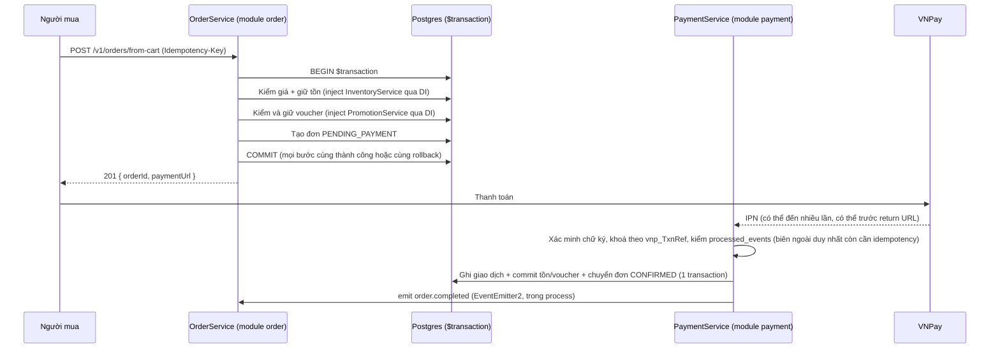

Hết hạn thanh toán → một `$transaction` khác nhả tồn + nhả voucher + đơn `CANCELLED`, không cần bù trừ qua nhiều
service. Bước ghi nhận thanh toán thành công **không rollback được** (tiền đã thu) → lệch số tiền với VNPay thì đơn
vào `MANUAL_REVIEW` và báo admin (không áp dụng cho lỗi tồn/voucher — hai lỗi đó chặn ngay trong `$transaction`
trước khi có đơn).

---

## 9. Yêu cầu phi chức năng

| ID | Yêu cầu | Ngưỡng |
|---|---|---|
| `NFR-001` | Độ trễ API đọc | p95 ≤ 300 ms |
| `NFR-002` | Độ trễ API ghi | p95 ≤ 800 ms |
| `NFR-003` | Độ trễ tìm kiếm | p95 ≤ 500 ms |
| `NFR-004` | Sẵn sàng hệ thống | ≥ 99,5% / tháng |
| `NFR-005` | Sẵn sàng luồng thanh toán | ≥ 99,9% |
| `NFR-006` | RPO (mất dữ liệu tối đa) | ≤ 15 phút |
| `NFR-007` | RTO (thời gian khôi phục) | ≤ 60 phút |
| `NFR-008` | Độ trễ lan truyền event | p95 ≤ 5 giây |
| `NFR-009` | Độ trễ index tìm kiếm | ≤ 30 giây sau khi duyệt |
| `NFR-010` | Kết nối WebSocket đồng thời | ≥ 5.000 |
| `NFR-011` | Chênh lệch đối soát thanh toán | **0** |
| `NFR-012` | Kích thước bundle FE (trang chính) | ≤ 250 KB gzip |
| `NFR-013` | Lighthouse (Performance, mobile) | ≥ 85 |
| `NFR-014` | Tiếp cận | WCAG 2.2 AA |
| `NFR-015` | Thời gian dựng môi trường dev | ≤ 30 phút |

Quy mô mục tiêu năm 1: **50.000 MAU**, **2.000 đơn/ngày**, đỉnh flash sale **20× lưu lượng thường** trong 15 phút.

---

## 10. Bảo mật và tuân thủ

Chi tiết: [security.md](../01-architecture/security.md). Các quyết định cốt lõi:

| Hạng mục | Quyết định |
|---|---|
| Token | Access JWT **RS256**, TTL 15 phút, nằm trong session NextAuth mã hoá; refresh 30 ngày, HttpOnly, **xoay mỗi lần dùng** |
| Phát hiện đánh cắp | Dùng lại refresh token đã xoay → thu hồi **toàn bộ** phiên + gửi email cảnh báo |
| Permission trong token | **Không** — tra từ cache Redis (TTL 15 phút) để thu hồi có hiệu lực ngay |
| Mật khẩu | bcrypt cost 12, tối thiểu 8 ký tự, chặn danh sách mật khẩu phổ biến, không ép đổi định kỳ |
| SSO | OAuth 2.0 + PKCE; **không** tự liên kết tài khoản khi email chưa xác minh |
| Phân quyền | 3 tầng AND: `@Roles` + `@Permissions` + CASL theo bản ghi; `sellerId` luôn lấy từ token |
| Che giấu | Người gọi không được phép biết tài nguyên tồn tại → trả `404`, không phải `403` |
| Header | Helmet + CSP có nonce, `frame-ancestors 'none'`, HSTS preload |
| CORS | Danh sách origin cố định, **không** dùng `*` hay `origin: true` ở bất kỳ môi trường nào |
| Upload | Signed URL, giới hạn MIME + dung lượng, kiểm tra magic bytes, phục vụ từ domain riêng |
| Thanh toán | Không lưu dữ liệu thẻ; xác minh `vnp_SecureHash`; đối chiếu số tiền; lệch → `MANUAL_REVIEW` |
| Dữ liệu cá nhân | Event chỉ mang trường công khai; log redact; xoá tài khoản = ẩn danh hoá user, **giữ** đơn/giao dịch/audit |
| Nội bộ | Ranh giới module thực thi bằng ESLint (chặn import chéo module ngoài `index.ts`), không phải bằng user Postgres/NetworkPolicy riêng cho từng module — một user Postgres cho `api`/`worker`/`worker-media`, quyền tối thiểu ở mức ứng dụng; xem [security.md §13](../01-architecture/security.md) |

---

## 11. Kế hoạch triển khai

### 11.1 Sáu giai đoạn

Sprint = **2 tuần**. Tổng **18 sprint = 36 tuần**.

| Phase | Tên | Sprint | Tuần | Nội dung chính | Kết quả kiểm chứng được |
|---|---|---|---|---|---|
| **P0** | Nền móng | S1–S2 | 1–4 | Monorepo pnpm + Turborepo, `@timmyhub/{contracts,common,prisma,testing}`, khung `backend/apps/api` + `backend/apps/worker`, docker compose dev, CI, module `platform`, `identity-auth`, `rbac-permission`, `master-data` | Đăng ký → đăng nhập → gọi được một endpoint có phân quyền; dev mới dựng được trong 30 phút |
| **P1** | Bán được hàng | S3–S7 | 5–14 | `user-profile`, `seller-onboarding`, `media-upload`, `catalog-product`, `inventory`, `cart-checkout`, `order-fulfillment`, `payment-vnpay`, `notification` (in-app + email) | Một seller thật đăng sản phẩm, một user thật mua và thanh toán VNPay sandbox thành công, đơn chuyển trạng thái đúng |
| **P2** | Vận hành sàn | S8–S10 | 15–20 | `wallet-settlement`, `promotion-voucher`, `campaign-flashsale`, `search-discovery`, `admin-console`, `analytics-sales` (cơ bản), `audit-log` | Admin duyệt được mọi thứ từ một hàng chờ; seller thấy doanh số và rút được tiền; tìm kiếm chạy trên Elasticsearch |
| **P3** | Trao đổi & tin cậy | S11–S13 | 21–26 | `review-rating`, `chat-support`, `notification` nâng cao (preference, web push), `content-post` bản cơ bản | Ba vai trao đổi được với nhau: chat, ticket, tranh chấp, đánh giá |
| **P4** | Quảng cáo & doanh số nâng cao | S14–S16 | 27–32 | `video-ads`, `analytics-sales` nâng cao (phễu, cohort, export), `content-post` nâng cao (feed dọc, kiểm duyệt, attribution) | Seller mua và chạy được một chiến dịch quảng cáo, thấy CTR và đơn hàng phát sinh, bị trừ phí đúng |
| **P5** | Cứng hoá & ra mắt | S17–S18 | 33–36 | Kiểm thử tải, rà soát bảo mật, hoàn thiện k8s production, runbook, UAT, đào tạo vận hành | Đạt toàn bộ NFR §9; diễn tập khôi phục sự cố thành công |

### 11.2 Đồ thị phụ thuộc giữa các domain

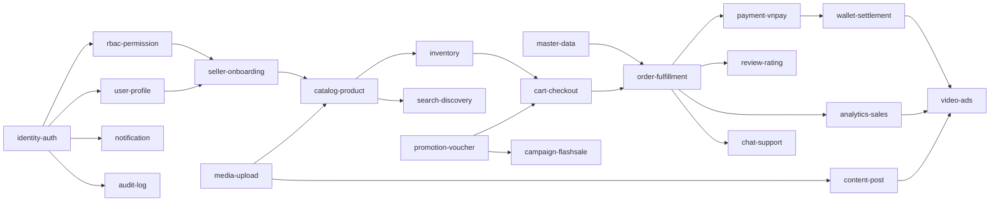

**Đường găng:** `identity-auth → rbac-permission → seller-onboarding → catalog-product → inventory → cart-checkout
→ order-fulfillment → payment-vnpay → wallet-settlement`. Mọi chậm trễ trên chuỗi này đẩy lùi toàn bộ dự án —
ưu tiên nhân sự mạnh nhất và bắt đầu sớm nhất.

**Làm song song được:** `media-upload`, `master-data`, `notification`, `search-discovery`, `audit-log` không chặn
đường găng và nên giao cho một luồng làm việc riêng.

### 11.3 Chi tiết từng sprint

| Sprint | Tuần | Backend | Frontend | Hạ tầng |
|---|---|---|---|---|
| S1 | 1–2 | Khung monorepo, shared libs, module `platform` (khung `backend/apps/api`), module `identity` (đăng ký, đăng nhập, refresh) | Khung Next.js, design token, shadcn base, layout, trang đăng nhập/đăng ký | docker compose dev, CI lint + test |
| S2 | 3–4 | RBAC, permission, CASL, seed, kiểm tra nhất quán lúc boot, module `master-data` | NextAuth, middleware phân quyền, next-intl, Storybook, `DataTable` dùng chung | Dockerfile, registry, deploy staging thủ công |
| S3 | 5–6 | module `user-profile`, `seller`, `media` | Trang hồ sơ, địa chỉ, đăng ký bán hàng, upload ảnh | k8s manifest cơ bản, Ingress staging |
| S4 | 7–8 | module `catalog`: danh mục, sản phẩm, biến thể, thuộc tính, kiểm duyệt | Quản lý sản phẩm của seller, trang chi tiết sản phẩm, trang danh mục | HPA, probe, migration job |
| S5 | 9–10 | module `inventory`: reserve/commit/release, log tồn kho, cảnh báo | Quản lý tồn kho, nhập hàng loạt | Prometheus + Grafana |
| S6 | 11–12 | module `cart`, `order` state machine, `Prisma.$transaction` cho checkout, outbox cho hiệu ứng phụ ra ngoài process | Giỏ hàng, luồng checkout, danh sách/chi tiết đơn (user + seller) | `backend/apps/worker` giống production, DLQ BullMQ, cảnh báo |
| S7 | 13–14 | module `payment`: VNPay create/return/**IPN idempotent**, đối soát; module `notification` (in-app + email) | Trang thanh toán, trang kết quả, trung tâm thông báo | Sentry, OpenTelemetry, backup tự động |
| S8 | 15–16 | module `wallet-settlement` (trong `payment`): ví seller, sổ giao dịch, hoa hồng, yêu cầu rút + OTP | Ví seller, lịch sử giao dịch, yêu cầu rút tiền | Runbook bản đầu, diễn tập khôi phục |
| S9 | 17–18 | module `promotion`: voucher, campaign, flash sale, tồn kho campaign | Áp voucher, trang flash sale có đếm ngược, quản lý khuyến mãi | Kiểm thử tải luồng flash sale |
| S10 | 19–20 | module `search` (index + truy vấn + gợi ý), `audit`, `analytics` (chỉ số cơ bản) | Tìm kiếm + bộ lọc, admin console (12 màn CRUD), dashboard cơ bản | CD tự động lên staging |
| S11 | 21–22 | module `engagement`: đánh giá, bình luận, helpful, wishlist | Đánh giá sản phẩm, wishlist, rating realtime | — |
| S12 | 23–24 | module `chat`: hội thoại, ticket, SLA, phân công, bot bước đầu | Chat user↔seller, hộp thư hỗ trợ, màn ticket của admin | Kiểm thử tải WebSocket (5.000 kết nối) |
| S13 | 25–26 | Tranh chấp đơn hàng, module `notification` nâng cao (preference, web push), module `content` bản cơ bản | Trang tranh chấp, cài đặt thông báo, soạn post | **Chuẩn bị GA**: k8s production, chạy thử xanh–lam |
| S14 | 27–28 | module `content` nâng cao: feed, gắn sản phẩm, kiểm duyệt, attribution | Feed cuộn dọc, trình phát video, tương tác realtime | CDN cho media |
| S15 | 29–30 | module `video-ads` (trong `content`): chiến dịch, đặt chỗ hiển thị, đo impression/click, gom sự kiện | Trình tạo quảng cáo, báo cáo hiệu quả, vị trí quảng cáo trên FE | Tối ưu chi phí, autoscale `worker-media` theo độ sâu hàng đợi |
| S16 | 31–32 | Tính phí quảng cáo + đối soát, `analytics` nâng cao (phễu, cohort, export CSV/Excel) | Dashboard doanh số đầy đủ, báo cáo, xuất dữ liệu | Job tổng hợp hằng ngày, giám sát chi phí |
| S17 | 33–34 | Vá hiệu năng, index, cache, xử lý nợ kỹ thuật | Tối ưu bundle, Lighthouse, rà soát tiếp cận | Kiểm thử tải toàn hệ thống, rà soát bảo mật |
| S18 | 35–36 | Sửa lỗi UAT, ổn định | Sửa lỗi UAT, hoàn thiện trang lỗi/rỗng | Runbook hoàn chỉnh, đào tạo vận hành, ra mắt |

### 11.4 Bảy nguyên tắc thực thi

| # | Nguyên tắc |
|---|---|
| 1 | **Lát cắt dọc**: mỗi sprint kết thúc bằng một luồng người dùng chạy được đầu–cuối, không phải "xong tầng service" |
| 2 | `requirements.md` của một domain phải ở trạng thái **approved trước** khi sprint đó bắt đầu |
| 3 | Mỗi `TASK-*` tham chiếu ít nhất một `REQ-*`; không có task mồ côi |
| 4 | Module mới chỉ được merge khi có đủ: migration Prisma, seed, khai báo trong Swagger, test tích hợp, dashboard metrics; nếu là module chạm outbox (mail/webhook/audit) thì thêm job dispatch ở `worker` |
| 5 | Hợp đồng API và event chốt **trước** khi FE và BE làm song song (`@timmyhub/contracts` merge trước) |
| 6 | Không có nhánh sống quá 3 ngày; trunk-based với feature flag cho tính năng chưa xong |
| 7 | 15% quỹ thời gian mỗi sprint dành cho nợ kỹ thuật và sửa lỗi — không lấp bằng tính năng |

---

## 12. Cột mốc và tiêu chí ra mắt

| Mốc | Tuần | Tên | Tiêu chí ra (phải đạt **toàn bộ**) |
|---|---|---|---|
| **M0** | 4 | Khung xương chạy được | Đăng ký/đăng nhập/phân quyền hoạt động · CI xanh · dev mới dựng được trong 30 phút · staging có URL |
| **M1** | 14 | MVP chức năng (nội bộ) | Mua hàng đầu–cuối với VNPay sandbox · không oversell trong test đồng thời · outbox không mất event · 9 domain MVP có spec approved · độ phủ test đường găng ≥ 70% |
| **M2** | 20 | Beta kín | 50 seller được mời vận hành thật · rút tiền hoạt động · admin console đủ dùng · tìm kiếm chạy ES · đối soát VNPay 7 ngày liên tiếp không lệch · 0 lỗi P1 tồn đọng |
| **M3** | 26 | **v1.0 GA** | Toàn bộ feature P0 hoàn tất · đạt `NFR-001..011` · rà soát bảo mật không còn phát hiện mức cao · runbook + diễn tập khôi phục xong · chat/ticket vận hành · trang lỗi/rỗng đủ mọi route |
| **M4** | 32 | v1.5 — Quảng cáo & doanh số | Chiến dịch quảng cáo chạy và tính phí đúng (0 sai lệch) · dashboard doanh số đầy đủ · xuất báo cáo · feed nội dung có attribution |
| **M5** | 36 | Sẵn sàng mở rộng | Chịu tải đỉnh flash sale 20× · chi phí hạ tầng trong ngân sách · đội vận hành tự chủ · toàn bộ `docs/` ở trạng thái approved |

**Điều kiện hoãn ra mắt:** nếu đến M3 mà chưa đạt `NFR-011` (đối soát thanh toán còn lệch) thì **hoãn GA** —
không ra mắt sàn có sai lệch tiền, dù mọi tính năng khác đã xong.

---

## 13. Nhân sự và ước lượng công sức

### 13.1 Đội hình

| Vai trò | Số lượng | Trách nhiệm |
|---|---|---|
| Tech Lead | 1 | Kiến trúc, ADR, review, gỡ chặn |
| Backend Engineer | 3 | Service, `design.md`, test tích hợp |
| Frontend Engineer | 3 | Next.js, design system, Storybook, e2e |
| DevOps | 1 (50%) | Docker, k8s, CI/CD, giám sát, runbook |
| QA | 1 | Kế hoạch test, e2e, UAT, kiểm thử tải |
| PO / BA | 1 (50%) | Requirements EARS, thứ tự ưu tiên, nghiệm thu |
| **Tổng quy đổi** | **~9 FTE** | |

### 13.2 Ước lượng theo phase

Đơn vị: **person-week** (tuần-người), đã gồm test và tài liệu, chưa trừ nghỉ lễ.

| Phase | Tuần lịch | BE | FE | DevOps | QA | Tổng |
|---|---|---|---|---|---|---|
| P0 Nền móng | 4 | 12 | 12 | 3 | 2 | **29** |
| P1 Bán được hàng | 10 | 30 | 30 | 5 | 8 | **73** |
| P2 Vận hành sàn | 6 | 18 | 18 | 3 | 6 | **45** |
| P3 Trao đổi & tin cậy | 6 | 18 | 18 | 3 | 6 | **45** |
| P4 Quảng cáo & doanh số | 6 | 18 | 18 | 3 | 6 | **45** |
| P5 Cứng hoá & ra mắt | 4 | 10 | 10 | 4 | 6 | **30** |
| **Tổng** | **36** | **106** | **106** | **21** | **34** | **267** |

### 13.3 Ước lượng theo domain (phần backend, để xếp việc)

| Nhóm | Domain (module trong `backend/apps/api`) | Person-week / domain |
|---|---|---|
| Rất lớn | `payment-vnpay`, `order-fulfillment`, `catalog-product`, `analytics-sales`, `video-ads` | 8–12 |
| Lớn | `identity-auth`, `rbac-permission`, `inventory`, `wallet-settlement`, `content-post`, `chat-support` | 5–8 |
| Vừa | `cart-checkout`, `seller-onboarding`, `promotion-voucher`, `campaign-flashsale`, `search-discovery`, `notification`, `review-rating`, `admin-console` | 3–5 |
| Nhỏ | `user-profile`, `media-upload`, `audit-log`, `master-data` | 1–3 |

### 13.4 Điều chỉnh nếu đội nhỏ hơn

Kiến trúc modular monolith ([ADR-0015](../01-architecture/adr/ADR-0015-modular-monolith.md)) đã chọn sẵn cho mọi quy
mô đội — không còn quyết định "có nên làm microservices hay không" phụ thuộc số người. Đội nhỏ hơn chỉ đổi **tốc độ
làm hết phạm vi**, không đổi kiến trúc:

| Đội | Hệ quả |
|---|---|
| 9 người (kế hoạch) | 36 tuần, đủ phạm vi |
| 6 người | ~50 tuần, hoặc đẩy P4 (quảng cáo) sang pha sau |
| 4 người | Bắt buộc **cắt phạm vi**, không cắt kiến trúc: hoãn `video-ads` và `analytics-sales` nâng cao sang sau GA; kỷ luật ranh giới module (rule ESLint, review bắt buộc khi động tới `index.ts` của module khác) càng quan trọng hơn vì ít người sửa nhiều module cùng lúc, dễ xói mòn ranh giới nếu không thực thi |

---

## 14. Rủi ro và biện pháp giảm thiểu

| ID | Rủi ro | Khả năng | Tác động | Giảm thiểu | Dấu hiệu sớm |
|---|---|---|---|---|---|
| R1 | Ranh giới module xói mòn theo thời gian (import chéo module, query bảng module khác) vì không có biên deployment/database ép buộc như microservices | Cao | Cao | Rule ESLint chặn import chéo module ngoài `index.ts` chạy ở CI, không chỉ ở máy dev; review bắt buộc khi PR động tới `index.ts` của module khác; test kiến trúc (dependency-cruiser/`madge`) chặn chu trình; xem [ADR-0015 §Chi phí phải trả](../01-architecture/adr/ADR-0015-modular-monolith.md) | Import trực tiếp service/repository nội bộ của module khác lọt qua review |
| R2 | Sai sót luồng thanh toán VNPay (IPN trùng, đến trước return URL, sai số tiền) | Trung bình | **Rất cao** | Idempotent theo `vnp_TxnRef`; khoá hàng; ghi log nguyên văn trước khi xử lý; đối soát hằng ngày; lệch → `MANUAL_REVIEW`; bộ test bao phủ 12 kịch bản IPN | Đối soát lệch dù chỉ 1 giao dịch |
| R3 | Nhất quán dữ liệu giữa module (read model lệch) — vẫn tồn tại dù cùng database, vì `search`/`analytics` vẫn là read model tái dựng bất đồng bộ | Trung bình | Trung bình | Read model cập nhật qua `EventEmitter2` (đồng bộ, cùng transaction đã commit) và phải **tái dựng được** kèm lệnh rebuild + test; `SyncCheckpoint` giám sát độ trễ | Số liệu hai màn hình khác nhau |
| R4 | Đội chưa có kinh nghiệm k8s + BullMQ/Redis production | Trung bình | Cao | DevOps chuyên trách từ S1; staging giống production từ S3; diễn tập sự cố ở S8; runbook viết dần, không để cuối | Sự cố staging không ai xử lý được trong 1 giờ |
| R5 | Oversell khi flash sale | Trung bình | Cao | Reserve tồn trong cùng transaction với kiểm giá; kiểm thử tải riêng cho flash sale ở S9; tồn kho campaign tách riêng | Test đồng thời thấy tồn âm |
| R6 | Phạm vi phình to (251 feature) | Cao | Cao | Khoá phạm vi theo `feature-inventory.md`; feature mới phải có ID và đổi lấy feature khác cùng cỡ; P2 chỉ làm sau M3 | Sprint liên tiếp không đạt cam kết |
| R7 | Hợp đồng FE–BE lệch, hai bên chờ nhau | Trung bình | Trung bình | `@timmyhub/contracts` merge trước khi code; MSW mock ở FE dùng chính schema zod; contract test ở CI | FE phải sửa lại sau khi BE xong |
| R8 | Elasticsearch trở thành phụ thuộc cứng | Trung bình | Trung bình | ES là index **dẫn xuất**, tái dựng được; có đường suy giảm sang `ILIKE` trên Postgres | Sàn chết khi ES restart |
| R9 | `worker-media` (ffmpeg) bão hoà CPU và trở thành điểm nghẽn transcode khi lượng video tăng | Trung bình | Trung bình | HPA theo độ sâu hàng đợi (không theo CPU trung bình, vì CPU luôn ở mức cao khi đang transcode); giới hạn độ phân giải/độ dài video đầu vào; theo dõi độ trễ hàng đợi hằng tuần từ S10 | Hàng đợi media dồn ứ quá 15 phút |
| R10 | Tính phí quảng cáo sai (đếm trùng impression) | Trung bình | Cao | Gom sự kiện có `eventId` để khử trùng; đối soát mỗi giờ; giới hạn ngân sách cứng; audit đầy đủ | Chênh lệch giữa số đếm thô và số đã tính phí |
| R11 | Bí mật kế thừa bị lợi dụng | Thấp | **Rất cao** | Xoay toàn bộ khoá ở §18.1 **trước** khi bắt đầu; gitleaks + push protection ở S1 | Hoạt động lạ trên Sentry/Supabase/Vercel |
| R12 | Nợ chất lượng quay lại (strict off, không test) | Trung bình | Trung bình | `strict: true` từ commit đầu tiên; Husky chặn; ngưỡng độ phủ ở CI; Definition of Done bắt buộc | PR xin miễn lint |

---

## 15. Chất lượng và quy trình

### 15.1 Chiến lược kiểm thử

| Tầng | Công cụ | Phạm vi | Ngưỡng |
|---|---|---|---|
| Unit | Jest (BE), Vitest (FE) | Logic nghiệp vụ thuần, hàm tiện ích | Độ phủ ≥ 80% cho `*.service.ts` |
| Integration | Jest + **Testcontainers** (Postgres, Redis) | Module + DB thật + BullMQ thật; event `EventEmitter2` test trong process, không cần container | Mọi endpoint ghi, mọi consumer BullMQ |
| Contract | zod schema dùng chung + test đối chiếu | Hợp đồng API và event giữa module | Mọi event trong `event-catalog.md` |
| Component | Testing Library + Storybook play | Component dùng chung | Mọi component trong `component-inventory.md` |
| E2E | Playwright | 12 luồng người dùng chính | Chạy mỗi PR vào `main` |
| Tải | k6 | Checkout, flash sale, WebSocket, tìm kiếm | Trước M2 và M3 |
| Bảo mật | gitleaks, `pnpm audit`, Trivy, rà soát thủ công | Mỗi PR + trước mỗi mốc | 0 phát hiện mức cao |

Kịch bản **bắt buộc** có test tự động: IPN trùng lặp · IPN đến trước return URL · IPN sai số tiền ·
đặt hàng đồng thời vượt tồn · hết hạn giữ tồn · voucher hết lượt khi hai người dùng cùng lúc ·
consumer nhận event trùng · rebuild read model từ đầu.

### 15.2 Definition of Done

Một `TASK-*` chỉ được coi là xong khi **tất cả** các mục sau đúng:

- [ ] Code đáp ứng đủ acceptance criteria của mọi `REQ-*` mà task tham chiếu
- [ ] TypeScript strict, ESLint và Prettier sạch, không có `any` không giải thích
- [ ] Có migration Prisma (không dùng `db push`) và seed cập nhật nếu cần
- [ ] Có test ở tầng phù hợp; CI xanh
- [ ] Swagger đầy đủ; schema zod nằm trong `@timmyhub/contracts`
- [ ] Guard phân quyền đúng; permission đã có trong seed và trong danh mục
- [ ] Ghi audit log cho thao tác ghi
- [ ] Event mới đã cập nhật vào `event-catalog.md`
- [ ] FE: có story Storybook, xử lý trạng thái loading/rỗng/lỗi, đạt tiếp cận cơ bản
- [ ] Tài liệu liên quan cập nhật **trong cùng PR**
- [ ] Đã được một người khác review

### 15.3 CI/CD

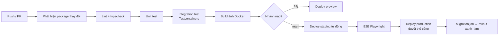

Turborepo (`--filter='...[origin/main]'`) chỉ build lại package/module thật sự đổi, và chỉ dựng lại image nào trong
3 (`api`/`worker`/`worker-media`) bị ảnh hưởng — đây là điều kiện để một app NestJS chứa 16 module không làm CI
chậm đến mức không dùng được (xem [monorepo-and-build.md](../05-infra/monorepo-and-build.md)).

---

## 16. Vận hành và chi phí

### 16.1 Môi trường

| Môi trường | Mục đích | Hạ tầng |
|---|---|---|
| `local` | Phát triển | docker compose, 1 Postgres (1 database chung), Redis, ES 1 node |
| `staging` | Nghiệm thu, e2e, kiểm thử tải | k8s namespace riêng, 1 replica mỗi đơn vị (`api`/`worker`/`worker-media`), dữ liệu giả |
| `production` | Vận hành thật | k8s, HPA 2–10 replica cho `api` (theo CPU), 1–N cho `worker-media` (theo độ sâu hàng đợi), Postgres có replica đọc, ES 3 node |

### 16.2 Giám sát

| Loại | Công cụ | Cảnh báo chính |
|---|---|---|
| Metrics | Prometheus + Grafana | p95 độ trễ vượt NFR · tỷ lệ lỗi > 1% · độ sâu hàng đợi > 1.000 |
| Log | pino → thu gom tập trung | Tỷ lệ log `error` tăng đột biến |
| Trace | OpenTelemetry | Request > 3 giây xuyên module/job |
| Lỗi | Sentry | Lỗi mới chưa từng thấy |
| Nghiệp vụ | Dashboard riêng | Outbox `PENDING` > 60 giây · DLQ có tin nhắn · đối soát lệch · tỷ lệ checkout tụt |

### 16.3 Chi phí (production, năm 1)

| Hạng mục | Mức tương đối |
|---|---|
| Kubernetes (3 node vừa, chỉ 3 đơn vị triển khai backend) | Phần lớn chi phí |
| PostgreSQL quản lý (Supabase) + replica (1 database chung, không nhân 16 lần) | Cao |
| Elasticsearch 3 node | Cao |
| Upstash Redis (BullMQ + cache + Socket.IO adapter) | Thấp–trung bình |
| Supabase Storage + CDN | Theo lưu lượng media — **video là khoản tăng nhanh nhất** |
| Sentry, giám sát | Thấp |

> **Đánh đổi đã chọn** ([ADR-0015](../01-architecture/adr/ADR-0015-modular-monolith.md)): modular monolith rẻ hơn
> đáng kể so với 17 service độc lập cùng chức năng — ít pod hơn (3 thay vì 18), một database thay vì 16, không cần
> RabbitMQ quản lý, không cần NetworkPolicy phức tạp giữa service. Cái đánh đổi lại là **không** scale độc lập theo
> từng domain (cả `api` scale cùng nhau) và **không** cô lập sự cố ở mức process cho lỗi trong logic module — bù lại
> bằng kỷ luật ranh giới module (R1) và tách sớm phần thực sự cần scale riêng (`worker-media`) ngay từ đầu.

---

## 17. Bộ tài liệu `docs/`

**151 file** (kể cả `docs/README.md`). Trạng thái hiện tại:

| Thư mục | Nội dung | Số file | Trạng thái |
|---|---|---|---|
| `docs/README.md` | Mục lục, lối đọc theo vai trò, quy ước | 1 | ✅ xong |
| `00-overview/` | Tổng quan sản phẩm, **kế hoạch này**, danh mục 251 feature, vai trò & quyền, thuật ngữ | 5 | ✅ xong |
| `01-architecture/` | Kiến trúc, danh mục service, giao tiếp, dữ liệu, sự kiện, API, bảo mật, realtime, observability, **radar công nghệ**, **đồng thời & nhất quán**, **RBAC nâng cao**, **i18n backend**, **đường xử lý video** | 14 | ✅ xong (14/14) |
| `01-architecture/adr/` | 12 ADR nền + **ADR-0014 đường xử lý video** + **ADR-0015 modular monolith** (supersede ADR-0001/0002/0003) (+2 ADR ứng viên từ radar, chưa viết) | 14 | ✅ xong (14/14 ADR cơ sở; ADR-0013/0016 vẫn là ứng viên chờ duyệt ở `technology-radar.md`) |
| `02-domain/` | Mô hình miền + schema Prisma từng service + **biến thể sản phẩm** + **tranh chấp đơn hàng** | 19 | 🔄 đang viết (2/19) |
| `03-specs/` | 23 domain × (`requirements.md` EARS + `design.md` + `tasks.md`) | 69 | ⏳ chờ |
| `04-frontend/` | Kiến trúc FE, route, design system, component, state, auth, i18n, Storybook, **SEO**, **chuyển động & hiệu ứng**, **soạn thảo/tải lên/phát video** | 11 | 🔄 đang viết (3/11) |
| `05-infra/` | Dev local, Docker, k8s, CI/CD, biến môi trường, runbook, **monorepo & build (Turborepo)** | 7 | 🔄 đang viết (1/7) |
| `06-quality/` | **Chuẩn code**, **git hook và quy ước commit**, **hiệu năng**, **cổng chất lượng tự động**, chiến lược test, Definition of Done | 6 | 🔄 đang viết (4/6) |
| `07-plan/` | Kế hoạch triển khai chi tiết, cột mốc, rủi ro | 3 | ⏳ chờ |
| `08-handoff/` | Bàn giao, onboarding, ánh xạ từ bản cũ | 3 | ⏳ chờ |

### 17.1 Tài liệu chuyên đề cắt ngang

Ngoài cây trên, mười bốn tài liệu sau **cắt ngang nhiều domain** và là ràng buộc kỹ thuật bắt buộc đọc trước khi làm phần
tương ứng — không phải tài liệu tham khảo tuỳ chọn:

| Tài liệu | Ràng buộc chính nó đặt ra |
|---|---|
| [technology-radar.md](../01-architecture/technology-radar.md) | Danh sách ADOPT/TRIAL/ASSESS/HOLD; thêm thư viện ngoài danh sách phải có ADR |
| [concurrency-and-consistency.md](../01-architecture/concurrency-and-consistency.md) | Mọi phép trừ tồn kho/số dư là `UPDATE … WHERE` nguyên tử + ràng buộc `CHECK`; không dùng khoá Redis cho tồn kho |
| [rbac-advanced.md](../01-architecture/rbac-advanced.md) | Phân quyền 4 lớp; quyền không nằm trong JWT; thiếu cache thì **fail closed**; ngoài phạm vi trả `404` |
| [i18n-backend.md](../01-architecture/i18n-backend.md) | Backend trả `code` + tham số, không trả câu hoàn chỉnh |
| [product-variant.md](../02-domain/product-variant.md) | Giá và tồn kho nằm ở **biến thể**, không ở sản phẩm; đơn hàng lưu snapshot |
| [order-dispute.md](../02-domain/order-dispute.md) | Ký quỹ, hạn xử lý của từng bên, hoàn tiền một phần, bằng chứng bất biến |
| [seo.md](../04-frontend/seo.md) | Nội dung chính phải có trong HTML lần đầu; canonical bắt buộc; không xoá trang hết hàng |
| [motion-and-effects.md](../04-frontend/motion-and-effects.md) | 0 KB thư viện chuyển động trong gói chung; tôn trọng `prefers-reduced-motion`; CLS bằng 0 |
| [performance.md](../06-quality/performance.md) | Ngân sách LCP/INP/CLS theo trang, p95 đọc < 300 ms, ≤ 10 truy vấn/request |
| [media-video-pipeline.md](../01-architecture/media-video-pipeline.md) | Upload tus 6 MB/chunk; chỉ `PUBLISHED` mới phát ra ngoài; request không chờ ffmpeg |
| [editor-and-uploader.md](../04-frontend/editor-and-uploader.md) | TipTap lưu JSON và backend làm sạch; TipTap/Uppy/`hls.js` đều nạp động |
| [quality-gates.md](../06-quality/quality-gates.md) | a11y 3 lớp, Lighthouse CI, `size-limit` là điều kiện merge; có lộ trình bật dần |
| [git-hooks.md](../06-quality/git-hooks.md) | `pre-commit` < 5 giây, commit phải có scope trong danh sách, mọi hook đều được CI chạy lại |
| [monorepo-and-build.md](../05-infra/monorepo-and-build.md) | CI chỉ chạy phần đã đổi; task chạm DB/mạng không được cache |

### 17.2 Skill cho Claude Code

`.claude/skills/` chứa **mười** skill dự án, Claude tự nạp khi gặp đúng loại việc. Ngoài ra `CLAUDE.md` ở gốc repo
ghi 17 luật cứng (tiền, ranh giới service, outbox, 4 lớp phân quyền, 7 trạng thái UI, nạp động, `strict`) và bản đồ
tài liệu — file này được nạp tự động ở mọi phiên, nên luật không phụ thuộc việc ai nhớ nhắc.

| Skill | Dùng cho |
|---|---|
| `spec-domain` | Viết/cập nhật spec một domain: EARS, design, tasks, truy vết ID |
| `docs-audit` | Rà link chết, truy vết hai chiều, số liệu lệch giữa các file |
| `ui-component` | Component giao diện: 7 trạng thái, token, WCAG 2.2 AA, Storybook, i18n |
| `page-build` | Route Next.js hoàn chỉnh: ranh giới RSC, metadata + JSON-LD, 3 file trạng thái bắt buộc, ngân sách |
| `design-review` | Rà soát UI/UX theo 10 heuristic Nielsen, Laws of UX, phân cấp thị giác, WCAG 2.2 AA |
| `nest-endpoint` | Endpoint backend: zod DTO, 4 lớp phân quyền, audit, idempotency, outbox, test |
| `prisma-schema` | Mô hình dữ liệu: `Decimal(14,2)`, `Timestamptz`, index tổ hợp, `version`, outbox, migration 6 bước |
| `code-review` | Rà trước merge, mỗi lỗi phải kèm kịch bản hỏng cụ thể |
| `perf-audit` | Đo trước sửa sau: bundle, Core Web Vitals, `EXPLAIN`, cache, độ sâu hàng đợi |
| `i18n-strings` | Chuỗi cứng, tên khoá theo ý nghĩa, ICU plural, `Intl` cho tiền/ngày, thêm locale |

Quy ước áp dụng cho mọi file: văn xuôi tiếng Việt · identifier tiếng Anh · front-matter YAML ·
requirement viết theo **EARS** · ID truy vết `FEAT-*` → `REQ-*` → `TASK-*` · sơ đồ Mermaid inline ·
mọi quy tắc code đều có cặp ❌ BAD / ✅ GOOD.

Sau khi viết xong, bộ tài liệu được kiểm chứng bằng: đếm file khớp cây · truy vết hai chiều (mọi `REQ-*` có mặt
trong một `tasks.md`, mọi `TASK-*` trỏ về `REQ-*`, mọi `FEAT-*` có ít nhất một `REQ-*`) · không có link chết ·
28 controller + 42 model của bản cũ đều được ánh xạ hoặc ghi lý do loại bỏ · 44 biến môi trường cũ đều được phân bổ.

---

## 18. Nợ kỹ thuật kế thừa phải xử lý

### 18.1 Bí mật bị lộ — xoay **trước** khi bắt đầu

| Vị trí ở repo cũ | Nội dung lộ | Việc phải làm |
|---|---|---|
| `timmyhub-nextjs/.env` (**đã commit**) | `SENTRY_AUTH_TOKEN`, `NEXT_PUBLIC_SENTRY_DSN` | Thu hồi token Sentry, tạo DSN mới |
| `.kiro/settings/mcp.json` | Chuỗi kết nối Supabase pooler kèm thông tin đăng nhập, `VERCEL_TOKEN` dạng rõ | Đổi mật khẩu database, thu hồi Vercel token |
| `.cursor/mcp.json` (**không** gitignore) | Google `X-Goog-Api-Key` dạng rõ | Thu hồi khoá, tạo khoá mới có giới hạn referrer |

Coi như cả ba đã bị sử dụng. Xoá khỏi lịch sử git là việc phụ, **không thay thế** việc xoay khoá.

### 18.2 Lỗi nghiệp vụ phải sửa (14 feature `kế thừa*`)

| Lỗi ở bản cũ | Cách bản mới ngăn tái diễn |
|---|---|
| Thiếu seed permission | Kiểm tra lúc khởi động, **từ chối boot** nếu `@Permissions` không có trong danh mục |
| CASL `mapSubject` fallback sai | Viết lại ánh xạ + test cho từng subject |
| DTO `class-validator` không chạy | ESLint chặn import; zod là nguồn duy nhất |
| `?callbackUrl` và `?redirect` lệch nhau | Một hằng số duy nhất, có test |
| `useNotificationSocket` lặp `/api` trong URL | Một hằng số `WS_URL`, có test kiểm tra URL sinh ra |
| Route chết `/admin/customers`, `/seller/orders` | Test kiểm tra mọi mục sidebar trỏ tới route tồn tại |
| Trang stub `/profile/change-password`, `/profile/notifications` | Đặc tả và làm đầy đủ |
| Không có `error.tsx` / `not-found.tsx` | Bắt buộc cho mọi route group, kiểm tra ở CI |
| `strict: false`, `no-explicit-any: off` | Bật strict từ commit đầu |
| `db push --accept-data-loss` | `prisma migrate` + kiểm tra drift ở CI |
| `Wallet`/`WalletTransaction` không có API | Domain `wallet-settlement` đầy đủ |

---

## 19. Giả định và câu hỏi mở

### 19.1 Giả định (nếu sai thì kế hoạch phải xem lại)

| # | Giả định | Ảnh hưởng nếu sai |
|---|---|---|
| A1 | Quy mô năm 1 ≤ 50.000 MAU và ≤ 2.000 đơn/ngày | Vượt nhiều → phải thiết kế lại phân vùng dữ liệu |
| A2 | Seller tự vận chuyển hoặc dùng đơn vị bên ngoài; sàn **không** làm logistics | Nếu phải tích hợp hãng vận chuyển → thêm 1 domain, ~6 person-week |
| A3 | Chỉ VNPay và COD trong v1 | Thêm cổng khác → mở rộng `payment-service`, ~4 person-week |
| A4 | **Không migrate dữ liệu** từ bản cũ; khởi động sạch | Nếu phải migrate → thêm một pha riêng ~4–6 tuần và rủi ro lớn |
| A5 | Chỉ tiếng Việt và tiếng Anh, chỉ VND | Đa tiền tệ ảnh hưởng toàn bộ mô hình tiền |
| A6 | Đội đủ 9 người từ S1 | Xem §13.4 |
| A7 | Có tài khoản VNPay sandbox từ S5 | Chậm → đẩy lùi đường găng |

### 19.2 Câu hỏi mở cần chốt

| # | Câu hỏi | Cần chốt trước |
|---|---|---|
| Q1 | Mức hoa hồng sàn theo danh mục là bao nhiêu? | S8 (`wallet-settlement`) |
| Q2 | Chu kỳ đối soát và thanh toán cho seller: theo tuần hay nửa tháng? | S8 |
| Q3 | Hạn mức rút tiền theo ngày và ngưỡng cần admin duyệt? | S8 |
| Q4 | Mô hình tính phí quảng cáo: CPM, CPC hay cả hai? Giá sàn? | S15 |
| Q5 | Cửa sổ attribution cho đơn hàng đến từ nội dung/quảng cáo: 7 ngày? | S14 |
| Q6 | Chính sách hoàn tiền và thời hạn khiếu nại sau khi nhận hàng? | S13 |
| Q7 | Thời gian giữ tồn khi chờ thanh toán: 15 phút? | S5 |
| Q8 | Thời hạn lưu audit log và chat message trước khi archive? | S10 |
| Q9 | Có cần tích hợp hoá đơn điện tử với cơ quan thuế không? | M3 |

---

## 20. Bước tiếp theo

| # | Việc | Ai | Khi nào |
|---|---|---|---|
| 1 | **Xoay ba nhóm khoá ở §18.1** | DevOps | Ngay lập tức, trước mọi việc khác |
| 2 | Duyệt bản kế hoạch này và [feature-inventory.md](feature-inventory.md) — khoá phạm vi | PO + Tech Lead | Trước S1 |
| 3 | Trả lời Q1 và Q7 ở §19.2 (ảnh hưởng thiết kế sớm) | PO | Trước S5 |
| 4 | Hoàn thiện phần còn lại của `01-architecture/` + 12 ADR | Tech Lead | Tuần 0 |
| 5 | Viết `02-domain/` + spec 9 domain MVP | Tech Lead + BE | Tuần 0–2 |
| 6 | Dựng monorepo, `@timmyhub/contracts`, docker compose, CI | Toàn đội | S1 |
| 7 | Bật gitleaks + secret scanning + branch protection | DevOps | S1 |
| 8 | Xin tài khoản VNPay sandbox | PO | Trước S5 |

---

## Phụ lục A. Danh sách đầy đủ 251 tính năng

Nguồn sự thật là [feature-inventory.md](feature-inventory.md); bảng dưới là bản sao để đọc offline.
Nguồn: `kế thừa` giữ nguyên · `kế thừa+` mở rộng · `kế thừa*` phải sửa lỗi bản cũ · `mới`.

#### identity-auth — Xác thực & phiên  *(19)*

| ID | Tính năng | Nguồn | Ưu tiên |
|---|---|---|---|
| FEAT-IDN-001 | Đăng ký bằng email + mật khẩu (bcrypt, cost ≥ 12) | kế thừa | P0 |
| FEAT-IDN-002 | Đăng nhập trả access token + refresh token | kế thừa | P0 |
| FEAT-IDN-003 | Refresh token xoay vòng (rotation) + phát hiện tái sử dụng | kế thừa* | P0 |
| FEAT-IDN-004 | Đăng xuất một thiết bị / tất cả thiết bị | kế thừa | P0 |
| FEAT-IDN-005 | Quản lý danh sách thiết bị đã đăng nhập, thu hồi từng thiết bị | kế thừa | P1 |
| FEAT-IDN-006 | Quên mật khẩu → email token một lần, hết hạn 15 phút | kế thừa | P0 |
| FEAT-IDN-007 | Đặt lại mật khẩu bằng token, vô hiệu toàn bộ phiên cũ | kế thừa | P0 |
| FEAT-IDN-008 | Đổi mật khẩu khi đã đăng nhập (yêu cầu mật khẩu hiện tại) | kế thừa* | P0 |
| FEAT-IDN-009 | SSO Google (Passport OAuth2) | kế thừa | P1 |
| FEAT-IDN-010 | SSO Facebook | kế thừa | P1 |
| FEAT-IDN-011 | Liên kết / gỡ liên kết tài khoản SSO với tài khoản email | mới | P2 |
| FEAT-IDN-012 | Cookie HttpOnly + SameSite cấu hình theo môi trường | kế thừa* | P0 |
| FEAT-IDN-013 | Phiên NextAuth mã hoá phía FE, không lộ role/permission ra client | mới | P0 |
| FEAT-IDN-014 | Dọn refresh token hết hạn theo lịch (BullMQ cron) | kế thừa+ | P1 |
| FEAT-IDN-015 | Thống kê token/phiên đang hoạt động cho admin | kế thừa | P2 |
| FEAT-IDN-016 | Xác minh email sau đăng ký | mới | P1 |
| FEAT-IDN-017 | Khoá tài khoản sau N lần đăng nhập sai, mở khoá theo thời gian | mới | P1 |
| FEAT-IDN-018 | 2FA qua TOTP cho `ADMIN` / `SUPER_ADMIN` | mới | P2 |
| FEAT-IDN-019 | Thống nhất tham số chuyển hướng `?callbackUrl` trên toàn hệ thống | kế thừa* | P0 |

#### rbac-permission — Vai trò & quyền  *(11)*

| ID | Tính năng | Nguồn | Ưu tiên |
|---|---|---|---|
| FEAT-RBAC-001 | Enum `UserRole[]` gắn trực tiếp trên `User` (lớp 1) | kế thừa | P0 |
| FEAT-RBAC-002 | Bảng `SystemRole` / `Permission` / `RolePermission` động (lớp 2) | kế thừa | P0 |
| FEAT-RBAC-003 | Gán quyền trực tiếp cho user, cho phép/khước từ (lớp 2b) | kế thừa | P1 |
| FEAT-RBAC-004 | CASL ability theo bản ghi (chủ sở hữu, shop) (lớp 3) | kế thừa* | P0 |
| FEAT-RBAC-005 | Chuẩn đặt tên quyền `module:resource:action` | kế thừa | P0 |
| FEAT-RBAC-006 | Seed đầy đủ permission, **không endpoint nào trỏ tới quyền không tồn tại** | kế thừa* | P0 |
| FEAT-RBAC-007 | CRUD role & gán permission cho role qua admin console | kế thừa | P1 |
| FEAT-RBAC-008 | Gán / gỡ role cho người dùng | kế thừa | P0 |
| FEAT-RBAC-009 | API kiểm tra quyền hiệu lực (`effective permissions`) của một user | mới | P1 |
| FEAT-RBAC-010 | Cache permission trong Redis, invalidate khi role/permission đổi | mới | P1 |
| FEAT-RBAC-011 | Kiểm tra nhất quán quyền lúc khởi động (fail fast nếu thiếu) | mới | P0 |

#### user-profile — Hồ sơ người dùng  *(10)*

| ID | Tính năng | Nguồn | Ưu tiên |
|---|---|---|---|
| FEAT-USR-001 | Xem / cập nhật hồ sơ (tên, avatar, ngày sinh, giới tính, số điện thoại) | kế thừa | P0 |
| FEAT-USR-002 | Sổ địa chỉ: thêm/sửa/xoá, đặt mặc định | kế thừa | P0 |
| FEAT-USR-003 | Chọn địa chỉ theo tỉnh/huyện/xã từ master data | kế thừa | P0 |
| FEAT-USR-004 | Trang quản lý tài khoản (admin CRUD user) | kế thừa | P1 |
| FEAT-USR-005 | Khoá / mở khoá tài khoản người dùng | kế thừa | P1 |
| FEAT-USR-006 | Trang cài đặt thông báo (bản cũ mới là stub) | kế thừa* | P1 |
| FEAT-USR-007 | Trang đổi mật khẩu (bản cũ mới là stub) | kế thừa* | P0 |
| FEAT-USR-008 | Xoá tài khoản (soft delete + ẩn danh hoá dữ liệu cá nhân) | mới | P2 |
| FEAT-USR-009 | Xuất dữ liệu cá nhân theo yêu cầu | mới | P2 |
| FEAT-USR-010 | Theo dõi shop (follow seller) | mới | P1 |

#### seller-onboarding — Trở thành người bán  *(9)*

| ID | Tính năng | Nguồn | Ưu tiên |
|---|---|---|---|
| FEAT-SEL-001 | Gửi đơn đăng ký bán hàng (thông tin shop, giấy tờ) | kế thừa | P0 |
| FEAT-SEL-002 | Admin duyệt / từ chối đơn kèm lý do | kế thừa | P0 |
| FEAT-SEL-003 | Hồ sơ shop: tên, slug, logo, banner, mô tả, địa chỉ kho | kế thừa | P0 |
| FEAT-SEL-004 | Trang shop công khai theo slug | kế thừa | P1 |
| FEAT-SEL-005 | Quản lý thương hiệu (`BrandProfile`) | kế thừa | P1 |
| FEAT-SEL-006 | Huy hiệu xác minh shop | mới | P2 |
| FEAT-SEL-007 | Tạm ngưng / khôi phục shop vi phạm | mới | P1 |
| FEAT-SEL-008 | Chỉ số uy tín shop (tỉ lệ huỷ, thời gian xử lý, điểm review) | mới | P2 |
| FEAT-SEL-009 | Cấu hình chính sách shop (đổi trả, thời gian chuẩn bị hàng) | mới | P1 |

#### catalog-product — Danh mục & sản phẩm  *(15)*

| ID | Tính năng | Nguồn | Ưu tiên |
|---|---|---|---|
| FEAT-CAT-001 | Cây danh mục nhiều cấp, kéo thả sắp xếp | kế thừa | P0 |
| FEAT-CAT-002 | Tạo sản phẩm với nhiều biến thể (`ProductVariant`) | kế thừa | P0 |
| FEAT-CAT-003 | Thuộc tính biến thể (màu/size…) sinh ma trận biến thể | kế thừa+ | P0 |
| FEAT-CAT-004 | Thư viện ảnh sản phẩm + ảnh riêng theo biến thể | kế thừa | P0 |
| FEAT-CAT-005 | Slug tự sinh, duy nhất, có lịch sử slug cũ để redirect | kế thừa+ | P1 |
| FEAT-CAT-006 | Hàng đợi duyệt sản phẩm (`ResourceStatus`), duyệt/từ chối kèm lý do | kế thừa* | P0 |
| FEAT-CAT-007 | Danh sách sản phẩm của seller (`/seller/products`) | kế thừa | P0 |
| FEAT-CAT-008 | Lọc sản phẩm theo danh mục/giá/thương hiệu/đánh giá | kế thừa | P0 |
| FEAT-CAT-009 | Trang chi tiết sản phẩm theo slug | kế thừa | P0 |
| FEAT-CAT-010 | Metadata SEO + JSON-LD `Product` | mới | P1 |
| FEAT-CAT-011 | Nhập hàng loạt sản phẩm bằng CSV/Excel | mới | P2 |
| FEAT-CAT-012 | Nhân bản sản phẩm | mới | P2 |
| FEAT-CAT-013 | Lưu nháp sản phẩm, xem trước trước khi gửi duyệt | mới | P1 |
| FEAT-CAT-014 | Lịch sử thay đổi giá | mới | P2 |
| FEAT-CAT-015 | Ngừng kinh doanh sản phẩm (không xoá cứng khi đã có đơn) | kế thừa+ | P1 |

#### inventory — Tồn kho  *(10)*

| ID | Tính năng | Nguồn | Ưu tiên |
|---|---|---|---|
| FEAT-INV-001 | Tồn kho theo biến thể, tách `onHand` / `reserved` / `available` | mới | P0 |
| FEAT-INV-002 | Reserve tồn kho khi tạo đơn, tự hết hạn nếu không thanh toán | mới | P0 |
| FEAT-INV-003 | Commit tồn kho khi thanh toán thành công | mới | P0 |
| FEAT-INV-004 | Release tồn kho khi huỷ/hết hạn/hoàn tiền | mới | P0 |
| FEAT-INV-005 | Nhật ký biến động tồn kho (`InventoryLedger`) bất biến | mới | P0 |
| FEAT-INV-006 | Điều chỉnh tồn thủ công kèm lý do | mới | P1 |
| FEAT-INV-007 | Cảnh báo sắp hết hàng theo ngưỡng | mới | P1 |
| FEAT-INV-008 | Tồn kho riêng cho flash sale, tách khỏi tồn thường | mới | P1 |
| FEAT-INV-009 | Báo cáo tồn kho + giá trị tồn | mới | P2 |
| FEAT-INV-010 | Chống bán vượt tồn ở mức DB (ràng buộc `available >= 0`) | mới | P0 |

#### cart-checkout — Giỏ hàng & thanh toán  *(11)*

| ID | Tính năng | Nguồn | Ưu tiên |
|---|---|---|---|
| FEAT-CRT-001 | Giỏ hàng bền vững theo user | kế thừa | P0 |
| FEAT-CRT-002 | Thêm/sửa số lượng/xoá item | kế thừa | P0 |
| FEAT-CRT-003 | Giỏ hàng cho khách chưa đăng nhập, gộp khi đăng nhập | mới | P1 |
| FEAT-CRT-004 | Nhóm giỏ theo shop (mỗi shop một đơn con) | kế thừa+ | P0 |
| FEAT-CRT-005 | Kiểm tra lại giỏ trước checkout (giá, tồn, trạng thái sản phẩm) | kế thừa+ | P0 |
| FEAT-CRT-006 | Chốt ảnh giá (price snapshot) tại thời điểm đặt đơn | kế thừa+ | P0 |
| FEAT-CRT-007 | Áp voucher trong checkout, xem trước số tiền giảm | kế thừa | P0 |
| FEAT-CRT-008 | Chọn phương thức thanh toán (VNPay / COD) | kế thừa | P0 |
| FEAT-CRT-009 | Checkout nguyên tử qua `Prisma.$transaction` (giữ tồn + giữ voucher + tạo đơn cùng một transaction, tự rollback nếu bất kỳ bước nào lỗi) | mới | P0 |
| FEAT-CRT-010 | Lưu giỏ để mua sau (save for later) | mới | P2 |
| FEAT-CRT-011 | Nhắc giỏ hàng bỏ quên qua email | mới | P2 |

#### order-fulfillment — Đơn hàng  *(16)*

| ID | Tính năng | Nguồn | Ưu tiên |
|---|---|---|---|
| FEAT-ORD-001 | Tạo đơn từ giỏ hàng | kế thừa | P0 |
| FEAT-ORD-002 | Máy trạng thái đơn hàng, chỉ cho phép chuyển hợp lệ | kế thừa+ | P0 |
| FEAT-ORD-003 | Lịch sử chuyển trạng thái (ai, khi nào, vì sao) | mới | P0 |
| FEAT-ORD-004 | Danh sách đơn của tôi, lọc theo trạng thái | kế thừa | P0 |
| FEAT-ORD-005 | Chi tiết đơn + theo dõi tiến trình | kế thừa | P0 |
| FEAT-ORD-006 | Seller xử lý đơn (xác nhận, đóng gói, bàn giao vận chuyển) | kế thừa* | P0 |
| FEAT-ORD-007 | Admin xem/đổi trạng thái mọi đơn (`orders:process`) | kế thừa | P0 |
| FEAT-ORD-008 | Người mua xác nhận đã nhận hàng | kế thừa | P0 |
| FEAT-ORD-009 | Tự động xác nhận nhận hàng sau N ngày giao thành công | mới | P1 |
| FEAT-ORD-010 | Huỷ đơn (người mua trước khi giao, seller kèm lý do) | kế thừa+ | P0 |
| FEAT-ORD-011 | Yêu cầu trả hàng / hoàn tiền | mới | P1 |
| FEAT-ORD-012 | Tính phí vận chuyển theo vùng và trọng lượng | kế thừa+ | P1 |
| FEAT-ORD-013 | Gán shipper và cập nhật trạng thái giao (`ShipperStatus`) | kế thừa | P1 |
| FEAT-ORD-014 | In phiếu giao hàng / hoá đơn (PDF) | mới | P2 |
| FEAT-ORD-015 | Xuất danh sách đơn ra CSV/Excel | mới | P1 |
| FEAT-ORD-016 | Màn hình `/seller/orders` (bản cũ có liên kết nhưng **không có trang**) | kế thừa* | P0 |

#### payment-vnpay — Thanh toán  *(11)*

| ID | Tính năng | Nguồn | Ưu tiên |
|---|---|---|---|
| FEAT-PAY-001 | Tạo URL thanh toán VNPay có chữ ký | kế thừa | P0 |
| FEAT-PAY-002 | Xử lý return URL (chỉ hiển thị, **không** chốt trạng thái) | kế thừa* | P0 |
| FEAT-PAY-003 | Xử lý IPN **idempotent**, là nguồn sự thật của trạng thái thanh toán | kế thừa* | P0 |
| FEAT-PAY-004 | Xác minh chữ ký `vnp_SecureHash`, từ chối yêu cầu sai | kế thừa | P0 |
| FEAT-PAY-005 | Bản ghi `Payment` với `PaymentStatus`, gắn `orderId` duy nhất | kế thừa | P0 |
| FEAT-PAY-006 | Thanh toán khi nhận hàng (COD) | kế thừa | P0 |
| FEAT-PAY-007 | Hoàn tiền (một phần / toàn phần) | mới | P1 |
| FEAT-PAY-008 | Đối soát định kỳ với sao kê VNPay, báo cáo sai lệch | mới | P1 |
| FEAT-PAY-009 | Tự huỷ đơn chưa thanh toán sau 15 phút, release tồn | mới | P0 |
| FEAT-PAY-010 | Nhật ký giao dịch thanh toán cho admin tra cứu | mới | P1 |
| FEAT-PAY-011 | Thử lại thanh toán cho đơn chưa thanh toán | mới | P1 |

#### wallet-settlement — Ví & đối soát  *(8)*

| ID | Tính năng | Nguồn | Ưu tiên |
|---|---|---|---|
| FEAT-WAL-001 | Ví seller với số dư khả dụng / đang giữ | kế thừa* | P1 |
| FEAT-WAL-002 | Sổ giao dịch ví bất biến (`WalletTransaction`) | kế thừa* | P1 |
| FEAT-WAL-003 | Ghi có cho seller khi đơn hoàn tất, trừ hoa hồng sàn | mới | P1 |
| FEAT-WAL-004 | Thời gian giữ tiền (hold) trước khi khả dụng | mới | P1 |
| FEAT-WAL-005 | Yêu cầu rút tiền + luồng duyệt của admin | mới | P1 |
| FEAT-WAL-006 | Sao kê đối soát theo kỳ, xuất file | mới | P2 |
| FEAT-WAL-007 | Cấu hình tỉ lệ hoa hồng theo danh mục | mới | P2 |
| FEAT-WAL-008 | Ví người mua (số dư hoàn tiền) | mới | P2 |

#### promotion-voucher — Voucher  *(9)*

| ID | Tính năng | Nguồn | Ưu tiên |
|---|---|---|---|
| FEAT-VCH-001 | Ba loại voucher (`VoucherType`): phần trăm, số tiền, miễn phí vận chuyển | kế thừa | P1 |
| FEAT-VCH-002 | Điều kiện áp dụng: giá trị tối thiểu, danh mục, shop, phương thức thanh toán | kế thừa+ | P1 |
| FEAT-VCH-003 | Giới hạn tổng lượt dùng và lượt dùng mỗi người | kế thừa | P1 |
| FEAT-VCH-004 | Kho voucher của người dùng (`UserVoucher`, `UserVoucherStatus`) | kế thừa | P1 |
| FEAT-VCH-005 | Nhật ký sử dụng voucher (`VoucherUsageLog`) | kế thừa | P1 |
| FEAT-VCH-006 | Voucher do seller tự phát hành trong phạm vi shop | mới | P1 |
| FEAT-VCH-007 | Thu thập voucher trên trang shop / trang chủ | kế thừa | P1 |
| FEAT-VCH-008 | Hoàn trả lượt dùng voucher khi huỷ đơn | mới | P1 |
| FEAT-VCH-009 | Chống lạm dụng voucher (giới hạn theo thiết bị/IP) | mới | P2 |

#### campaign-flashsale — Chiến dịch & flash sale  *(7)*

| ID | Tính năng | Nguồn | Ưu tiên |
|---|---|---|---|
| FEAT-CPG-001 | Tạo chiến dịch khuyến mãi có khung thời gian | kế thừa | P1 |
| FEAT-CPG-002 | Đăng ký sản phẩm vào chiến dịch (`CampaignProduct`) kèm giá riêng | kế thừa | P1 |
| FEAT-CPG-003 | Duyệt sản phẩm tham gia chiến dịch | mới | P1 |
| FEAT-CPG-004 | Flash sale theo khung giờ, đếm ngược, hạn mức tồn riêng | kế thừa+ | P1 |
| FEAT-CPG-005 | Tự kích hoạt / kết thúc chiến dịch theo lịch (BullMQ) | mới | P1 |
| FEAT-CPG-006 | Banner & trang đích của chiến dịch | mới | P2 |
| FEAT-CPG-007 | Báo cáo hiệu quả chiến dịch | mới | P2 |

#### content-post — Bài đăng & video  *(12)*

| ID | Tính năng | Nguồn | Ưu tiên |
|---|---|---|---|
| FEAT-PST-001 | Seller đăng bài (văn bản + ảnh) với `PostStatus` | kế thừa | P1 |
| FEAT-PST-002 | Đăng video dọc (feed cuộn kiểu short-video) | kế thừa+ | P1 |
| FEAT-PST-003 | Gắn sản phẩm vào bài/video (`PostProduct`), mua ngay từ nội dung | kế thừa+ | P1 |
| FEAT-PST-004 | Thích bài (`PostLike`) cập nhật realtime | kế thừa | P1 |
| FEAT-PST-005 | Bình luận bài (`PostComment`) realtime, bình luận lồng nhau | kế thừa+ | P1 |
| FEAT-PST-006 | Hàng đợi kiểm duyệt nội dung, duyệt/từ chối kèm lý do | mới | P1 |
| FEAT-PST-007 | Feed cá nhân hoá (theo shop đang theo dõi + độ phổ biến) | mới | P2 |
| FEAT-PST-008 | Hashtag và trang hashtag | mới | P2 |
| FEAT-PST-009 | Hẹn giờ đăng bài | mới | P2 |
| FEAT-PST-010 | Báo cáo nội dung vi phạm | mới | P1 |
| FEAT-PST-011 | Chia sẻ bài ra mạng xã hội, sinh OG image | mới | P2 |
| FEAT-PST-012 | Lưu / bỏ lưu bài | mới | P2 |

#### video-ads — Quảng cáo  *(12)*

| ID | Tính năng | Nguồn | Ưu tiên |
|---|---|---|---|
| FEAT-ADS-001 | Tạo chiến dịch quảng cáo (mục tiêu, ngân sách, thời gian) | mới | P1 |
| FEAT-ADS-002 | Boost một post/video có sẵn thành quảng cáo | mới | P1 |
| FEAT-ADS-003 | Vị trí hiển thị: feed, trang chủ, kết quả tìm kiếm, trang sản phẩm | mới | P1 |
| FEAT-ADS-004 | Nhắm mục tiêu theo danh mục, khu vực, hành vi cơ bản | mới | P2 |
| FEAT-ADS-005 | Tính phí theo CPM / CPC, trừ ngân sách theo thời gian thực | mới | P1 |
| FEAT-ADS-006 | Đo impression / click / CTR / chuyển đổi ra đơn | mới | P1 |
| FEAT-ADS-007 | Chống gian lận nhấp chuột (khử trùng lặp theo phiên) | mới | P2 |
| FEAT-ADS-008 | Kiểm duyệt quảng cáo trước khi chạy | mới | P1 |
| FEAT-ADS-009 | Bảng điều khiển hiệu quả quảng cáo cho seller | mới | P1 |
| FEAT-ADS-010 | Tạm dừng / tiếp tục / kết thúc chiến dịch | mới | P1 |
| FEAT-ADS-011 | Cảnh báo sắp hết ngân sách | mới | P2 |
| FEAT-ADS-012 | Gắn nhãn "Được tài trợ" bắt buộc trên mọi nội dung quảng cáo | mới | P1 |

#### review-rating — Đánh giá  *(10)*

| ID | Tính năng | Nguồn | Ưu tiên |
|---|---|---|---|
| FEAT-REV-001 | Chỉ người đã mua và nhận hàng mới được đánh giá | kế thừa+ | P1 |
| FEAT-REV-002 | Đánh giá 1–5 sao kèm nội dung và ảnh/video | kế thừa | P1 |
| FEAT-REV-003 | Seller phản hồi đánh giá (`ReviewComment`) | kế thừa | P1 |
| FEAT-REV-004 | Bình chọn hữu ích (`ReviewHelpfulVote`) | kế thừa | P1 |
| FEAT-REV-005 | Cập nhật điểm trung bình sản phẩm realtime (`rating:updated`) | kế thừa | P1 |
| FEAT-REV-006 | Lọc đánh giá theo số sao / có ảnh | kế thừa | P1 |
| FEAT-REV-007 | Báo cáo & ẩn đánh giá vi phạm | mới | P1 |
| FEAT-REV-008 | Wishlist (`WishlistItem`) | kế thừa | P1 |
| FEAT-REV-009 | Nhắc đánh giá sau khi nhận hàng | mới | P2 |
| FEAT-REV-010 | Sửa đánh giá trong 7 ngày, có lịch sử | mới | P2 |

#### chat-support — Chat & hỗ trợ  *(10)*

| ID | Tính năng | Nguồn | Ưu tiên |
|---|---|---|---|
| FEAT-CHT-001 | Chat realtime 1-1 user ↔ seller (`ChatMessage`) | kế thừa | P1 |
| FEAT-CHT-002 | Danh sách hội thoại, đếm tin chưa đọc | kế thừa+ | P1 |
| FEAT-CHT-003 | Gửi ảnh và gắn sản phẩm/đơn hàng vào tin nhắn | mới | P1 |
| FEAT-CHT-004 | Trợ lý AI (`ai-assistant-bot`) trả lời câu hỏi thường gặp | kế thừa | P2 |
| FEAT-CHT-005 | Ticket hỗ trợ có trạng thái và mức ưu tiên | mới | P1 |
| FEAT-CHT-006 | Tranh chấp đơn hàng ba bên (user ↔ seller ↔ admin) | mới | P1 |
| FEAT-CHT-007 | Theo dõi SLA phản hồi, leo thang khi quá hạn | mới | P2 |
| FEAT-CHT-008 | Tin nhắn mẫu cho seller | mới | P2 |
| FEAT-CHT-009 | Chỉ báo đang gõ và đã đọc | mới | P2 |
| FEAT-CHT-010 | Chặn người dùng quấy rối | mới | P2 |

#### notification — Thông báo  *(9)*

| ID | Tính năng | Nguồn | Ưu tiên |
|---|---|---|---|
| FEAT-NTF-001 | Thông báo trong ứng dụng realtime (`notification:new`) | kế thừa | P0 |
| FEAT-NTF-002 | Đánh dấu đã đọc từng cái / tất cả | kế thừa | P0 |
| FEAT-NTF-003 | Email giao dịch qua SMTP + template | kế thừa+ | P0 |
| FEAT-NTF-004 | Hàng đợi gửi BullMQ, thử lại có backoff, dead-letter | mới | P0 |
| FEAT-NTF-005 | Tuỳ chọn nhận thông báo theo từng loại/kênh | mới | P1 |
| FEAT-NTF-006 | Web push (Service Worker) | mới | P2 |
| FEAT-NTF-007 | Thông báo quảng bá do admin gửi theo phân khúc | mới | P2 |
| FEAT-NTF-008 | Bản tin tổng hợp hằng ngày cho seller | mới | P2 |
| FEAT-NTF-009 | Quản lý template có phiên bản | mới | P1 |

#### search-discovery — Tìm kiếm  *(10)*

| ID | Tính năng | Nguồn | Ưu tiên |
|---|---|---|---|
| FEAT-SRC-001 | Tìm kiếm sản phẩm toàn văn trên Elasticsearch | kế thừa | P1 |
| FEAT-SRC-002 | Đồng bộ chỉ mục qua domain event, không đọc chéo DB | kế thừa+ | P1 |
| FEAT-SRC-003 | Gợi ý tự động khi gõ | kế thừa | P1 |
| FEAT-SRC-004 | Bộ lọc facet (danh mục, giá, thương hiệu, đánh giá, shop) | kế thừa+ | P1 |
| FEAT-SRC-005 | Sắp xếp: liên quan, bán chạy, mới, giá | kế thừa | P1 |
| FEAT-SRC-006 | Chịu lỗi chính tả và hỗ trợ tiếng Việt không dấu | mới | P1 |
| FEAT-SRC-007 | Reindex toàn bộ không gián đoạn (alias swap) | mới | P1 |
| FEAT-SRC-008 | Tìm kiếm shop và tìm kiếm nội dung | mới | P2 |
| FEAT-SRC-009 | Từ khoá thịnh hành và lịch sử tìm kiếm | mới | P2 |
| FEAT-SRC-010 | Chèn kết quả được tài trợ có gắn nhãn | mới | P2 |

#### media-upload — Media  *(8)*

| ID | Tính năng | Nguồn | Ưu tiên |
|---|---|---|---|
| FEAT-MED-001 | Upload ảnh lên Supabase Storage (≤ 5 MB) | kế thừa | P0 |
| FEAT-MED-002 | Upload video (≤ 200 MB, ≤ 10 phút) | kế thừa+ | P1 |
| FEAT-MED-003 | Kiểm tra MIME thật, không tin phần mở rộng tệp | kế thừa* | P0 |
| FEAT-MED-004 | Sinh thumbnail và nhiều kích thước ảnh (job) | mới | P1 |
| FEAT-MED-005 | Chuyển mã video sang HLS ladder 360p/720p(/1080p) bằng ffmpeg worker | mới | P1 |
| FEAT-MED-006 | Upload trực tiếp bằng signed URL, không đi qua gateway | mới | P1 |
| FEAT-MED-007 | Dọn tệp mồ côi theo lịch | mới | P2 |
| FEAT-MED-008 | Quét nội dung không phù hợp trước khi công khai | mới | P2 |
| FEAT-MED-009 | Upload nối lại được bằng tus (chunk 6 MB), tiếp tục sau khi mất mạng | mới | P0 |
| FEAT-MED-010 | Cấp token upload có hạn 30 phút; client không cầm khoá dịch vụ storage | mới | P0 |
| FEAT-MED-011 | Quét mã độc (ClamAV) trên tệp gốc trước khi chuyển mã | mới | P1 |
| FEAT-MED-012 | Sinh poster, sprite xem trước khi tua và ảnh động cho feed | mới | P1 |
| FEAT-MED-013 | Theo dõi tiến trình xử lý video theo thời gian thực (WebSocket) | mới | P1 |
| FEAT-MED-014 | Thử lại tác vụ chuyển mã thất bại (tự động có backoff + thủ công từ admin) | mới | P2 |

#### analytics-sales — Phân tích doanh số  *(13)*

| ID | Tính năng | Nguồn | Ưu tiên |
|---|---|---|---|
| FEAT-ANA-001 | Bảng điều khiển admin: GMV, đơn, người dùng mới, doanh thu | kế thừa+ | P1 |
| FEAT-ANA-002 | Bảng điều khiển seller: doanh thu, đơn, lượt xem, tỉ lệ chuyển đổi | kế thừa+ | P1 |
| FEAT-ANA-003 | Doanh thu theo thời gian (ngày/tuần/tháng) với biểu đồ | kế thừa+ | P1 |
| FEAT-ANA-004 | Top sản phẩm / danh mục / shop bán chạy | kế thừa | P1 |
| FEAT-ANA-005 | Phễu chuyển đổi: xem → giỏ → checkout → đơn → hoàn tất | mới | P1 |
| FEAT-ANA-006 | Phân tích cohort giữ chân khách hàng | mới | P2 |
| FEAT-ANA-007 | Quy kết doanh thu từ nội dung và quảng cáo | mới | P1 |
| FEAT-ANA-008 | So sánh kỳ (so với kỳ trước / cùng kỳ năm trước) | mới | P2 |
| FEAT-ANA-009 | Xuất báo cáo CSV/Excel (job, tải về qua link tạm) | mới | P1 |
| FEAT-ANA-010 | Bản tổng hợp theo ngày dựng sẵn để đọc nhanh | mới | P1 |
| FEAT-ANA-011 | Báo cáo tồn kho và hàng chậm luân chuyển | mới | P2 |
| FEAT-ANA-012 | Mục tiêu doanh số và theo dõi tiến độ | mới | P2 |
| FEAT-ANA-013 | Số liệu thời gian thực trong ngày (gần realtime) | mới | P2 |

#### audit-log — Nhật ký kiểm toán  *(8)*

| ID | Tính năng | Nguồn | Ưu tiên |
|---|---|---|---|
| FEAT-AUD-001 | Ghi tự động mọi thao tác ghi dữ liệu kèm actor, entity, diff | kế thừa+ | P0 |
| FEAT-AUD-002 | Gắn `requestId` / `traceId` xuyên service | mới | P0 |
| FEAT-AUD-003 | Lưu bất biến, phân vùng theo tháng, không cho sửa/xoá | mới | P1 |
| FEAT-AUD-004 | Giao diện tra cứu audit log cho admin (lọc, phân trang) | kế thừa+ | P1 |
| FEAT-AUD-005 | Nhật ký hệ thống (`SystemLog`, `LogStatus`) tập trung | kế thừa | P1 |
| FEAT-AUD-006 | Chính sách lưu trữ và chuyển lưu trữ lạnh | mới | P2 |
| FEAT-AUD-007 | Xuất audit log phục vụ kiểm toán | mới | P2 |
| FEAT-AUD-008 | Che dữ liệu nhạy cảm trong log (mật khẩu, token, thẻ) | mới | P0 |

#### master-data — Dữ liệu nền  *(7)*

| ID | Tính năng | Nguồn | Ưu tiên |
|---|---|---|---|
| FEAT-MDT-001 | Tỉnh / huyện / xã (`Province`, `District`, `Ward`) | kế thừa | P0 |
| FEAT-MDT-002 | API tra cứu địa giới có cache | kế thừa+ | P0 |
| FEAT-MDT-003 | Cấu hình hệ thống theo khoá–giá trị, có phiên bản | mới | P1 |
| FEAT-MDT-004 | Feature flag bật/tắt theo môi trường và theo phần trăm | mới | P1 |
| FEAT-MDT-005 | Bảng phí vận chuyển theo vùng | mới | P1 |
| FEAT-MDT-006 | Danh mục lý do (huỷ đơn, từ chối duyệt, báo cáo vi phạm) | mới | P1 |
| FEAT-MDT-007 | Chế độ bảo trì | mới | P2 |

#### admin-console — Bảng quản trị  *(10)*

| ID | Tính năng | Nguồn | Ưu tiên |
|---|---|---|---|
| FEAT-ADM-001 | Khung màn hình quản lý dạng tab (danh sách ↔ chi tiết) | kế thừa | P0 |
| FEAT-ADM-002 | Bảng dữ liệu: lọc nhanh, ẩn/hiện cột, ghim cột, chọn nhiều dòng | kế thừa | P0 |
| FEAT-ADM-003 | Xuất CSV từ bảng dữ liệu | kế thừa | P1 |
| FEAT-ADM-004 | Đặt lại trạng thái bảng về mặc định | kế thừa | P1 |
| FEAT-ADM-005 | Hàng đợi duyệt thống nhất (seller, sản phẩm, nội dung, quảng cáo, rút tiền) | mới | P1 |
| FEAT-ADM-006 | Màn hình `/admin/customers` (bản cũ có liên kết nhưng **không có trang**) | kế thừa* | P1 |
| FEAT-ADM-007 | Thao tác hàng loạt trên nhiều dòng đã chọn | mới | P2 |
| FEAT-ADM-008 | Trang lỗi và trạng thái rỗng cho mọi route (`error.tsx`, `not-found.tsx`) | kế thừa* | P0 |
| FEAT-ADM-009 | Đồng bộ giao diện sáng/tối toàn hệ thống | kế thừa | P1 |
| FEAT-ADM-010 | Trang sức khoẻ hệ thống (trạng thái từng service) | mới | P1 |

---

## Phụ lục B. Bản đồ màn hình frontend

Mọi route nằm dưới tiền tố locale: `/[locale]/...` với `locale ∈ { vi, en }`, mặc định `vi`
([ADR-0008](../01-architecture/adr/ADR-0008-next-intl.md)). Cột **Guard** là điều kiện tối thiểu do
`middleware.ts` kiểm tra; quyền chi tiết vẫn được backend kiểm tra lại.

### B.1 Nhóm công khai — `app/[locale]/(public)/`

| Route | Màn hình | Render | Guard |
|---|---|---|---|
| `/` | Trang chủ: banner, danh mục, flash sale, gợi ý, quảng cáo | RSC + ISR 60s | — |
| `/search` | Kết quả tìm kiếm + facet + sắp xếp | RSC + lọc phía client | — |
| `/c/[slug]` | Trang danh mục | RSC + ISR | — |
| `/p/[slug]` | Chi tiết sản phẩm, biến thể, đánh giá, shop | RSC + island client | — |
| `/shop/[slug]` | Trang shop công khai | RSC + ISR | — |
| `/shop/[slug]/products` | Sản phẩm của shop | RSC | — |
| `/feed` | Feed video dọc / bài đăng | Client (danh sách ảo) | — |
| `/feed/[postId]` | Chi tiết bài đăng, bình luận realtime | RSC + WS | — |
| `/flash-sale` | Flash sale theo khung giờ, đếm ngược | RSC + đồng hồ client | — |
| `/campaign/[slug]` | Trang đích chiến dịch | RSC + ISR | — |
| `/hashtag/[tag]` | Nội dung theo hashtag | RSC | — |
| `/help`, `/policy/[slug]` | Trợ giúp, điều khoản, chính sách | RSC tĩnh | — |

### B.2 Nhóm xác thực — `app/[locale]/(auth)/`

| Route | Màn hình | Guard |
|---|---|---|
| `/login` | Đăng nhập (mật khẩu + Google + Facebook), nhận `?callbackUrl` | Chưa đăng nhập |
| `/register` | Đăng ký | Chưa đăng nhập |
| `/forgot-password` | Yêu cầu đặt lại mật khẩu | — |
| `/reset-password` | Đặt lại bằng token | Token hợp lệ |
| `/verify-email` | Xác minh email | Token hợp lệ |

### B.3 Nhóm tài khoản người mua — `app/[locale]/(account)/`

| Route | Màn hình | Guard |
|---|---|---|
| `/cart` | Giỏ hàng nhóm theo shop | `USER` |
| `/checkout` | Địa chỉ, vận chuyển, voucher, phương thức thanh toán | `USER` |
| `/checkout/payment` | Chuyển hướng VNPay / xác nhận COD | `USER` |
| `/checkout/result` | Kết quả thanh toán (đọc return URL, **không** chốt trạng thái) | `USER` |
| `/account` | Hồ sơ cá nhân | `USER` |
| `/account/addresses` | Sổ địa chỉ | `USER` |
| `/account/password` | Đổi mật khẩu | `USER` |
| `/account/notifications` | Tuỳ chọn nhận thông báo | `USER` |
| `/account/devices` | Thiết bị đã đăng nhập, thu hồi phiên | `USER` |
| `/account/orders` | Đơn hàng của tôi, lọc theo trạng thái | `USER` |
| `/account/orders/[code]` | Chi tiết đơn + tiến trình | `USER` |
| `/account/orders/[code]/return` | Yêu cầu trả hàng / hoàn tiền | `USER` |
| `/account/reviews` | Đánh giá đã viết / chờ viết | `USER` |
| `/account/wishlist` | Danh sách yêu thích | `USER` |
| `/account/vouchers` | Kho voucher | `USER` |
| `/account/wallet` | Số dư hoàn tiền, lịch sử | `USER` |
| `/account/following` | Shop đang theo dõi | `USER` |
| `/account/saved-posts` | Bài đã lưu | `USER` |
| `/account/disputes` · `/account/disputes/[id]` | Tranh chấp đơn hàng | `USER` |
| `/chat` · `/chat/[conversationId]` | Hộp thoại với shop và hỗ trợ | `USER` |
| `/notifications` | Trung tâm thông báo | `USER` |
| `/become-seller` | Đăng ký bán hàng, theo dõi trạng thái đơn | `USER` |

### B.4 Nhóm người bán — `app/[locale]/(seller)/seller/`

| Route | Màn hình | Guard |
|---|---|---|
| `/seller` | Bảng điều khiển: doanh thu, đơn mới, cảnh báo tồn | `SELLER` |
| `/seller/products` · `/new` · `/[id]` | Quản lý sản phẩm, trình soạn biến thể | `SELLER` |
| `/seller/inventory` | Tồn kho, điều chỉnh, nhập hàng loạt | `SELLER` |
| `/seller/orders` · `/[code]` | Xử lý đơn (**bản cũ thiếu trang này**) | `SELLER` |
| `/seller/shipping` | Cấu hình vận chuyển, in phiếu giao | `SELLER` |
| `/seller/shop` | Hồ sơ shop, slug, chính sách | `SELLER` |
| `/seller/brands` | Thương hiệu | `SELLER` |
| `/seller/vouchers` | Voucher của shop | `SELLER` |
| `/seller/campaigns` | Đăng ký sản phẩm vào chiến dịch sàn | `SELLER` |
| `/seller/posts` · `/new` | Bài đăng và video | `SELLER` |
| `/seller/ads` · `/new` · `/[id]` | Chiến dịch quảng cáo, báo cáo hiệu quả | `SELLER` |
| `/seller/reviews` | Đánh giá sản phẩm và phản hồi | `SELLER` |
| `/seller/chat` | Hộp thoại với khách | `SELLER` |
| `/seller/analytics` · `/funnel` | Doanh số, phễu, cohort, xuất báo cáo | `SELLER` |
| `/seller/wallet` · `/seller/withdrawals` | Ví, sổ giao dịch, yêu cầu rút tiền | `SELLER` |
| `/seller/settings` | Nhân viên shop, thông báo, tích hợp | `SELLER` |

### B.5 Nhóm quản trị — `app/[locale]/(admin)/admin/`

| Route | Màn hình | Quyền |
|---|---|---|
| `/admin` | Bảng điều khiển sàn | `analytics:dashboard:read` |
| `/admin/customers` | Khách hàng (**bản cũ thiếu trang này**) | `identity:users:read` |
| `/admin/staff` · `/admin/roles` · `/admin/permissions` | Nhân sự, vai trò, quyền | `rbac:*` |
| `/admin/sellers` · `/applications` | Shop và đơn đăng ký bán | `seller:applications:*` |
| `/admin/categories` | Cây danh mục | `catalog:categories:*` |
| `/admin/products` · `/moderation` | Sản phẩm và hàng chờ duyệt | `catalog:products:approve` |
| `/admin/orders` | Toàn bộ đơn hàng | `order:orders:process` |
| `/admin/payments` · `/refunds` | Giao dịch, đối soát, hoàn tiền | `payment:*` |
| `/admin/withdrawals` | Duyệt rút tiền | `payment:withdrawals:approve` |
| `/admin/vouchers` · `/campaigns` | Khuyến mãi sàn | `promotion:*` |
| `/admin/posts/moderation` · `/ads/moderation` · `/reviews/moderation` | Kiểm duyệt nội dung | `content:*`, `engagement:*` |
| `/admin/tickets` · `/admin/disputes` | Hỗ trợ và phân xử tranh chấp | `chat:tickets:*` |
| `/admin/notifications` | Gửi thông báo theo phân khúc, quản lý template | `notification:*` |
| `/admin/master-data/{locations,config,feature-flags,shipping-rates}` | Dữ liệu nền | `masterdata:*` |
| `/admin/audit-logs` · `/system-logs` | Tra cứu nhật ký | `audit:logs:read` |
| `/admin/system-health` | Trạng thái từng service | `admin:system:read` |

### B.6 Trang hệ thống (bắt buộc ở **mọi** route group)

| Tệp | Mục đích |
|---|---|
| `error.tsx` | Lỗi runtime, có nút thử lại và mã lỗi để báo hỗ trợ |
| `not-found.tsx` | 404 kèm gợi ý điều hướng |
| `loading.tsx` | Khung xương (skeleton) khớp bố cục thật |
| Trang 403 | Thiếu quyền — phân biệt rõ với 404 |
| `/maintenance` | Chế độ bảo trì, bật bằng feature flag |

> Bản cũ **không có** `error.tsx` hay `not-found.tsx` ở bất kỳ route nào — `FEAT-ADM-008` biến việc này thành
> điều kiện của Definition of Done.

---

## Phụ lục C. Bản đồ API theo module

Quy ước đường dẫn ([api-conventions.md](../01-architecture/api-conventions.md)): `/v1/...` cho người dùng cuối,
`/v1/seller/...` cho người bán, `/v1/admin/...` cho quản trị. Tất cả đi qua module `platform` (trước gọi là
`api-gateway`) trong `backend/apps/api`. Cột **Service** dưới đây là tên module (`<domain>-service`), không phải
service triển khai riêng.

| Service | Nhóm endpoint |
|---|---|
| `identity-service` | `POST /v1/auth/{register,login,refresh,logout,logout-all,sso}` · `POST /v1/auth/{forgot-password,reset-password,verify-email}` · `GET\|PATCH /v1/me` · `GET /v1/me/devices` · `DELETE /v1/me/devices/:id` · `POST /v1/me/password` · `GET\|POST\|PATCH /v1/admin/users` · `POST /v1/admin/users/:id/{lock,unlock,roles}` · CRUD `/v1/admin/roles`, `/v1/admin/permissions` · `GET /v1/admin/users/:id/effective-permissions` |
| `seller-service` | `POST /v1/seller/applications` · `GET /v1/seller/applications/me` · `GET\|PATCH /v1/seller/shop` · CRUD `/v1/seller/brands` · `GET /v1/shops/:slug` · `POST\|DELETE /v1/shops/:id/follow` · `GET /v1/admin/seller-applications` · `POST /v1/admin/seller-applications/:id/{approve,reject}` · `POST /v1/admin/shops/:id/{suspend,restore}` |
| `catalog-service` | `GET /v1/categories` · `GET /v1/products` · `GET /v1/products/:slug` · CRUD `/v1/seller/products` · `POST /v1/seller/products/:id/{submit,duplicate,deactivate}` · `GET\|PATCH /v1/seller/inventory` · `POST /v1/seller/inventory/{adjust,bulk-import}` · `GET /v1/admin/products` · `POST /v1/admin/products/:id/{approve,reject}` · CRUD `/v1/admin/categories` |
| `cart-service` | `GET /v1/cart` · `POST /v1/cart/items` · `PATCH\|DELETE /v1/cart/items/:id` · `POST /v1/cart/merge` · `POST /v1/cart/validate` |
| `order-service` | `POST /v1/orders` · `GET /v1/orders` · `GET /v1/orders/:code` · `POST /v1/orders/:code/{cancel,confirm-received,return-request}` · CRUD `/v1/addresses` · `GET /v1/seller/orders` · `POST /v1/seller/orders/:code/{confirm,pack,ship}` · `GET /v1/admin/orders` · `PATCH /v1/admin/orders/:code/status` · `POST /v1/admin/orders/export` |
| `payment-service` | `POST /v1/payments/vnpay/create-url` · `GET /v1/payments/vnpay/return` · `POST /v1/payments/vnpay/ipn` *(công khai, xác thực bằng chữ ký)* · `GET /v1/payments/:orderCode` · `GET /v1/seller/wallet` · `GET /v1/seller/wallet/transactions` · `POST /v1/seller/withdrawals` · `GET /v1/admin/payments` · `POST /v1/admin/payments/:id/refund` · `GET /v1/admin/withdrawals` · `POST /v1/admin/withdrawals/:id/{approve,reject}` · `GET /v1/admin/reconciliation` |
| `promotion-service` | `GET /v1/vouchers/available` · `POST /v1/vouchers/:code/claim` · `POST /v1/vouchers/preview` · `GET /v1/me/vouchers` · CRUD `/v1/seller/vouchers` · `GET /v1/campaigns` · `GET /v1/campaigns/:slug` · `POST /v1/seller/campaigns/:id/products` · `GET\|POST\|PATCH /v1/admin/campaigns` · `POST /v1/admin/campaigns/:id/products/:pid/approve` |
| `content-service` | `GET /v1/feed` · `GET /v1/posts/:id` · `POST\|DELETE /v1/posts/:id/like` · `GET\|POST /v1/posts/:id/comments` · `POST /v1/posts/:id/report` · CRUD `/v1/seller/posts` · `GET\|POST\|PATCH /v1/seller/ads/campaigns` · `POST /v1/seller/ads/campaigns/:id/{pause,resume,end}` · `GET /v1/seller/ads/campaigns/:id/metrics` · `POST /v1/ads/events` *(impression/click theo lô)* · `GET /v1/admin/content/moderation` · `POST /v1/admin/content/:id/{approve,reject}` |
| `engagement-service` | `GET /v1/products/:id/reviews` · `POST /v1/reviews` · `PATCH /v1/reviews/:id` · `POST /v1/reviews/:id/helpful` · `POST /v1/reviews/:id/report` · `POST /v1/seller/reviews/:id/reply` · `GET\|POST\|DELETE /v1/me/wishlist` · `GET /v1/admin/reviews/moderation` |
| `chat-service` | `GET /v1/conversations` · `GET /v1/conversations/:id/messages` · `POST /v1/conversations` · `POST /v1/tickets` · `GET /v1/tickets` · `PATCH /v1/tickets/:id` · `POST /v1/disputes` · `GET /v1/disputes/:id` · `POST /v1/admin/disputes/:id/resolve` · `POST /v1/admin/tickets/:id/assign` |
| `notification-service` | `GET /v1/notifications` · `POST /v1/notifications/:id/read` · `POST /v1/notifications/read-all` · `GET\|PATCH /v1/me/notification-preferences` · `POST /v1/me/push-subscriptions` · `GET\|POST\|PATCH /v1/admin/notification-templates` · `POST /v1/admin/notifications/broadcast` |
| `search-service` | `GET /v1/search/products` · `GET /v1/search/suggest` · `GET /v1/search/shops` · `GET /v1/search/posts` · `POST /v1/admin/search/reindex` · `GET /v1/admin/search/status` |
| `media-service` | `POST /v1/media/upload-url` · `POST /v1/media/:id/complete` · `GET /v1/media/:id` · `DELETE /v1/media/:id` |
| `analytics-service` | `GET /v1/seller/analytics/{overview,revenue,products,funnel,cohort,inventory}` · `POST /v1/seller/analytics/export` · `GET /v1/admin/analytics/{overview,revenue,sellers,categories}` · `GET /v1/exports/:jobId` |
| `audit-service` | `GET /v1/admin/audit-logs` · `GET /v1/admin/audit-logs/:id` · `GET /v1/admin/system-logs` · `POST /v1/admin/audit-logs/export` |
| `master-data-service` | `GET /v1/locations/{provinces,districts,wards}` · `GET /v1/shipping-rates/quote` · `GET /v1/config/public` · `GET /v1/feature-flags` · `GET\|PATCH /v1/admin/config` · `GET\|PATCH /v1/admin/feature-flags` · CRUD `/v1/admin/shipping-rates` · `GET /v1/reason-codes` |
| `platform` | `GET /health`, `GET /health/ready`, `GET /docs` (Swagger tổng hợp), `GET /metrics` (chỉ nội bộ) |

**Endpoint công khai không cần token** — phải gắn `@Public()` có chủ đích và được liệt kê ở đây: trang chủ, tìm kiếm,
danh mục, sản phẩm, shop, feed, đánh giá, master data, `POST /v1/auth/*`, và `POST /v1/payments/vnpay/ipn`.

---

## Phụ lục D. Thực thể dữ liệu theo module

Một database Postgres **chung** cho `api`/`worker`/`worker-media`
([ADR-0015](../01-architecture/adr/ADR-0015-modular-monolith.md)). Ranh giới dữ liệu giữa module là quy ước:
mỗi nhóm bảng dưới đây được định nghĩa trong **một file schema Prisma riêng**
(`prisma/schema/<domain>.prisma`) và chỉ module tương ứng được migrate/query trực tiếp — module khác muốn dùng
dữ liệu này phải gọi hàm qua DI, không query thẳng bảng. Tham chiếu chéo module lưu bằng **id + ảnh chụp dữ liệu**
(snapshot) hoặc read model cập nhật qua `EventEmitter2` — **không** khoá ngoại xuyên nhóm bảng
([data-architecture.md](../01-architecture/data-architecture.md), [domain-model.md §2](../02-domain/domain-model.md)).

| Module (nhóm bảng) | Bảng chính | Read model (đồng bộ bằng event) |
|---|---|---|
| `identity` | `User`, `Profile`, `Account`, `Device`, `RefreshToken`, `PasswordResetToken`, `SystemRole`, `Permission`, `RolePermission`, `UserPermission` | — |
| `seller` | `SellerProfile`, `SellerApplication`, `BrandProfile`, `ShopFollow`, `ShopPolicy`, `ShopMetric` | `UserRef` |
| `catalog` | `Category`, `Product`, `ProductVariant`, `ProductImage`, `ProductAttribute`, `SlugHistory`, `Inventory`, `InventoryLedger`, `StockReservation` | `SellerRef` |
| `cart` | `Cart`, `CartItem` | `ProductSnapshot` |
| `order` | `Order`, `OrderItem`, `OrderStatusHistory`, `Address`, `ReturnRequest`, `Shipment` | `UserRef`, `SellerRef` |
| `payment` | `Payment`, `PaymentAttempt`, `Refund`, `Wallet`, `WalletTransaction`, `Withdrawal`, `ReconciliationRun` | `OrderRef`, `SellerRef` |
| `promotion` | `Voucher`, `UserVoucher`, `VoucherUsageLog`, `PromotionCampaign`, `CampaignProduct` | `ProductRef` |
| `content` | `Post`, `PostMedia`, `PostProduct`, `PostLike`, `PostComment`, `AdCampaign`, `AdCreative`, `AdPlacement`, `AdEventRollup`, `AdBillingEntry` | `SellerRef`, `ProductRef` |
| `engagement` | `Review`, `ReviewMedia`, `ReviewComment`, `ReviewHelpfulVote`, `WishlistItem` | `UserRef`, `ProductRef` |
| `chat` | `Conversation`, `ConversationMember`, `ChatMessage`, `MessageAttachment`, `SupportTicket`, `Dispute`, `DisputeEvidence` | `UserRef`, `OrderRef` |
| `notification` | `Notification`, `NotificationPreference`, `NotificationTemplate`, `PushSubscription`, `DeliveryAttempt` | `UserRef` |
| `search` | `IndexJob`, `SyncCheckpoint` *(chỉ mục thật ở Elasticsearch, dựng lại được hoàn toàn)* | — |
| `media` | `MediaAsset`, `MediaVariant`, `ProcessingJob` | — |
| `analytics` | `DailyRollup`, `SellerDailyRollup`, `ProductDailyRollup`, `FunnelEvent`, `CohortSnapshot`, `ReportJob` | — |
| `audit` | `AuditLog`, `SystemLog` *(cả hai phân vùng theo tháng)* | — |
| `master-data` | `Province`, `District`, `Ward`, `SystemConfig`, `FeatureFlag`, `ShippingRate`, `ReasonCode` | — |

Toàn database chỉ cần **một** cặp bảng hạ tầng dùng chung: `outbox_events` (hiệu ứng phụ đi ra ngoài process —
mail, webhook, audit sink — dispatch bằng BullMQ ở `worker`) và `processed_events` (idempotency ở đúng biên đó).
Event nội bộ giữa module (đa số domain event) đi qua `EventEmitter2` trong process, phát sinh **không cần** hai
bảng này vì cùng transaction/process, không giao at-least-once như broker ngoài.

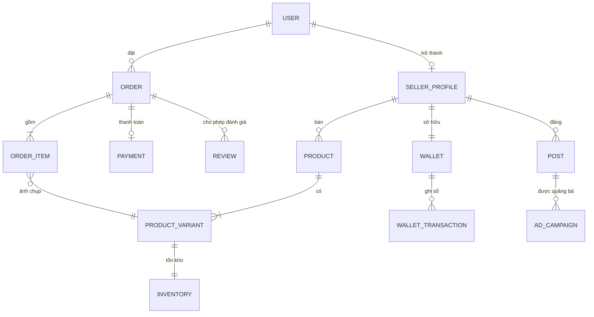

Ranh giới service cắt ngang sơ đồ trên: `ORDER_ITEM` giữ **ảnh chụp** tên, ảnh, giá, SKU của `PRODUCT_VARIANT`
tại thời điểm đặt đơn và **không bao giờ** cập nhật lại — đơn cũ phải đọc được nguyên trạng kể cả khi sản phẩm
đã đổi giá hoặc ngừng kinh doanh.

---

## Phụ lục E. Máy trạng thái

### E.1 Đơn hàng — `OrderStatus` (11 trạng thái)

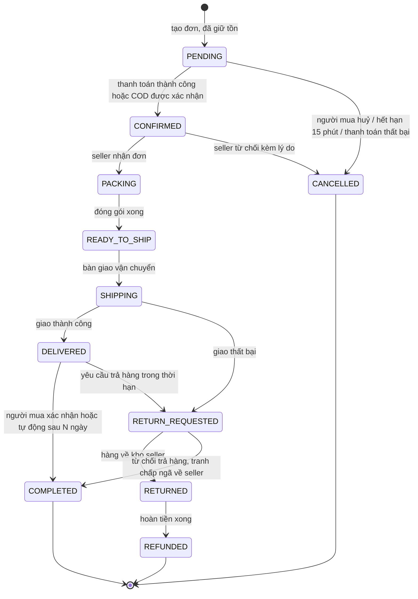

| Quy tắc | Nội dung |
|---|---|
| Chuyển trạng thái | Chỉ qua một `OrderStateMachine` duy nhất; không service nào được `UPDATE status` trực tiếp |
| Ghi vết | Mỗi lần chuyển ghi `OrderStatusHistory` (ai, từ đâu, sang đâu, lý do, thời điểm) |
| Tiền | `COMPLETED` là điều kiện duy nhất để ghi có ví seller (`wallet.credited`) |
| Tồn kho | `CANCELLED` và `RETURNED` luôn kéo theo `inventory.released` |
| Trạng thái cuối | `COMPLETED`, `CANCELLED`, `REFUNDED` — không chuyển tiếp được nữa |

### E.2 Thanh toán — `PaymentStatus`

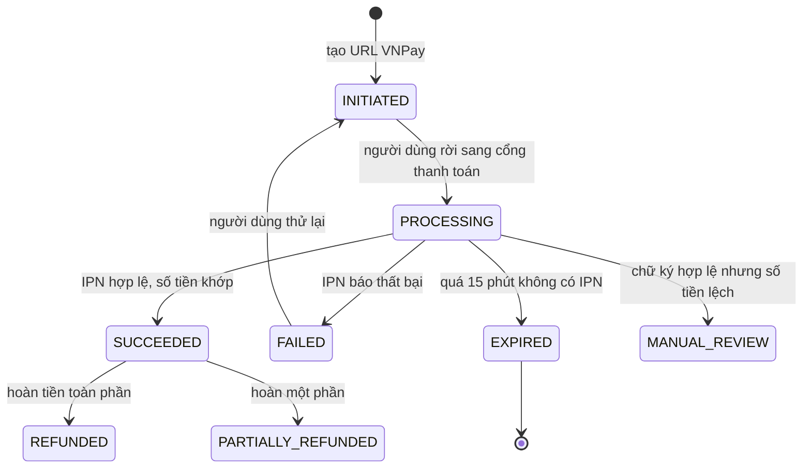

**Nguồn sự thật là IPN, không phải return URL.** Return URL chỉ để hiển thị; IPN có thể đến trước return URL và
đến nhiều lần. `MANUAL_REVIEW` là trạng thái có người xử lý — hệ thống **không** tự quyết khi tiền lệch.

### E.3 Kiểm duyệt — `ResourceStatus` (dùng chung cho sản phẩm, bài đăng, quảng cáo, đơn đăng ký bán)

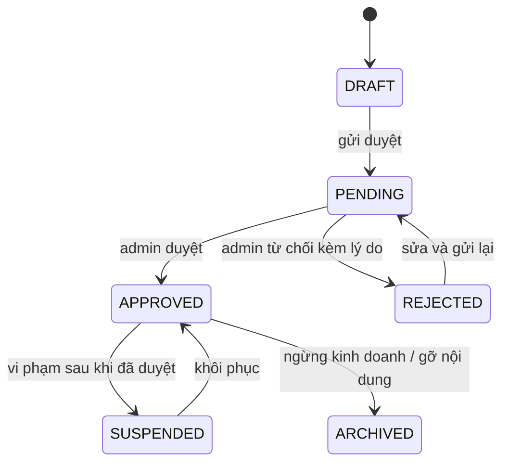

Mọi lần `REJECTED` bắt buộc có `reasonCode` lấy từ `masterdata_db.ReasonCode` cộng ghi chú tự do — người bị từ chối
phải biết chính xác cần sửa gì.

### E.4 Giữ tồn kho — `StockReservation`

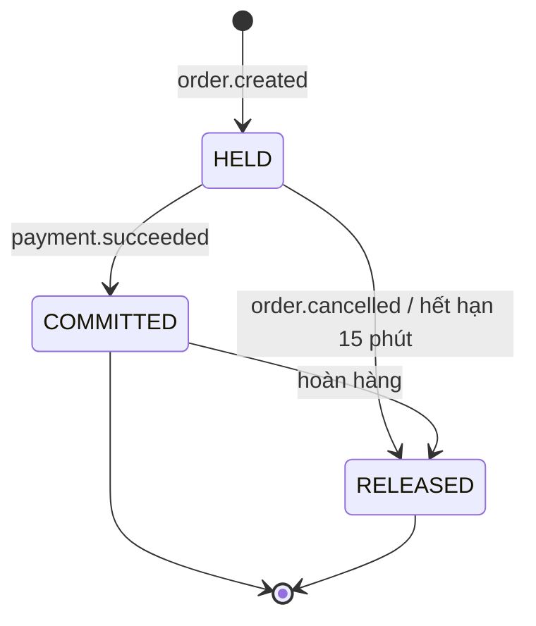

`available = onHand − reserved`. Ràng buộc mức DB `CHECK (reserved >= 0 AND onHand >= reserved)` là lớp chống
bán vượt tồn cuối cùng, kể cả khi logic ứng dụng có lỗi.

### E.5 Rút tiền — `WithdrawalStatus`

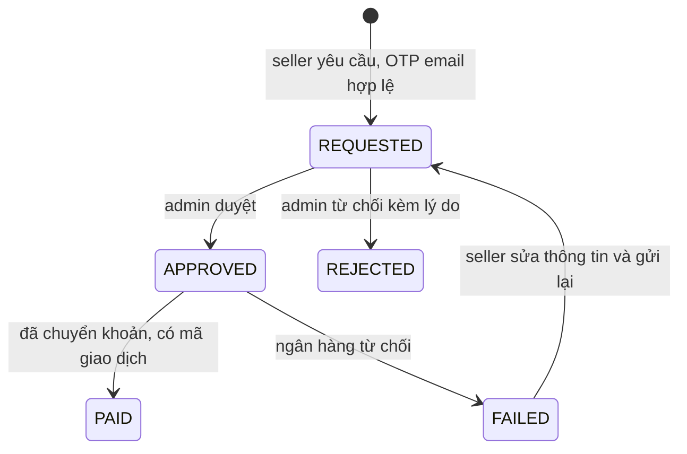

Số tiền bị giữ (`heldBalance`) ngay khi `REQUESTED` và chỉ trừ khỏi `availableBalance` khi `PAID`; `REJECTED` và
`FAILED` trả lại số dư khả dụng.

### E.6 Ticket và tranh chấp

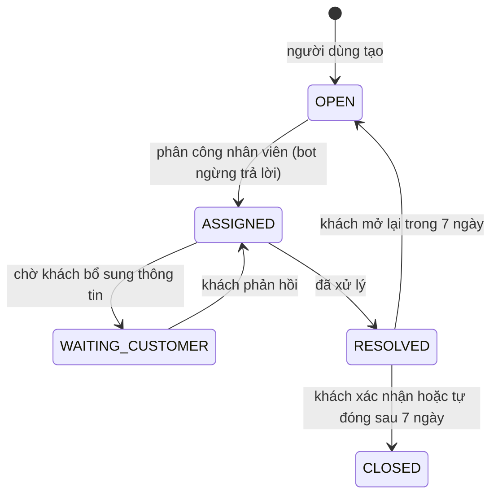

Tranh chấp đơn hàng đi qua ba mốc bắt buộc: người mua mở (kèm bằng chứng) → seller phản hồi trong 48 giờ →
admin phân xử. Quá hạn ở bước nào thì `ticket.sla-breached` được phát và leo thang.

---

## Phụ lục F. Danh mục domain event (86 event)

Chi tiết payload, phiên bản và consumer ở [event-catalog.md](../01-architecture/event-catalog.md).
Quy ước tên: `<domain>.<entity>.<hành động ở thì quá khứ>`.

| Domain phát | Event |
|---|---|
| `identity` | `user.registered` · `user.email-verified` · `user.profile-updated` · `user.locked` · `user.role-granted` · `user.role-revoked` · `rbac.permissions.changed` |
| `seller` | `seller.application.submitted` · `seller.application.approved` · `seller.application.rejected` · `seller.shop.updated` · `seller.shop.suspended` |
| `catalog` | `category.updated` · `product.created` · `product.updated` · `product.approved` · `product.rejected` · `product.deactivated` · `inventory.reserved` · `inventory.reserve-failed` · `inventory.committed` · `inventory.released` · `inventory.adjusted` · `inventory.low-stock` |
| `cart` | `cart.item-added` · `cart.abandoned` |
| `order` | `order.created` · `order.confirmed` · `order.packed` · `order.shipped` · `order.delivered` · `order.completed` · `order.cancelled` · `order.refund-requested` |
| `payment` | `payment.succeeded` · `payment.failed` · `payment.expired` · `payment.refunded` · `wallet.credited` · `wallet.debited` · `withdrawal.requested` · `withdrawal.approved` · `withdrawal.rejected` |
| `promotion` | `voucher.issued` · `voucher.used` · `voucher.released` · `campaign.activated` · `campaign.ended` · `campaign.product-approved` |
| `content` | `post.created` · `post.approved` · `post.rejected` · `post.liked` · `post.commented` · `post.reported` · `ad.campaign.created` · `ad.campaign.approved` · `ad.impression.batched` · `ad.click.batched` · `ad.budget.exhausted` |
| `engagement` | `review.created` · `review.replied` · `review.moderated` · `rating.updated` · `wishlist.item-added` |
| `chat` | `chat.message-sent` · `ticket.created` · `ticket.assigned` · `ticket.resolved` · `ticket.sla-breached` · `dispute.opened` · `dispute.resolved` |
| `notification` | `notification.created` · `notification.delivery-failed` |
| `media` | `media.uploaded` · `media.processed` · `media.transcoded` · `media.rejected` |
| `search` | `search.index-completed` · `search.index-failed` |
| `analytics` | `report.export-ready` · `report.export-failed` |
| `master-data` | `config.updated` · `feature-flag.changed` |
| *(mọi service)* | `audit.recorded` · `system.log-recorded` |

Ba module là **điểm cuối toàn cục** — nghe rất nhiều qua `EventEmitter2` nhưng không module nào phụ thuộc ngược lại
chúng, nhờ vậy đồ thị phụ thuộc gọi hàm giữa module không có chu trình: `notification`, `analytics`, `audit`.

---

## Phụ lục G. Biến môi trường

Chi tiết theo môi trường ở [environments.md](../05-infra/environments.md). `.env.example` chỉ chứa **tên biến**,
tuyệt đối không có giá trị mẫu trông giống thật.

### G.1 Dùng chung cho `api`, `worker`, `worker-media`

| Biến | Ý nghĩa |
|---|---|
| `NODE_ENV` | `development` / `staging` / `production` |
| `APP_NAME` | `api` / `worker` / `worker-media`, gắn vào log và metric |
| `PORT` | Cổng HTTP nội bộ (health/metrics) — chỉ `api` |
| `DATABASE_URL` | Postgres **chung** cho cả ba process |
| `UPSTASH_REDIS_TCP_URL` | Redis TCP — BullMQ (outbox dispatch, job nền) và Socket.IO adapter |
| `UPSTASH_REDIS_REST_URL` / `UPSTASH_REDIS_REST_TOKEN` | Redis REST — cache, rate limit |
| `JWT_PUBLIC_KEY` hoặc `JWKS_URL` | Xác minh token |
| `LOG_LEVEL` | `debug` / `info` / `warn` / `error` |
| `SENTRY_DSN` | Báo lỗi (tuỳ chọn ở dev) |
| `OTEL_EXPORTER_OTLP_ENDPOINT` | Trace phân tán |

Không còn `RABBITMQ_URL` — event nội bộ dùng `EventEmitter2` trong process, không cấu hình qua biến môi trường.

### G.2 Riêng theo module (đọc trong `api`, hoặc trong `worker`/`worker-media` nếu module đó có job nền)

| Module | Biến riêng |
|---|---|
| `platform` | `CORS_ORIGINS`, `THROTTLE_TTL`, `THROTTLE_LIMIT`, `SWAGGER_ENABLED`, `WS_PATH` |
| `identity` | `JWT_PRIVATE_KEY`, `JWT_ACCESS_TTL`, `JWT_REFRESH_TTL`, `BCRYPT_ROUNDS`, `GOOGLE_CLIENT_ID`, `GOOGLE_CLIENT_SECRET`, `FACEBOOK_APP_ID`, `FACEBOOK_APP_SECRET`, `BOOTSTRAP_SUPER_ADMIN_EMAIL`, `BOOTSTRAP_SUPER_ADMIN_PASSWORD`, `ACCOUNT_LOCK_THRESHOLD` |
| `payment` | `VNPAY_TMN_CODE`, `VNPAY_HASH_SECRET`, `VNPAY_URL`, `VNPAY_RETURN_URL`, `VNPAY_IPN_ALLOWED_IPS`, `PAYMENT_TIMEOUT_MINUTES`, `COMMISSION_DEFAULT_RATE`, `WITHDRAWAL_DAILY_LIMIT`, `WALLET_HOLD_DAYS` |
| `media` | `SUPABASE_URL`, `SUPABASE_SERVICE_ROLE_KEY`, `SUPABASE_BUCKET_PUBLIC`, `SUPABASE_BUCKET_PRIVATE`, `MAX_IMAGE_SIZE_MB`, `MAX_VIDEO_SIZE_MB`, `CDN_BASE_URL` — biến ffmpeg (`FFMPEG_THREADS`, `HLS_RENDITIONS`) chỉ đọc trong `worker-media` |
| `search` | `ELASTICSEARCH_NODE`, `ELASTICSEARCH_USERNAME`, `ELASTICSEARCH_PASSWORD`, `ES_INDEX_PREFIX`, `ES_REINDEX_BATCH_SIZE` |
| `notification` | `SMTP_HOST`, `SMTP_PORT`, `SMTP_USER`, `SMTP_PASSWORD`, `MAIL_FROM`, `VAPID_PUBLIC_KEY`, `VAPID_PRIVATE_KEY`, `APP_BASE_URL` — biến SMTP chỉ cần trong `worker` (nơi gửi mail thật) |
| `audit` | `ELASTICSEARCH_NODE`, `AUDIT_RETENTION_MONTHS`, `AUDIT_PARTITION_AHEAD_MONTHS` |
| `content` | `AD_ROLLUP_WINDOW_SECONDS`, `AD_BILLING_INTERVAL_MINUTES`, `AD_ATTRIBUTION_WINDOW_DAYS` |
| `order` | `ORDER_AUTO_COMPLETE_DAYS`, `RETURN_WINDOW_DAYS` |
| `analytics` | `REPORT_EXPORT_TTL_HOURS`, `ROLLUP_CRON` |
| Frontend | `NEXT_PUBLIC_API_URL`, `NEXT_PUBLIC_WS_URL`, `NEXT_PUBLIC_CDN_URL`, `AUTH_SECRET`, `AUTH_URL`, `AUTH_GOOGLE_ID`, `AUTH_GOOGLE_SECRET`, `AUTH_FACEBOOK_ID`, `AUTH_FACEBOOK_SECRET`, `NEXT_PUBLIC_SENTRY_DSN` |

### G.3 Biến của bản cũ bị loại bỏ

| Biến | Lý do |
|---|---|
| `STRIPE_SECRET_KEY`, `STRIPE_WEBHOOK_SECRET` | Không dùng Stripe (`FEAT-DEP-001`) |
| `OPENAI_API_KEY` | Khai báo nhưng chưa dùng; sẽ khai lại khi làm trợ lý AI (`FEAT-CHT-004`) |
| `NEXT_PUBLIC_ACCESS_TOKEN_COOKIE` và các biến cookie phân quyền | NextAuth thay thế (`FEAT-DEP-002`) |

---

## Phụ lục H. Quy trình làm việc

### H.1 Nhịp sprint hai tuần

| Ngày | Hoạt động |
|---|---|
| T2 tuần 1 | Sprint planning: chốt `TASK-*` từ `tasks.md` của domain trong sprint |
| Hằng ngày | Standup 15 phút, cập nhật bảng công việc |
| T5 tuần 1 | Rà soát giữa kỳ: hợp đồng API/event đã merge chưa |
| T4 tuần 2 | Code freeze cho tính năng; chỉ sửa lỗi |
| T5 tuần 2 | Demo lát cắt dọc + retro + cập nhật `docs/` |

### H.2 Definition of Ready (một `TASK-*` mới được đưa vào sprint)

- [ ] Tham chiếu ít nhất một `REQ-*` đã ở trạng thái `approved`
- [ ] Có acceptance criteria dạng Given/When/Then
- [ ] Hợp đồng API và event liên quan đã chốt trong `@timmyhub/contracts`
- [ ] Phụ thuộc kỹ thuật (service khác, migration, seed) đã sẵn sàng hoặc có phương án tạm
- [ ] Ước lượng ≤ 3 ngày công; lớn hơn thì phải chẻ nhỏ

### H.3 Definition of Done

- [ ] Code + test đơn vị (nhánh nghiệp vụ chính) + test tích hợp cho luồng chính
- [ ] Migration Prisma có lịch sử, chạy được xuôi và có kịch bản lùi
- [ ] Seed cập nhật (`seed:essential` phải idempotent)
- [ ] Swagger mô tả đủ request/response/mã lỗi
- [ ] Event mới đã ghi vào `event-catalog.md`, permission mới đã seed và qua kiểm tra nhất quán lúc boot
- [ ] Audit log ghi cho mọi thao tác ghi
- [ ] Frontend: có story Storybook cho component dùng lại, trang lỗi/rỗng/loading, đạt WCAG 2.2 AA
- [ ] `docs/` cập nhật **trong cùng PR** (requirements ↔ design ↔ tasks đánh dấu xong)
- [ ] CI xanh; không có lỗ hổng HIGH từ `pnpm audit` và quét image
- [ ] Đã demo được trên staging

### H.4 Ma trận trách nhiệm (RACI)

| Hạng mục | Tech Lead | BE | FE | DevOps | QA | PO |
|---|---|---|---|---|---|---|
| ADR, ranh giới service | **A/R** | C | C | C | I | I |
| `requirements.md` (EARS) | C | C | C | I | C | **A/R** |
| `design.md` từng domain | **A** | **R** | C | I | C | I |
| Hợp đồng `@timmyhub/contracts` | **A** | **R** | **R** | I | I | C |
| Triển khai service | C | **A/R** | I | C | C | I |
| Giao diện & design system | C | I | **A/R** | I | C | C |
| CI/CD, k8s, giám sát | C | C | I | **A/R** | I | I |
| Chiến lược test, e2e, UAT | C | C | C | I | **A/R** | C |
| Nghiệm thu tính năng | C | I | I | I | C | **A/R** |
| Quyết định hoãn ra mắt | **R** | I | I | C | C | **A** |

*(A = chịu trách nhiệm cuối, R = thực hiện, C = được hỏi ý kiến, I = được thông báo)*

### H.5 Sinh và truy vết `TASK-*`

Mỗi `tasks.md` của domain tuân thủ khuôn mẫu:

```markdown
- [ ] **TASK-ORD-021** Thêm bước chuyển `SHIPPING → DELIVERED` vào state machine
    - Ref: `REQ-ORD-012`, `REQ-ORD-013`
    - Ước lượng: 1.5 ngày · Vai: BE
    - Xong khi: test tích hợp phủ cả đường hợp lệ và đường bị chặn; `order.delivered` phát đúng một lần
```

Ba quy tắc kiểm tra tự động trước khi merge:

1. Mọi `TASK-*` có ít nhất một `REQ-*` trong dòng `Ref:`.
2. Mọi `REQ-*` xuất hiện ở ít nhất một `TASK-*`.
3. Mọi `FEAT-*` trong [feature-inventory.md](feature-inventory.md) có ít nhất một `REQ-*`.

### H.6 Quy ước nhánh và commit

| Hạng mục | Quy ước |
|---|---|
| Nhánh | `feat/<domain>-<mô tả ngắn>`, `fix/…`, `chore/…`; sống tối đa 3 ngày |
| Commit | Conventional Commits, kiểm bằng commitlint |
| PR | Bắt buộc 1 người duyệt; PR động tới hợp đồng dùng chung cần Tech Lead duyệt |
| Feature flag | Tính năng chưa xong vẫn merge được nhưng phải tắt sau cờ |
| Release | Tag `v<major>.<minor>.<patch>`, sinh changelog từ commit |

---

## Phụ lục I. Lịch trình tổng

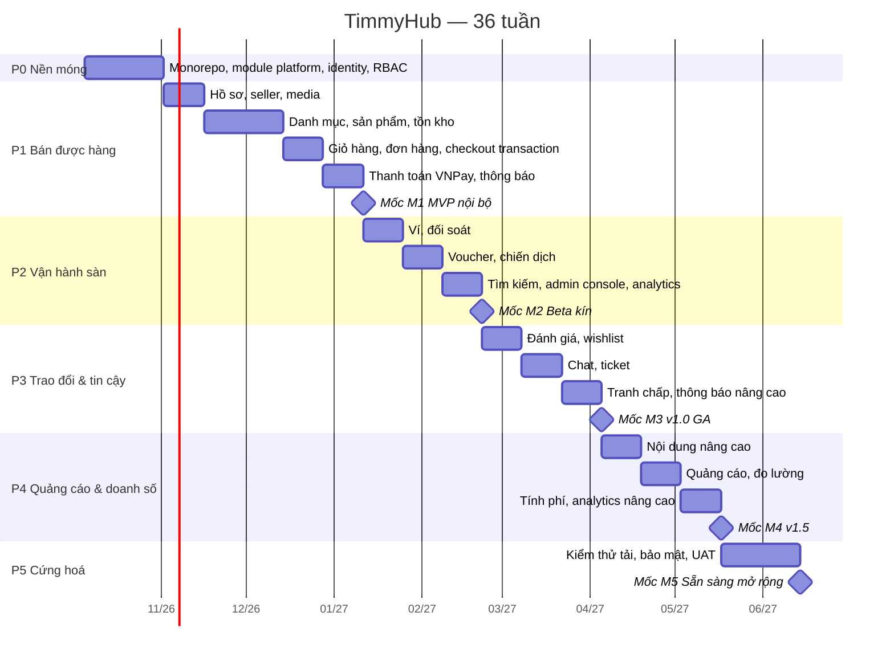

Ngày bắt đầu 2026-10-05 là giả định để sơ đồ có mốc cụ thể; điều chỉnh khi chốt ngày khởi động thật.

---

## Phụ lục J. Việc phải xong trước sprint 1 (tuần 0)

| # | Việc | Ai | Chặn cái gì nếu chưa xong |
|---|---|---|---|
| 1 | **Xoay toàn bộ bí mật bị lộ ở repo cũ** (Sentry, Supabase, Vercel, Google API key) | Tech Lead | Không được dùng lại bất kỳ giá trị nào |
| 2 | Tạo repo mới, bật secret scanning + push protection + branch protection | Tech Lead | Mọi commit |
| 3 | Khởi tạo pnpm workspace, `.editorconfig`, ESLint, Prettier, Husky, commitlint | Tech Lead | S1 |
| 4 | Dựng `docker-compose.dev.yml`: Postgres 16, Redis, Elasticsearch, MailHog | DevOps | S1 |
| 5 | Tạo dự án Supabase (storage) và VNPay sandbox | DevOps + PO | S3, S7 |
| 6 | Đăng ký OAuth app Google và Facebook | DevOps | S1 |
| 7 | Chốt `requirements.md` cho `identity-auth` và `rbac-permission` ở trạng thái approved | PO + Tech Lead | S1 |
| 8 | Chốt bảng token thiết kế và bộ component nền shadcn/ui | FE Lead | S1 |
| 9 | Chốt danh sách `PERMISSIONS` đầy đủ trong `@timmyhub/contracts` | Tech Lead | S2 |
| 10 | Lập tài khoản Sentry, Upstash, registry image, cluster staging | DevOps | S2 |
| 11 | Chốt câu trả lời cho các câu hỏi mở ở §19 | PO | P1 |
| 12 | Thống nhất nhịp làm việc, DoR/DoD, quy ước nhánh với cả đội | Tech Lead | S1 |

---

## Đọc tiếp

| Muốn biết | Đọc |
|---|---|
| Sản phẩm làm gì, cho ai | [product-overview.md](product-overview.md) |
| Danh sách đầy đủ 251 tính năng | [feature-inventory.md](feature-inventory.md) |
| Ai được làm gì | [roles-and-permissions.md](roles-and-permissions.md) |
| Thuật ngữ, quy ước đặt tên | [glossary.md](glossary.md) |
| Kiến trúc chi tiết | [system-architecture.md](../01-architecture/system-architecture.md) · [service-catalog.md](../01-architecture/service-catalog.md) |
| Service nói chuyện với nhau ra sao | [communication-patterns.md](../01-architecture/communication-patterns.md) · [event-catalog.md](../01-architecture/event-catalog.md) |
| Hợp đồng API | [api-conventions.md](../01-architecture/api-conventions.md) |
| Bảo mật | [security.md](../01-architecture/security.md) |
| Realtime | [realtime.md](../01-architecture/realtime.md) |
| Kế hoạch chi tiết hơn nữa | [07-plan/implementation-plan.md](../07-plan/implementation-plan.md) · [07-plan/milestones.md](../07-plan/milestones.md) · [07-plan/risks.md](../07-plan/risks.md) |
| Bắt tay vào code | [08-handoff/handoff.md](../08-handoff/handoff.md) · [08-handoff/onboarding.md](../08-handoff/onboarding.md) |
