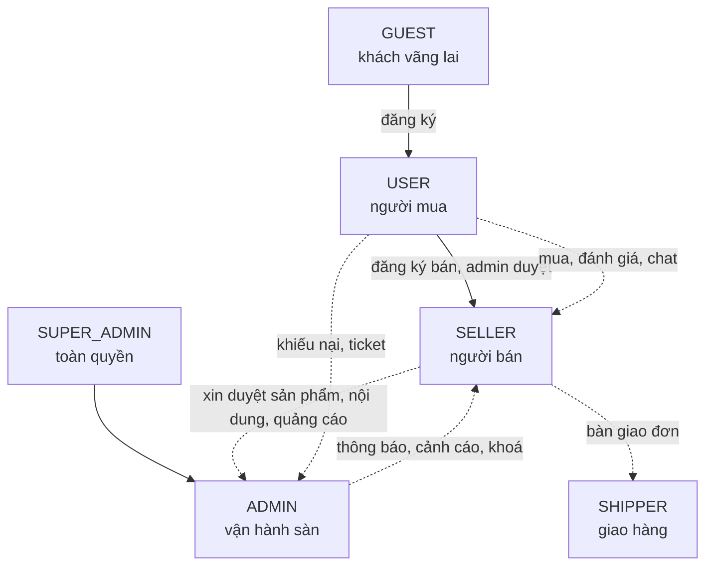
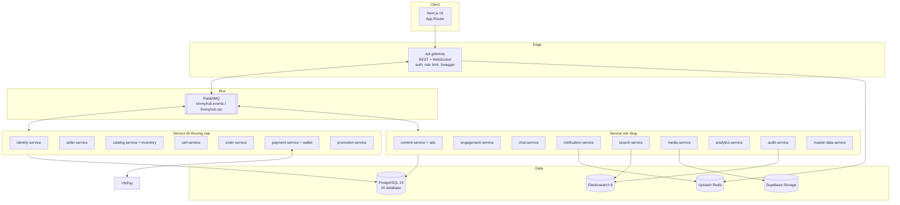
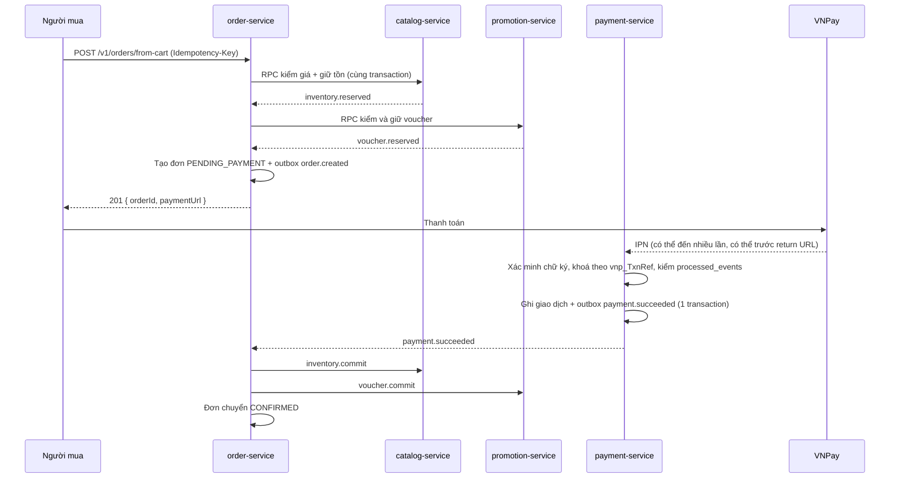
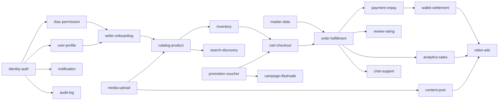
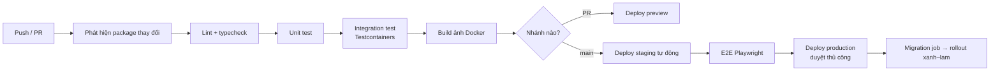

# TimmyHub — Tổng quan kế hoạch dự án

> **Tài liệu này là bản tổng quan đứng độc lập.** Đọc hết file này là nắm được: làm cái gì, cho ai, bằng công nghệ gì,
> kiến trúc ra sao, chia bao nhiêu giai đoạn, ai làm, mất bao lâu, rủi ro ở đâu, và đọc tiếp file nào để đi sâu.
> Mọi con số và bảng ở đây đều trỏ tới tài liệu chi tiết tương ứng.

---

## Mục lục

| § | Nội dung |
|---|---|
| 1 | Tóm tắt điều hành |
| 2 | Bối cảnh: vì sao làm lại |
| 3 | Mục tiêu và phi mục tiêu |
| 4 | Người dùng và vai trò |
| 5 | Phạm vi tính năng — 23 domain, 176 feature |
| 6 | Kiến trúc tổng thể — 17 đơn vị triển khai |
| 7 | Công nghệ sử dụng (đầy đủ, kèm lý do) |
| 8 | Dữ liệu và sự kiện |
| 9 | Yêu cầu phi chức năng (NFR) |
| 10 | Bảo mật và tuân thủ |
| 11 | Kế hoạch triển khai — 6 phase, 18 sprint |
| 12 | Cột mốc và tiêu chí ra mắt |
| 13 | Nhân sự và ước lượng công sức |
| 14 | Rủi ro và biện pháp giảm thiểu |
| 15 | Chất lượng và quy trình |
| 16 | Vận hành và chi phí |
| 17 | Bộ tài liệu `docs/` |
| 18 | Nợ kỹ thuật kế thừa phải xử lý |
| 19 | Giả định và câu hỏi mở |
| 20 | Bước tiếp theo |

---

## 1. Tóm tắt điều hành

**TimmyHub là sàn thương mại điện tử đa vai trò kiêm trung tâm trao đổi giữa admin – user – seller.**
Seller đăng bán sản phẩm, đăng bài post và video quảng cáo, quản lý doanh số và dòng tiền; user mua hàng và tương tác
nội dung; admin kiểm duyệt và vận hành toàn sàn. Ba vai trao đổi với nhau qua một hệ thống chat/ticket, một luồng
kiểm duyệt thống nhất, và một bộ thông báo chung.

| Hạng mục | Con số |
|---|---|
| Tính năng đặc tả | **176** (`FEAT-*`) trên **23 domain** |
| Trong đó kế thừa từ bản cũ | 74 giữ nguyên + 31 mở rộng + 14 kế thừa nhưng **phải sửa lỗi** |
| Tính năng mới | **57** |
| Tính năng loại bỏ có chủ đích | 6 |
| Đơn vị triển khai | **17** (1 gateway + 16 service), database-per-service |
| Domain event | **78** (`EVT-*`) |
| Quyết định kiến trúc ghi nhận | **12** ADR |
| Thời gian dự kiến | **36 tuần** (18 sprint × 2 tuần) |
| Quy mô đội | **~9 FTE** (chi tiết §13) |
| Mốc GA (v1.0) | Tuần **26** |

**Điểm khác biệt lớn nhất so với bản cũ:** bản cũ là monolith NestJS + Mantine đã chạy được nhưng có lỗ hổng phân
quyền và không có lịch sử migration. Bản này là **viết lại** theo kiến trúc microservices, đổi toàn bộ tầng UI,
và bổ sung ba mảng nghiệp vụ mà bản cũ thiếu hẳn: **tồn kho có reserve**, **ví & đối soát cho seller**,
**quảng cáo trả phí có đo lường**.

**Bốn rủi ro lớn nhất** (chi tiết §14): chi phí vận hành microservices; tính đúng đắn của luồng thanh toán VNPay IPN;
nhất quán dữ liệu giữa các service; và việc đội chưa có kinh nghiệm vận hành k8s + RabbitMQ ở production.

---

## 2. Bối cảnh: vì sao làm lại

`D:\IT\2026\Projects\TimmyHub` (bản cũ) đã chạy được: ~29 module NestJS, 45 model Prisma, ~50 route Next.js.
Nhưng có những vấn đề không sửa vá được:

| # | Vấn đề ở bản cũ | Hệ quả | Cách xử lý ở bản mới |
|---|---|---|---|
| 1 | Cookie `access_token`, `user_roles`, `user_permissions` **không HttpOnly**; `proxy.ts` phân quyền ở edge dựa trên chính các cookie đó | Bất kỳ script nào cũng sửa được `user_roles` để vượt guard phía client | NextAuth, session mã hoá, bỏ hoàn toàn 3 cookie ([ADR-0005](../01-architecture/adr/ADR-0005-nextauth.md)) |
| 2 | Thiếu seed permission (`product:approve`, `users:create`, `rbac:permissions:*`) | Một loạt endpoint admin **không ai gọi được**, kể cả super admin | Kiểm tra nhất quán lúc khởi động, service **từ chối boot** nếu thiếu (`FEAT-RBAC-011`) |
| 3 | CASL `mapSubject` có nhánh fallback sai | Rule phân quyền theo bản ghi lưu trong DB **vô hiệu hoàn toàn** | Viết lại ánh xạ subject, có test cho từng subject |
| 4 | DTO khai bằng `class-validator` nhưng chỉ đăng ký `ZodValidationPipe` | Decorator `@IsEmail()`, `@IsString()`… **không bao giờ chạy** — API nhận dữ liệu bẩn | zod là nguồn validation **duy nhất**; ESLint chặn import `class-validator` ([ADR-0010](../01-architecture/adr/ADR-0010-zod-single-validation-source.md)) |
| 5 | `prisma db push --accept-data-loss`, không có thư mục migration | Không rollback được, không tái lập được schema production | `prisma migrate` + kiểm tra drift trong CI ([ADR-0009](../01-architecture/adr/ADR-0009-prisma-migrate.md)) |
| 6 | Model `Wallet`/`WalletTransaction` tồn tại nhưng **không có một API nào** | Doanh số không có đường về tiền cho seller | Domain `wallet-settlement` đầy đủ (§5) |
| 7 | Trừ kho trực tiếp khi tạo đơn, không có reserve | Oversell khi flash sale | Domain `inventory` với reserve/commit/release trong cùng transaction |
| 8 | `strict: false`, `no-explicit-any: 'off'` ở backend; không Husky, không test, không Storybook | Lỗi kiểu chỉ lộ ra lúc chạy | TypeScript strict, Husky + lint-staged + commitlint, chiến lược test 4 tầng |
| 9 | AG Grid **Enterprise** dùng làm mặc định | Rủi ro giấy phép thương mại | TanStack Table mặc định ([ADR-0007](../01-architecture/adr/ADR-0007-tanstack-table-over-aggrid.md)) |
| 10 | Không có `error.tsx` / `not-found.tsx` ở bất kỳ route nào; 2 route chết (`/admin/customers`, `/seller/orders`); 2 trang stub | Lỗi runtime làm trắng trang | Bắt buộc có trang lỗi/rỗng cho mọi route group |
| 11 | Bí mật bị commit (Sentry token, Supabase connection string, Vercel token, Google API key) | Rò rỉ hạ tầng | Xoay toàn bộ trước khi tái sử dụng — xem §18 |
| 12 | Không có `docs/`, chỉ 1 file kế hoạch 2.397 dòng | Không ai onboard được | Bộ `docs/` ~95 file có truy vết ID |

**Quyết định:** đây là **viết lại**, không phải nâng cấp. Dữ liệu bản cũ **không migrate** — bản mới khởi động với
dữ liệu sạch (xem giả định A4 ở §19).

---

## 3. Mục tiêu và phi mục tiêu

### 3.1 Mục tiêu sản phẩm

| # | Mục tiêu | Đo bằng |
|---|---|---|
| G1 | Người mua tìm và mua được hàng trong ≤ 5 bước từ trang chủ | Tỷ lệ hoàn tất checkout ≥ 60% |
| G2 | Seller tự phục vụ hoàn toàn: đăng ký → bán → nhận tiền, không cần admin can thiệp | ≥ 90% đơn seller xử lý không phát sinh ticket |
| G3 | Admin kiểm duyệt được mọi loại nội dung từ một hàng chờ duy nhất | Thời gian duyệt trung bình ≤ 4 giờ |
| G4 | Seller thấy được doanh số và dòng tiền gần thời gian thực | Dashboard trễ ≤ 5 phút |
| G5 | Nội dung (post/video) dẫn được ra đơn hàng và đo được | Có attribution cho ≥ 95% đơn đến từ nội dung |
| G6 | Quảng cáo trả phí có thể mua, chạy và tính phí tự động | Sai lệch tính phí = 0 |

### 3.2 Mục tiêu kỹ thuật

| # | Mục tiêu |
|---|---|
| T1 | Mỗi service triển khai độc lập, không cần dừng service khác |
| T2 | Không mất dữ liệu nghiệp vụ khi RabbitMQ hoặc một service phụ trợ chết (outbox + đường suy giảm) |
| T3 | Không oversell trong mọi kịch bản, kể cả flash sale |
| T4 | Không sai tiền: 0 chênh lệch khi đối soát với VNPay |
| T5 | Mọi thao tác ghi đều có audit log truy vết được tới actor và request |
| T6 | Dev mới dựng được toàn hệ thống trên máy cá nhân trong ≤ 30 phút |

### 3.3 Phi mục tiêu (lần này **không** làm)

| Không làm | Lý do |
|---|---|
| App mobile native (iOS/Android) | Web responsive + PWA đủ cho giai đoạn này |
| Livestream bán hàng | Chi phí hạ tầng lớn, chưa có nhu cầu được xác nhận |
| Đa tiền tệ, đa quốc gia | Chỉ VND, chỉ thị trường Việt Nam |
| Cổng thanh toán ngoài VNPay | Thêm sau khi luồng VNPay ổn định |
| Hệ thống logistics riêng | Seller tự vận chuyển hoặc dùng đơn vị bên ngoài |
| Gợi ý sản phẩm bằng machine learning | Giai đoạn đầu dùng luật + độ phổ biến |
| Migrate dữ liệu từ bản cũ | Xem §19 |

---

## 4. Người dùng và vai trò

| Vai | Ai | Làm được gì | Số lượng dự kiến năm 1 |
|---|---|---|---|
| `GUEST` | Chưa đăng nhập | Xem sản phẩm, xem post/video, tìm kiếm | — |
| `USER` | Người mua | Mua, đánh giá, wishlist, chat với seller, tương tác nội dung, ví cá nhân | ~50.000 |
| `SELLER` | Chủ shop | Tất cả của `USER` + quản lý shop, sản phẩm, tồn kho, đơn, khuyến mãi, nội dung, quảng cáo, doanh số, rút tiền | ~1.500 |
| `ADMIN` | Nhân viên vận hành | Kiểm duyệt, quản lý người dùng/seller/danh mục, xử lý ticket, xem báo cáo toàn sàn | ~20 |
| `SUPER_ADMIN` | Chủ hệ thống | Toàn quyền, gán quyền, cấu hình hệ thống, feature flag | 1–3 |
| `SHIPPER` | Đối tác giao hàng | Cập nhật trạng thái vận chuyển (phạm vi hẹp, sau MVP) | ~50 |

Phân quyền dùng **3 tầng ghép bằng AND**: `UserRole` (vai) → `Permission` dạng `module:resource:action` (chức năng)
→ CASL (theo từng bản ghi). Chi tiết: [roles-and-permissions.md](roles-and-permissions.md).

---

## 5. Phạm vi tính năng

Nguồn sự thật đầy đủ: [feature-inventory.md](feature-inventory.md) — 176 feature có ID `FEAT-<DOMAIN>-<nnn>`.
Bảng dưới là bản tóm tắt theo domain.

| # | Domain | Mã | Số feature | P0 | Trạng thái | Service chứa |
|---|---|---|---|---|---|---|
| 1 | `identity-auth` | IDN | 14 | 12 | kế thừa + sửa lỗi | `identity-service` |
| 2 | `rbac-permission` | RBAC | 11 | 9 | kế thừa + sửa lỗi | `identity-service` |
| 3 | `user-profile` | USR | 9 | 6 | kế thừa | `identity-service` |
| 4 | `seller-onboarding` | SEL | 8 | 6 | kế thừa | `seller-service` |
| 5 | `catalog-product` | CAT | 17 | 12 | kế thừa + mở rộng | `catalog-service` |
| 6 | `inventory` | INV | 8 | 7 | **mới** | `catalog-service` |
| 7 | `cart-checkout` | CRT | 9 | 8 | kế thừa | `cart-service` |
| 8 | `order-fulfillment` | ORD | 14 | 11 | kế thừa + mở rộng | `order-service` |
| 9 | `payment-vnpay` | PAY | 10 | 10 | kế thừa + sửa lỗi | `payment-service` |
| 10 | `wallet-settlement` | WAL | 9 | 4 | **mới** | `payment-service` |
| 11 | `promotion-voucher` | VCH | 8 | 3 | kế thừa | `promotion-service` |
| 12 | `campaign-flashsale` | CPG | 7 | 2 | kế thừa | `promotion-service` |
| 13 | `content-post` | PST | 11 | 2 | kế thừa + mở rộng | `content-service` |
| 14 | `video-ads` | ADS | 10 | 0 | **mới** | `content-service` |
| 15 | `review-rating` | REV | 7 | 3 | kế thừa | `engagement-service` |
| 16 | `chat-support` | CHT | 9 | 2 | kế thừa + mở rộng | `chat-service` |
| 17 | `notification` | NTF | 8 | 4 | kế thừa + mở rộng | `notification-service` |
| 18 | `search-discovery` | SRC | 7 | 3 | kế thừa | `search-service` |
| 19 | `media-upload` | MED | 6 | 5 | kế thừa | `media-service` |
| 20 | `analytics-sales` | ANA | 12 | 3 | kế thừa + mở rộng nhiều | `analytics-service` |
| 21 | `audit-log` | AUD | 6 | 4 | kế thừa + mở rộng | `audit-service` |
| 22 | `master-data` | MDT | 5 | 3 | kế thừa | `master-data-service` |
| 23 | `admin-console` | ADM | 11 | 5 | kế thừa | frontend + nhiều service |
| | **Tổng** | | **176** | **71** | | |

### 5.1 Ba mảng nghiệp vụ trọng tâm

**a. Seller đăng bán** — `seller-onboarding` + `catalog-product` + `inventory`:
đăng ký bán hàng có duyệt, hồ sơ shop có slug riêng, sản phẩm nhiều biến thể (variant) với SKU/giá/tồn riêng,
thuộc tính động theo danh mục, kiểm duyệt trước khi hiển thị, nhập/xuất hàng loạt, cảnh báo sắp hết hàng,
giữ tồn (reserve) khi checkout và tự nhả sau 15 phút nếu không thanh toán.

**b. Post và video quảng cáo** — `content-post` + `video-ads`:

| Nhóm | Nội dung |
|---|---|
| Post/video hữu cơ | Soạn bài có ảnh/video, gắn thẻ sản phẩm, feed cuộn dọc, like/comment realtime, lưu bài, chia sẻ, kiểm duyệt trước khi lên feed |
| Quảng cáo trả phí | Tạo chiến dịch, chọn mục tiêu (hiển thị / lượt xem / click), đặt ngân sách ngày và tổng, chọn đối tượng (danh mục, khu vực, thiết bị), lịch chạy |
| Vị trí hiển thị | Banner trang chủ, chèn giữa feed, gợi ý dưới sản phẩm, kết quả tìm kiếm được tài trợ |
| Đo lường | Impression, view (≥ 3 giây), click, CTR, CPM/CPC, chuyển đổi ra đơn hàng (attribution 7 ngày) |
| Tính phí | Gom sự kiện theo cửa sổ 60 giây, đối soát mỗi giờ, trừ ví quảng cáo, tự dừng khi hết ngân sách |
| Kiểm duyệt | Duyệt nội dung quảng cáo trước khi chạy; báo cáo vi phạm; gỡ và hoàn ngân sách còn lại |

**c. Quản lý doanh số** — `analytics-sales` + `wallet-settlement`:

| Nhóm | Nội dung |
|---|---|
| Chỉ số | GMV, doanh thu thuần, số đơn, giá trị đơn trung bình, tỷ lệ huỷ, tỷ lệ hoàn |
| Chiều phân tích | Theo thời gian, sản phẩm, danh mục, kênh (tìm kiếm / nội dung / quảng cáo), khu vực |
| Phễu | Lượt xem → thêm giỏ → bắt đầu thanh toán → đặt đơn → thanh toán thành công |
| Nâng cao | So sánh kỳ, cohort khách quay lại, top sản phẩm/khách hàng, vòng quay tồn kho |
| Xuất dữ liệu | CSV và Excel qua job nền, gửi link tải qua thông báo |
| Dòng tiền | Ví seller, sổ giao dịch, kỳ đối soát, hoa hồng sàn, yêu cầu rút tiền có duyệt + OTP |

### 5.2 Trung tâm trao đổi admin – user – seller

Đây là phần "hub" trong tên sản phẩm, trải trên `chat-support`, `notification`, `admin-console`, `audit-log`:

| Luồng trao đổi | Cơ chế |
|---|---|
| User ↔ Seller | Chat realtime theo hội thoại, gắn ngữ cảnh sản phẩm/đơn hàng |
| User ↔ Admin | Ticket khiếu nại có SLA, trạng thái, phân công nhân viên |
| Seller ↔ Admin | Hàng chờ kiểm duyệt (sản phẩm, nội dung, quảng cáo, hồ sơ shop), phản hồi lý do từ chối, kháng nghị |
| Ba bên | Tranh chấp đơn hàng: user mở → seller phản hồi → admin phân xử, có mốc thời gian và bằng chứng đính kèm |
| Hệ thống → mọi vai | Thông báo in-app / email / web push, có tuỳ chọn bật tắt theo loại (trừ nhóm giao dịch bắt buộc) |
| Trợ lý tự động | Bot trả lời bước đầu cho ticket hỗ trợ, ngừng khi có nhân viên nhận |

### 5.3 Tính năng loại bỏ có chủ đích

| ID | Bỏ | Lý do |
|---|---|---|
| `FEAT-DEP-001` | Tích hợp Stripe | Khai báo ở bản cũ nhưng không dùng; chỉ VNPay |
| `FEAT-DEP-002` | Cookie `user_roles` / `user_permissions` phía client | Lỗ hổng phân quyền |
| `FEAT-DEP-003` | DTO `class-validator` | Trùng vai trò với zod, và không hề chạy ở bản cũ |
| `FEAT-DEP-004` | AG Grid Enterprise làm mặc định | Giấy phép thương mại |
| `FEAT-DEP-005` | i18next | Thay bằng next-intl có locale trên URL |
| `FEAT-DEP-006` | `db push --accept-data-loss` | Thay bằng migration có lịch sử |

---

## 6. Kiến trúc tổng thể

### 6.1 Bức tranh chung

### 6.2 17 đơn vị triển khai

| # | Service | Port dev | Database | Trách nhiệm chính |
|---|---|---|---|---|
| 0 | `api-gateway` | 3000 | — | Điểm vào HTTP/WS duy nhất, guard, rate limit, gộp Swagger |
| 1 | `identity-service` | 3101 | `identity_db` | Auth, user, device, RBAC, permission, CASL, SSO |
| 2 | `seller-service` | 3102 | `seller_db` | Hồ sơ shop, đơn đăng ký bán, thương hiệu |
| 3 | `catalog-service` | 3103 | `catalog_db` | Danh mục, sản phẩm, biến thể, **tồn kho**, kiểm duyệt sản phẩm |
| 4 | `cart-service` | 3104 | `cart_db` | Giỏ hàng, kiểm tra tính hợp lệ của giỏ |
| 5 | `order-service` | 3105 | `order_db` | Đơn hàng, state machine, địa chỉ giao, phí ship |
| 6 | `payment-service` | 3106 | `payment_db` | VNPay, ví, giao dịch ví, đối soát, rút tiền |
| 7 | `promotion-service` | 3107 | `promotion_db` | Voucher, chiến dịch, flash sale |
| 8 | `content-service` | 3108 | `content_db` | Post, video, **chiến dịch quảng cáo**, kiểm duyệt nội dung |
| 9 | `engagement-service` | 3109 | `engagement_db` | Đánh giá, bình luận, wishlist, like |
| 10 | `chat-service` | 3110 | `chat_db` | Hội thoại đa bên, ticket, khiếu nại |
| 11 | `notification-service` | 3111 | `notification_db` | In-app, email, web push, template, tuỳ chọn nhận |
| 12 | `search-service` | 3112 | `search_db` + ES | Index Elasticsearch, truy vấn, gợi ý, reindex |
| 13 | `media-service` | 3113 | `media_db` | Upload Supabase Storage, thumbnail, transcode |
| 14 | `analytics-service` | 3114 | `analytics_db` | Doanh số, dashboard, báo cáo, xuất dữ liệu |
| 15 | `audit-service` | 3115 | `audit_db` + ES | Audit log, system log, tra cứu |
| 16 | `master-data-service` | 3116 | `masterdata_db` | Tỉnh/huyện/xã, cấu hình hệ thống, feature flag |

Chi tiết từng service (RPC cung cấp, event phát/nhận, job nền, rủi ro):
[service-catalog.md](../01-architecture/service-catalog.md).

### 6.3 Mười quy tắc kiến trúc bắt buộc

| # | Quy tắc |
|---|---|
| 1 | Một service **chỉ** truy cập database của chính nó; muốn dữ liệu service khác thì gọi RPC hoặc nghe event |
| 2 | Không có giao dịch phân tán 2PC; nhất quán cuối cùng qua event + saga có bù trừ |
| 3 | Mọi thay đổi nghiệp vụ + event tương ứng được ghi **trong cùng một transaction** qua bảng `outbox_events` |
| 4 | Mọi consumer phải **idempotent** (bảng `processed_events`), vì giao hàng là at-least-once |
| 5 | Đồ thị phụ thuộc RPC đồng bộ **không được có chu trình** |
| 6 | `notification`, `analytics`, `audit` là **sink toàn cục** — không service nào được phụ thuộc ngược vào chúng |
| 7 | Dữ liệu tham chiếu chéo service: hoặc **snapshot bất biến** (ghi một lần, không cập nhật), hoặc **read model** cập nhật bằng event và **tái dựng được** |
| 8 | Tiền luôn là `Decimal(14,2)`, truyền trong event dưới dạng **chuỗi** |
| 9 | Mỗi service phải khai báo **đường suy giảm** khi phụ thuộc chết (trừ `identity-service` — không có đường suy giảm) |
| 10 | Thêm service mới phải trả lời được 5 câu hỏi cổng ở [service-catalog.md](../01-architecture/service-catalog.md) |

---

## 7. Công nghệ sử dụng

### 7.1 Frontend

| Hạng mục | Lựa chọn | Vì sao |
|---|---|---|
| Framework | **Next.js 16** (App Router, RSC) | SEO cho trang sản phẩm, streaming, server action |
| Ngôn ngữ | TypeScript 5.x `strict` | Bắt lỗi trước khi chạy |
| UI kit | **shadcn/ui** + **Radix** | Sở hữu code component, không khoá vào thư viện ([ADR-0006](../01-architecture/adr/ADR-0006-shadcn-over-mantine.md)) |
| CSS | **Tailwind CSS v4** | Token hoá design system, không CSS-in-JS runtime |
| State cục bộ | **Zustand** | Nhẹ, không boilerplate; chỉ dùng cho UI state |
| State máy chủ | **TanStack Query v5** | Cache, invalidation, optimistic update |
| Bảng | **TanStack Table + TanStack Virtual** | Mặc định; AG Grid Community chỉ cho 2–3 grid admin phức tạp |
| Biểu đồ | **Recharts** | Đủ cho dashboard doanh số, API khai báo |
| Form | **react-hook-form + zod** (`zodResolver`) | Cùng schema với backend |
| HTTP | **axios** + interceptor | Refresh token, chuẩn hoá lỗi, gắn `X-Request-Id` |
| Auth | **NextAuth (Auth.js v5)** | Session mã hoá HttpOnly, SSO Google/Facebook |
| i18n | **next-intl** | Locale trên URL `/[locale]/...`, dịch được ở server component |
| Realtime | **socket.io-client** | Khớp với gateway |
| Storybook | **Storybook 8** (CSF3) | Bắt buộc có story cho component dùng chung |
| Test | Vitest + Testing Library + Playwright | Unit / component / e2e |
| Chất lượng | ESLint, Prettier, **Husky + lint-staged + commitlint** | Chặn lỗi trước khi commit |

### 7.2 Backend

| Hạng mục | Lựa chọn | Vì sao |
|---|---|---|
| Runtime | **Node.js 22 LTS** | Ổn định, hỗ trợ dài hạn |
| Framework | **NestJS 11** (microservices) | DI, module hoá, transport RabbitMQ sẵn có |
| ORM | **Prisma 7** + `@prisma/adapter-pg` | Kiểu an toàn, migration có lịch sử, client extension cho audit |
| CSDL | **PostgreSQL 16** | 16 database riêng, partition cho bảng log |
| Nền tảng bổ trợ | **Supabase** (Postgres quản lý + Storage) | Giảm việc vận hành, Storage cho media |
| Event bus | **RabbitMQ** (topic + direct + DLX) | Định tuyến linh hoạt, vận hành nhẹ hơn Kafka ([ADR-0003](../01-architecture/adr/ADR-0003-rabbitmq-event-bus.md)) |
| Job queue | **BullMQ** trên **Upstash Redis (TCP)** | 10 hàng đợi: mail, media, index, báo cáo, tính phí quảng cáo… |
| Cache / rate limit | **Upstash Redis (REST)** | Không giữ kết nối, hợp môi trường serverless ([ADR-0004](../01-architecture/adr/ADR-0004-upstash-redis.md)) |
| Realtime | **Socket.IO** + `@socket.io/redis-adapter` | Nhiều pod gateway đồng bộ qua Redis pub/sub |
| Tìm kiếm | **Elasticsearch 8** | Full-text tiếng Việt, facet, gợi ý |
| Validation | **zod** + `nestjs-zod` | Một nguồn schema dùng chung FE/BE |
| Auth | **Passport** (JWT, Google, Facebook) + **bcrypt** (cost 12) | Chuẩn quen thuộc |
| Bảo mật HTTP | **Helmet**, CORS danh sách trắng, `@nestjs/throttler` | Header bảo mật, chống lạm dụng |
| Mail | **Nodemailer** + template MJML/Handlebars | Gửi qua job, có retry |
| API docs | **Swagger** (`@nestjs/swagger` + `patchNestJsSwagger`) | Sinh từ chính schema zod |
| Thanh toán | **VNPay** (create URL, return, IPN) | Yêu cầu nghiệp vụ |
| Log ứng dụng | **pino** + `pino-http`, redact trường nhạy cảm | JSON có cấu trúc |
| Audit log | **`nestjs-cls`** + **Prisma Client Extension** → `EVT-audit.recorded` → `audit-service` | Xem §7.4 |
| Trace | **OpenTelemetry** | `traceId` xuyên service, nối vào audit record |
| Lỗi runtime | **Sentry** (FE + BE) | Gom lỗi, source map |
| Metrics | **Prometheus** + Grafana | RED metrics, độ sâu hàng đợi |
| Test | Jest + Supertest + **Testcontainers** | Integration chạy với Postgres/RabbitMQ thật |

### 7.3 Hạ tầng và vận hành

| Hạng mục | Lựa chọn |
|---|---|
| Đóng gói | **Docker** multi-stage, tối ưu cache pnpm workspace, ảnh chạy non-root |
| Dev local | **docker compose** (postgres, redis, rabbitmq, elasticsearch, kibana, mailhog) |
| Điều phối | **Kubernetes** — Deployment, Service, Ingress, HPA, PDB, probe, Secret, ConfigMap |
| CI/CD | **GitHub Actions** — phát hiện service thay đổi → lint/test/build → build ảnh → deploy |
| Migration | k8s Job chạy `prisma migrate deploy` **trước** khi rollout |
| Bí mật | GitHub Secrets (CI), Kubernetes Secret + External Secrets Operator (prod) |
| Monorepo | **pnpm workspace**: `backend/` (apps + libs), `frontend/`, `shared/` |

### 7.4 Chốt thư viện audit log

So sánh và kết luận đầy đủ ở [observability.md](../01-architecture/observability.md) và
[ADR-0011](../01-architecture/adr/ADR-0011-audit-log-strategy.md). Tóm tắt:

| Hạng | Giải pháp | Đánh giá |
|---|---|---|
| ✅ **Chọn** | `nestjs-cls` (AsyncLocalStorage giữ actor/requestId/traceId) + **Prisma Client Extension** `$extends` sinh audit record → phát `EVT-audit.recorded` → `audit-service` ghi Postgres partition theo tháng + index Elasticsearch | Bắt được cả thay đổi ngoài controller, diff chính xác, không phụ thuộc thư viện bị bỏ rơi, tách tải khỏi service nghiệp vụ |
| ✅ Bổ sung | `@nestjs-cls/transactional` | Gắn audit vào cùng transaction nghiệp vụ |
| ✅ Bổ sung | `pino` + `pino-http` có redact | Log **ứng dụng**, tách bạch với audit log **nghiệp vụ** |
| ✅ Bổ sung | `@opentelemetry/sdk-node` | Nối `traceId` xuyên service vào audit record |
| ⚪ Tuỳ chọn | `pgaudit`, hoặc bảng append-only + chuỗi hash | Khi cần bằng chứng chống sửa |
| ❌ Không dùng | `audit-log-nestjs`, `typeorm-auditing`, `prisma-audit` | Ít bảo trì, hoặc sai stack (TypeORM) |

---

## 8. Dữ liệu và sự kiện

### 8.1 Phân bổ dữ liệu

16 database, mỗi service sở hữu độc quyền database của mình. Ước tính năm 1:

| Database | Bảng lớn nhất | Ước tính bản ghi năm 1 |
|---|---|---|
| `catalog_db` | `product_variants` | ~400.000 |
| `order_db` | `order_items` | ~1.800.000 |
| `content_db` | `ad_event_rollups` | ~30.000.000 (partition theo tháng) |
| `audit_db` | `audit_logs` | ~20.000.000 (partition theo tháng) |
| `chat_db` | `chat_messages` | ~5.000.000 (partition theo tháng) |
| `engagement_db` | `reviews` | ~300.000 |

Chi tiết: [data-architecture.md](../01-architecture/data-architecture.md); schema từng service:
[02-domain/schemas/](../02-domain/schemas/).

### 8.2 Sự kiện

**78 domain event**, tên theo `<domain>.<entity>.<hành động ở thì quá khứ>`. Những event quan trọng nhất:

| Event | Nơi phát | Ai nghe |
|---|---|---|
| `order.created` | `order-service` | catalog (giữ tồn), promotion, notification, analytics |
| `payment.succeeded` | `payment-service` — **chỉ từ IPN**, không bao giờ từ return URL | order, wallet, notification, analytics |
| `order.completed` | `order-service` | payment (chia tiền), engagement (mở quyền đánh giá), analytics, content (attribution), notification, seller, audit |
| `product.approved` | `catalog-service` | search (index), notification, analytics |
| `inventory.reserved` / `inventory.reserve-failed` | `catalog-service` | order (tiếp tục hoặc huỷ saga) |
| `ad.impression.batched` | `content-service` (gom 60 giây, tối đa 1000 mục) | analytics, payment (tính phí) |
| `audit.recorded` | mọi service | audit-service |

Danh mục đầy đủ kèm schema zod: [event-catalog.md](../01-architecture/event-catalog.md).

### 8.3 Luồng checkout (saga)

Bù trừ: hết hạn thanh toán → nhả tồn + nhả voucher + đơn `CANCELLED`.
Bước `commit` **không có bù trừ** (tiền đã thu) → thất bại thì đơn vào `MANUAL_REVIEW` và báo admin.

---

## 9. Yêu cầu phi chức năng

| ID | Yêu cầu | Ngưỡng |
|---|---|---|
| `NFR-001` | Độ trễ API đọc | p95 ≤ 300 ms |
| `NFR-002` | Độ trễ API ghi | p95 ≤ 800 ms |
| `NFR-003` | Độ trễ tìm kiếm | p95 ≤ 500 ms |
| `NFR-004` | Sẵn sàng hệ thống | ≥ 99,5% / tháng |
| `NFR-005` | Sẵn sàng luồng thanh toán | ≥ 99,9% |
| `NFR-006` | RPO (mất dữ liệu tối đa) | ≤ 15 phút |
| `NFR-007` | RTO (thời gian khôi phục) | ≤ 60 phút |
| `NFR-008` | Độ trễ lan truyền event | p95 ≤ 5 giây |
| `NFR-009` | Độ trễ index tìm kiếm | ≤ 30 giây sau khi duyệt |
| `NFR-010` | Kết nối WebSocket đồng thời | ≥ 5.000 |
| `NFR-011` | Chênh lệch đối soát thanh toán | **0** |
| `NFR-012` | Kích thước bundle FE (trang chính) | ≤ 250 KB gzip |
| `NFR-013` | Lighthouse (Performance, mobile) | ≥ 85 |
| `NFR-014` | Tiếp cận | WCAG 2.2 AA |
| `NFR-015` | Thời gian dựng môi trường dev | ≤ 30 phút |

Quy mô mục tiêu năm 1: **50.000 MAU**, **2.000 đơn/ngày**, đỉnh flash sale **20× lưu lượng thường** trong 15 phút.

---

## 10. Bảo mật và tuân thủ

Chi tiết: [security.md](../01-architecture/security.md). Các quyết định cốt lõi:

| Hạng mục | Quyết định |
|---|---|
| Token | Access JWT **RS256**, TTL 15 phút, nằm trong session NextAuth mã hoá; refresh 30 ngày, HttpOnly, **xoay mỗi lần dùng** |
| Phát hiện đánh cắp | Dùng lại refresh token đã xoay → thu hồi **toàn bộ** phiên + gửi email cảnh báo |
| Permission trong token | **Không** — tra từ cache Redis (TTL 15 phút) để thu hồi có hiệu lực ngay |
| Mật khẩu | bcrypt cost 12, tối thiểu 8 ký tự, chặn danh sách mật khẩu phổ biến, không ép đổi định kỳ |
| SSO | OAuth 2.0 + PKCE; **không** tự liên kết tài khoản khi email chưa xác minh |
| Phân quyền | 3 tầng AND: `@Roles` + `@Permissions` + CASL theo bản ghi; `sellerId` luôn lấy từ token |
| Che giấu | Người gọi không được phép biết tài nguyên tồn tại → trả `404`, không phải `403` |
| Header | Helmet + CSP có nonce, `frame-ancestors 'none'`, HSTS preload |
| CORS | Danh sách origin cố định, **không** dùng `*` hay `origin: true` ở bất kỳ môi trường nào |
| Upload | Signed URL, giới hạn MIME + dung lượng, kiểm tra magic bytes, phục vụ từ domain riêng |
| Thanh toán | Không lưu dữ liệu thẻ; xác minh `vnp_SecureHash`; đối chiếu số tiền; lệch → `MANUAL_REVIEW` |
| Dữ liệu cá nhân | Event chỉ mang trường công khai; log redact; xoá tài khoản = ẩn danh hoá user, **giữ** đơn/giao dịch/audit |
| Nội bộ | Mỗi service có user Postgres + user RabbitMQ riêng, quyền tối thiểu; NetworkPolicy chặn ngoài namespace |

---

## 11. Kế hoạch triển khai

### 11.1 Sáu giai đoạn

Sprint = **2 tuần**. Tổng **18 sprint = 36 tuần**.

| Phase | Tên | Sprint | Tuần | Nội dung chính | Kết quả kiểm chứng được |
|---|---|---|---|---|---|
| **P0** | Nền móng | S1–S2 | 1–4 | Monorepo pnpm, `@timmyhub/{contracts,common,rmq,prisma,testing}`, docker compose dev, CI, `api-gateway`, `identity-auth`, `rbac-permission`, `master-data` | Đăng ký → đăng nhập → gọi được một endpoint có phân quyền; dev mới dựng được trong 30 phút |
| **P1** | Bán được hàng | S3–S7 | 5–14 | `user-profile`, `seller-onboarding`, `media-upload`, `catalog-product`, `inventory`, `cart-checkout`, `order-fulfillment`, `payment-vnpay`, `notification` (in-app + email) | Một seller thật đăng sản phẩm, một user thật mua và thanh toán VNPay sandbox thành công, đơn chuyển trạng thái đúng |
| **P2** | Vận hành sàn | S8–S10 | 15–20 | `wallet-settlement`, `promotion-voucher`, `campaign-flashsale`, `search-discovery`, `admin-console`, `analytics-sales` (cơ bản), `audit-log` | Admin duyệt được mọi thứ từ một hàng chờ; seller thấy doanh số và rút được tiền; tìm kiếm chạy trên Elasticsearch |
| **P3** | Trao đổi & tin cậy | S11–S13 | 21–26 | `review-rating`, `chat-support`, `notification` nâng cao (preference, web push), `content-post` bản cơ bản | Ba vai trao đổi được với nhau: chat, ticket, tranh chấp, đánh giá |
| **P4** | Quảng cáo & doanh số nâng cao | S14–S16 | 27–32 | `video-ads`, `analytics-sales` nâng cao (phễu, cohort, export), `content-post` nâng cao (feed dọc, kiểm duyệt, attribution) | Seller mua và chạy được một chiến dịch quảng cáo, thấy CTR và đơn hàng phát sinh, bị trừ phí đúng |
| **P5** | Cứng hoá & ra mắt | S17–S18 | 33–36 | Kiểm thử tải, rà soát bảo mật, hoàn thiện k8s production, runbook, UAT, đào tạo vận hành | Đạt toàn bộ NFR §9; diễn tập khôi phục sự cố thành công |

### 11.2 Đồ thị phụ thuộc giữa các domain

**Đường găng:** `identity-auth → rbac-permission → seller-onboarding → catalog-product → inventory → cart-checkout
→ order-fulfillment → payment-vnpay → wallet-settlement`. Mọi chậm trễ trên chuỗi này đẩy lùi toàn bộ dự án —
ưu tiên nhân sự mạnh nhất và bắt đầu sớm nhất.

**Làm song song được:** `media-upload`, `master-data`, `notification`, `search-discovery`, `audit-log` không chặn
đường găng và nên giao cho một luồng làm việc riêng.

### 11.3 Chi tiết từng sprint

| Sprint | Tuần | Backend | Frontend | Hạ tầng |
|---|---|---|---|---|
| S1 | 1–2 | Khung monorepo, shared libs, `api-gateway` skeleton, `identity-service` (đăng ký, đăng nhập, refresh) | Khung Next.js, design token, shadcn base, layout, trang đăng nhập/đăng ký | docker compose dev, CI lint + test |
| S2 | 3–4 | RBAC, permission, CASL, seed, kiểm tra nhất quán lúc boot, `master-data-service` | NextAuth, middleware phân quyền, next-intl, Storybook, `DataTable` dùng chung | Dockerfile, registry, deploy staging thủ công |
| S3 | 5–6 | `user-profile`, `seller-service`, `media-service` | Trang hồ sơ, địa chỉ, đăng ký bán hàng, upload ảnh | k8s manifest cơ bản, Ingress staging |
| S4 | 7–8 | `catalog-service`: danh mục, sản phẩm, biến thể, thuộc tính, kiểm duyệt | Quản lý sản phẩm của seller, trang chi tiết sản phẩm, trang danh mục | HPA, probe, migration job |
| S5 | 9–10 | `inventory`: reserve/commit/release, log tồn kho, cảnh báo | Quản lý tồn kho, nhập hàng loạt | Prometheus + Grafana |
| S6 | 11–12 | `cart-service`, `order-service` state machine, outbox + saga | Giỏ hàng, luồng checkout, danh sách/chi tiết đơn (user + seller) | RabbitMQ giống production, DLQ, cảnh báo |
| S7 | 13–14 | `payment-service`: VNPay create/return/**IPN idempotent**, đối soát; `notification-service` (in-app + email) | Trang thanh toán, trang kết quả, trung tâm thông báo | Sentry, OpenTelemetry, backup tự động |
| S8 | 15–16 | `wallet-settlement`: ví seller, sổ giao dịch, hoa hồng, yêu cầu rút + OTP | Ví seller, lịch sử giao dịch, yêu cầu rút tiền | Runbook bản đầu, diễn tập khôi phục |
| S9 | 17–18 | `promotion-service`: voucher, campaign, flash sale, tồn kho campaign | Áp voucher, trang flash sale có đếm ngược, quản lý khuyến mãi | Kiểm thử tải luồng flash sale |
| S10 | 19–20 | `search-service` (index + truy vấn + gợi ý), `audit-service`, `analytics-service` (chỉ số cơ bản) | Tìm kiếm + bộ lọc, admin console (12 màn CRUD), dashboard cơ bản | CD tự động lên staging |
| S11 | 21–22 | `engagement-service`: đánh giá, bình luận, helpful, wishlist | Đánh giá sản phẩm, wishlist, rating realtime | — |
| S12 | 23–24 | `chat-service`: hội thoại, ticket, SLA, phân công, bot bước đầu | Chat user↔seller, hộp thư hỗ trợ, màn ticket của admin | Kiểm thử tải WebSocket (5.000 kết nối) |
| S13 | 25–26 | Tranh chấp đơn hàng, `notification` nâng cao (preference, web push), `content-service` bản cơ bản | Trang tranh chấp, cài đặt thông báo, soạn post | **Chuẩn bị GA**: k8s production, chạy thử xanh–lam |
| S14 | 27–28 | `content-service` nâng cao: feed, gắn sản phẩm, kiểm duyệt, attribution | Feed cuộn dọc, trình phát video, tương tác realtime | CDN cho media |
| S15 | 29–30 | `video-ads`: chiến dịch, đặt chỗ hiển thị, đo impression/click, gom sự kiện | Trình tạo quảng cáo, báo cáo hiệu quả, vị trí quảng cáo trên FE | Tối ưu chi phí, autoscale theo độ sâu hàng đợi |
| S16 | 31–32 | Tính phí quảng cáo + đối soát, `analytics` nâng cao (phễu, cohort, export CSV/Excel) | Dashboard doanh số đầy đủ, báo cáo, xuất dữ liệu | Job tổng hợp hằng ngày, giám sát chi phí |
| S17 | 33–34 | Vá hiệu năng, index, cache, xử lý nợ kỹ thuật | Tối ưu bundle, Lighthouse, rà soát tiếp cận | Kiểm thử tải toàn hệ thống, rà soát bảo mật |
| S18 | 35–36 | Sửa lỗi UAT, ổn định | Sửa lỗi UAT, hoàn thiện trang lỗi/rỗng | Runbook hoàn chỉnh, đào tạo vận hành, ra mắt |

### 11.4 Bảy nguyên tắc thực thi

| # | Nguyên tắc |
|---|---|
| 1 | **Lát cắt dọc**: mỗi sprint kết thúc bằng một luồng người dùng chạy được đầu–cuối, không phải "xong tầng service" |
| 2 | `requirements.md` của một domain phải ở trạng thái **approved trước** khi sprint đó bắt đầu |
| 3 | Mỗi `TASK-*` tham chiếu ít nhất một `REQ-*`; không có task mồ côi |
| 4 | Service mới chỉ được merge khi có đủ: migration, seed, health check, Swagger, test tích hợp, dashboard metrics |
| 5 | Hợp đồng API và event chốt **trước** khi FE và BE làm song song (`@timmyhub/contracts` merge trước) |
| 6 | Không có nhánh sống quá 3 ngày; trunk-based với feature flag cho tính năng chưa xong |
| 7 | 15% quỹ thời gian mỗi sprint dành cho nợ kỹ thuật và sửa lỗi — không lấp bằng tính năng |

---

## 12. Cột mốc và tiêu chí ra mắt

| Mốc | Tuần | Tên | Tiêu chí ra (phải đạt **toàn bộ**) |
|---|---|---|---|
| **M0** | 4 | Khung xương chạy được | Đăng ký/đăng nhập/phân quyền hoạt động · CI xanh · dev mới dựng được trong 30 phút · staging có URL |
| **M1** | 14 | MVP chức năng (nội bộ) | Mua hàng đầu–cuối với VNPay sandbox · không oversell trong test đồng thời · outbox không mất event · 9 domain MVP có spec approved · độ phủ test đường găng ≥ 70% |
| **M2** | 20 | Beta kín | 50 seller được mời vận hành thật · rút tiền hoạt động · admin console đủ dùng · tìm kiếm chạy ES · đối soát VNPay 7 ngày liên tiếp không lệch · 0 lỗi P1 tồn đọng |
| **M3** | 26 | **v1.0 GA** | Toàn bộ feature P0 hoàn tất · đạt `NFR-001..011` · rà soát bảo mật không còn phát hiện mức cao · runbook + diễn tập khôi phục xong · chat/ticket vận hành · trang lỗi/rỗng đủ mọi route |
| **M4** | 32 | v1.5 — Quảng cáo & doanh số | Chiến dịch quảng cáo chạy và tính phí đúng (0 sai lệch) · dashboard doanh số đầy đủ · xuất báo cáo · feed nội dung có attribution |
| **M5** | 36 | Sẵn sàng mở rộng | Chịu tải đỉnh flash sale 20× · chi phí hạ tầng trong ngân sách · đội vận hành tự chủ · toàn bộ `docs/` ở trạng thái approved |

**Điều kiện hoãn ra mắt:** nếu đến M3 mà chưa đạt `NFR-011` (đối soát thanh toán còn lệch) thì **hoãn GA** —
không ra mắt sàn có sai lệch tiền, dù mọi tính năng khác đã xong.

---

## 13. Nhân sự và ước lượng công sức

### 13.1 Đội hình

| Vai trò | Số lượng | Trách nhiệm |
|---|---|---|
| Tech Lead | 1 | Kiến trúc, ADR, review, gỡ chặn |
| Backend Engineer | 3 | Service, `design.md`, test tích hợp |
| Frontend Engineer | 3 | Next.js, design system, Storybook, e2e |
| DevOps | 1 (50%) | Docker, k8s, CI/CD, giám sát, runbook |
| QA | 1 | Kế hoạch test, e2e, UAT, kiểm thử tải |
| PO / BA | 1 (50%) | Requirements EARS, thứ tự ưu tiên, nghiệm thu |
| **Tổng quy đổi** | **~9 FTE** | |

### 13.2 Ước lượng theo phase

Đơn vị: **person-week** (tuần-người), đã gồm test và tài liệu, chưa trừ nghỉ lễ.

| Phase | Tuần lịch | BE | FE | DevOps | QA | Tổng |
|---|---|---|---|---|---|---|
| P0 Nền móng | 4 | 12 | 12 | 3 | 2 | **29** |
| P1 Bán được hàng | 10 | 30 | 30 | 5 | 8 | **73** |
| P2 Vận hành sàn | 6 | 18 | 18 | 3 | 6 | **45** |
| P3 Trao đổi & tin cậy | 6 | 18 | 18 | 3 | 6 | **45** |
| P4 Quảng cáo & doanh số | 6 | 18 | 18 | 3 | 6 | **45** |
| P5 Cứng hoá & ra mắt | 4 | 10 | 10 | 4 | 6 | **30** |
| **Tổng** | **36** | **106** | **106** | **21** | **34** | **267** |

### 13.3 Ước lượng theo domain (phần backend, để xếp việc)

| Nhóm | Domain | Person-week / domain |
|---|---|---|
| Rất lớn | `payment-vnpay`, `order-fulfillment`, `catalog-product`, `analytics-sales`, `video-ads` | 8–12 |
| Lớn | `identity-auth`, `rbac-permission`, `inventory`, `wallet-settlement`, `content-post`, `chat-support` | 5–8 |
| Vừa | `cart-checkout`, `seller-onboarding`, `promotion-voucher`, `campaign-flashsale`, `search-discovery`, `notification`, `review-rating`, `admin-console` | 3–5 |
| Nhỏ | `user-profile`, `media-upload`, `audit-log`, `master-data` | 1–3 |

### 13.4 Điều chỉnh nếu đội nhỏ hơn

| Đội | Hệ quả |
|---|---|
| 9 người (kế hoạch) | 36 tuần, đủ phạm vi |
| 6 người | ~50 tuần, hoặc đẩy P4 (quảng cáo) sang pha sau |
| 4 người | **Không nên làm full microservices** — xem lại [ADR-0001](../01-architecture/adr/ADR-0001-microservices.md), cân nhắc modular monolith rồi tách dần |

---

## 14. Rủi ro và biện pháp giảm thiểu

| ID | Rủi ro | Khả năng | Tác động | Giảm thiểu | Dấu hiệu sớm |
|---|---|---|---|---|---|
| R1 | Chi phí vận hành microservices vượt năng lực đội | Cao | Cao | Bắt đầu 17 service nhưng **cho phép gộp lại**; điều kiện dừng ở [system-architecture.md](../01-architecture/system-architecture.md): sau 6 tháng nếu dưới 5 service thực sự độc lập thì gộp về modular monolith | Deploy phải làm đồng loạt nhiều service |
| R2 | Sai sót luồng thanh toán VNPay (IPN trùng, đến trước return URL, sai số tiền) | Trung bình | **Rất cao** | Idempotent theo `vnp_TxnRef`; khoá hàng; ghi log nguyên văn trước khi xử lý; đối soát hằng ngày; lệch → `MANUAL_REVIEW`; bộ test bao phủ 12 kịch bản IPN | Đối soát lệch dù chỉ 1 giao dịch |
| R3 | Nhất quán dữ liệu giữa service (read model lệch) | Cao | Trung bình | Outbox + consumer idempotent; mọi read model phải **tái dựng được** và có lệnh rebuild + test; `SyncCheckpoint` giám sát độ trễ | Số liệu hai màn hình khác nhau |
| R4 | Đội chưa có kinh nghiệm k8s + RabbitMQ production | Cao | Cao | DevOps chuyên trách từ S1; staging giống production từ S3; diễn tập sự cố ở S8; runbook viết dần, không để cuối | Sự cố staging không ai xử lý được trong 1 giờ |
| R5 | Oversell khi flash sale | Trung bình | Cao | Reserve tồn trong cùng transaction với kiểm giá; kiểm thử tải riêng cho flash sale ở S9; tồn kho campaign tách riêng | Test đồng thời thấy tồn âm |
| R6 | Phạm vi phình to (176 feature) | Cao | Cao | Khoá phạm vi theo `feature-inventory.md`; feature mới phải có ID và đổi lấy feature khác cùng cỡ; P2 chỉ làm sau M3 | Sprint liên tiếp không đạt cam kết |
| R7 | Hợp đồng FE–BE lệch, hai bên chờ nhau | Trung bình | Trung bình | `@timmyhub/contracts` merge trước khi code; MSW mock ở FE dùng chính schema zod; contract test ở CI | FE phải sửa lại sau khi BE xong |
| R8 | Elasticsearch trở thành phụ thuộc cứng | Trung bình | Trung bình | ES là index **dẫn xuất**, tái dựng được; có đường suy giảm sang `ILIKE` trên Postgres | Sàn chết khi ES restart |
| R9 | Chi phí hạ tầng vượt ngân sách (nhiều service = nhiều pod) | Trung bình | Trung bình | HPA theo tải; service nhỏ dùng 1 replica ở staging; theo dõi chi phí hằng tuần từ S10 | Hoá đơn tăng trên 20% so với tháng liền kề |
| R10 | Tính phí quảng cáo sai (đếm trùng impression) | Trung bình | Cao | Gom sự kiện có `eventId` để khử trùng; đối soát mỗi giờ; giới hạn ngân sách cứng; audit đầy đủ | Chênh lệch giữa số đếm thô và số đã tính phí |
| R11 | Bí mật kế thừa bị lợi dụng | Thấp | **Rất cao** | Xoay toàn bộ khoá ở §18.1 **trước** khi bắt đầu; gitleaks + push protection ở S1 | Hoạt động lạ trên Sentry/Supabase/Vercel |
| R12 | Nợ chất lượng quay lại (strict off, không test) | Trung bình | Trung bình | `strict: true` từ commit đầu tiên; Husky chặn; ngưỡng độ phủ ở CI; Definition of Done bắt buộc | PR xin miễn lint |

---

## 15. Chất lượng và quy trình

### 15.1 Chiến lược kiểm thử

| Tầng | Công cụ | Phạm vi | Ngưỡng |
|---|---|---|---|
| Unit | Jest (BE), Vitest (FE) | Logic nghiệp vụ thuần, hàm tiện ích | Độ phủ ≥ 80% cho `*.service.ts` |
| Integration | Jest + **Testcontainers** (Postgres, RabbitMQ, Redis) | Service + DB thật + hàng đợi thật | Mọi endpoint ghi, mọi consumer |
| Contract | zod schema dùng chung + test đối chiếu | Hợp đồng API và event giữa service | Mọi event trong `event-catalog.md` |
| Component | Testing Library + Storybook play | Component dùng chung | Mọi component trong `component-inventory.md` |
| E2E | Playwright | 12 luồng người dùng chính | Chạy mỗi PR vào `main` |
| Tải | k6 | Checkout, flash sale, WebSocket, tìm kiếm | Trước M2 và M3 |
| Bảo mật | gitleaks, `pnpm audit`, Trivy, rà soát thủ công | Mỗi PR + trước mỗi mốc | 0 phát hiện mức cao |

Kịch bản **bắt buộc** có test tự động: IPN trùng lặp · IPN đến trước return URL · IPN sai số tiền ·
đặt hàng đồng thời vượt tồn · hết hạn giữ tồn · voucher hết lượt khi hai người dùng cùng lúc ·
consumer nhận event trùng · rebuild read model từ đầu.

### 15.2 Definition of Done

Một `TASK-*` chỉ được coi là xong khi **tất cả** các mục sau đúng:

- [ ] Code đáp ứng đủ acceptance criteria của mọi `REQ-*` mà task tham chiếu
- [ ] TypeScript strict, ESLint và Prettier sạch, không có `any` không giải thích
- [ ] Có migration Prisma (không dùng `db push`) và seed cập nhật nếu cần
- [ ] Có test ở tầng phù hợp; CI xanh
- [ ] Swagger đầy đủ; schema zod nằm trong `@timmyhub/contracts`
- [ ] Guard phân quyền đúng; permission đã có trong seed và trong danh mục
- [ ] Ghi audit log cho thao tác ghi
- [ ] Event mới đã cập nhật vào `event-catalog.md`
- [ ] FE: có story Storybook, xử lý trạng thái loading/rỗng/lỗi, đạt tiếp cận cơ bản
- [ ] Tài liệu liên quan cập nhật **trong cùng PR**
- [ ] Đã được một người khác review

### 15.3 CI/CD

Chỉ build và deploy service **có thay đổi** — đây là điều kiện để 17 service không làm CI chậm đến mức không dùng được.

---

## 16. Vận hành và chi phí

### 16.1 Môi trường

| Môi trường | Mục đích | Hạ tầng |
|---|---|---|
| `local` | Phát triển | docker compose, 1 Postgres nhiều database, 1 RabbitMQ, ES 1 node |
| `staging` | Nghiệm thu, e2e, kiểm thử tải | k8s namespace riêng, 1 replica/service, dữ liệu giả |
| `production` | Vận hành thật | k8s, HPA 2–10 replica, Postgres có replica đọc, ES 3 node |

### 16.2 Giám sát

| Loại | Công cụ | Cảnh báo chính |
|---|---|---|
| Metrics | Prometheus + Grafana | p95 độ trễ vượt NFR · tỷ lệ lỗi > 1% · độ sâu hàng đợi > 1.000 |
| Log | pino → thu gom tập trung | Tỷ lệ log `error` tăng đột biến |
| Trace | OpenTelemetry | Request > 3 giây xuyên service |
| Lỗi | Sentry | Lỗi mới chưa từng thấy |
| Nghiệp vụ | Dashboard riêng | Outbox `PENDING` > 60 giây · DLQ có tin nhắn · đối soát lệch · tỷ lệ checkout tụt |

### 16.3 Chi phí (production, năm 1)

| Hạng mục | Mức tương đối |
|---|---|
| Kubernetes (3 node vừa) | Phần lớn chi phí |
| PostgreSQL quản lý (Supabase) + replica | Cao |
| Elasticsearch 3 node | Cao |
| RabbitMQ quản lý | Trung bình |
| Upstash Redis | Thấp–trung bình |
| Supabase Storage + CDN | Theo lưu lượng media — **video là khoản tăng nhanh nhất** |
| Sentry, giám sát | Thấp |

> Microservices **đắt hơn** monolith cùng chức năng: nhiều pod, nhiều database, nhiều đường mạng, nhiều việc vận hành.
> Cái đổi lại là khả năng triển khai độc lập và cô lập sự cố. Nếu sau 6 tháng lợi ích đó không hiện thực hoá,
> điều kiện dừng ở R1 sẽ được kích hoạt.

---

## 17. Bộ tài liệu `docs/`

~95 file. Trạng thái hiện tại:

| Thư mục | Nội dung | Số file | Trạng thái |
|---|---|---|---|
| `00-overview/` | Tổng quan sản phẩm, **kế hoạch này**, danh mục 176 feature, vai trò & quyền, thuật ngữ | 5 | ✅ xong |
| `01-architecture/` | Kiến trúc, danh mục service, giao tiếp, dữ liệu, sự kiện, API, bảo mật, realtime, observability | 9 | 🔄 đang viết |
| `01-architecture/adr/` | 12 quyết định kiến trúc | 12 | ⏳ chờ |
| `02-domain/` | Mô hình miền + schema Prisma từng service | 17 | ⏳ chờ |
| `03-specs/` | 23 domain × (`requirements.md` EARS + `design.md` + `tasks.md`) | 69 | ⏳ chờ |
| `04-frontend/` | Kiến trúc FE, route, design system, component, state, auth, i18n, Storybook | 8 | ⏳ chờ |
| `05-infra/` | Dev local, Docker, k8s, CI/CD, biến môi trường, runbook | 6 | ⏳ chờ |
| `06-quality/` | Chuẩn code, chiến lược test, Definition of Done | 3 | ⏳ chờ |
| `07-plan/` | Kế hoạch triển khai chi tiết, cột mốc, rủi ro | 3 | ⏳ chờ |
| `08-handoff/` | Bàn giao, onboarding, ánh xạ từ bản cũ | 3 | ⏳ chờ |

Quy ước áp dụng cho mọi file: văn xuôi tiếng Việt · identifier tiếng Anh · front-matter YAML ·
requirement viết theo **EARS** · ID truy vết `FEAT-*` → `REQ-*` → `TASK-*` · sơ đồ Mermaid inline ·
mọi quy tắc code đều có cặp ❌ BAD / ✅ GOOD.

Sau khi viết xong, bộ tài liệu được kiểm chứng bằng: đếm file khớp cây · truy vết hai chiều (mọi `REQ-*` có mặt
trong một `tasks.md`, mọi `TASK-*` trỏ về `REQ-*`, mọi `FEAT-*` có ít nhất một `REQ-*`) · không có link chết ·
28 controller + 45 model của bản cũ đều được ánh xạ hoặc ghi lý do loại bỏ · 44 biến môi trường cũ đều được phân bổ.

---

## 18. Nợ kỹ thuật kế thừa phải xử lý

### 18.1 Bí mật bị lộ — xoay **trước** khi bắt đầu

| Vị trí ở repo cũ | Nội dung lộ | Việc phải làm |
|---|---|---|
| `timmyhub-nextjs/.env` (**đã commit**) | `SENTRY_AUTH_TOKEN`, `NEXT_PUBLIC_SENTRY_DSN` | Thu hồi token Sentry, tạo DSN mới |
| `.kiro/settings/mcp.json` | Chuỗi kết nối Supabase pooler kèm thông tin đăng nhập, `VERCEL_TOKEN` dạng rõ | Đổi mật khẩu database, thu hồi Vercel token |
| `.cursor/mcp.json` (**không** gitignore) | Google `X-Goog-Api-Key` dạng rõ | Thu hồi khoá, tạo khoá mới có giới hạn referrer |

Coi như cả ba đã bị sử dụng. Xoá khỏi lịch sử git là việc phụ, **không thay thế** việc xoay khoá.

### 18.2 Lỗi nghiệp vụ phải sửa (14 feature `kế thừa*`)

| Lỗi ở bản cũ | Cách bản mới ngăn tái diễn |
|---|---|
| Thiếu seed permission | Kiểm tra lúc khởi động, **từ chối boot** nếu `@Permissions` không có trong danh mục |
| CASL `mapSubject` fallback sai | Viết lại ánh xạ + test cho từng subject |
| DTO `class-validator` không chạy | ESLint chặn import; zod là nguồn duy nhất |
| `?callbackUrl` và `?redirect` lệch nhau | Một hằng số duy nhất, có test |
| `useNotificationSocket` lặp `/api` trong URL | Một hằng số `WS_URL`, có test kiểm tra URL sinh ra |
| Route chết `/admin/customers`, `/seller/orders` | Test kiểm tra mọi mục sidebar trỏ tới route tồn tại |
| Trang stub `/profile/change-password`, `/profile/notifications` | Đặc tả và làm đầy đủ |
| Không có `error.tsx` / `not-found.tsx` | Bắt buộc cho mọi route group, kiểm tra ở CI |
| `strict: false`, `no-explicit-any: off` | Bật strict từ commit đầu |
| `db push --accept-data-loss` | `prisma migrate` + kiểm tra drift ở CI |
| `Wallet`/`WalletTransaction` không có API | Domain `wallet-settlement` đầy đủ |

---

## 19. Giả định và câu hỏi mở

### 19.1 Giả định (nếu sai thì kế hoạch phải xem lại)

| # | Giả định | Ảnh hưởng nếu sai |
|---|---|---|
| A1 | Quy mô năm 1 ≤ 50.000 MAU và ≤ 2.000 đơn/ngày | Vượt nhiều → phải thiết kế lại phân vùng dữ liệu |
| A2 | Seller tự vận chuyển hoặc dùng đơn vị bên ngoài; sàn **không** làm logistics | Nếu phải tích hợp hãng vận chuyển → thêm 1 domain, ~6 person-week |
| A3 | Chỉ VNPay và COD trong v1 | Thêm cổng khác → mở rộng `payment-service`, ~4 person-week |
| A4 | **Không migrate dữ liệu** từ bản cũ; khởi động sạch | Nếu phải migrate → thêm một pha riêng ~4–6 tuần và rủi ro lớn |
| A5 | Chỉ tiếng Việt và tiếng Anh, chỉ VND | Đa tiền tệ ảnh hưởng toàn bộ mô hình tiền |
| A6 | Đội đủ 9 người từ S1 | Xem §13.4 |
| A7 | Có tài khoản VNPay sandbox từ S5 | Chậm → đẩy lùi đường găng |

### 19.2 Câu hỏi mở cần chốt

| # | Câu hỏi | Cần chốt trước |
|---|---|---|
| Q1 | Mức hoa hồng sàn theo danh mục là bao nhiêu? | S8 (`wallet-settlement`) |
| Q2 | Chu kỳ đối soát và thanh toán cho seller: theo tuần hay nửa tháng? | S8 |
| Q3 | Hạn mức rút tiền theo ngày và ngưỡng cần admin duyệt? | S8 |
| Q4 | Mô hình tính phí quảng cáo: CPM, CPC hay cả hai? Giá sàn? | S15 |
| Q5 | Cửa sổ attribution cho đơn hàng đến từ nội dung/quảng cáo: 7 ngày? | S14 |
| Q6 | Chính sách hoàn tiền và thời hạn khiếu nại sau khi nhận hàng? | S13 |
| Q7 | Thời gian giữ tồn khi chờ thanh toán: 15 phút? | S5 |
| Q8 | Thời hạn lưu audit log và chat message trước khi archive? | S10 |
| Q9 | Có cần tích hợp hoá đơn điện tử với cơ quan thuế không? | M3 |

---

## 20. Bước tiếp theo

| # | Việc | Ai | Khi nào |
|---|---|---|---|
| 1 | **Xoay ba nhóm khoá ở §18.1** | DevOps | Ngay lập tức, trước mọi việc khác |
| 2 | Duyệt bản kế hoạch này và [feature-inventory.md](feature-inventory.md) — khoá phạm vi | PO + Tech Lead | Trước S1 |
| 3 | Trả lời Q1 và Q7 ở §19.2 (ảnh hưởng thiết kế sớm) | PO | Trước S5 |
| 4 | Hoàn thiện phần còn lại của `01-architecture/` + 12 ADR | Tech Lead | Tuần 0 |
| 5 | Viết `02-domain/` + spec 9 domain MVP | Tech Lead + BE | Tuần 0–2 |
| 6 | Dựng monorepo, `@timmyhub/contracts`, docker compose, CI | Toàn đội | S1 |
| 7 | Bật gitleaks + secret scanning + branch protection | DevOps | S1 |
| 8 | Xin tài khoản VNPay sandbox | PO | Trước S5 |

---

## Đọc tiếp

| Muốn biết | Đọc |
|---|---|
| Sản phẩm làm gì, cho ai | [product-overview.md](product-overview.md) |
| Danh sách đầy đủ 176 tính năng | [feature-inventory.md](feature-inventory.md) |
| Ai được làm gì | [roles-and-permissions.md](roles-and-permissions.md) |
| Thuật ngữ, quy ước đặt tên | [glossary.md](glossary.md) |
| Kiến trúc chi tiết | [system-architecture.md](../01-architecture/system-architecture.md) · [service-catalog.md](../01-architecture/service-catalog.md) |
| Service nói chuyện với nhau ra sao | [communication-patterns.md](../01-architecture/communication-patterns.md) · [event-catalog.md](../01-architecture/event-catalog.md) |
| Hợp đồng API | [api-conventions.md](../01-architecture/api-conventions.md) |
| Bảo mật | [security.md](../01-architecture/security.md) |
| Realtime | [realtime.md](../01-architecture/realtime.md) |
| Kế hoạch chi tiết hơn nữa | [07-plan/implementation-plan.md](../07-plan/implementation-plan.md) · [07-plan/milestones.md](../07-plan/milestones.md) · [07-plan/risks.md](../07-plan/risks.md) |
| Bắt tay vào code | [08-handoff/handoff.md](../08-handoff/handoff.md) · [08-handoff/onboarding.md](../08-handoff/onboarding.md) |
