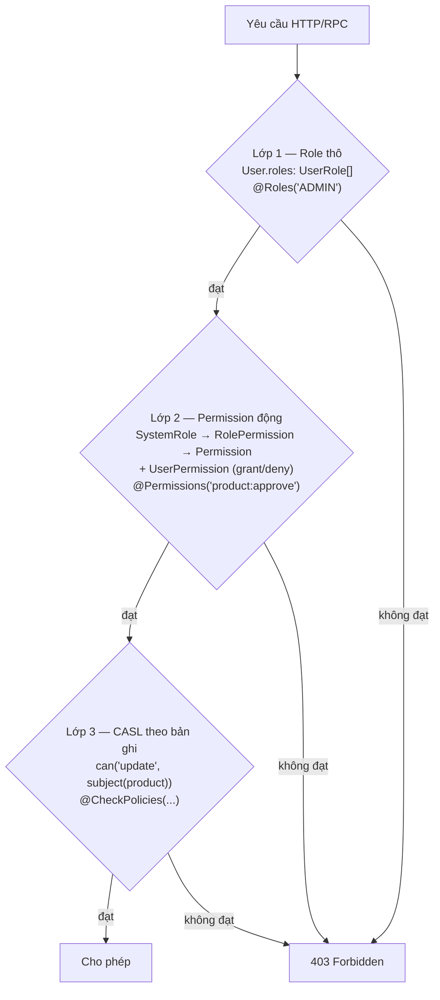
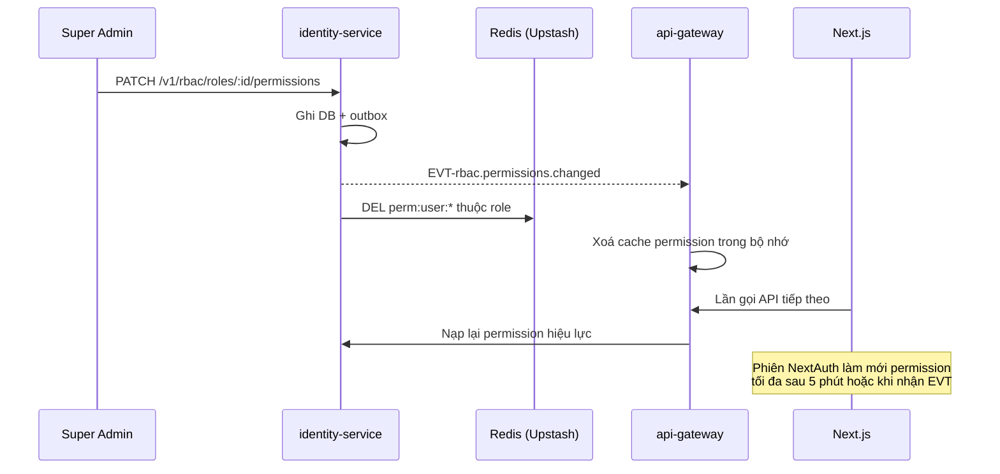

# Vai trò & Quyền

Tài liệu này chốt **mô hình phân quyền** và **danh mục permission chuẩn tắc**. Danh sách permission ở đây là nguồn để
sinh hằng số `PERMISSIONS` trong `@timmyhub/contracts` và để seed bảng `Permission`.

## 1. Mô hình ba lớp



| Lớp | Lưu ở đâu | Dùng khi | Đánh giá ở đâu |
|---|---|---|---|
| 1. Role thô | Cột `User.roles` (`UserRole[]`) | Phân luồng thô: khu vực admin/seller | `RolesGuard` (gateway + service) |
| 2. Permission động | Bảng `SystemRole`, `RolePermission`, `Permission`, `UserPermission` | Bật/tắt chức năng không cần deploy | `PermissionsGuard` |
| 3. CASL | Không lưu; suy ra từ dữ liệu bản ghi | "Chỉ sửa được sản phẩm của shop mình" | `PoliciesGuard` |

**Nguyên tắc:** ba lớp là **AND**, không phải OR. Vượt lớp 1 không bỏ qua lớp 2, và lớp 3 luôn là chốt chặn cuối cho
tài nguyên có chủ sở hữu.

> **Lỗi bản cũ phải tránh:** `CaslAbilityFactory.mapSubject` ở bản cũ rơi vào nhánh fallback nên subject của rule lấy từ
> DB không bao giờ khớp → toàn bộ rule cấp bản ghi trở thành vô hiệu, hệ thống chỉ còn chạy trên lớp 1.
> Bản mới bắt buộc đăng ký subject tường minh và có test cho từng subject. Xem
> [rbac-permission/design.md](../03-specs/rbac-permission/design.md).

## 2. Vai trò hệ thống

`enum UserRole { GUEST, USER, SELLER, SHIPPER, ADMIN, SUPER_ADMIN }`

| Role | Cách có được | Kế thừa quyền | Ghi chú |
|---|---|---|---|
| `GUEST` | Mặc định khi chưa đăng nhập | — | Không lưu trong DB, chỉ là trạng thái |
| `USER` | Tự động sau khi đăng ký | `GUEST` | Vai mặc định |
| `SELLER` | Admin duyệt đơn đăng ký bán hàng | `USER` | Một tài khoản vừa là `USER` vừa là `SELLER` |
| `SHIPPER` | Admin gán | `USER` | Chỉ cập nhật trạng thái đơn được gán |
| `ADMIN` | `SUPER_ADMIN` gán | `USER` | Vận hành sàn |
| `SUPER_ADMIN` | Seed hoặc `SUPER_ADMIN` khác gán | `ADMIN` | Toàn quyền, **bỏ qua kiểm tra permission** |

**`SUPER_ADMIN` bypass:** guard trả `true` ngay khi user có `SUPER_ADMIN`. Việc bypass này **vẫn ghi audit log** —
không được im lặng. Xem [FEAT-AUD-001](feature-inventory.md#21-audit-log--nhật-ký-kiểm-toán).

## 3. Quy ước đặt tên permission

```
<module>:<resource>:<action>
```

- `module` — nhóm nghiệp vụ, trùng tên domain spec: `catalog`, `orders`, `payment`, `content`, `rbac`…
- `resource` — danh từ số nhiều: `products`, `variants`, `campaigns`. Bỏ qua khi module chỉ có một tài nguyên.
- `action` — động từ chuẩn: `create`, `read`, `update`, `delete`, `list`, `approve`, `reject`, `export`, `process`,
  `assign`, `publish`, `moderate`, `refund`.

Phạm vi được biểu diễn bằng hậu tố khi cần phân biệt:

| Hậu tố | Ý nghĩa | Ví dụ |
|---|---|---|
| *(không có)* | Trong phạm vi sở hữu (CASL quyết định) | `catalog:products:update` |
| `:any` | Trên mọi bản ghi, không giới hạn chủ sở hữu | `catalog:products:update:any` |

❌ **BAD**

```ts
@Permissions('canApproveProduct')     // không theo cấu trúc, không nhóm được
@Permissions('product:approve')       // thiếu module, trùng với 'content:post:approve' về ngữ nghĩa
@Permissions('ADMIN')                 // trộn role vào permission
```

✅ **GOOD**

```ts
@Permissions(PERMISSIONS.CATALOG.PRODUCTS.APPROVE)   // 'catalog:products:approve'
@Roles(UserRole.ADMIN)                               // role đi ở decorator riêng
```

**Ràng buộc bắt buộc (FEAT-RBAC-011):** khi khởi động, mỗi service quét toàn bộ metadata `@Permissions` và đối chiếu
với hằng `PERMISSIONS` + bảng `Permission`. Thiếu một chuỗi nào → **service không khởi động**. Đây chính là cách chặn
lỗi bản cũ: endpoint `PATCH /products/:id/approve` yêu cầu `product:approve` nhưng quyền này **chưa bao giờ được seed**,
nên không tài khoản nào duyệt được sản phẩm qua API.

## 4. Danh mục permission

### 4.1 `identity`

| Permission | Mô tả | Mặc định cho |
|---|---|---|
| `identity:users:list` | Xem danh sách người dùng | ADMIN |
| `identity:users:read` | Xem chi tiết người dùng | ADMIN |
| `identity:users:create` | Tạo người dùng | ADMIN |
| `identity:users:update` | Cập nhật người dùng | ADMIN |
| `identity:users:delete` | Xoá người dùng | SUPER_ADMIN |
| `identity:users:lock` | Khoá / mở khoá tài khoản | ADMIN |
| `identity:users:assign-role` | Gán role cho người dùng | SUPER_ADMIN |
| `identity:devices:list:any` | Xem thiết bị của người dùng khác | ADMIN |
| `identity:devices:revoke:any` | Thu hồi phiên của người dùng khác | ADMIN |
| `identity:sessions:stats` | Xem thống kê phiên/token | ADMIN |

### 4.2 `rbac`

| Permission | Mô tả | Mặc định cho |
|---|---|---|
| `rbac:roles:list` · `rbac:roles:read` | Đọc role | ADMIN |
| `rbac:roles:create` · `rbac:roles:update` · `rbac:roles:delete` | Quản lý role | SUPER_ADMIN |
| `rbac:permissions:list` · `rbac:permissions:read` | Đọc permission | ADMIN |
| `rbac:permissions:create` · `rbac:permissions:update` · `rbac:permissions:delete` | Quản lý permission | SUPER_ADMIN |
| `rbac:role-permissions:assign` | Gán permission cho role | SUPER_ADMIN |
| `rbac:user-permissions:assign` | Gán / khước từ permission trực tiếp cho user | SUPER_ADMIN |

### 4.3 `seller`

| Permission | Mô tả | Mặc định cho |
|---|---|---|
| `seller:applications:list` · `:read` | Xem đơn đăng ký bán hàng | ADMIN |
| `seller:applications:approve` · `:reject` | Duyệt / từ chối đơn | ADMIN |
| `seller:shops:update` | Cập nhật shop của mình | SELLER |
| `seller:shops:update:any` | Cập nhật shop bất kỳ | ADMIN |
| `seller:shops:suspend` | Tạm ngưng shop | ADMIN |
| `seller:brands:create` · `:update` · `:delete` | Quản lý thương hiệu | SELLER |

### 4.4 `catalog`

| Permission | Mô tả | Mặc định cho |
|---|---|---|
| `catalog:categories:create` · `:update` · `:delete` | Quản lý danh mục | ADMIN |
| `catalog:products:create` | Tạo sản phẩm | SELLER |
| `catalog:products:update` · `:delete` | Sửa / xoá sản phẩm **của mình** (CASL) | SELLER |
| `catalog:products:update:any` · `:delete:any` | Sửa / xoá sản phẩm bất kỳ | ADMIN |
| `catalog:products:list:any` | Xem toàn bộ sản phẩm kể cả chưa duyệt | ADMIN |
| `catalog:products:approve` · `:reject` | Duyệt / từ chối sản phẩm | ADMIN |
| `catalog:products:import` · `:export` | Nhập / xuất hàng loạt | SELLER |
| `catalog:inventory:read` · `:adjust` | Xem / điều chỉnh tồn kho của mình | SELLER |
| `catalog:inventory:read:any` | Xem tồn kho toàn sàn | ADMIN |

### 4.5 `cart` · `orders`

| Permission | Mô tả | Mặc định cho |
|---|---|---|
| `cart:items:manage` | Thao tác giỏ hàng của mình | USER |
| `orders:create` | Đặt đơn | USER |
| `orders:read` | Xem đơn của mình | USER |
| `orders:list:any` · `orders:read:any` | Xem mọi đơn | ADMIN |
| `orders:list:shop` | Xem đơn thuộc shop của mình | SELLER |
| `orders:process` | Chuyển trạng thái đơn | ADMIN, SELLER |
| `orders:cancel` | Huỷ đơn của mình | USER |
| `orders:cancel:any` | Huỷ đơn bất kỳ | ADMIN |
| `orders:shipping:update` | Cập nhật trạng thái giao đơn được gán | SHIPPER |
| `orders:export` | Xuất danh sách đơn | SELLER, ADMIN |

### 4.6 `payment` · `wallet`

| Permission | Mô tả | Mặc định cho |
|---|---|---|
| `payment:transactions:list:any` | Xem mọi giao dịch | ADMIN |
| `payment:refund:create` | Tạo hoàn tiền | ADMIN |
| `payment:reconciliation:run` · `:read` | Chạy / xem đối soát | ADMIN |
| `wallet:balance:read` | Xem ví của mình | SELLER |
| `wallet:transactions:list` | Xem sổ giao dịch ví của mình | SELLER |
| `wallet:withdrawals:create` | Tạo yêu cầu rút tiền | SELLER |
| `wallet:withdrawals:approve` · `:reject` | Duyệt yêu cầu rút | ADMIN |
| `wallet:commission:configure` | Cấu hình tỉ lệ hoa hồng | SUPER_ADMIN |

### 4.7 `promotion`

| Permission | Mô tả | Mặc định cho |
|---|---|---|
| `promotion:vouchers:create` · `:update` · `:delete` | Voucher phạm vi shop | SELLER |
| `promotion:vouchers:create:any` … | Voucher toàn sàn | ADMIN |
| `promotion:vouchers:list:any` | Xem mọi voucher | ADMIN |
| `promotion:campaigns:create` · `:update` · `:delete` | Quản lý chiến dịch | ADMIN |
| `promotion:campaigns:enroll` | Đăng ký sản phẩm vào chiến dịch | SELLER |
| `promotion:campaigns:approve` | Duyệt sản phẩm tham gia | ADMIN |

### 4.8 `content` · `ads`

| Permission | Mô tả | Mặc định cho |
|---|---|---|
| `content:posts:create` · `:update` · `:delete` | Bài đăng của mình | SELLER |
| `content:posts:moderate` | Duyệt / từ chối / gỡ bài | ADMIN |
| `content:comments:delete:any` | Xoá bình luận bất kỳ | ADMIN |
| `content:reports:list` · `:resolve` | Xử lý báo cáo vi phạm | ADMIN |
| `ads:campaigns:create` · `:update` · `:pause` | Chiến dịch quảng cáo của mình | SELLER |
| `ads:campaigns:approve` · `:reject` | Duyệt quảng cáo | ADMIN |
| `ads:campaigns:list:any` | Xem mọi chiến dịch quảng cáo | ADMIN |

### 4.9 `engagement` · `chat` · `notification`

| Permission | Mô tả | Mặc định cho |
|---|---|---|
| `engagement:reviews:create` | Viết đánh giá | USER |
| `engagement:reviews:reply` | Phản hồi đánh giá trên shop của mình | SELLER |
| `engagement:reviews:moderate` | Ẩn / khôi phục đánh giá | ADMIN |
| `chat:conversations:read:any` | Xem hội thoại bất kỳ (xử lý tranh chấp) | ADMIN |
| `chat:tickets:assign` · `:resolve` | Xử lý ticket | ADMIN |
| `notification:broadcast:send` | Gửi thông báo hàng loạt | ADMIN |
| `notification:templates:manage` | Quản lý template | ADMIN |

### 4.10 `search` · `media` · `analytics` · `audit` · `masterdata`

| Permission | Mô tả | Mặc định cho |
|---|---|---|
| `search:index:reindex` | Chạy reindex | ADMIN |
| `media:files:upload` | Tải tệp lên | USER |
| `media:files:delete:any` | Xoá tệp bất kỳ | ADMIN |
| `analytics:shop:read` | Xem báo cáo shop của mình | SELLER |
| `analytics:platform:read` | Xem báo cáo toàn sàn | ADMIN |
| `analytics:reports:export` | Xuất báo cáo | SELLER, ADMIN |
| `audit:logs:list` · `:read` | Tra cứu audit log | ADMIN |
| `audit:logs:export` | Xuất audit log | SUPER_ADMIN |
| `masterdata:config:read` · `:update` | Cấu hình hệ thống | SUPER_ADMIN |
| `masterdata:feature-flags:update` | Bật/tắt feature flag | SUPER_ADMIN |
| `masterdata:shipping-rates:update` | Cập nhật bảng phí vận chuyển | ADMIN |

## 5. Ma trận vai trò × nhóm chức năng

`✓` = có quyền đầy đủ · `◐` = chỉ trong phạm vi sở hữu · `—` = không có quyền

| Nhóm chức năng | GUEST | USER | SELLER | SHIPPER | ADMIN | SUPER_ADMIN |
|---|---|---|---|---|---|---|
| Xem sản phẩm, nội dung công khai | ✓ | ✓ | ✓ | ✓ | ✓ | ✓ |
| Giỏ hàng, đặt đơn, thanh toán | — | ✓ | ✓ | ✓ | ✓ | ✓ |
| Đánh giá, wishlist, chat | — | ✓ | ✓ | ✓ | ✓ | ✓ |
| Quản lý sản phẩm & tồn kho | — | — | ◐ | — | ✓ | ✓ |
| Xử lý đơn hàng | — | ◐ | ◐ | ◐ | ✓ | ✓ |
| Cập nhật trạng thái giao hàng | — | — | — | ◐ | ✓ | ✓ |
| Đăng post / video / quảng cáo | — | — | ◐ | — | ✓ | ✓ |
| Ví & rút tiền | — | — | ◐ | — | ✓ | ✓ |
| Báo cáo doanh số | — | — | ◐ | — | ✓ | ✓ |
| Duyệt seller / sản phẩm / nội dung | — | — | — | — | ✓ | ✓ |
| Voucher & chiến dịch toàn sàn | — | — | ◐ | — | ✓ | ✓ |
| Đối soát & hoàn tiền | — | — | — | — | ✓ | ✓ |
| Tra cứu audit log | — | — | — | — | ✓ | ✓ |
| Quản lý role & permission | — | — | — | — | — | ✓ |
| Cấu hình hệ thống & feature flag | — | — | — | — | — | ✓ |

## 6. Điều kiện CASL theo bản ghi

| Subject | Điều kiện cho `SELLER` | Điều kiện cho `USER` |
|---|---|---|
| `Product` | `product.sellerId === user.sellerProfileId` | — |
| `ProductVariant` | qua `product.sellerId` | — |
| `Order` | `order.items.some(i => i.sellerId === user.sellerProfileId)` | `order.userId === user.id` |
| `Post` | `post.authorId === user.id` | — |
| `AdCampaign` | `campaign.sellerId === user.sellerProfileId` | — |
| `Review` | phản hồi khi `review.product.sellerId === user.sellerProfileId` | `review.userId === user.id` |
| `Address` | — | `address.userId === user.id` |
| `Wallet` | `wallet.ownerId === user.sellerProfileId` | — |
| `Conversation` | là một bên tham gia | là một bên tham gia |

Subject **phải** được đăng ký tường minh trong `CaslAbilityFactory`; không dùng nhánh fallback. Mỗi subject có ít nhất
một test khẳng định (cho phép) và một test phủ định (từ chối).

## 7. Phát tán thay đổi quyền



| Ràng buộc | Giá trị |
|---|---|
| TTL cache permission (Redis) | 15 phút |
| Thời gian phát tán tối đa khi đổi quyền | ≤ 5 phút |
| Thu hồi tức thì (khoá tài khoản, gỡ role) | Ngay lập tức — vô hiệu refresh token và xoá cache |

## 8. Seed mặc định

Seed tạo: 6 bản ghi `SystemRole` trùng tên với `UserRole`, toàn bộ permission ở §4, và các liên kết `RolePermission`
theo cột "Mặc định cho". Seed phải **idempotent** (`upsert` theo `code`) để chạy lại nhiều lần không hỏng dữ liệu.

Tài khoản `SUPER_ADMIN` đầu tiên lấy từ biến môi trường `BOOTSTRAP_SUPER_ADMIN_EMAIL` và
`BOOTSTRAP_SUPER_ADMIN_PASSWORD`; nếu thiếu ở môi trường `production` thì seed dừng với lỗi rõ ràng, **không** dùng
mật khẩu mặc định.
