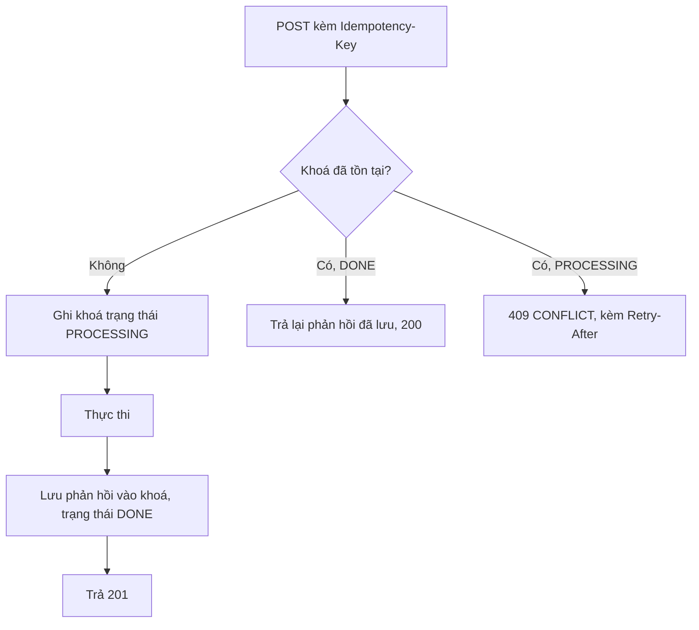

# Quy ước API

Áp dụng cho **mọi** endpoint HTTP do module `platform` của `backend/apps/api` phơi ra
([ADR-0015](adr/ADR-0015-modular-monolith.md) — trước đây là `api-gateway`, một service riêng). Frontend chỉ được
gọi các endpoint tuân thủ tài liệu này.

## 1. URL và phiên bản

```
https://api.timmyhub.vn/v1/<phạm vi>/<tài nguyên>[/<id>[/<tài nguyên con>]]
```

| Phạm vi | Tiền tố | Ai gọi |
|---|---|---|
| Công khai & người mua | `/v1/...` | Guest, User |
| Người bán | `/v1/seller/...` | Seller |
| Quản trị | `/v1/admin/...` | Admin, Super Admin |

| Quy tắc | ❌ BAD | ✅ GOOD |
|---|---|---|
| Danh từ số nhiều | `/v1/product/123` | `/v1/products/123` |
| Không động từ | `/v1/getOrders`, `/v1/orders/create` | `GET /v1/orders`, `POST /v1/orders` |
| Hành động là tài nguyên con | `POST /v1/products/approve/:id` | `POST /v1/products/:id/approval` |
| Phạm vi ở tiền tố, không ở query | `/v1/products?scope=mine` | `/v1/seller/products` |
| kebab-case | `/v1/promotionCampaigns` | `/v1/promotion-campaigns` |
| Phiên bản bắt buộc | `/products` | `/v1/products` |

Phiên bản chỉ tăng khi có thay đổi phá vỡ. `/v1` và `/v2` chạy song song tối thiểu **2 chu kỳ phát hành**;
`/v1` trả header `Deprecation` và `Sunset` trong giai đoạn đó.

## 2. Phương thức

| Phương thức | Ngữ nghĩa | Idempotent | Body |
|---|---|---|---|
| `GET` | Đọc | Có | Không |
| `POST` | Tạo, hoặc hành động không idempotent | Không | Có |
| `PATCH` | Cập nhật một phần | Không bắt buộc | Có |
| `PUT` | Thay thế toàn bộ | Có | Có |
| `DELETE` | Xoá (mềm) | Có | Không |

Dự án **ưu tiên `PATCH`**; `PUT` chỉ dùng khi thật sự thay thế toàn bộ tài nguyên.

## 3. Hình dạng phản hồi

Mọi phản hồi dùng đúng một trong hai hình dạng dưới. Không có ngoại lệ.

### 3.1 Thành công

```ts
export const apiResponseSchema = <T extends z.ZodTypeAny>(data: T) =>
    z.object({
        success: z.literal(true),
        data,
        meta: z.object({
            requestId: z.string(),
            timestamp: z.string().datetime(),
        }),
    })
```

```json
{
    "success": true,
    "data": { "id": "ckx1", "name": "Áo thun nam" },
    "meta": { "requestId": "req_01H…", "timestamp": "2026-09-15T08:30:00.000Z" }
}
```

> **Khác bản cũ:** `ApiResponse<T>` ở `timmyhub-shared` cũ **không có trường `success`**, buộc client phải đoán
> thành/bại qua mã HTTP và hình dạng dữ liệu. Bản mới bắt buộc có.

### 3.2 Phân trang

```json
{
    "success": true,
    "data": [ /* … */ ],
    "pagination": {
        "page": 1,
        "pageSize": 20,
        "totalItems": 137,
        "totalPages": 7,
        "hasNext": true,
        "hasPrev": false
    },
    "meta": { "requestId": "req_01H…", "timestamp": "2026-09-15T08:30:00.000Z" }
}
```

Danh sách rất dài hoặc cuộn vô hạn (feed, chat, thông báo) dùng con trỏ thay vì số trang:

```json
{
    "success": true,
    "data": [ /* … */ ],
    "pagination": { "nextCursor": "eyJpZCI6ImNreDEifQ==", "hasNext": true },
    "meta": { "requestId": "req_01H…", "timestamp": "2026-09-15T08:30:00.000Z" }
}
```

| Tham số | Kiểu | Mặc định | Tối đa |
|---|---|---|---|
| `page` | int ≥ 1 | 1 | — |
| `pageSize` | int ≥ 1 | 20 | 100 |
| `cursor` | string (base64) | — | — |
| `limit` | int ≥ 1 | 20 | 100 |

### 3.3 Lỗi

```json
{
    "success": false,
    "error": {
        "code": "INSUFFICIENT_STOCK",
        "message": "Sản phẩm không đủ số lượng trong kho",
        "details": [
            { "field": "items[0].quantity", "requested": 5, "available": 2 }
        ]
    },
    "meta": { "requestId": "req_01H…", "timestamp": "2026-09-15T08:30:00.000Z" }
}
```

| Trường | Bắt buộc | Mục đích |
|---|---|---|
| `error.code` | Có | `SCREAMING_SNAKE_CASE`, ổn định, client **phân nhánh theo trường này** |
| `error.message` | Có | Tiếng Việt, hiển thị được cho người dùng cuối |
| `error.details` | Không | Dữ liệu có cấu trúc để client xử lý |
| `meta.requestId` | Có | Đối chiếu với log và audit khi hỗ trợ |

❌ **BAD** — client phân nhánh theo chuỗi thông báo:

```ts
if (err.response.data.message === 'Không đủ hàng') { /* … */ }  // đổi chữ là hỏng
```

✅ **GOOD**

```ts
if (err.code === API_ERROR.INSUFFICIENT_STOCK) { /* … */ }
```

## 4. Mã trạng thái HTTP

| Mã | Dùng khi | Không dùng khi |
|---|---|---|
| `200` | Đọc / cập nhật thành công | Tạo mới |
| `201` | Tạo thành công (có header `Location`) | |
| `202` | Đã nhận, xử lý bất đồng bộ (xuất báo cáo, reindex) | |
| `204` | Xoá thành công, không có body | Có body |
| `400` | Yêu cầu sai cú pháp, validate thất bại | Lỗi nghiệp vụ hợp lệ về cú pháp |
| `401` | Chưa xác thực hoặc token hết hạn | Đã đăng nhập nhưng thiếu quyền |
| `403` | Đã xác thực nhưng không đủ quyền | Chưa đăng nhập |
| `404` | Không tìm thấy, **hoặc** có nhưng người gọi không được phép biết là nó tồn tại | |
| `409` | Xung đột trạng thái (đơn đã huỷ, slug trùng) | |
| `410` | Tài nguyên đã bị xoá vĩnh viễn | |
| `422` | Cú pháp đúng nhưng vi phạm quy tắc nghiệp vụ | Lỗi validate kiểu dữ liệu (dùng `400`) |
| `429` | Vượt giới hạn tần suất (kèm `Retry-After`) | |
| `500` | Lỗi không lường trước | Lỗi đã biết và xử lý được |
| `503` | Service phụ thuộc không sẵn sàng / circuit breaker mở | |

Phân biệt `400` và `422`: `400` = "tôi không hiểu bạn nói gì" (thiếu trường, sai kiểu);
`422` = "tôi hiểu nhưng không làm được" (voucher hết hạn, đơn không ở trạng thái cho phép huỷ).

## 5. Danh mục mã lỗi

Định nghĩa trong `@timmyhub/contracts/src/errors.ts`, dùng chung FE/BE.

| Mã | HTTP | Ý nghĩa |
|---|---|---|
| **Chung** | | |
| `VALIDATION_FAILED` | 400 | Dữ liệu vào không hợp lệ |
| `UNAUTHENTICATED` | 401 | Thiếu / sai token |
| `TOKEN_EXPIRED` | 401 | Access token hết hạn (client nên refresh) |
| `FORBIDDEN` | 403 | Không đủ quyền |
| `NOT_FOUND` | 404 | Không tồn tại |
| `CONFLICT` | 409 | Xung đột trạng thái |
| `RATE_LIMITED` | 429 | Vượt giới hạn |
| `INTERNAL_ERROR` | 500 | Lỗi hệ thống |
| `SERVICE_UNAVAILABLE` | 503 | Service phụ thuộc hỏng |
| **identity** | | |
| `EMAIL_ALREADY_EXISTS` | 409 | Email đã đăng ký |
| `INVALID_CREDENTIALS` | 401 | Sai email hoặc mật khẩu |
| `ACCOUNT_LOCKED` | 403 | Tài khoản bị khoá |
| `EMAIL_NOT_VERIFIED` | 403 | Chưa xác minh email |
| `REFRESH_TOKEN_REUSED` | 401 | Phát hiện tái sử dụng token → thu hồi toàn bộ phiên |
| **catalog / inventory** | | |
| `PRODUCT_NOT_AVAILABLE` | 422 | Sản phẩm chưa duyệt / đã ngừng bán |
| `INSUFFICIENT_STOCK` | 422 | Không đủ tồn khả dụng |
| `RESERVATION_EXPIRED` | 409 | Giữ tồn đã hết hạn |
| `SKU_ALREADY_EXISTS` | 409 | SKU trùng trong shop |
| **cart / order** | | |
| `CART_EMPTY` | 422 | Giỏ trống |
| `CART_ITEM_CHANGED` | 409 | Giá hoặc trạng thái sản phẩm đã đổi so với lúc xem giỏ |
| `INVALID_ORDER_TRANSITION` | 422 | Chuyển trạng thái không hợp lệ |
| `ORDER_NOT_CANCELLABLE` | 422 | Đơn đã qua giai đoạn cho phép huỷ |
| `ADDRESS_REQUIRED` | 422 | Chưa có địa chỉ giao hàng |
| **payment / wallet** | | |
| `PAYMENT_ALREADY_PROCESSED` | 409 | Giao dịch đã xử lý (IPN lặp) |
| `INVALID_SIGNATURE` | 400 | Chữ ký VNPay sai |
| `PAYMENT_EXPIRED` | 422 | Quá hạn thanh toán |
| `INSUFFICIENT_BALANCE` | 422 | Số dư ví không đủ |
| `WITHDRAWAL_LIMIT_EXCEEDED` | 422 | Vượt hạn mức rút |
| **promotion** | | |
| `VOUCHER_NOT_APPLICABLE` | 422 | Không thoả điều kiện |
| `VOUCHER_EXPIRED` | 422 | Hết hạn |
| `VOUCHER_USAGE_LIMIT_REACHED` | 422 | Hết lượt |
| `CAMPAIGN_NOT_ACTIVE` | 422 | Chiến dịch chưa/đã kết thúc |
| **content / ads** | | |
| `CONTENT_UNDER_REVIEW` | 422 | Nội dung đang chờ duyệt |
| `AD_BUDGET_EXHAUSTED` | 422 | Hết ngân sách quảng cáo |
| **engagement** | | |
| `REVIEW_NOT_ALLOWED` | 403 | Chưa mua hoặc đã đánh giá |
| **media** | | |
| `FILE_TOO_LARGE` | 400 | Vượt giới hạn dung lượng |
| `UNSUPPORTED_FILE_TYPE` | 400 | Định dạng không hỗ trợ |

## 6. Truy vấn danh sách

```
GET /v1/products?page=1&pageSize=20&sort=-createdAt&q=áo+thun
    &filter[categoryId]=ckx1&filter[minPrice]=100000&filter[maxPrice]=500000
```

| Tham số | Cú pháp | Ví dụ |
|---|---|---|
| Tìm kiếm | `q` | `q=áo thun` |
| Sắp xếp | `sort`, `-` là giảm dần, nhiều trường cách nhau bằng dấu phẩy | `sort=-createdAt,name` |
| Lọc | `filter[<trường>]` | `filter[status]=ACTIVE` |
| Lọc nhiều giá trị | lặp lại tham số | `filter[status]=ACTIVE&filter[status]=DRAFT` |
| Khoảng | hậu tố `Min` / `Max` | `filter[priceMin]=100000` |
| Chọn trường | `fields` | `fields=id,name,price` |
| Nhúng quan hệ | `include` (danh sách trắng cố định) | `include=variants,seller` |

`include` **chỉ chấp nhận giá trị trong danh sách trắng** khai báo sẵn cho từng endpoint — không cho phép client tự do
nhúng quan hệ tuỳ ý (tránh truy vấn nặng và rò rỉ dữ liệu).

## 7. Header

### Yêu cầu

| Header | Bắt buộc | Ghi chú |
|---|---|---|
| `Authorization: Bearer <accessToken>` | Khi cần xác thực | Hoặc cookie HttpOnly với yêu cầu từ trình duyệt |
| `Content-Type: application/json` | Khi có body | Upload dùng signed URL, không multipart qua gateway |
| `Accept-Language: vi \| en` | Không | Quyết định ngôn ngữ `error.message` |
| `X-Request-Id` | Không | Client sinh được; nếu thiếu, gateway tự sinh |
| `Idempotency-Key` | **Có** với `POST` thay đổi tiền/tồn | UUID v4, hiệu lực 24 giờ |

### Phản hồi

| Header | Khi nào |
|---|---|
| `X-Request-Id` | Luôn luôn |
| `X-RateLimit-Limit`, `X-RateLimit-Remaining`, `X-RateLimit-Reset` | Mọi endpoint có giới hạn |
| `Retry-After` | `429`, `503` |
| `Location` | `201` |
| `Deprecation`, `Sunset` | Endpoint sắp gỡ bỏ |
| `ETag`, `Cache-Control` | Endpoint đọc có cache |

## 8. Idempotency cho thao tác ghi

Bắt buộc với: `POST /v1/orders/from-cart`, `POST /v1/payments/*`, `POST /v1/wallet/withdrawals`,
`POST /v1/ads/campaigns/:id/budget`.



Khoá lưu ở Redis, TTL 24 giờ. Cùng `Idempotency-Key` nhưng **body khác** → `422 VALIDATION_FAILED`.

## 9. Validation

Một nguồn duy nhất: **zod** qua `nestjs-zod` ([ADR-0010](adr/ADR-0010-zod-single-validation-source.md)).

```ts
// @timmyhub/contracts
export const createProductSchema = z.object({
    name: z.string().min(3).max(200),
    categoryId: z.string().cuid(),
    description: z.string().max(5000).optional(),
    variants: z.array(z.object({
        sku: z.string().min(1).max(50),
        price: z.string().regex(/^\d+(\.\d{1,2})?$/),
        stock: z.number().int().nonnegative(),
    })).min(1).max(100),
})
export type CreateProductInput = z.infer<typeof createProductSchema>
```

```ts
// backend/apps/api/src/modules/catalog
export class CreateProductDto extends createZodDto(createProductSchema) {}

@Post()
create(@Body() dto: CreateProductDto) { /* … */ }
```

| Tầng | Trách nhiệm |
|---|---|
| Frontend | `zodResolver` trong react-hook-form — phản hồi tức thì cho người dùng |
| Module `platform` (biên HTTP) | `ZodValidationPipe` toàn cục — chặn dữ liệu bẩn ở biên |
| Service của module nghiệp vụ | Parse lại input khi được gọi trực tiếp bởi module khác trong process — **không tin caller** dù cùng process, vì input có thể đến từ nhiều điểm gọi khác nhau theo thời gian |

Lỗi validate được ánh xạ sang `VALIDATION_FAILED` với `details` là mảng `{ field, message, code }`.

> **Lỗi bản cũ phải tránh:** bản cũ khai báo DTO bằng `class-validator` nhưng chỉ đăng ký `ZodValidationPipe` toàn cục,
> nên các decorator `@IsString()`, `@IsEmail()`… **không bao giờ chạy**. Bản mới cấm hoàn toàn `class-validator`;
> ESLint chặn import.

## 10. Swagger

Một app, một tài liệu OpenAPI — `backend/apps/api` sinh trực tiếp từ decorator của mọi module, không cần bước tổng
hợp từ nhiều service như trước [ADR-0015](adr/ADR-0015-modular-monolith.md).

| Môi trường | Đường dẫn | Bảo vệ |
|---|---|---|
| dev | `http://localhost:3001/docs` | Mở |
| staging | `https://api-staging.timmyhub.vn/docs` | HTTP Basic |
| production | **Không phơi ra công khai** | Chỉ truy cập nội bộ |

Yêu cầu tối thiểu với mỗi endpoint:

- [ ] `@ApiTags` theo domain
- [ ] `@ApiOperation({ summary })` bằng tiếng Việt
- [ ] Schema request/response sinh từ zod (`patchNestJsSwagger()`)
- [ ] Liệt kê mọi mã lỗi có thể trả về
- [ ] Ít nhất một ví dụ thực tế
- [ ] Ghi rõ quyền cần có (`@ApiSecurity` + mô tả permission)

## 11. Tương thích ngược

| Thay đổi | Phá vỡ? |
|---|---|
| Thêm trường tuỳ chọn vào **response** | Không |
| Thêm trường tuỳ chọn vào **request** | Không |
| Thêm trường **bắt buộc** vào request | **Có** |
| Xoá / đổi tên trường response | **Có** |
| Đổi kiểu dữ liệu | **Có** |
| Thêm giá trị enum | **Có nếu client dùng `switch` vét cạn** — luôn thông báo trước |
| Thắt chặt validate | **Có** |
| Nới lỏng validate | Không |
| Đổi mã HTTP hoặc `error.code` | **Có** |

Client **phải** bỏ qua trường lạ trong response — không dùng `z.object().strict()` cho dữ liệu nhận từ API.

## 12. Giới hạn tần suất

| Nhóm endpoint | Giới hạn | Cửa sổ | Khoá theo |
|---|---|---|---|
| `POST /v1/auth/login` | 5 | 15 phút | IP + email |
| `POST /v1/auth/register` | 3 | 1 giờ | IP |
| `POST /v1/auth/forgot-password` | 3 | 1 giờ | IP + email |
| Đọc công khai | 300 | 1 phút | IP |
| Đọc có xác thực | 600 | 1 phút | userId |
| Ghi có xác thực | 120 | 1 phút | userId |
| `POST /v1/orders/from-cart` | 10 | 1 phút | userId |
| `POST /v1/media/upload-url` | 30 | 1 phút | userId |
| Tìm kiếm | 60 | 1 phút | IP hoặc userId |
| Webhook VNPay (IPN) | **Không giới hạn** | — | Xác thực bằng chữ ký + danh sách IP |

Vượt giới hạn → `429 RATE_LIMITED` kèm `Retry-After`. Bộ đếm ở Upstash Redis, thuật toán cửa sổ trượt.

## 13. Webhook nhận từ bên ngoài

Hiện chỉ có VNPay IPN: `POST /v1/payments/vnpay/ipn`.

| Yêu cầu | Chi tiết |
|---|---|
| Xác thực | `vnp_SecureHash` (HMAC-SHA512) — sai thì `400 INVALID_SIGNATURE`, **không** tiết lộ lý do chi tiết |
| Danh sách IP | Chỉ chấp nhận dải IP VNPay công bố |
| Idempotent | Khử trùng lặp theo `vnp_TxnRef`; gọi lại trả cùng kết quả |
| Phản hồi | Theo đúng định dạng VNPay yêu cầu (`RspCode`, `Message`), **không** dùng hình dạng ở §3 |
| Thời gian | Phản hồi trong ≤ 5 giây; xử lý nặng đẩy sang job |
| Ghi log | Lưu nguyên văn payload vào `SystemLog` trước khi xử lý |

## 14. Checklist thêm endpoint mới

- [ ] URL theo §1, phương thức theo §2
- [ ] Schema zod trong `@timmyhub/contracts`, xuất cả type
- [ ] Response đúng hình dạng §3
- [ ] Mã lỗi đã có trong §5, hoặc bổ sung vào đó
- [ ] Guard đầy đủ: `@Roles` và/hoặc `@Permissions`, `@CheckPolicies` cho tài nguyên có chủ sở hữu
- [ ] Permission đã có trong [roles-and-permissions.md](../00-overview/roles-and-permissions.md) và trong seed
- [ ] Đã khai báo giới hạn tần suất nếu là ghi hoặc tốn tài nguyên
- [ ] `Idempotency-Key` nếu thay đổi tiền hoặc tồn kho
- [ ] Swagger đầy đủ theo §10
- [ ] Ghi audit log nếu là thao tác ghi
- [ ] Có test tích hợp cho: thành công, thiếu quyền, dữ liệu sai, xung đột trạng thái
