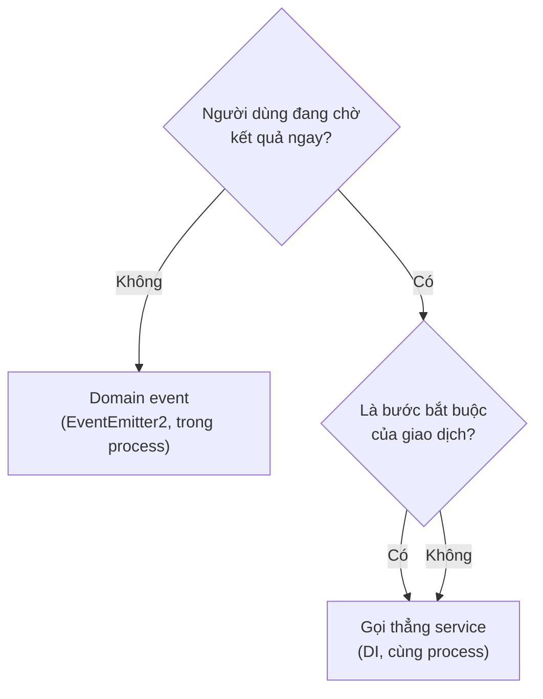
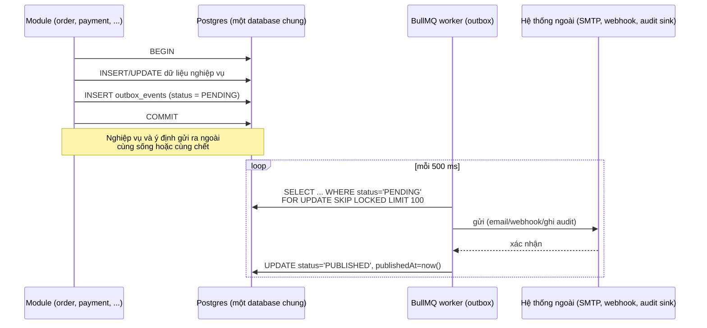
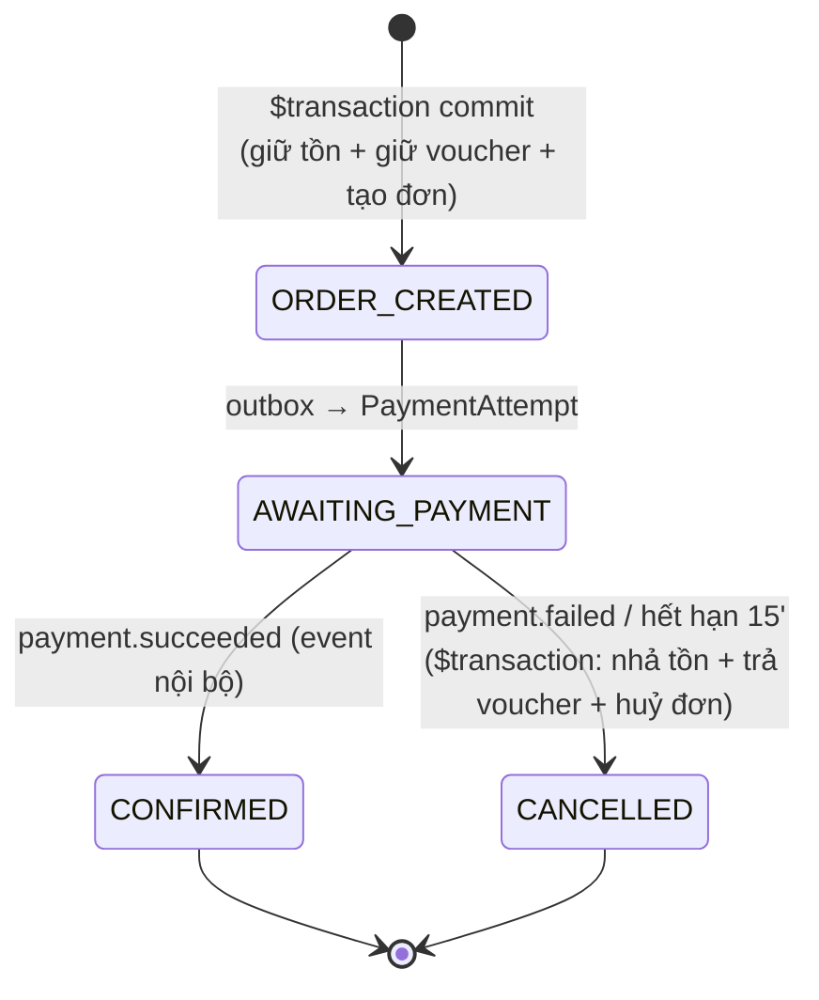
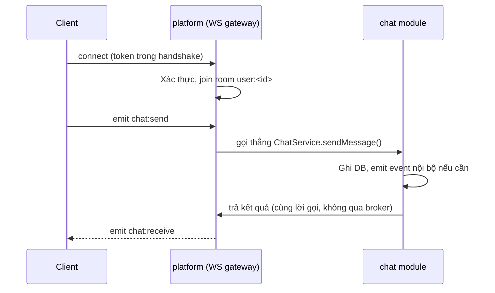

# Mẫu giao tiếp giữa các module

> Trước ngày 2026-09-19, tài liệu này mô tả giao tiếp qua RabbitMQ giữa các service độc lập. Theo
> [ADR-0015](adr/ADR-0015-modular-monolith.md), toàn bộ module chạy trong **một process**: RPC trở thành gọi hàm
> trực tiếp qua DI, event trở thành `EventEmitter2` trong process, saga checkout trở thành một `$transaction` Prisma
> thật. RabbitMQ không còn trong tech stack bắt buộc. Outbox pattern vẫn giữ nhưng thu hẹp phạm vi — xem §3.

## 1. Chọn cách giao tiếp



Không còn nhánh "đọc read model vì dữ liệu ở service khác" hay "RPC vì cần đồng bộ" — mọi module đều đọc được dữ liệu
mới nhất của module khác qua service export, cùng một request, không có độ trễ mạng. Chỉ còn một câu hỏi thật sự cần
trả lời: **việc này là một bước phải hoàn thành ngay trong luồng hiện tại (gọi hàm), hay là một phản ứng phụ mà module
khác có thể xử lý sau, độc lập với luồng hiện tại (event)?**

| Mẫu | Dùng khi | Ví dụ | Không dùng khi |
|---|---|---|---|
| **Gọi thẳng service (DI)** | Cần kết quả ngay, là bước bắt buộc của luồng hiện tại | `InventoryService.reserve()` trong checkout | Chỉ để thông báo cho module khác biết việc đã xảy ra |
| **Domain event (`EventEmitter2`)** | Việc đã xảy ra, module khác phản ứng độc lập, không chặn luồng hiện tại | `order.completed` → `payment` ghi có ví, `engagement` mở quyền đánh giá | Cần kết quả xử lý ngay để quyết định bước tiếp theo |
| **Outbox + BullMQ worker** | Hệ quả **phải** xảy ra dù process crash ngay sau đó, và không thể đồng bộ trong transaction hiện tại (gửi ra ngoài hệ thống) | Gửi email xác nhận, đẩy webhook, ghi audit log | Phản ứng chỉ cần trong process — dùng event emitter, không cần outbox |
| **Job (BullMQ)** | Việc nặng CPU/IO, chạy nền, không chặn request | Chuyển mã video, tổng hợp báo cáo | Cần trả kết quả trong cùng request |

❌ **BAD** — inject Prisma/repository của module khác:

```ts
// order/order.service.ts
constructor(private readonly prisma: PrismaService) {}

async createFromCart(cartId: string) {
    // Truy cập thẳng bảng của module catalog — phá ranh giới module
    const variant = await this.prisma.productVariant.findUnique({ where: { id: variantId } })
}
```

Vấn đề: xói mòn ranh giới module ngay cả khi cùng database — làm mất khả năng tách module này ra service riêng sau
này mà không phải viết lại toàn bộ logic đọc dữ liệu.

✅ **GOOD** — gọi qua service đã export:

```ts
// order/order.service.ts
constructor(private readonly catalogService: CatalogService) {}

async createFromCart(cartId: string) {
    const variant = await this.catalogService.getVariantSnapshot(variantId)
}
```

```ts
// catalog/catalog.module.ts
@Module({
    providers: [CatalogService, InventoryService],
    exports: [CatalogService, InventoryService],   // chỉ những gì cố ý export mới gọi được từ module khác
})
export class CatalogModule {}
```

Ranh giới này được ép bằng ESLint boundary rule (chặn import trực tiếp `catalog/catalog.repository.ts` hoặc Prisma
model của module khác từ ngoài module `catalog`), không phải bằng network policy như bản microservice cũ.

## 2. Giao dịch xuyên module

Vì tất cả module dùng chung một database, giao dịch xuyên domain (ví dụ checkout chạm `cart`, `catalog`, `order`,
`promotion`) dùng **một `$transaction` Prisma thật** thay vì saga + compensating action:

```ts
// order/order.service.ts
async createFromCart(userId: string, dto: CreateOrderFromCartDto) {
    return this.prisma.$transaction(async (tx) => {
        const cart = await this.cartService.validate(userId, tx)
        await this.inventoryService.reserve(cart.items, tx)
        const voucher = dto.voucherCode
            ? await this.promotionService.reserveVoucher(dto.voucherCode, userId, tx)
            : null
        const order = await this.orderRepository.create(cart, voucher, tx)
        await this.outboxService.enqueue('order.created', order, tx)   // §3 — chỉ cho hệ quả bất đồng bộ ra ngoài
        return order
    })
}
```

Mỗi service export nhận tham số `tx` tuỳ chọn (Prisma `TransactionClient`) để tham gia transaction của caller thay vì
tự mở transaction riêng — đây là điểm khác biệt kỹ thuật chính so với gọi RPC giữa các service độc lập trước đây.

Chỉ bước phụ thuộc hệ thống **bên ngoài** (chờ VNPay xác nhận thanh toán) vẫn phải bất đồng bộ, vì không thể đưa một
lệnh gọi HTTP ra ngoài vào trong `$transaction` — xem §4.

❌ **BAD** — coi mọi thứ vẫn cần saga dù đã cùng database:

```ts
async createFromCart(userId: string, dto: CreateOrderFromCartDto) {
    await this.inventoryService.reserve(cart.items)
    try {
        await this.promotionService.reserveVoucher(dto.voucherCode, userId)
    } catch {
        await this.inventoryService.release(cart.items)   // compensating action thủ công — không cần thiết nữa
        throw new BadRequestException()
    }
}
```

Vấn đề: viết lại logic bù trừ bằng tay trong khi Postgres đã có thể rollback toàn bộ transaction miễn phí.

## 3. Outbox — chỉ cho hệ quả bất đồng bộ ra ngoài process

Outbox **không còn dùng cho mọi domain event** như bản microservice cũ (listener giờ chạy trong cùng process, không
có rủi ro "publish rồi crash trước khi gửi" qua broker riêng). Outbox chỉ giữ lại cho đúng một nhóm trường hợp: hệ quả
phải chắc chắn xảy ra dù process crash ngay sau khi commit, và việc đó không thể làm trong transaction hiện tại vì đi
ra ngoài hệ thống — gửi email, đẩy webhook, ghi audit log bất biến.



```prisma
model OutboxEvent {
    id            String       @id @default(cuid())
    eventName     String                                 // 'order.created'
    aggregateType String                                 // 'Order'
    aggregateId   String
    payload       Json
    metadata      Json                                   // traceId, actorId, occurredAt
    status        OutboxStatus @default(PENDING)
    attempts      Int          @default(0)
    lastError     String?
    createdAt     DateTime     @default(now())
    publishedAt   DateTime?

    @@index([status, createdAt])
    @@map("outbox_events")
}

enum OutboxStatus {
    PENDING
    PUBLISHED
    FAILED
}
```

| Ràng buộc | Giá trị |
|---|---|
| Chu kỳ quét | 500 ms (job BullMQ lặp, không phải RabbitMQ relay) |
| Kích thước lô | 100 |
| Khoá | `FOR UPDATE SKIP LOCKED` (nhiều worker chạy song song an toàn) |
| Dọn bản ghi `PUBLISHED` | Sau 7 ngày |
| Cảnh báo | `PENDING` cũ hơn 60 giây, hoặc `FAILED` > 0 |

> **Hệ quả:** gửi ra ngoài **ít nhất một lần** (at-least-once). Handler phía `EXT` (hoặc chính worker trước khi gọi
> `EXT`) phải idempotent — xem §4, áp dụng nguyên lý tương tự dù không còn "consumer" theo nghĩa broker.

**Không dùng outbox cho:** domain event mà mọi listener đều nằm trong cùng process (`order.completed` →
`engagement` mở quyền đánh giá) — dùng `EventEmitter2` ở §5, đơn giản hơn và không có độ trễ 500ms của vòng quét.

## 4. Việc bất đồng bộ chờ hệ thống ngoài — checkout chờ thanh toán

Duy nhất bước "chờ VNPay xác nhận" trong checkout vẫn bất đồng bộ, vì phụ thuộc một hệ thống ngoài không thể đưa vào
transaction. Toàn bộ phần còn lại của checkout (giữ tồn, giữ voucher, tạo đơn) giờ nằm trong một `$transaction` (§2),
không còn là các bước saga riêng biệt với compensating action.



Không còn trạng thái `MANUAL_REVIEW` do "chốt tồn thất bại sau khi đã thu tiền" — vì tồn kho và voucher đã được giữ
**trong cùng transaction** lúc tạo đơn (bước xảy ra trước khi có thanh toán), không phải "chốt" ở một bước riêng sau
khi thanh toán thành công. Khi `payment.succeeded` đến, việc cần làm chỉ là cập nhật trạng thái đơn — không có bước
ghi dữ liệu nào có thể thất bại theo cách cần xem xét thủ công. Trường hợp cần chú ý duy nhất còn lại: IPN đến sau khi
đơn đã bị huỷ do hết hạn — xử lý bằng kiểm tra trạng thái hiện tại trước khi cập nhật (xem
[concurrency-and-consistency.md](concurrency-and-consistency.md)), không cần trạng thái tường minh riêng.

| Bước | Trong `$transaction` lúc tạo đơn? | Ghi chú |
|---|---|---|
| Kiểm giỏ hàng | Có | Chỉ đọc |
| Giữ tồn kho | Có | `UPDATE ... WHERE available >= qty` nguyên tử |
| Giữ voucher | Có | Cùng nguyên lý atomic update |
| Tạo `Order` | Có | Cùng transaction |
| Enqueue outbox `order.created` | Có (ghi trong transaction, gửi sau bởi worker) | Kích hoạt tạo `PaymentAttempt`, gửi thông báo |
| Chờ `payment.succeeded`/`failed` | Không — bất đồng bộ, phụ thuộc VNPay | Timeout 15 phút, xử lý ở §5 |
| Huỷ đơn khi hết hạn/thất bại | Có (transaction riêng lúc huỷ) | Nhả tồn + trả voucher + cập nhật trạng thái cùng lúc |

## 5. Event trong process (`EventEmitter2`)

```ts
// order/order.service.ts
async markCompleted(orderId: string) {
    const order = await this.prisma.order.update({ where: { id: orderId }, data: { status: 'COMPLETED' } })
    this.eventEmitter.emit('order.completed', new OrderCompletedEvent(order))
    return order
}
```

```ts
// engagement/engagement.listener.ts
@OnEvent('order.completed')
async handleOrderCompleted(event: OrderCompletedEvent) {
    await this.engagementService.unlockReviewEligibility(event.order)
}
```

✅ **GOOD** — listener tự chịu trách nhiệm lỗi của mình, không làm hỏng luồng phát event:

```ts
@OnEvent('order.completed', { async: true })
async handleOrderCompleted(event: OrderCompletedEvent) {
    try {
        await this.engagementService.unlockReviewEligibility(event.order)
    } catch (err) {
        this.logger.error('Xử lý order.completed thất bại', err)
        // Không throw lại — một listener lỗi không được làm rollback hay chặn listener khác
    }
}
```

❌ **BAD** — phát event rồi chờ kết quả xử lý của listener như thể là RPC:

```ts
this.eventEmitter.emit('order.completed', event)
const result = await someGlobalState.waitFor('review-unlocked')   // event không phải RPC, đừng giả lập request/response qua nó
```

**Quy ước đặt tên và payload event giữ nguyên** như bản cũ (`<domain>.<entity>.<hành động quá khứ>`, payload chỉ chứa
đủ dữ liệu consumer cần — không phình to toàn bộ entity) — xem danh mục đầy đủ ở [event-catalog.md](event-catalog.md).
Không còn khái niệm "version phát song song" hay "phong bì sự kiện" qua message broker (không cần `traceId` bơm qua
network vì cùng process đã có `AsyncLocalStorage`/request context); nếu một event cần lưu vết đầy đủ (audit), dùng
outbox ở §3, không dùng `EventEmitter2`.

## 6. BullMQ cho job nền

Không đổi vai trò so với bản cũ — vẫn là hàng đợi việc nặng CPU/IO chạy trên **worker process riêng** trong cùng
codebase (`backend/apps/api/src/worker`), tách khỏi web process để không chiếm CPU của request HTTP.

| Hàng đợi | Module | Việc | Đồng thời | Retry |
|---|---|---|---|---|
| `email` | notification | Gửi SMTP | 5 | 5 lần, backoff mũ |
| `push` | notification | Web push | 10 | 3 lần |
| `outbox-dispatch` | dùng chung (§3) | Gửi các bản ghi `outbox_events` PENDING | 10 | Theo `attempts` trên bản ghi |
| `media-thumbnail` | media | Sinh thumbnail | 3 | 3 lần |
| `media-transcode` | media | Chuyển mã video | 1 | 2 lần |
| `search-index` | search | Đồng bộ chỉ mục theo lô | 5 | 5 lần |
| `report-export` | analytics | Sinh CSV/Excel | 2 | 2 lần |
| `daily-rollup` | analytics | Tổng hợp ngày (cron 00:15) | 1 | 3 lần |
| `ad-billing` | content | Tổng hợp & trừ ngân sách (mỗi phút) | 1 | 3 lần |
| `inventory-expiry` | catalog | Hết hạn reservation (mỗi phút) | 1 | 5 lần |
| `token-cleanup` | identity | Dọn token hết hạn (cron hằng giờ) | 1 | 3 lần |

BullMQ cần **kết nối TCP** tới Redis (`UPSTASH_REDIS_TCP_URL`), không dùng được REST API. Cache và rate limit thì dùng
`@upstash/redis` qua REST. Xem [ADR-0004](adr/ADR-0004-upstash-redis.md).

## 7. WebSocket

Module `platform` (gateway cũ) giữ kết nối WebSocket. Vì mọi module đã ở cùng process, module `chat` gọi thẳng hàm
gửi socket thay vì publish qua Redis rồi chờ gateway nhận lại:



Redis pub/sub adapter **chỉ còn cần khi app scale ngang nhiều pod** (đồng bộ giữa các instance của cùng một app), không
còn lý do "đồng bộ giữa các service khác nhau" như bản cũ. Chi tiết namespace, tên room, danh mục event realtime:
[realtime.md](realtime.md).

## 8. Chống mẫu cần tránh

| Chống mẫu | Vì sao sai | Thay bằng |
|---|---|---|
| Module A import thẳng Prisma model/repository của module B | Phá ranh giới module dù cùng database, khó tách sau này | Gọi qua service đã export (§1) |
| Chuỗi gọi hàm xuyên 4-5 module trong một request | Vẫn có chi phí (dù không phải chi phí mạng): khó test, khó theo dõi lỗi | Cân nhắc gộp logic hoặc dùng event nếu không cần đồng bộ |
| Event mang tên mệnh lệnh (`order.create`) | Event là sự việc đã xảy ra, không phải yêu cầu | `order.created` |
| Event chứa toàn bộ entity | Payload phình to, rò rỉ mô hình nội bộ dù cùng process | Chỉ id + các trường listener thực sự cần |
| Dùng outbox cho event chỉ có listener trong process | Thêm độ trễ 500ms và bảng DB không cần thiết | `EventEmitter2` (§5) |
| Dùng `EventEmitter2` cho hệ quả phải sống sót qua crash (email, webhook) | Mất hệ quả nếu process chết trước khi listener chạy xong | Outbox (§3) |
| Giả lập request/response qua `EventEmitter2` | Event không đảm bảo thứ tự chờ kết quả, dễ deadlock logic | Gọi thẳng service (§1) |
| Retry thao tác ghi không có khoá idempotent | Ghi trùng, trừ tiền hai lần | Khoá idempotent hoặc không retry — xem [concurrency-and-consistency.md](concurrency-and-consistency.md) |
| `catch` rồi bỏ qua lỗi outbox worker | Mất dữ liệu âm thầm (email/webhook không bao giờ gửi) | Đánh dấu `FAILED`, cảnh báo, cho retry thủ công |
