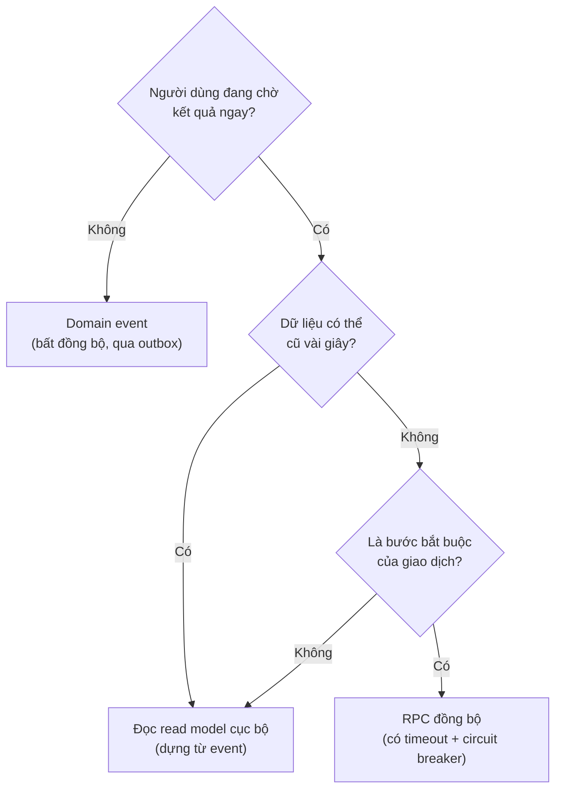
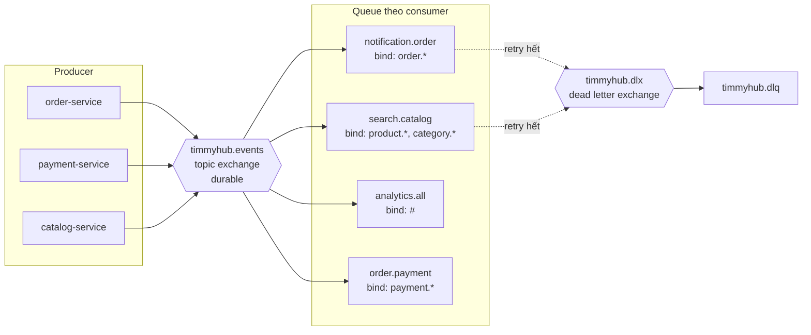
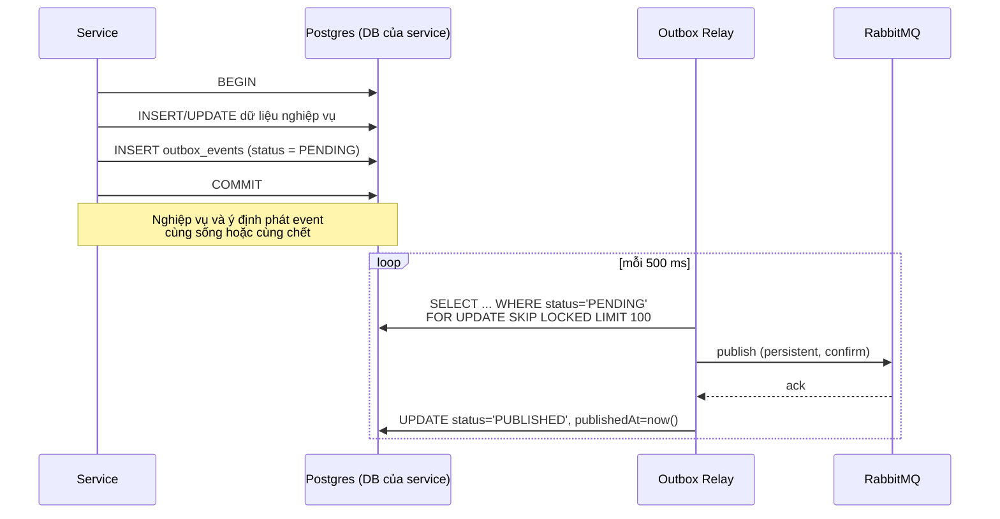
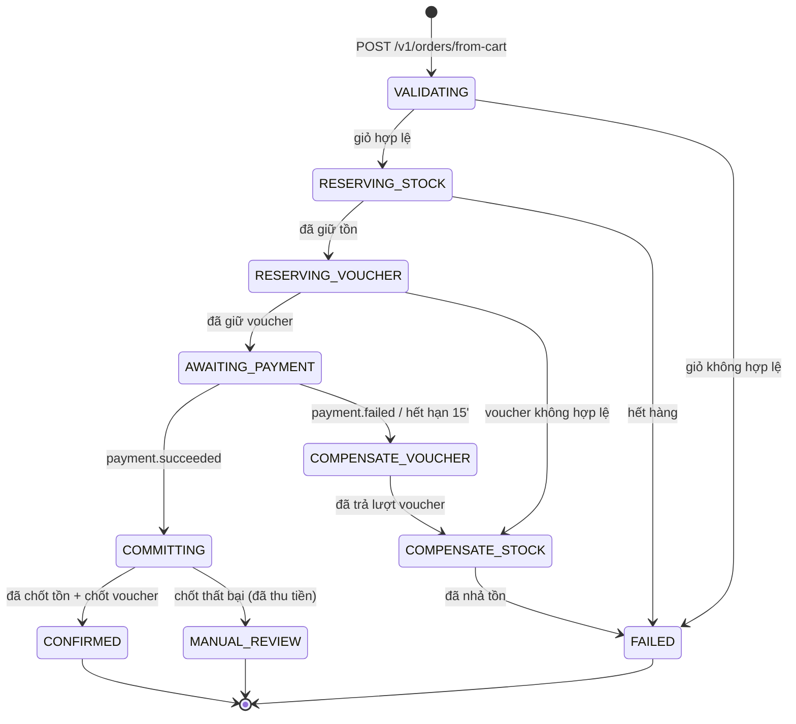
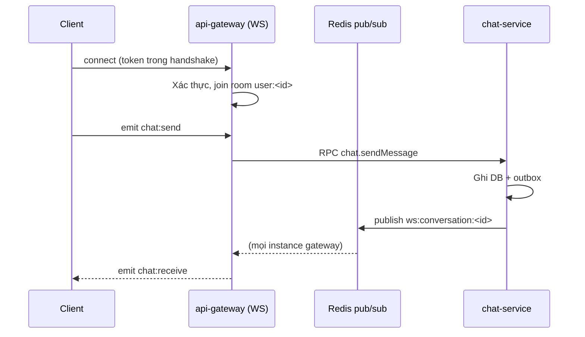

# Mẫu giao tiếp giữa các service

## 1. Chọn cách giao tiếp



| Mẫu | Dùng khi | Ví dụ | Không dùng khi |
|---|---|---|---|
| **RPC đồng bộ** | Cần kết quả ngay, là bước bắt buộc | `inventory.reserve` trong checkout | Chỉ để thông báo cho service khác |
| **Domain event** | Việc đã xảy ra, bên khác phản ứng | `order.completed` → ghi có ví, mở quyền đánh giá | Cần biết kết quả xử lý ngay |
| **Read model** | Dữ liệu tham chiếu, chấp nhận trễ vài giây | `engagement-service` biết ai đã mua gì | Dữ liệu quyết định tiền bạc tại thời điểm giao dịch |
| **Job (BullMQ)** | Việc nặng, trong phạm vi một service | Chuyển mã video, sinh báo cáo | Cần chia việc xuyên service |

❌ **BAD** — gọi HTTP trực tiếp giữa service:

```ts
// order-service
const product = await this.http.get(`http://catalog-service:3103/products/${id}`)
```

Vấn đề: bỏ qua service discovery, không có retry/timeout thống nhất, ghép cứng địa chỉ mạng, không đo được.

✅ **GOOD** — RPC qua RabbitMQ:

```ts
// order-service
const product = await firstValueFrom(
    this.catalogClient
        .send<VariantSnapshot>({ cmd: 'catalog.getVariantSnapshot' }, { variantId })
        .pipe(timeout(3000)),
)
```

## 2. Topology RabbitMQ



| Thành phần | Tên | Thuộc tính |
|---|---|---|
| Exchange sự kiện | `timmyhub.events` | `topic`, `durable: true` |
| Exchange RPC | `timmyhub.rpc` | `direct`, `durable: true` |
| Dead letter exchange | `timmyhub.dlx` | `topic`, `durable: true` |
| Dead letter queue | `timmyhub.dlq` | `durable`, không TTL, cần xử lý thủ công |
| Queue consumer | `<service>.<nhóm>` | `durable: true`, `x-dead-letter-exchange: timmyhub.dlx` |

**Routing key** = tên event: `<domain>.<entity>.<hành động quá khứ>` (ví dụ `order.created`, `ad.campaign.approved`).
Mỗi consumer có **queue riêng** — không dùng chung queue giữa các service, vì như vậy chỉ một service nhận được message.

### Cấu hình bắt buộc

| Thiết lập | Giá trị | Lý do |
|---|---|---|
| `prefetch` | 10 (30 cho `analytics`, `audit`) | Tránh một consumer ôm hết message |
| `noAck` | `false` | Chỉ ack sau khi xử lý xong |
| `persistent` | `true` | Message sống qua restart broker |
| `publisherConfirms` | bật | Outbox chỉ đánh dấu đã phát khi broker xác nhận |
| Số lần thử lại | 5, backoff 1s → 2s → 4s → 8s → 16s | Sau đó vào DLQ |

## 3. Transactional outbox

Vấn đề: ghi DB và phát message là hai hệ thống khác nhau — không có transaction chung. Nếu ghi xong rồi mới phát mà
process chết ở giữa, event mất vĩnh viễn.



```prisma
model OutboxEvent {
    id            String    @id @default(cuid())
    eventName     String                              // 'order.created'
    aggregateType String                              // 'Order'
    aggregateId   String
    payload       Json
    metadata      Json                                // traceId, actorId, occurredAt, version
    status        OutboxStatus @default(PENDING)
    attempts      Int       @default(0)
    lastError     String?
    createdAt     DateTime  @default(now())
    publishedAt   DateTime?

    @@index([status, createdAt])
    @@map("outbox_events")
}

enum OutboxStatus {
    PENDING
    PUBLISHED
    FAILED
}
```

| Ràng buộc | Giá trị |
|---|---|
| Chu kỳ quét | 500 ms |
| Kích thước lô | 100 |
| Khoá | `FOR UPDATE SKIP LOCKED` (nhiều replica chạy song song an toàn) |
| Dọn bản ghi `PUBLISHED` | Sau 7 ngày |
| Cảnh báo | `PENDING` cũ hơn 60 giây, hoặc `FAILED` > 0 |

> **Hệ quả:** phát event **ít nhất một lần** (at-least-once). Vì vậy mọi consumer bắt buộc idempotent — xem §4.

## 4. Consumer idempotent

```prisma
model ProcessedEvent {
    eventId     String   @id          // id của OutboxEvent bên producer
    eventName   String
    processedAt DateTime @default(now())

    @@index([processedAt])
    @@map("processed_events")
}
```

✅ **GOOD**

```ts
@EventPattern('order.completed')
async handleOrderCompleted(@Payload() msg: EventEnvelope<OrderCompletedPayload>) {
    await this.prisma.$transaction(async (tx) => {
        // 1. Khử trùng lặp: trùng eventId → không làm gì
        const created = await tx.processedEvent.createMany({
            data: { eventId: msg.id, eventName: msg.name },
            skipDuplicates: true,
        })
        if (created.count === 0) return

        // 2. Xử lý nghiệp vụ trong CÙNG transaction
        await tx.wallet.update({ /* ... */ })
    })
}
```

❌ **BAD**

```ts
@EventPattern('order.completed')
async handleOrderCompleted(@Payload() msg) {
    if (await this.prisma.processedEvent.findUnique({ where: { eventId: msg.id } })) return
    await this.walletService.credit(msg.data)          // tách transaction → xử lý hai lần khi chạy song song
    await this.prisma.processedEvent.create({ data: { eventId: msg.id } })
}
```

Ngoài ra, ưu tiên các thao tác **tự nhiên idempotent**: `upsert` theo khoá tự nhiên, `UPDATE ... WHERE status = 'X'`,
cộng dồn theo `(aggregateId, eventId)` thay vì `+= value` mù quáng.

Bản ghi `ProcessedEvent` giữ **30 ngày**, dọn bằng job — đủ dài so với TTL message và số lần retry.

## 5. Saga checkout

Checkout đi qua 4 service, không có transaction phân tán. Dùng **saga theo kiểu điều phối (orchestration)** với
`order-service` làm điều phối viên — dễ theo dõi và dễ gỡ lỗi hơn kiểu vũ đạo (choreography).



| Bước | Hành động thuận | Hành động bù trừ | Ghi chú |
|---|---|---|---|
| 1 | `cart.validate` | — | Chỉ đọc |
| 2 | `inventory.reserve` | `inventory.release` | Reservation tự hết hạn sau 15 phút |
| 3 | `voucher.reserve` | `voucher.release` | |
| 4 | Ghi `Order` + outbox | Đánh dấu `CANCELLED` | Cục bộ, có transaction thật |
| 5 | Chờ `payment.succeeded` | Huỷ `PaymentAttempt` | Hết hạn sau 15 phút |
| 6 | `inventory.commit` + `voucher.commit` | **Không bù trừ** → `MANUAL_REVIEW` | Tiền đã thu, không được nhả tồn tự động |

**Trạng thái `MANUAL_REVIEW`** là có chủ đích: khi đã thu tiền mà chốt tồn thất bại, tự động hoàn tiền hoặc tự động nhả
tồn đều có thể sai. Hệ thống dừng lại, cảnh báo admin, ghi audit log đầy đủ. Quy trình xử lý: [runbook.md](../05-infra/runbook.md).

Trạng thái saga lưu ở bảng `SagaState` trong `order_db`, có `correlationId` = `orderId` và timeout cho từng bước.

## 6. Hợp đồng RPC

```ts
// @timmyhub/contracts
export const RPC = {
    CATALOG: {
        GET_VARIANT_SNAPSHOT: 'catalog.getVariantSnapshot',
        RESERVE_INVENTORY: 'inventory.reserve',
    },
} as const
```

```ts
// Producer
this.catalogClient
    .send<VariantSnapshot, GetVariantSnapshotInput>(
        { cmd: RPC.CATALOG.GET_VARIANT_SNAPSHOT },
        { variantId },
    )
    .pipe(timeout(3000), retry({ count: 2, delay: 200 }))

// Consumer
@MessagePattern({ cmd: RPC.CATALOG.GET_VARIANT_SNAPSHOT })
async getVariantSnapshot(@Payload() input: unknown): Promise<VariantSnapshot> {
    const dto = getVariantSnapshotSchema.parse(input)   // validate lại, không tin caller
    return this.service.getSnapshot(dto.variantId)
}
```

| Thiết lập | Giá trị mặc định | Ngoại lệ |
|---|---|---|
| Timeout | 3.000 ms | `payment.*`: 10.000 ms; `analytics.*`: 15.000 ms |
| Thử lại | 2 lần, chỉ với thao tác **đọc** | Thao tác ghi **không tự retry** trừ khi có khoá idempotent |
| Circuit breaker | Mở sau 5 lỗi liên tiếp, thử lại sau 30 giây | |
| Khi mạch mở | Ném `ServiceUnavailableException` → gateway trả `503` kèm `retryAfter` | |

Lỗi RPC được chuẩn hoá thành `RpcException` với `code`, `message`, `details`; gateway ánh xạ sang mã HTTP theo
[api-conventions.md](api-conventions.md).

## 7. Phong bì sự kiện

Mọi message qua `timmyhub.events` dùng chung một phong bì. Định nghĩa nằm ở `@timmyhub/contracts`:

```ts
export const eventEnvelopeSchema = z.object({
    id: z.string().cuid(),                    // = OutboxEvent.id, dùng để khử trùng lặp
    name: z.string(),                         // 'order.created'
    version: z.number().int().positive(),     // phiên bản schema payload
    occurredAt: z.string().datetime(),
    producer: z.string(),                     // 'order-service'
    correlationId: z.string().nullable(),     // xuyên suốt một luồng nghiệp vụ
    causationId: z.string().nullable(),       // id event đã gây ra event này
    traceId: z.string(),
    actor: z.object({
        id: z.string().nullable(),
        type: z.enum(['USER', 'SYSTEM', 'ADMIN']),
    }),
    aggregate: z.object({ type: z.string(), id: z.string() }),
    data: z.unknown(),                        // payload theo schema riêng từng event
})
```

## 8. Tiến hoá schema sự kiện

| Loại thay đổi | Có phá vỡ? | Cách làm |
|---|---|---|
| Thêm trường **tuỳ chọn** | Không | Phát hành trực tiếp, giữ nguyên `version` |
| Thêm trường **bắt buộc** | Có | Tăng `version`, phát **song song** hai phiên bản |
| Xoá / đổi tên trường | Có | Tăng `version`, phát song song |
| Đổi ngữ nghĩa cùng tên trường | Có (nguy hiểm nhất) | **Đổi tên trường**, không tái sử dụng |
| Đổi tên event | Có | Event mới + phát cả hai trong ≥ 2 chu kỳ phát hành |

Quy trình phát hành song song:

1. Producer phát cả `v1` và `v2` (cùng `name`, khác `version`).
2. Từng consumer nâng cấp sang `v2`, có kiểm chứng.
3. Khi mọi consumer đã lên `v2` (kiểm tra bằng metric `event_consumed_total{version}`), producer ngừng phát `v1`.
4. Xoá schema `v1` khỏi `@timmyhub/contracts` ở lần phát hành kế tiếp.

Consumer **không được** dùng `strict` khi parse payload — trường lạ phải bị bỏ qua, không gây lỗi.

## 9. Thứ tự và trùng lặp

| Đảm bảo | Có? | Hệ quả |
|---|---|---|
| Giao ít nhất một lần | Có | Consumer phải idempotent |
| Giao đúng một lần | **Không** | Đừng thiết kế dựa trên giả định này |
| Thứ tự toàn cục | **Không** | Không giả định event của hai aggregate khác nhau đến theo thứ tự |
| Thứ tự trong một aggregate | Chỉ khi cùng queue và `prefetch: 1` | Nếu cần, dùng số phiên bản aggregate và bỏ qua event cũ |

Mẫu xử lý event đến sai thứ tự:

```ts
// Bỏ qua event có version nhỏ hơn version hiện tại của bản ghi
const updated = await tx.searchDocument.updateMany({
    where: { productId, sourceVersion: { lt: msg.data.version } },
    data: { /* ... */, sourceVersion: msg.data.version },
})
```

## 10. BullMQ cho job nội bộ

BullMQ **không thay thế** RabbitMQ: RabbitMQ để giao tiếp **giữa** các service, BullMQ để chạy việc nặng **trong** một
service.

| Hàng đợi | Service | Việc | Đồng thời | Retry |
|---|---|---|---|---|
| `email` | notification | Gửi SMTP | 5 | 5 lần, backoff mũ |
| `push` | notification | Web push | 10 | 3 lần |
| `media-thumbnail` | media | Sinh thumbnail | 3 | 3 lần |
| `media-transcode` | media | Chuyển mã video | 1 | 2 lần |
| `search-index` | search | Đồng bộ chỉ mục theo lô | 5 | 5 lần |
| `report-export` | analytics | Sinh CSV/Excel | 2 | 2 lần |
| `daily-rollup` | analytics | Tổng hợp ngày (cron 00:15) | 1 | 3 lần |
| `ad-billing` | content | Tổng hợp & trừ ngân sách (mỗi phút) | 1 | 3 lần |
| `inventory-expiry` | catalog | Hết hạn reservation (mỗi phút) | 1 | 5 lần |
| `token-cleanup` | identity | Dọn token hết hạn (cron hằng giờ) | 1 | 3 lần |

BullMQ cần **kết nối TCP** tới Redis (`UPSTASH_REDIS_TCP_URL`), không dùng được REST API. Cache và rate limit thì dùng
`@upstash/redis` qua REST. Xem [ADR-0004](adr/ADR-0004-upstash-redis.md).

## 11. WebSocket

Gateway giữ kết nối WebSocket; service phát event realtime qua Redis pub/sub để gateway đẩy xuống client.



Chi tiết namespace, tên room, danh mục event realtime: [realtime.md](realtime.md).

## 12. Chống mẫu cần tránh

| Chống mẫu | Vì sao sai | Thay bằng |
|---|---|---|
| Service A đọc trực tiếp DB của service B | Phá ranh giới, migration của B làm hỏng A | RPC hoặc read model dựng từ event |
| Chuỗi RPC đồng bộ 3 tầng trở lên | Độ trễ cộng dồn, một mắt xích hỏng là hỏng cả chuỗi | Bất đồng bộ hoá, hoặc gộp bước |
| Event mang tên mệnh lệnh (`order.create`) | Event là sự việc đã xảy ra, không phải yêu cầu | `order.created` |
| Event chứa toàn bộ entity | Payload phình to, rò rỉ mô hình nội bộ | Chỉ id + các trường consumer thực sự cần |
| Consumer gọi ngược RPC về producer để lấy thêm dữ liệu | Tạo ghép cứng và chu trình | Đưa đủ dữ liệu vào payload |
| Phát event ngoài transaction | Mất event khi process chết | Outbox |
| Dùng chung một queue cho nhiều service | Chỉ một service nhận được message | Mỗi consumer một queue riêng |
| Retry thao tác ghi không có khoá idempotent | Ghi trùng, trừ tiền hai lần | Khoá idempotent hoặc không retry |
| `catch` rồi `ack` message lỗi | Mất dữ liệu âm thầm | `nack` để vào DLQ, có cảnh báo |
