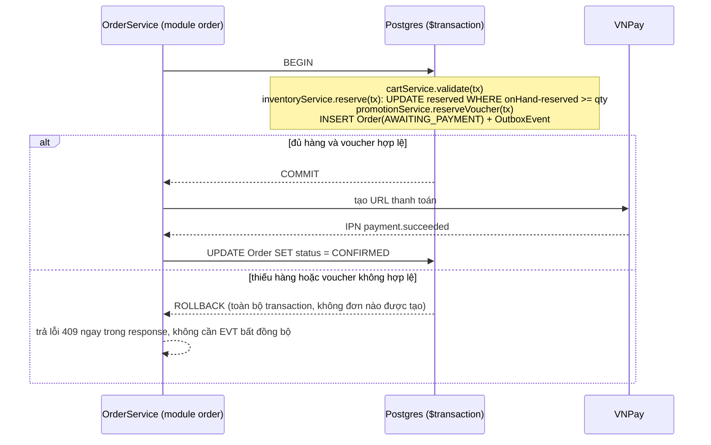

# Tranh chấp đồng thời (race condition) và nhất quán dữ liệu

> Sàn thương mại điện tử hỏng ở đúng những chỗ có hai người bấm cùng một giây. Tài liệu này liệt kê **mọi điểm tranh
> chấp đã biết** của TimmyHub, chọn **một** biện pháp cho mỗi điểm, và nói rõ vì sao không chọn biện pháp khác.
> Nguyên tắc xuyên suốt: **ràng buộc ở tầng cơ sở dữ liệu là lớp chặn cuối cùng** — logic ứng dụng có thể sai, ràng buộc thì không.
>
> Phần lớn nội dung dưới đây là ràng buộc ở tầng Postgres, không phụ thuộc vào việc backend là microservices hay
> modular monolith — vẫn giữ nguyên giá trị sau [ADR-0015](adr/ADR-0015-modular-monolith.md). Chỗ duy nhất đổi: các
> bước trước đây là lời gọi RPC riêng biệt giữa service (reserve rồi commit ở một service khác) giờ nằm trong
> **cùng một `$transaction` Prisma** vì cùng module hoặc cùng database — xem §3.

---

## 1. Bản đồ điểm tranh chấp

| # | Tình huống | Hậu quả nếu không xử lý | Biện pháp chọn |
|---|---|---|---|
| 1 | Hai người mua cùng variant cuối cùng | Bán vượt tồn (oversell) | `UPDATE … WHERE available >= qty` nguyên tử + `CHECK` |
| 2 | Flash sale 1.000 người vào cùng lúc | Vượt hạn mức campaign, DB quá tải | Hàng đợi vào trước + đếm nguyên tử trên Redis, chốt lại ở DB |
| 3 | Một voucher dùng hai lần ở hai tab | Mất tiền theo số lần lặp | Unique `(voucherId, userId, orderId)` + đếm nguyên tử |
| 4 | Bấm đúp nút "Đặt hàng" | Hai đơn giống hệt | `Idempotency-Key` + unique index |
| 5 | IPN VNPay gửi lại nhiều lần | Cộng tiền nhiều lần vào ví | Unique `vnp_TxnRef` + `processed_events` |
| 6 | Rút tiền hai lần khi số dư chỉ đủ một | Số dư âm | `UPDATE … WHERE availableBalance >= amount` + `CHECK balance >= 0` |
| 7 | Worker BullMQ dispatch trùng một outbox event ra hệ thống ngoài | Gửi mail/webhook trùng, trạng thái phía ngoài sai | Bảng `processed_events(eventId)` |
| 8 | Hai admin cùng duyệt một sản phẩm | Ghi đè quyết định của nhau | Optimistic lock theo `version` |
| 9 | Seller sửa giá đúng lúc người mua đặt | Giá hiển thị khác giá tính tiền | Snapshot giá vào `OrderItem`, kiểm lại ở bước xác nhận |
| 10 | Job định kỳ chạy trên nhiều pod | Gửi mail trùng, tổng hợp trùng | BullMQ repeatable job + `jobId` cố định |
| 11 | Reindex Elasticsearch song song với cập nhật | Index tụt hậu, mất bản mới | Ghi theo `version` của document, `external_gte` |
| 12 | Gộp giỏ hàng khi đăng nhập trên hai thiết bị | Số lượng nhân đôi | `upsert` theo `(cartId, variantId)` với `quantity = GREATEST(...)` |
| 13 | Tăng bộ đếm (view, like, impression) | Mất số đếm do read-modify-write | Cộng nguyên tử, hoặc bảng đệm rồi tổng hợp |
| 14 | Sinh mã đơn hàng | Trùng mã | Sequence của Postgres, không dùng `COUNT(*) + 1` |

---

## 2. Bộ công cụ và khi nào dùng cái nào

| Công cụ | Dùng khi | Không dùng khi |
|---|---|---|
| **Ràng buộc DB** (`UNIQUE`, `CHECK`, `EXCLUDE`) | Luôn luôn, như lớp chặn cuối | Không bao giờ bỏ, kể cả khi ứng dụng đã kiểm |
| **`UPDATE … WHERE <điều kiện>` nguyên tử** | Trừ số lượng, trừ số dư — 90% trường hợp | Khi cần đọc rồi tính toán phức tạp giữa chừng |
| **Optimistic lock (`version`)** | Sửa thực thể ít va chạm: sản phẩm, hồ sơ shop | Điểm nóng ghi liên tục — sẽ retry liên miên |
| **Pessimistic lock (`SELECT … FOR UPDATE`)** | Nhiều dòng phải cùng nhất quán: ví + bút toán | Giữ khoá qua lời gọi mạng — cấm tuyệt đối |
| **Advisory lock (`pg_advisory_xact_lock`)** | Cần khoá theo khoá logic chưa có dòng nào | Thay cho ràng buộc dữ liệu |
| **Khoá phân tán Redis** | Job nền, điều phối nhiều tiến trình | **Không** dùng để bảo vệ tính đúng đắn của tiền hay tồn kho |
| **Idempotency key** | Mọi endpoint POST public, mọi consumer | — |
| **Serializable isolation** | Bút toán sổ cái, đối soát | Đường đọc nhiều — chi phí retry cao |

### 2.1 Vì sao không dựa vào khoá Redis cho tồn kho

❌ **BAD** — đúng trong 99% trường hợp, sai đúng lúc quan trọng nhất:

```ts
const lock = await redlock.acquire([`stock:${variantId}`], 5000)
try {
    const v = await prisma.variant.findUnique({ where: { id: variantId } })
    if (v.available < qty) throw new ConflictException('OUT_OF_STOCK')
    await prisma.variant.update({ where: { id: variantId }, data: { available: v.available - qty } })
} finally {
    await lock.release()
}
```

Khoá hết hạn giữa chừng (GC dừng tiến trình, mạng trễ) là hai tiến trình cùng tin mình đang giữ khoá. Redis không có
cơ chế cắt (fencing token) nên không thể ngăn tiến trình cũ ghi đè. Mất khoá ⇒ bán vượt tồn.

✅ **GOOD** — cơ sở dữ liệu tự quyết định ai thắng:

```ts
const updated = await prisma.$executeRaw`
    UPDATE "InventoryItem"
    SET "reserved" = "reserved" + ${qty}
    WHERE "variantId" = ${variantId}
      AND "onHand" - "reserved" >= ${qty}
`
if (updated === 0) throw new ConflictException('OUT_OF_STOCK')
```

Một câu lệnh, một transaction, không có khoảng trống giữa đọc và ghi. Cộng thêm lớp chặn cuối trong migration:

```sql
ALTER TABLE "InventoryItem"
    ADD CONSTRAINT inventory_non_negative
    CHECK ("onHand" >= 0 AND "reserved" >= 0 AND "reserved" <= "onHand");
```

---

## 3. Giữ tồn kho khi đặt hàng

Từ [ADR-0015](adr/ADR-0015-modular-monolith.md), `order`, `catalog` (tồn kho) và `promotion` (voucher) là các module
trong cùng một app, cùng một database — nên bước giữ chỗ và tạo đơn nằm **trong cùng một `$transaction` Prisma**,
không còn là hai lời gọi RPC cách nhau giữa hai service. Chỉ bước chờ VNPay xác nhận thanh toán là còn thật sự
bất đồng bộ, vì nó phụ thuộc hệ thống ngoài. Xem thêm `communication-patterns.md §2` và `§4`.



Vì reserve và tạo đơn nằm chung một transaction, không còn trạng thái `MANUAL_REVIEW` như thiết kế cũ (khi phải
"commit" tồn kho sau khi thanh toán thành công ở một service khác) — hết hàng hoặc voucher sai bị chặn ngay bằng
rollback trước khi đơn tồn tại.

Ba quy tắc bắt buộc:

1. **Giữ chỗ có hạn dùng.** `StockReservation` có `expiresAt`; job chạy mỗi phút giải phóng bản ghi quá hạn.
   Người dùng đóng trình duyệt giữa chừng không được phép khoá hàng vĩnh viễn.
2. **Giải phóng phải idempotent.** Gọi `release` hai lần chỉ có tác dụng một lần — kiểm bằng trạng thái của
   `StockReservation`, không bằng phép cộng trừ mù.
3. **Sắp xếp thứ tự khoá.** Đơn nhiều dòng phải khoá theo `variantId` tăng dần để không bao giờ deadlock chéo:

```ts
const sorted = [...items].sort((a, b) => a.variantId.localeCompare(b.variantId))
```

---

## 4. Flash sale và campaign

Điểm nóng nhất của cả hệ thống: hàng nghìn request vào đúng một dòng dữ liệu trong vài giây.

Ba lớp, từ ngoài vào trong:

| Lớp | Cơ chế | Chặn được gì |
|---|---|---|
| 1. Biên | Rate limit theo user và theo IP ở gateway + Turnstile | Bot, script cào |
| 2. Redis | `DECR` nguyên tử trên `campaign:{id}:remaining`, hết thì trả `SOLD_OUT` ngay | ~99% lưu lượng không chạm tới Postgres |
| 3. Postgres | `UPDATE … WHERE soldQty + ? <= limitQty` + `CHECK` | Là số liệu đúng cuối cùng |

Redis ở đây là **bộ lọc**, không phải nguồn sự thật. Nếu Redis và Postgres lệch (Redis mất dữ liệu, restart), Postgres
thắng, và một job hoà lại bộ đếm Redis từ Postgres mỗi 30 giây.

❌ **BAD** — đọc rồi so sánh ở tầng ứng dụng:

```ts
const c = await prisma.campaign.findUnique({ where: { id } })
if (c.soldQty + qty > c.limitQty) throw new ConflictException('SOLD_OUT')
await prisma.campaign.update({ where: { id }, data: { soldQty: c.soldQty + qty } })
```

✅ **GOOD**:

```ts
const n = await prisma.$executeRaw`
    UPDATE "Campaign" SET "soldQty" = "soldQty" + ${qty}
    WHERE "id" = ${id} AND "soldQty" + ${qty} <= "limitQty" AND "status" = 'ACTIVE'
`
if (n === 0) throw new ConflictException('SOLD_OUT')
```

---

## 5. Voucher

Một voucher có ba loại hạn mức chồng nhau: tổng lượt phát, lượt trên mỗi người, và điều kiện đơn hàng. Cả ba phải
được kiểm trong **cùng một transaction** với việc tạo đơn.

```prisma
model VoucherRedemption {
    id        String   @id @default(uuid())
    voucherId String
    userId    String
    orderId   String
    createdAt DateTime @default(now())

    @@unique([voucherId, orderId])          // một đơn không dùng một voucher hai lần
    @@index([voucherId, userId])            // đếm lượt theo người
}
```

Thứ tự trong transaction: `INSERT VoucherRedemption` **trước**, cập nhật bộ đếm sau. Nếu unique index bắn lỗi
`P2002` thì người dùng đã dùng rồi — trả `409 VOUCHER_ALREADY_USED`, không cần đọc trước để kiểm.

Khi đơn bị huỷ, phát `EVT-voucher.released`; listener của module `promotion` xoá `VoucherRedemption` và giảm bộ đếm —
cũng trong một transaction.

---

## 6. Ví và sổ cái

Tiền là chỗ duy nhất dùng `SERIALIZABLE` và pessimistic lock cùng lúc, vì sai ở đây không sửa được bằng cách chạy lại.

```ts
await prisma.$transaction(
    async (tx) => {
        // khoá theo thứ tự tài khoản tăng dần để không deadlock
        const [from, to] = await tx.$queryRaw`
            SELECT * FROM "LedgerAccount" WHERE id IN (${fromId}, ${toId})
            ORDER BY id FOR UPDATE
        `
        if (from.balance < amount) throw new ConflictException('INSUFFICIENT_FUNDS')

        const journalId = await tx.ledgerJournal.create({ data: { reference, createdBy } })
        await tx.ledgerEntry.createMany({
            data: [
                { journalId, accountId: fromId, direction: 'DEBIT', amount },
                { journalId, accountId: toId, direction: 'CREDIT', amount },
            ],
        })
        await tx.$executeRaw`UPDATE "LedgerAccount" SET balance = balance - ${amount} WHERE id = ${fromId}`
        await tx.$executeRaw`UPDATE "LedgerAccount" SET balance = balance + ${amount} WHERE id = ${toId}`
    },
    { isolationLevel: Prisma.TransactionIsolationLevel.Serializable, timeout: 5000 },
)
```

Kèm theo:

- `LedgerEntry` là **append-only** — thu hồi bằng bút toán ngược, không `UPDATE`, không `DELETE`. Chặn bằng trigger.
- Mỗi journal phải cân: `SUM(DEBIT) = SUM(CREDIT)`. Một job đối soát chạy hằng đêm và cảnh báo nếu lệch.
- Lỗi `40001` (serialization failure) là **bình thường** — retry tối đa 3 lần với backoff, không coi là lỗi 500.

---

## 7. Idempotency ở biên

Mọi `POST` public đi qua middleware:

```ts
@Post('orders')
@Idempotent({ ttlSeconds: 86_400 })
create(@Body() dto: CreateOrderDto, @CurrentUser() user: AuthUser) { … }
```

| Tình huống | Hành vi |
|---|---|
| Key chưa từng thấy | Xử lý bình thường, lưu `(key, userId, hash(body)) → response` |
| Key đã có, body giống | Trả lại đúng response cũ, không xử lý lại |
| Key đã có, body khác | `422 IDEMPOTENCY_KEY_REUSED` |
| Key đang xử lý | `409 REQUEST_IN_PROGRESS`, client thử lại sau |

Hiệu ứng gọi ra ngoài process qua outbox (mail, webhook, audit sink) thì dùng bảng
`processed_events(eventId PRIMARY KEY, processedAt)` ở phía worker BullMQ: chèn trước, xử lý sau, chèn trùng thì bỏ
qua. Listener `EventEmitter2` trong process không cần bảng này — nó chạy trong cùng transaction/process đã tạo ra
sự kiện, không có nguy cơ nhận trùng do broker gửi lại.

---

## 8. Optimistic lock cho thực thể biên tập

Dùng cho sản phẩm, hồ sơ shop, bài đăng, cấu hình — nơi hai người sửa cùng lúc là chuyện có thật nhưng không thường xuyên.

```ts
const n = await prisma.product.updateMany({
    where: { id, version: dto.version },
    data: { ...patch, version: { increment: 1 } },
})
if (n.count === 0) throw new ConflictException('STALE_VERSION')
```

Frontend nhận `409 STALE_VERSION` thì **không** tự ghi đè; hiển thị "Người khác vừa sửa mục này" kèm nút tải lại và
so sánh khác biệt. Ghi đè ngầm là mất dữ liệu của đồng nghiệp.

---

## 9. Mức cô lập transaction dùng ở đâu

| Mức | Dùng cho | Ghi chú |
|---|---|---|
| `READ COMMITTED` (mặc định) | Phần lớn nghiệp vụ | Đã đủ khi mọi phép trừ đều là `UPDATE … WHERE` nguyên tử |
| `REPEATABLE READ` | Báo cáo đọc nhiều bảng cần ảnh nhất quán | Cần retry khi `40001` |
| `SERIALIZABLE` | Sổ cái, đối soát, rút tiền | Bắt buộc có vòng retry |

Quy tắc chung cho mọi transaction:

- Thời gian sống **≤ 3 giây**; đặt `statement_timeout` và `idle_in_transaction_session_timeout`.
- Gọi service của module khác trong cùng process (DI, cùng nhận `tx`) là **được phép** và là cách làm chuẩn cho
  giao dịch xuyên module — xem `communication-patterns.md §2`.
- **Không** gọi ra hệ thống thật sự ở ngoài process (HTTP tới bên thứ ba, SMTP, webhook) bên trong transaction —
  những việc đó đi qua outbox, dispatch sau khi transaction đã commit.
- Không mở transaction bao quanh vòng lặp qua danh sách do người dùng gửi lên mà chưa giới hạn số phần tử.

---

## 10. Cách kiểm chứng

Không có test thì mọi điều ở trên chỉ là ý định.

| Cách | Công cụ | Ngưỡng đạt |
|---|---|---|
| Test đồng thời có chủ đích | Vitest/Jest + Testcontainers, `Promise.all` 50 request cùng lúc vào 1 variant có `onHand = 1` | Đúng **1** thành công, 49 nhận `409` |
| Test idempotency | Gửi cùng `Idempotency-Key` 20 lần song song | Đúng 1 đơn được tạo |
| Test IPN lặp | Phát lại cùng `vnp_TxnRef` 10 lần | Ví cộng tiền đúng 1 lần |
| Kiểm cân sổ cái | Job đối soát trên dữ liệu sinh ngẫu nhiên | `SUM(DEBIT) − SUM(CREDIT) = 0` tuyệt đối |
| Tải flash sale | k6, 2.000 VU trong 30 giây, tồn 100 | Bán đúng 100, p95 < 500 ms, không lỗi 5xx |
| Phát hiện deadlock | Bật `log_lock_waits`, chạy bộ tải hỗn hợp | Không có deadlock trong 30 phút |

Mỗi hạng mục ở bảng này là một `TASK-*` thật trong `03-specs/*/tasks.md`, không phải khuyến nghị chung chung.

---

## 11. Checklist trước khi merge code chạm dữ liệu dùng chung

- [ ] Phép trừ số lượng/số dư viết dạng `UPDATE … WHERE` nguyên tử, **không** đọc-rồi-ghi
- [ ] Có ràng buộc DB tương ứng (`CHECK`, `UNIQUE`) trong migration, không chỉ kiểm ở ứng dụng
- [ ] Endpoint ghi public có `Idempotency-Key`; worker dispatch outbox có `processed_events`
- [ ] Không có lời gọi ra ngoài process (HTTP bên thứ ba, SMTP, webhook) bên trong transaction
- [ ] Khoá nhiều dòng theo thứ tự xác định
- [ ] Có ít nhất một test chạy song song chứng minh chỉ một bên thắng
- [ ] Lỗi tranh chấp trả mã rõ nghĩa (`409` kèm `errorCode`), không phải `500`
