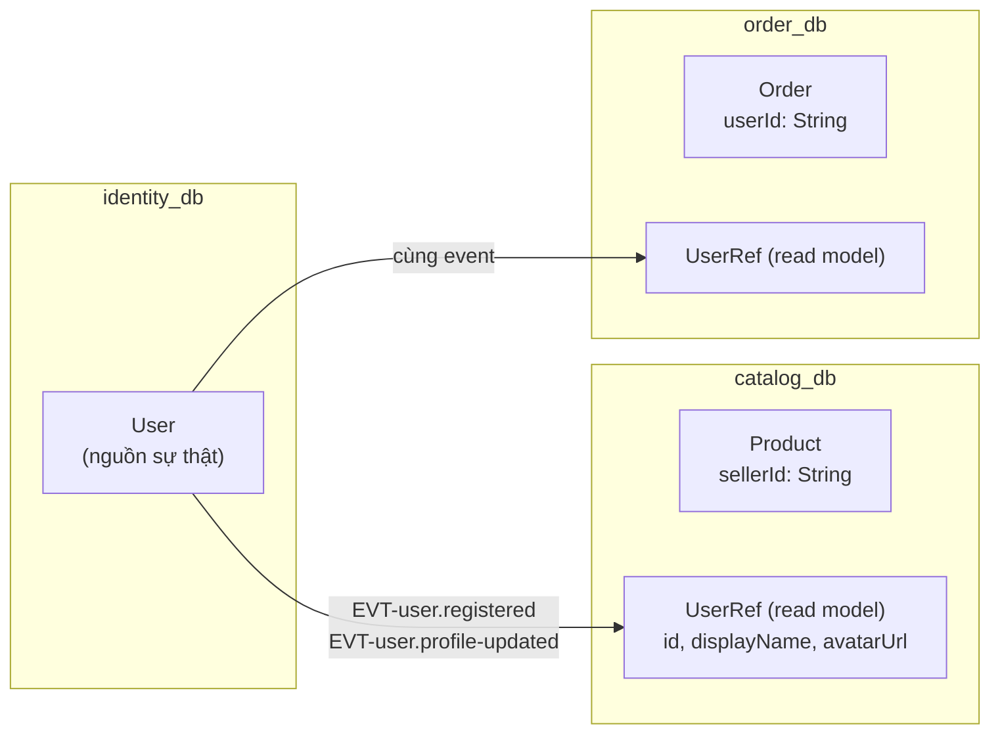

# Kiến trúc dữ liệu

## 1. Nguyên tắc nền

| # | Nguyên tắc | Kiểm chứng bằng |
|---|---|---|
| 1 | Mỗi service sở hữu **đúng một** database; không ai khác kết nối vào | Mỗi service có `DATABASE_URL` riêng với tài khoản riêng, chỉ được cấp quyền trên schema của mình |
| 2 | Không `JOIN` xuyên service | Rà soát PR; không tồn tại chuỗi kết nối chéo trong cấu hình |
| 3 | Khoá ngoại **chỉ trong cùng database** | Tham chiếu ra ngoài lưu dưới dạng id trần (`sellerId String`), không `@relation` |
| 4 | Dữ liệu trùng lặp là chấp nhận được, miễn là chỉ một nơi được ghi | Read model luôn `readonly`, chỉ cập nhật bởi event handler |
| 5 | Dữ liệu tiền bạc dùng `Decimal`, không `Float` | Lint schema |
| 6 | Mọi thay đổi schema đi qua `prisma migrate` | CI chặn nếu `migrations/` không khớp `schema.prisma` |
| 7 | Không xoá cứng dữ liệu nghiệp vụ có tham chiếu | `deletedAt` + lọc mặc định |

## 2. Bản đồ database

| Database | Service | Nhóm model chính | Kích thước dự kiến năm 1 |
|---|---|---|---|
| `identity_db` | identity | `User`, `Profile`, `Device`, `RefreshToken`, `SystemRole`, `Permission`, `RolePermission`, `UserPermission`, `PasswordResetToken` | ~50 K user, ~500 K token |
| `seller_db` | seller | `SellerProfile`, `SellerApplication`, `BrandProfile`, `ShopFollow`, `ShopPolicy` | ~5 K shop |
| `catalog_db` | catalog | `Category`, `Product`, `ProductVariant`, `ProductImage`, `ProductAttribute`, `Inventory`, `InventoryReservation`, `InventoryLedger` | ~200 K sản phẩm, ~800 K biến thể, ledger ~5 M dòng |
| `cart_db` | cart | `Cart`, `CartItem`, `SavedItem` | ~50 K giỏ |
| `order_db` | order | `Order`, `OrderItem`, `OrderStatusHistory`, `Address`, `ReturnRequest`, `SagaState` | ~700 K đơn |
| `payment_db` | payment | `Payment`, `PaymentAttempt`, `Refund`, `Wallet`, `WalletTransaction`, `Withdrawal`, `Reconciliation` | ~700 K giao dịch |
| `promotion_db` | promotion | `Voucher`, `UserVoucher`, `VoucherUsageLog`, `PromotionCampaign`, `CampaignProduct`, `FlashSaleSlot` | ~2 M `UserVoucher` |
| `content_db` | content | `Post`, `PostProduct`, `PostLike`, `PostComment`, `AdCampaign`, `AdCreative`, `AdPlacement`, `AdEventRollup`, `ContentReport` | ~100 K bài, rollup ~10 M dòng |
| `engagement_db` | engagement | `Review`, `ReviewComment`, `ReviewHelpfulVote`, `WishlistItem`, `PurchasedItem` (read model) | ~500 K đánh giá |
| `chat_db` | chat | `Conversation`, `ConversationParticipant`, `ChatMessage`, `SupportTicket`, `Dispute` | ~10 M tin nhắn |
| `notification_db` | notification | `Notification`, `NotificationPreference`, `NotificationTemplate`, `DeliveryLog` | ~20 M thông báo |
| `search_db` | search | `IndexJob`, `SearchKeyword`, `SyncCheckpoint` | nhỏ |
| `media_db` | media | `MediaAsset`, `MediaVariant`, `UploadSession` | ~2 M tệp |
| `analytics_db` | analytics | `DailyRollup`, `HourlyRollup`, `FunnelEvent`, `CohortSnapshot`, `ReportJob` | rollup ~20 M dòng |
| `audit_db` | audit | `AuditLog` (phân vùng), `SystemLog` (phân vùng) | ~100 M dòng/năm |
| `masterdata_db` | masterdata | `Province`, `District`, `Ward`, `SystemConfig`, `FeatureFlag`, `ShippingRate`, `ReasonCode` | ~11 K bản ghi địa giới |

Ở môi trường dev: **một** instance PostgreSQL, 16 database logic. Ở production: tách theo nhóm tải — `catalog_db`,
`order_db`, `audit_db`, `analytics_db` nằm trên instance riêng; phần còn lại dùng chung.

## 3. Dữ liệu tham chiếu xuyên service



Ba cách tham chiếu dữ liệu của service khác, chọn theo nhu cầu:

| Cách | Khi nào | Ví dụ | Đánh đổi |
|---|---|---|---|
| **Id trần** | Chỉ cần liên kết, hiển thị lấy sau | `Order.userId` | Cần một lần gọi thêm khi hiển thị |
| **Ảnh dữ liệu (denormalized snapshot)** | Giá trị **phải** đóng băng tại thời điểm giao dịch | `OrderItem.productName`, `unitPrice` | Không bao giờ cập nhật — đó là mục đích |
| **Read model** | Đọc nhiều, hiển thị kèm, chấp nhận trễ vài giây | `UserRef` trong `catalog_db` | Phải có event handler và cơ chế dựng lại |

❌ **BAD** — ảnh giá và read model lẫn lộn:

```prisma
model OrderItem {
    productId   String
    // Cập nhật theo product.updated → hoá đơn cũ đổi giá theo giá hiện tại
    productName String   // ❌ nếu bị event handler ghi đè
    unitPrice   Decimal  // ❌ nếu bị event handler ghi đè
}
```

✅ **GOOD** — tách rõ ràng:

```prisma
model OrderItem {
    id         String  @id @default(cuid())
    orderId    String
    // --- Ảnh dữ liệu: ghi một lần lúc tạo đơn, KHÔNG BAO GIỜ cập nhật ---
    productId  String
    variantId  String
    sellerId   String
    productName String
    variantName String
    sku        String
    imageUrl   String?
    unitPrice  Decimal @db.Decimal(14, 2)
    quantity   Int
    // -------------------------------------------------------------------
    order      Order   @relation(fields: [orderId], references: [id])

    @@index([productId])
    @@index([sellerId])
    @@map("order_items")
}
```

Quy tắc: **bất cứ thứ gì in ra hoá đơn đều là ảnh dữ liệu.** Read model chỉ dùng cho hiển thị phụ trợ
(tên shop trong danh sách, avatar người bình luận) — nơi dữ liệu cũ vài giây không gây hại.

### Dựng lại read model

Mỗi read model phải có: ①`SyncCheckpoint` ghi event cuối đã xử lý, ② lệnh dựng lại từ đầu
(`pnpm --filter <service> rebuild:read-model`), ③ test khẳng định dựng lại cho ra cùng kết quả.
Read model không có cách dựng lại là **nợ kỹ thuật chặn phát hành**.

## 4. Quy ước schema Prisma

```prisma
generator client {
    provider        = "prisma-client"
    output          = "../src/generated/prisma"
    previewFeatures = ["driverAdapters"]
}

datasource db {
    provider = "postgresql"
    url      = env("DATABASE_URL")
}
```

| Hạng mục | Quy ước | Ví dụ |
|---|---|---|
| Khoá chính | `String @id @default(cuid())` | |
| Tiền | `Decimal @db.Decimal(14, 2)` | `unitPrice` |
| Phần trăm | `Decimal @db.Decimal(5, 2)` | `commissionRate` |
| Số lượng | `Int` | `quantity` |
| Thời gian | `DateTime` (UTC), cột `timestamptz` | `createdAt` |
| JSON | `Json` — chỉ cho dữ liệu **không truy vấn** | `AuditLog.diff` |
| Enum | Khai báo trong schema, không dùng `String` tự do | `OrderStatus` |
| Xoá mềm | `deletedAt DateTime?` + index một phần | |
| Đặt tên bảng | `@@map("snake_case_số_nhiều")` | `@@map("product_variants")` |
| Đặt tên cột | `@map("snake_case")` khi khác `camelCase` | `@map("seller_profile_id")` |

**Bắt buộc `@db.Decimal` cho tiền.** `Float` gây sai số tích luỹ; `Int` theo đơn vị nhỏ nhất cũng được nhưng phải nhất
quán toàn hệ thống — dự án chọn `Decimal`.

Mọi service dùng `@prisma/adapter-pg` với connection pool:

```ts
const adapter = new PrismaPg({
    connectionString: process.env.DATABASE_URL,
    max: Number(process.env.DB_POOL_MAX ?? 10),
})
export const prisma = new PrismaClient({ adapter }).$extends(auditExtension)
```

## 5. Chỉ mục

Nguyên tắc: **mỗi truy vấn trên đường nóng phải có chỉ mục tương ứng**; mỗi chỉ mục phải chỉ ra được truy vấn dùng nó.

| Bảng | Chỉ mục | Truy vấn phục vụ |
|---|---|---|
| `products` | `(sellerId, status, createdAt DESC)` | Danh sách sản phẩm của seller |
| `products` | `(status, categoryId, createdAt DESC)` | Duyệt theo danh mục |
| `products` | `UNIQUE(slug)` | Trang chi tiết theo slug |
| `product_variants` | `UNIQUE(productId, sku)` | Chống trùng SKU trong sản phẩm |
| `inventory` | `UNIQUE(variantId)` | Reserve/commit |
| `inventory_ledger` | `(variantId, createdAt DESC)` | Lịch sử biến động |
| `orders` | `(userId, status, createdAt DESC)` | Đơn của tôi |
| `orders` | `(sellerId, status, createdAt DESC)` | Đơn của shop |
| `orders` | `UNIQUE(orderNumber)` | Tra cứu theo mã đơn |
| `order_items` | `(sellerId, createdAt DESC)` | Tổng hợp doanh số |
| `payments` | `UNIQUE(orderId)` | Một đơn một thanh toán thành công |
| `payments` | `UNIQUE(providerTxnRef)` | Khử trùng lặp IPN |
| `user_vouchers` | `UNIQUE(userId, voucherId)` | Chống thu thập trùng |
| `voucher_usage_logs` | `(voucherId, userId)` | Kiểm tra giới hạn mỗi người |
| `posts` | `(authorId, status, publishedAt DESC)` | Bài của seller |
| `posts` | `(status, publishedAt DESC)` | Feed |
| `post_likes` | `UNIQUE(postId, userId)` | Chống like trùng |
| `reviews` | `(productId, status, createdAt DESC)` | Đánh giá theo sản phẩm |
| `reviews` | `UNIQUE(orderItemId)` | Một dòng đơn một đánh giá |
| `chat_messages` | `(conversationId, createdAt DESC)` | Cuộn lịch sử chat |
| `notifications` | `(userId, readAt, createdAt DESC)` | Danh sách chưa đọc |
| `audit_logs` | `(entityType, entityId, createdAt DESC)` | Lịch sử một thực thể |
| `audit_logs` | `(actorId, createdAt DESC)` | Hoạt động của một người |
| `outbox_events` | `(status, createdAt)` | Relay quét |
| Mọi bảng có xoá mềm | Index một phần `WHERE deleted_at IS NULL` | Danh sách mặc định |

## 6. Migration

Dùng `prisma migrate`, **không** dùng `prisma db push` ngoài môi trường cá nhân —
xem [ADR-0009](adr/ADR-0009-prisma-migrate.md). (Bản cũ chạy `db push --accept-data-loss` nên không có lịch sử migration
và từng có nguy cơ mất dữ liệu.)

```bash
# Phát triển
pnpm --filter catalog-service exec prisma migrate dev --name add_inventory_reservation

# CI: chặn nếu schema và migration lệch nhau
pnpm --filter catalog-service exec prisma migrate diff \
    --from-migrations ./prisma/migrations \
    --to-schema-datamodel ./prisma/schema.prisma \
    --exit-code

# Production: chạy bằng Kubernetes Job trước khi rollout
pnpm --filter catalog-service exec prisma migrate deploy
```

### Thay đổi phá vỡ — mẫu bốn bước

Không bao giờ đổi schema và code trong cùng một lần phát hành khi thay đổi có tính phá vỡ.

| Bước | Schema | Code | Ví dụ: đổi `Product.price` → `ProductVariant.price` |
|---|---|---|---|
| 1. Mở rộng | Thêm cột mới, cho phép `NULL` | Chưa dùng | Thêm `ProductVariant.price` |
| 2. Ghi đôi | Không đổi | Ghi cả cột cũ và mới, đọc cột cũ | |
| 3. Lấp dữ liệu | Migration dữ liệu | Chuyển sang đọc cột mới | Sao chép `Product.price` xuống từng biến thể |
| 4. Thu hẹp | Xoá cột cũ, đặt `NOT NULL` | Bỏ ghi cột cũ | Xoá `Product.price` |

Mỗi bước là **một lần phát hành riêng**, có thể quay lui độc lập.

### Quy tắc migration

1. Migration **không được** chứa `DROP` cột ở cùng lần phát hành với code còn đọc cột đó.
2. Thêm cột `NOT NULL` vào bảng có dữ liệu thì phải có `DEFAULT`, hoặc tách thành ba bước.
3. Tạo index trên bảng lớn dùng `CREATE INDEX CONCURRENTLY` (Prisma: viết SQL thủ công trong migration).
4. Migration dữ liệu lớn chạy theo lô, không khoá bảng.
5. Mọi migration production chạy bằng Kubernetes Job **trước** khi rollout pod mới.

## 7. Phân vùng bảng lớn

Bốn bảng tăng trưởng không giới hạn được phân vùng theo tháng (`RANGE` trên `created_at`):

| Bảng | Database | Lưu nóng | Sau đó |
|---|---|---|---|
| `audit_logs` | `audit_db` | 12 tháng | Lưu trữ lạnh (object storage), giữ 7 năm |
| `system_logs` | `audit_db` | 3 tháng | Xoá |
| `ad_event_rollups` | `content_db` | 6 tháng | Tổng hợp theo tháng rồi xoá chi tiết |
| `chat_messages` | `chat_db` | 24 tháng | Lưu trữ lạnh |

Job `partition-maintenance` tạo trước phân vùng của **3 tháng kế tiếp** và tách phân vùng quá hạn. Thiếu phân vùng là
lỗi nghiêm trọng (mọi `INSERT` thất bại) → có cảnh báo riêng.

## 8. Cache

| Tầng | Công nghệ | TTL | Vô hiệu hoá bằng |
|---|---|---|---|
| Kết quả RPC đọc nhiều | Upstash Redis (REST) | 5 phút | Event tương ứng |
| Quyền hiệu lực của user | Redis | 15 phút | `rbac.permissions.changed`, `user.role-*` |
| Chi tiết sản phẩm theo slug | Redis | 10 phút | `product.updated`, `product.deactivated` |
| Cây danh mục | Redis | 1 giờ | `category.updated` |
| Dữ liệu nền (tỉnh/huyện/xã, config, flag) | Redis | 24 giờ | `config.updated`, `feature-flag.changed` |
| Giỏ hàng | Redis | 30 phút | Mọi thao tác ghi giỏ |
| Giỏ khách vãng lai | Redis (nguồn duy nhất) | 7 ngày | — |
| Bộ đếm rate limit | Redis | Theo cửa sổ | — |
| Trang tĩnh (ISR) | Next.js | 60 giây | Tag revalidation |

**Quy tắc:** cache luôn có TTL; vô hiệu hoá chủ động là để giảm độ trễ, **không phải** cơ chế đúng đắn duy nhất.
Hệ thống phải chạy đúng cả khi mọi thứ chỉ hết hạn theo TTL.

Mẫu khoá: `<service>:<mục đích>:<định danh>` — ví dụ `catalog:product:slug:ao-thun-nam`.

## 9. Sao lưu và khôi phục

| Database | Tần suất | Cách | Giữ | Khôi phục theo thời điểm |
|---|---|---|---|---|
| Toàn bộ 16 DB | Liên tục (WAL) | PITR của nhà cung cấp | 7 ngày | Có |
| Toàn bộ 16 DB | Hằng ngày 02:00 | Snapshot đầy đủ | 30 ngày | Không |
| `payment_db`, `order_db`, `audit_db` | Hằng ngày | Bản sao thêm ở vùng khác | 90 ngày | Không |
| Elasticsearch | — | **Không sao lưu** — dựng lại từ `catalog_db` | — | — |
| Supabase Storage | Hằng ngày | Bản sao bucket | 30 ngày | Không |

| Chỉ tiêu | Mục tiêu |
|---|---|
| RPO | ≤ 15 phút (NFR-006) |
| RTO | ≤ 60 phút (NFR-007) |
| Diễn tập khôi phục | Hằng quý, có biên bản |

**Khôi phục từng phần rất phức tạp** trong kiến trúc này: khôi phục `order_db` về thời điểm T mà `payment_db` vẫn ở
hiện tại sẽ tạo trạng thái không nhất quán. Quy trình xử lý (khôi phục theo nhóm, phát lại event từ outbox, đối soát
thủ công) ghi trong [runbook.md](../05-infra/runbook.md).

## 10. Dữ liệu cá nhân

| Loại | Ví dụ | Xử lý |
|---|---|---|
| Định danh trực tiếp | Email, số điện thoại, họ tên, địa chỉ | Mã hoá khi nghỉ ở tầng DB; che trong log |
| Xác thực | Mật khẩu | bcrypt cost ≥ 12, **không bao giờ** ghi log |
| Token | Access/refresh token, token đặt lại mật khẩu | Chỉ lưu bản băm; che trong log |
| Tài chính | Số tài khoản ngân hàng rút tiền | Mã hoá, chỉ hiện 4 số cuối |
| Hành vi | Lịch sử xem, tìm kiếm | Ẩn danh hoá sau 12 tháng |

Khi người dùng yêu cầu xoá tài khoản (FEAT-USR-008): ẩn danh hoá `User` và `Profile` (email → `deleted-<hash>@…`),
**giữ nguyên** `Order`, `Payment`, `AuditLog` vì nghĩa vụ kế toán và kiểm toán; xoá `Cart`, `WishlistItem`,
`ChatMessage` do người dùng tạo, lịch sử tìm kiếm.

Danh sách trường bị che trong log nằm trong cấu hình `pino` redact — xem [observability.md](observability.md).

## 11. Seed

| Loại | Chạy ở | Nội dung | Idempotent |
|---|---|---|---|
| `seed:essential` | Mọi môi trường kể cả production | Permission, SystemRole, ReasonCode, Province/District/Ward, NotificationTemplate | Có (`upsert` theo `code`) |
| `seed:demo` | Chỉ dev và staging | Shop mẫu, sản phẩm mẫu, đơn mẫu, người dùng mẫu | Có |

`seed:essential` chạy như một Kubernetes Job sau `migrate deploy`, trước khi rollout. Nếu seed thất bại ở production,
việc phát hành **dừng lại** — không rollout pod mới với dữ liệu nền thiếu.
