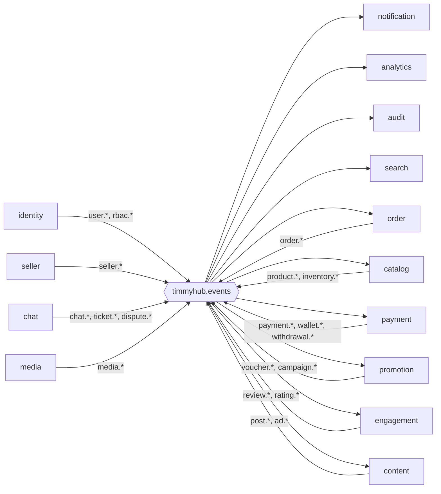

# Danh mục sự kiện

Đây là **hợp đồng công khai** giữa các service. Mọi thay đổi payload phải theo quy trình ở
[communication-patterns.md §8](communication-patterns.md#8-tiến-hoá-schema-sự-kiện).

Định danh tài liệu: `EVT-<tên event>`. Tên event = routing key trên exchange `timmyhub.events`.
Schema payload nằm trong `@timmyhub/contracts`, thư mục `src/events/`.

Viết tắt service trong bảng: `IDN` identity · `SEL` seller · `CAT` catalog · `CRT` cart · `ORD` order · `PAY` payment ·
`PRM` promotion · `CNT` content · `ENG` engagement · `CHT` chat · `NTF` notification · `SRC` search · `MED` media ·
`ANA` analytics · `AUD` audit · `MDT` masterdata · `GW` gateway.

## 1. Bảng tổng hợp

| Event | Producer | Consumer | Ver |
|---|---|---|---|
| **identity** | | | |
| `user.registered` | IDN | NTF, ANA, AUD | 1 |
| `user.email-verified` | IDN | NTF, ANA | 1 |
| `user.profile-updated` | IDN | CAT, ORD, ENG, CHT, CNT *(read model)* | 1 |
| `user.locked` | IDN | CHT, CNT, NTF, AUD | 1 |
| `user.role-granted` | IDN | GW, SEL, AUD | 1 |
| `user.role-revoked` | IDN | GW, SEL, AUD | 1 |
| `rbac.permissions.changed` | IDN | GW, AUD | 1 |
| **seller** | | | |
| `seller.application.submitted` | SEL | NTF, AUD | 1 |
| `seller.application.approved` | SEL | IDN, NTF, SRC, ANA, AUD | 1 |
| `seller.application.rejected` | SEL | NTF, AUD | 1 |
| `seller.shop.updated` | SEL | CAT, SRC, ORD *(read model)* | 1 |
| `seller.shop.suspended` | SEL | CAT, CNT, SRC, NTF, AUD | 1 |
| **catalog** | | | |
| `category.updated` | CAT | SRC, ANA | 1 |
| `product.created` | CAT | AUD | 1 |
| `product.updated` | CAT | CRT, SRC, CNT, ENG | 1 |
| `product.approved` | CAT | SRC, NTF, CNT, ANA, AUD | 1 |
| `product.rejected` | CAT | NTF, AUD | 1 |
| `product.deactivated` | CAT | CRT, SRC, CNT, ANA | 1 |
| **inventory** | | | |
| `inventory.reserved` | CAT | ORD, ANA | 1 |
| `inventory.reserve-failed` | CAT | ORD | 1 |
| `inventory.committed` | CAT | ORD, SRC, ANA | 1 |
| `inventory.released` | CAT | ORD, ANA | 1 |
| `inventory.adjusted` | CAT | ANA, AUD | 1 |
| `inventory.low-stock` | CAT | NTF | 1 |
| **cart** | | | |
| `cart.item-added` | CRT | ANA | 1 |
| `cart.abandoned` | CRT | NTF, ANA | 1 |
| **order** | | | |
| `order.created` | ORD | PAY, PRM, NTF, ANA, AUD | 1 |
| `order.confirmed` | ORD | NTF, SRC, ANA, AUD | 1 |
| `order.packed` | ORD | NTF, ANA | 1 |
| `order.shipped` | ORD | NTF, ANA | 1 |
| `order.delivered` | ORD | NTF, ANA | 1 |
| `order.completed` | ORD | PAY, ENG, SEL, SRC, NTF, ANA, AUD | 1 |
| `order.cancelled` | ORD | CAT, PRM, PAY, NTF, ANA, AUD | 1 |
| `order.refund-requested` | ORD | PAY, CHT, NTF, AUD | 1 |
| **payment** | | | |
| `payment.succeeded` | PAY | ORD, NTF, ANA, AUD | 1 |
| `payment.failed` | PAY | ORD, NTF, ANA | 1 |
| `payment.expired` | PAY | ORD, ANA | 1 |
| `payment.refunded` | PAY | ORD, NTF, ANA, AUD | 1 |
| `wallet.credited` | PAY | NTF, ANA, AUD | 1 |
| `wallet.debited` | PAY | CNT, NTF, ANA, AUD | 1 |
| `withdrawal.requested` | PAY | NTF, AUD | 1 |
| `withdrawal.approved` | PAY | NTF, ANA, AUD | 1 |
| `withdrawal.rejected` | PAY | NTF, AUD | 1 |
| **promotion** | | | |
| `voucher.issued` | PRM | NTF, ANA | 1 |
| `voucher.used` | PRM | ANA, AUD | 1 |
| `voucher.released` | PRM | ANA | 1 |
| `campaign.activated` | PRM | CAT, SRC, NTF, ANA | 1 |
| `campaign.ended` | PRM | CAT, SRC, ANA | 1 |
| `campaign.product-approved` | PRM | CAT, NTF | 1 |
| **content & ads** | | | |
| `post.created` | CNT | MED, AUD | 1 |
| `post.approved` | CNT | SRC, NTF, ANA | 1 |
| `post.rejected` | CNT | NTF, AUD | 1 |
| `post.liked` | CNT | ANA | 1 |
| `post.commented` | CNT | NTF, ANA | 1 |
| `post.reported` | CNT | NTF, AUD | 1 |
| `ad.campaign.created` | CNT | AUD | 1 |
| `ad.campaign.approved` | CNT | SRC, NTF, ANA | 1 |
| `ad.impression.batched` | CNT | ANA | 1 |
| `ad.click.batched` | CNT | ANA | 1 |
| `ad.budget.exhausted` | CNT | NTF, ANA | 1 |
| **engagement** | | | |
| `review.created` | ENG | CAT, SEL, SRC, NTF, ANA, AUD | 1 |
| `review.replied` | ENG | NTF | 1 |
| `review.moderated` | ENG | CAT, SRC, NTF, AUD | 1 |
| `rating.updated` | ENG | CAT, SRC | 1 |
| `wishlist.item-added` | ENG | ANA | 1 |
| **chat** | | | |
| `chat.message-sent` | CHT | NTF, ANA | 1 |
| `ticket.created` | CHT | NTF, ANA, AUD | 1 |
| `ticket.assigned` | CHT | NTF | 1 |
| `ticket.resolved` | CHT | NTF, ANA, AUD | 1 |
| `ticket.sla-breached` | CHT | NTF, ANA | 1 |
| `dispute.opened` | CHT | ORD, NTF, AUD | 1 |
| `dispute.resolved` | CHT | ORD, PAY, NTF, AUD | 1 |
| **notification** | | | |
| `notification.created` | NTF | ANA | 1 |
| `notification.delivery-failed` | NTF | AUD | 1 |
| **media** | | | |
| `media.uploaded` | MED | CNT, CAT | 1 |
| `media.processed` | MED | CNT, CAT | 1 |
| `media.transcoded` | MED | CNT | 1 |
| `media.rejected` | MED | CNT, NTF, AUD | 1 |
| **search** | | | |
| `search.index-completed` | SRC | ANA | 1 |
| `search.index-failed` | SRC | NTF | 1 |
| **analytics** | | | |
| `report.export-ready` | ANA | NTF | 1 |
| `report.export-failed` | ANA | NTF | 1 |
| **masterdata** | | | |
| `config.updated` | MDT | *(tất cả)* | 1 |
| `feature-flag.changed` | MDT | *(tất cả)*, GW | 1 |
| **audit** | | | |
| `audit.recorded` | *(tất cả)* | AUD | 1 |
| `system.log-recorded` | *(tất cả)* | AUD | 1 |

Tổng: **78 event**.

## 2. Payload chi tiết — các event quan trọng

Payload nằm ở trường `data` của phong bì (xem
[communication-patterns.md §7](communication-patterns.md#7-phong-bì-sự-kiện)).

### EVT-order.created

```ts
export const orderCreatedPayloadSchema = z.object({
    orderId: z.string().cuid(),
    orderNumber: z.string(),
    userId: z.string().cuid(),
    sellerId: z.string().cuid(),
    status: z.literal('PENDING_PAYMENT'),
    paymentMethod: z.enum(['VNPAY', 'COD']),
    subtotal: z.string(),            // Decimal dạng chuỗi, tránh sai số JSON number
    discountAmount: z.string(),
    shippingFee: z.string(),
    totalAmount: z.string(),
    currency: z.literal('VND'),
    voucherId: z.string().cuid().nullable(),
    items: z.array(z.object({
        orderItemId: z.string().cuid(),
        productId: z.string().cuid(),
        variantId: z.string().cuid(),
        sku: z.string(),
        quantity: z.number().int().positive(),
        unitPrice: z.string(),
    })).min(1),
    reservationId: z.string().cuid(),
    expiresAt: z.string().datetime(),   // hạn thanh toán
})
```

| Consumer | Phản ứng |
|---|---|
| PAY | Tạo `PaymentAttempt`, hẹn job hết hạn sau 15 phút |
| PRM | Giữ lượt voucher |
| NTF | Thông báo "Đơn hàng đang chờ thanh toán" |
| ANA | Ghi bước phễu `ORDER_CREATED` |
| AUD | Ghi audit |

### EVT-payment.succeeded

```ts
export const paymentSucceededPayloadSchema = z.object({
    paymentId: z.string().cuid(),
    orderId: z.string().cuid(),
    userId: z.string().cuid(),
    provider: z.enum(['VNPAY', 'COD']),
    providerTxnRef: z.string(),      // vnp_TxnRef
    providerTxnNo: z.string().nullable(),   // vnp_TransactionNo
    amount: z.string(),
    currency: z.literal('VND'),
    paidAt: z.string().datetime(),
    bankCode: z.string().nullable(),
})
```

> **Quan trọng:** event này chỉ được phát từ luồng xử lý **IPN**, không phát từ return URL. Xem
> [payment-vnpay/design.md](../03-specs/payment-vnpay/design.md).

### EVT-order.completed

```ts
export const orderCompletedPayloadSchema = z.object({
    orderId: z.string().cuid(),
    orderNumber: z.string(),
    userId: z.string().cuid(),
    sellerId: z.string().cuid(),
    completedAt: z.string().datetime(),
    totalAmount: z.string(),
    commissionAmount: z.string(),
    sellerPayoutAmount: z.string(),
    items: z.array(z.object({
        orderItemId: z.string().cuid(),
        productId: z.string().cuid(),
        variantId: z.string().cuid(),
        quantity: z.number().int().positive(),
        unitPrice: z.string(),
    })),
    attribution: z.object({
        sourcePostId: z.string().cuid().nullable(),
        sourceAdCampaignId: z.string().cuid().nullable(),
    }).nullable(),
})
```

Đây là event **nhiều consumer nhất** (7 service): ghi có ví seller, mở quyền đánh giá, cập nhật uy tín shop, tăng
`soldCount` trong chỉ mục, gửi thông báo, ghi doanh thu, ghi audit.

### EVT-inventory.reserved / EVT-inventory.reserve-failed

```ts
export const inventoryReservedPayloadSchema = z.object({
    reservationId: z.string().cuid(),
    orderId: z.string().cuid(),
    expiresAt: z.string().datetime(),
    items: z.array(z.object({
        variantId: z.string().cuid(),
        quantity: z.number().int().positive(),
    })),
})

export const inventoryReserveFailedPayloadSchema = z.object({
    orderId: z.string().cuid(),
    reason: z.enum(['OUT_OF_STOCK', 'VARIANT_INACTIVE', 'PRODUCT_UNAVAILABLE']),
    failedItems: z.array(z.object({
        variantId: z.string().cuid(),
        requested: z.number().int(),
        available: z.number().int(),
    })),
})
```

### EVT-product.approved

```ts
export const productApprovedPayloadSchema = z.object({
    productId: z.string().cuid(),
    sellerId: z.string().cuid(),
    slug: z.string(),
    name: z.string(),
    categoryId: z.string().cuid(),
    brandId: z.string().cuid().nullable(),
    minPrice: z.string(),
    maxPrice: z.string(),
    thumbnailUrl: z.string().url().nullable(),
    approvedBy: z.string().cuid(),
    approvedAt: z.string().datetime(),
    version: z.number().int(),         // để consumer bỏ qua event đến sai thứ tự
})
```

Payload cố ý mang đủ trường để `search-service` đánh chỉ mục **mà không cần gọi ngược** `catalog-service`.

### EVT-ad.impression.batched

```ts
export const adImpressionBatchedPayloadSchema = z.object({
    batchId: z.string().cuid(),
    windowStart: z.string().datetime(),
    windowEnd: z.string().datetime(),
    entries: z.array(z.object({
        adCampaignId: z.string().cuid(),
        creativeId: z.string().cuid(),
        placement: z.enum(['FEED', 'HOME', 'SEARCH', 'PRODUCT_DETAIL']),
        impressions: z.number().int().nonnegative(),
        uniqueViewers: z.number().int().nonnegative(),
        chargedAmount: z.string(),
    })).max(1000),
})
```

Sự kiện quảng cáo **không** phát từng lượt — đếm trong Redis, gom lô mỗi 60 giây. Nếu phát từng impression,
`analytics-service` sẽ nhận hàng nghìn message mỗi giây mà không thu được thêm thông tin gì.

### EVT-audit.recorded

```ts
export const auditRecordedPayloadSchema = z.object({
    service: z.string(),                 // 'order-service'
    action: z.string(),                  // 'order.status.update'
    entityType: z.string(),              // 'Order'
    entityId: z.string(),
    actorId: z.string().nullable(),
    actorType: z.enum(['USER', 'ADMIN', 'SYSTEM']),
    actorIp: z.string().nullable(),
    userAgent: z.string().nullable(),
    before: z.record(z.unknown()).nullable(),   // đã che trường nhạy cảm
    after: z.record(z.unknown()).nullable(),
    result: z.enum(['SUCCESS', 'FAILURE']),
    errorMessage: z.string().nullable(),
    occurredAt: z.string().datetime(),
})
```

### EVT-user.profile-updated

```ts
export const userProfileUpdatedPayloadSchema = z.object({
    userId: z.string().cuid(),
    displayName: z.string(),
    avatarUrl: z.string().url().nullable(),
    version: z.number().int(),
})
```

Payload **chỉ chứa trường công khai** mà read model ở service khác cần hiển thị. Email, số điện thoại, ngày sinh
**không** được phát ra — đó là dữ liệu cá nhân thuộc về `identity-service`.

## 3. Ánh xạ event → thông báo

`notification-service` tra bảng `NotificationTemplate` để biết event nào sinh thông báo gì, gửi cho ai, qua kênh nào.
Bảng dưới là cấu hình khởi tạo (seed), có thể đổi trong admin console mà không cần deploy.

| Event | Người nhận | Kênh | Template |
|---|---|---|---|
| `user.registered` | Chủ tài khoản | Email | `welcome` |
| `order.created` | Người mua | In-app, Email | `order-pending-payment` |
| `order.confirmed` | Người mua + Seller | In-app, Email | `order-confirmed`, `seller-new-order` |
| `order.shipped` | Người mua | In-app, Push | `order-shipped` |
| `order.delivered` | Người mua | In-app, Email | `order-delivered` |
| `order.completed` | Người mua + Seller | In-app | `order-completed`, `seller-order-completed` |
| `order.cancelled` | Người mua + Seller | In-app, Email | `order-cancelled` |
| `payment.succeeded` | Người mua | In-app, Email | `payment-success` |
| `payment.failed` | Người mua | In-app | `payment-failed` |
| `seller.application.approved` | Người nộp đơn | Email | `seller-approved` |
| `seller.application.rejected` | Người nộp đơn | Email | `seller-rejected` |
| `product.approved` | Seller | In-app | `product-approved` |
| `product.rejected` | Seller | In-app, Email | `product-rejected` |
| `inventory.low-stock` | Seller | In-app, Email | `low-stock-alert` |
| `review.created` | Seller | In-app | `new-review` |
| `review.replied` | Người đánh giá | In-app | `review-replied` |
| `chat.message-sent` | Bên còn lại | In-app, Push | `new-message` |
| `ticket.created` | Admin trực | In-app | `new-ticket` |
| `ticket.sla-breached` | Admin quản lý | In-app, Email | `sla-breach` |
| `withdrawal.approved` | Seller | In-app, Email | `withdrawal-approved` |
| `ad.budget.exhausted` | Seller | In-app, Email | `ad-budget-exhausted` |
| `report.export-ready` | Người yêu cầu | In-app, Email | `export-ready` |
| `campaign.activated` | Người theo dõi shop | In-app | `campaign-live` |

Mọi kênh đều kiểm tra `NotificationPreference` trước khi gửi, **trừ** nhóm giao dịch bắt buộc
(`payment.*`, `order.cancelled`, `withdrawal.*`) — người dùng không tắt được.

## 4. Sơ đồ quan hệ producer–consumer



`notification`, `analytics`, `audit` là ba consumer "toàn cục" — chúng nghe rất rộng nhưng **không** service nào phụ
thuộc ngược lại chúng. Đây là điều kiện giữ cho đồ thị phụ thuộc không có chu trình.

## 5. Quy tắc đặt event

| Quy tắc | ❌ BAD | ✅ GOOD |
|---|---|---|
| Thì quá khứ | `order.create` | `order.created` |
| Là sự việc, không phải mệnh lệnh | `notification.send` | `order.confirmed` (notification tự quyết định gửi gì) |
| Thuộc về producer | `catalog.notifySearch` | `product.approved` |
| Đủ dữ liệu cho consumer | `{ productId }` rồi consumer gọi ngược | Kèm các trường consumer cần |
| Không lộ mô hình nội bộ | Dump nguyên entity Prisma | Chỉ trường thuộc hợp đồng công khai |
| Không chứa dữ liệu cá nhân ngoài phạm vi | Kèm `email`, `phone` trong `user.profile-updated` | Chỉ `displayName`, `avatarUrl` |
| Kích thước hợp lý | Payload 500 KB | ≤ 64 KB; dữ liệu lớn để ở storage, truyền tham chiếu |

## 6. Checklist khi thêm event mới

- [ ] Tên theo `<domain>.<entity>.<hành động quá khứ>`
- [ ] Schema zod trong `@timmyhub/contracts/src/events/`, có `version`
- [ ] Đăng ký trong bảng §1 của tài liệu này, ghi rõ producer và consumer
- [ ] Producer phát **qua outbox**, không publish trực tiếp
- [ ] Mỗi consumer có queue riêng và xử lý idempotent
- [ ] Payload không chứa dữ liệu cá nhân ngoài phạm vi cần thiết
- [ ] Có test hợp đồng (contract test) hai chiều producer ↔ consumer
- [ ] Nếu sinh thông báo: bổ sung hàng vào bảng §3 và seed template
- [ ] Nếu ảnh hưởng báo cáo: cập nhật handler của `analytics-service`
