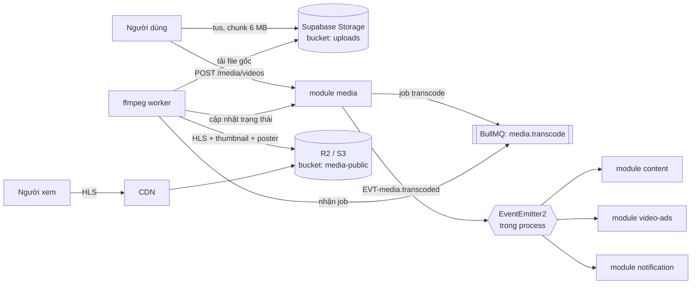
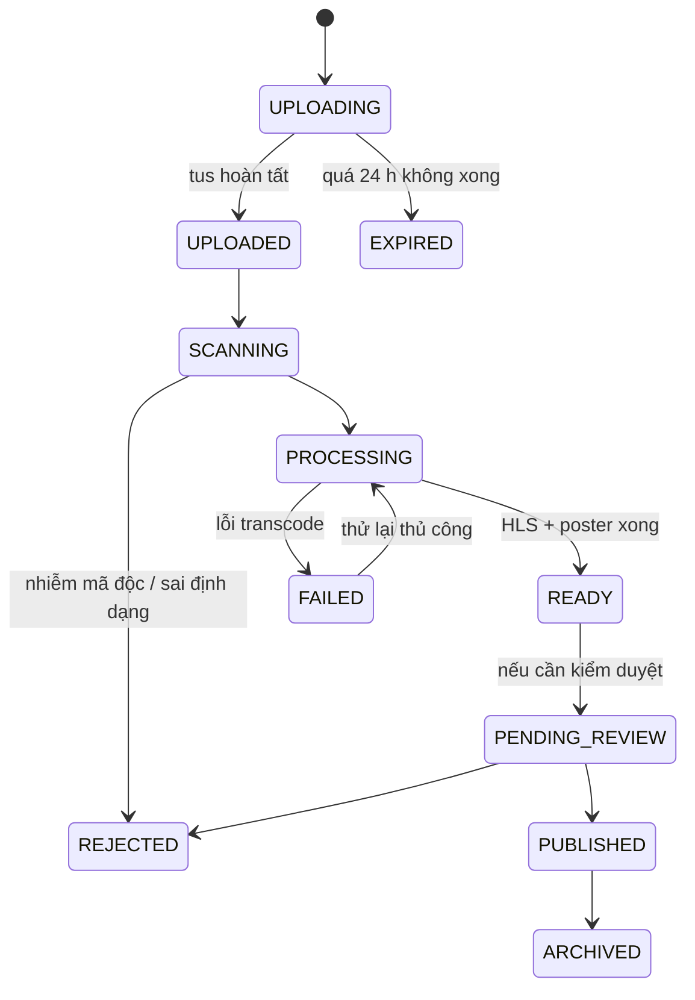

# Đường xử lý media và video

> Hiện trạng bản cũ: người dùng upload một file MP4 tối đa 50 MB bằng một request `multipart/form-data` duy nhất, file
> được lưu nguyên vẹn lên Supabase Storage, rồi frontend gắn thẳng vào `<video src="…">`.
>
> Ba hệ quả: **(1)** upload trên 4G đứt giữa chừng là mất trắng, phải làm lại từ đầu; **(2)** không có HLS nên người xem
> phải tải cả file trước khi tua được, và mọi thiết bị đều nhận cùng một chất lượng dù đang dùng 3G; **(3)** không có
> thumbnail nên feed video là một lưới ô đen. Domain `video-ads` và phần video của `content-post` **không thể chạy** trên
> nền này.
>
> Tài liệu này chốt kiến trúc thay thế và trả lời ba câu hỏi đã đặt ra: Supabase hỗ trợ tới đâu, Cloudflare có miễn phí
> không, và nếu tự làm bằng ffmpeg thì tốn gì.

---

## 1. Trả lời ba câu hỏi trước khi vào kiến trúc

### 1.1 Supabase hỗ trợ tới đâu?

| Hạng mục | Supabase Storage | Kết luận |
|---|---|---|
| Upload nối lại được (tus) | **Có sẵn**, đúng giao thức tus 1.0 (`storage/v1/upload/resumable`) | Dùng được ngay, không cần tự viết server tus |
| Kích thước file | Tới **50 GB** với tus/S3; upload thường tối đa 5 GB; khuyến nghị dùng tus khi file > 6 MB | Thừa sức cho giới hạn 200 MB của ta |
| Kích thước chunk | Bắt buộc **6 MB** với client tus (`chunkSize`) | Uppy phải cấu hình đúng, đây là lỗi hay gặp |
| Tương thích S3 | Có endpoint S3 | Đổi sang R2/MinIO sau này không phải viết lại tầng lưu trữ |
| **Transcode video** | **Không có.** Có trong lộ trình nhưng chưa ra | Phải tự transcode hoặc dùng dịch vụ ngoài |
| Biến đổi ảnh | Có (resize/format) trên gói trả phí | Dùng cho ảnh sản phẩm |
| Băng thông ra | Tính theo gói, đắt hơn CDN chuyên dụng nhiều lần | **Không** phục vụ video trực tiếp từ Supabase |

Chốt: Supabase giải quyết **vế upload** (tus) rất tốt, không giải quyết vế **transcode và phân phối**.

### 1.2 Cloudflare có miễn phí không?

**Cloudflare Stream: không có gói miễn phí.** Giá: **5 USD / 1.000 phút video lưu trữ mỗi tháng** (trả trước, mua theo
bội số 5 USD) và **1 USD / 1.000 phút được phát**. Ingest và encode miễn phí, băng thông đã nằm trong giá phát. Gói
Pro/Business của Cloudflare có kèm 100 phút lưu trữ và 10.000 phút phát — quá nhỏ, chỉ đủ để thử.

**Nhưng Cloudflare R2 thì có gói miễn phí và quan trọng hơn Stream với ta:** 10 GB lưu trữ, 1 triệu thao tác ghi,
10 triệu thao tác đọc mỗi tháng, và **egress bằng 0 USD** ở mọi mức. Đây mới là thứ làm cho phương án tự transcode trở
nên rẻ: chi phí phát video của một sàn nằm gần hết ở băng thông ra.

### 1.3 Tự làm bằng ffmpeg thì tốn gì?

| Khoản | Ước lượng |
|---|---|
| CPU | Ladder 3 rendition với `libx264 -preset veryfast` ≈ **1× thời lượng thật** trên 4 vCPU. 1 phút video ≈ 1 phút worker |
| Lưu trữ | 3 rendition HLS ≈ **25 MB / phút** video |
| Băng thông | 720p ≈ 1,5 Mbps ≈ **11 MB / phút xem** |
| Vận hành | 1 worker pool riêng (image có ffmpeg), hàng đợi, retry, dọn file tạm, giám sát độ trễ hàng đợi |

**So sánh chi phí trên 1.000 phút video lưu + 10.000 phút được xem mỗi tháng:**

| Phương án | Lưu trữ | Phát | Tổng/tháng | Ghi chú |
|---|---|---|---|---|
| **ffmpeg tự host + R2** | 25 GB × 0,015 = **0,38 USD** | **0 USD** (R2 miễn phí egress) + thao tác đọc ~0,04 USD | **≈ 0,4 USD** + tiền máy worker | Rẻ nhất, tốn công vận hành |
| ffmpeg tự host + Supabase Storage | ~0,5 USD | 110 GB × ~0,09 = **~10 USD** | **~10 USD** | Băng thông Supabase là điểm chết |
| Cloudflare Stream | 5 USD | 10 USD | **15 USD** | Không phải vận hành gì |
| Bunny Stream | ~0,25 USD | 110 GB × ~0,01 = **~1,1 USD** | **≈ 1,4 USD** | Encode gói trong giá lưu trữ |
| Mux | ~0,4 USD | 10.000 phút × 0,009 = **90 USD** | **~90 USD** | Đắt nhất, đổi lại là bộ tính năng đầy đủ nhất |

Con số trên nhỏ vì khối lượng giả định nhỏ; điều đáng chú ý là **thứ tự** không đổi khi nhân lên 100 lần. Ở quy mô
100.000 phút xem/tháng: R2 vẫn ≈ 4 USD, Cloudflare Stream ≈ 105 USD, Mux ≈ 900 USD.

---

## 2. Quyết định

**Tự transcode bằng ffmpeg worker (BullMQ), lưu HLS lên object storage tương thích S3, phát qua CDN.**
Chi tiết lý do và phương án bị loại: [ADR-0014](adr/ADR-0014-video-pipeline.md).

Kèm theo ba ràng buộc bắt buộc:

1. **Tầng lưu trữ và phát tách khỏi tầng nghiệp vụ** sau một interface `MediaStorageProvider`. Dev chạy MinIO, staging
   và production chạy Supabase Storage (upload) + R2 (phát). Đổi nhà cung cấp là đổi một class.
2. **Nhà cung cấp transcode cũng là interface** `VideoTranscodeProvider` với hai bản cài: `FfmpegWorkerProvider`
   (mặc định) và `CloudflareStreamProvider` (dự phòng). Không được để lệnh ffmpeg rải rác trong code nghiệp vụ.
3. **Có điều kiện chuyển đổi được ghi rõ từ trước** (§8) — khi chạm ngưỡng thì đổi sang dịch vụ ngoài, không tranh luận lại.

---

## 3. Toàn cảnh luồng



Nguyên tắc: **request HTTP không bao giờ chờ ffmpeg**. `POST /media/videos` trả `202` với `status: PROCESSING`; frontend
theo dõi trạng thái qua WebSocket (`media:{userId}`) hoặc polling nhẹ.

Lưu ý riêng cho luồng này: worker ffmpeg chạy ở **process worker riêng** ([ADR-0015](adr/ADR-0015-modular-monolith.md)),
không phải cùng process với web (`backend/apps/api`). Worker cập nhật trạng thái thẳng vào DB dùng chung, nhưng
**không thể** gọi `EventEmitter2` của process web — hai tiến trình khác nhau không chia sẻ event bus trong bộ nhớ.
Web nghe hoàn tất job qua `QueueEvents` của BullMQ (`job:completed` trên hàng đợi `media.transcode`), rồi mới tự phát
`EVT-media.transcoded` bằng `EventEmitter2` của chính process web cho các module `content`/`video-ads`/`notification`.

---

## 4. Upload nối lại được (tus)

| Hạng mục | Quy định |
|---|---|
| Giao thức | tus 1.0 qua endpoint resumable của Supabase Storage |
| Client | **Uppy** (`@uppy/core` + `@uppy/tus` + `@uppy/dashboard`), nạp động |
| Chunk | **6 MB** đúng yêu cầu của Supabase; đặt sai thì upload > 6 MB sẽ lỗi |
| Uỷ quyền | `media-service` cấp **token upload có thời hạn 30 phút** cho một `uploadId` + đường dẫn cố định; client **không** cầm service key |
| Đường dẫn | `uploads/{userId}/{uploadId}/source.{ext}` — client không tự chọn đường dẫn |
| Nối lại | Uppy lưu `uploadUrl` vào `localStorage`; mở lại trang trong 24 h vẫn tiếp tục được |
| Giới hạn | Video **200 MB** / 10 phút (tăng từ 50 MB vì có HLS mới xem được); ảnh 10 MB |
| Kiểm tra thật | Kiểm **magic bytes** ở worker, không tin `Content-Type` hay đuôi file |
| Quét virus | ClamAV trên file gốc trước khi transcode |
| Dọn rác | File gốc không được `finalize` trong 24 h → job dọn xoá |

Vì sao token có thời hạn chứ không proxy qua backend: proxy 200 MB qua `backend/apps/api` là chiếm connection và RAM
của cả web process trong nhiều phút — đúng thứ làm sập toàn bộ app lúc cao điểm (nay còn nghiêm trọng hơn trước vì
mọi module nghiệp vụ chạy chung process với module `platform`, không còn cách ly như khi `api-gateway` là service riêng).

---

## 5. Transcode

### 5.1 Ladder

| Rendition | Độ phân giải | Bitrate video | Khi nào tạo |
|---|---|---|---|
| 360p | 640×360 | 800 kbps | Luôn |
| 720p | 1280×720 | 2.500 kbps | Khi nguồn ≥ 720p |
| 1080p | 1920×1080 | 5.000 kbps | Khi nguồn ≥ 1080p **và** là video quảng cáo trả phí |

Audio AAC 128 kbps. Segment **4 giây** (feed dọc cần bắt đầu phát nhanh), `-g` = 2× fps để keyframe thẳng hàng giữa các
rendition — không thẳng hàng thì người xem đổi chất lượng sẽ bị giật.

```bash
ffmpeg -i source.mp4 \
    -filter_complex "[0:v]split=2[v1][v2]; [v1]scale=w=640:h=360[v1out]; [v2]scale=w=1280:h=720[v2out]" \
    -map "[v1out]" -c:v:0 libx264 -preset veryfast -b:v:0 800k  -maxrate:v:0 856k  -bufsize:v:0 1200k \
    -map "[v2out]" -c:v:1 libx264 -preset veryfast -b:v:1 2500k -maxrate:v:1 2675k -bufsize:v:1 3750k \
    -map a:0 -map a:0 -c:a aac -b:a 128k -ac 2 \
    -g 48 -keyint_min 48 -sc_threshold 0 \
    -f hls -hls_time 4 -hls_playlist_type vod -hls_segment_type mpegts \
    -master_pl_name master.m3u8 \
    -var_stream_map "v:0,a:0,name:360p v:1,a:1,name:720p" \
    "hls/%v/playlist.m3u8"
```

### 5.2 Ảnh đại diện

| Loại | Cách tạo |
|---|---|
| Poster | Frame tại giây thứ 1 (hoặc `POSTER_AT_SECOND` do seller chọn), xuất WebP 1280×720 |
| Sprite xem trước khi tua | 1 frame / 5 giây ghép thành lưới + file VTT |
| Ảnh động xem trước | GIF/WebP 3 giây cho feed |

Không có poster thì feed là lưới ô đen — đây là lỗi hiển thị số một của bản cũ.

### 5.3 Worker

| Hạng mục | Quy định |
|---|---|
| Hàng đợi | BullMQ `media.transcode`, **Upstash Redis qua TCP** (REST không chạy được BullMQ) |
| Tách pool | Worker ffmpeg chạy **deployment riêng biệt** khỏi cả web (`backend/apps/api`) lẫn worker BullMQ nhẹ (mail, index, thumbnail) — nó ăn CPU 100% và cần HPA theo độ sâu hàng đợi, không theo CPU như worker nhẹ |
| Đồng thời | 1 job / 4 vCPU; `concurrency` = số vCPU / 4 |
| Thời hạn | Job quá `TRANSCODE_TIMEOUT_SEC` (mặc định 900) bị giết, đánh `FAILED` |
| Retry | 3 lần, backoff mũ. Lỗi do **file hỏng** thì **không** retry — phân biệt lỗi hệ thống và lỗi dữ liệu |
| Idempotent | Job khoá theo `videoId`; chạy lại ghi đè cùng đường dẫn, không sinh bản trùng |
| Ưu tiên | Video quảng cáo trả phí ưu tiên cao hơn post thường |
| Dọn | Xoá thư mục tạm trong `finally`; đầy đĩa là sự cố hay gặp nhất của worker ffmpeg |
| Giám sát | Độ sâu hàng đợi, p95 thời gian chờ, tỉ lệ thất bại — cảnh báo khi chờ > 10 phút |

### 5.4 Trạng thái



**Chỉ `PUBLISHED` mới được phát ra ngoài.** Trạng thái `READY` nghĩa là file sẵn sàng, chưa có nghĩa là được phép hiển thị.

---

## 6. Phát video

| Hạng mục | Quy định |
|---|---|
| Định dạng | HLS (`.m3u8`) cho mọi trình duyệt; Safari phát natively, còn lại dùng `hls.js` |
| Trình phát | `media-chrome` (giao diện) + `hls.js` (nạp động, **không** vào gói chung) |
| Poster | Luôn có `poster`, kích thước cố định để CLS = 0 |
| Tự phát | Chỉ trong feed dọc, **tắt tiếng**, khi ≥ 60% khung hình; có nút bật tiếng |
| Preload | `metadata`, không `auto` — `auto` trên feed là đốt data của người dùng |
| Nội dung riêng tư | URL ký có hạn; video công khai đi thẳng CDN để cache được |
| Đo lường | Sự kiện `view` khi xem ≥ 3 giây, mốc 25/50/75/100% cho `video-ads` |

Bảo mật: video quảng cáo trả phí ký URL theo phiên để không bị nhúng lậu; video post công khai thì không ký, vì ký là
mất cache CDN — mất cache là mất luôn lợi thế chi phí của R2.

---

## 7. Tác động lên các phần khác

| Nơi | Thay đổi |
|---|---|
| `service-catalog.md` | Module `media` thêm trách nhiệm transcode; ffmpeg chạy trên một deployment worker riêng biệt (khác cả web lẫn worker BullMQ nhẹ), cùng codebase/image `backend/apps/api` nhưng entrypoint và image build thêm ffmpeg |
| `event-catalog.md` | **Không thêm event mới** — dùng đúng 4 event đã có: `media.uploaded` (tus hoàn tất), `media.processed` (ảnh xong), `media.transcoded` (HLS + poster xong), `media.rejected` (mã độc / sai định dạng / transcode thất bại, phân biệt bằng `reason`) |
| `feature-inventory.md` | Thêm 6 `FEAT-MED-009…014` (tus, token upload có hạn, ClamAV, poster/sprite, theo dõi tiến trình, thử lại); sửa `FEAT-MED-002` lên 200 MB và nâng `FEAT-MED-005` từ P2 lên P1 |
| `03-specs/media-upload/` | Viết lại toàn bộ requirements theo luồng mới |
| `03-specs/video-ads/` | Phụ thuộc `PUBLISHED`; số liệu impression gắn với mốc xem |
| `05-infra/kubernetes.md` | Worker cần image có ffmpeg, `emptyDir` đủ lớn, HPA theo độ sâu hàng đợi chứ không theo CPU |
| `environments.md` | `TRANSCODE_*`, `R2_*`, `CDN_BASE_URL`, `CLAMAV_HOST`, `MEDIA_MAX_VIDEO_MB` |

---

## 8. Khi nào bỏ tự host và chuyển sang dịch vụ ngoài

Chuyển sang Cloudflare Stream (hoặc Bunny Stream) **ngay** khi chạm một trong các mốc sau — đã thống nhất từ trước để
lúc đó không phải tranh luận:

- p95 thời gian chờ hàng đợi > 10 phút trong 3 ngày liên tiếp dù đã tăng worker, **hoặc**
- chi phí máy worker vượt chi phí dịch vụ ngoài tương đương, **hoặc**
- cần tính năng ta không định tự làm: DRM, watermark động, live stream, subtitle tự động, **hoặc**
- không có ai trong đội nhận vận hành worker (đây là lý do chính đáng, không phải lý do kém).

Vì đã có `VideoTranscodeProvider`, việc chuyển đổi là: bật provider mới cho video **mới**, giữ video cũ ở đường dẫn cũ,
không cần transcode lại.

---

## 9. Checklist

- [ ] Upload dùng tus, chunk đúng 6 MB, nối lại được sau khi mất mạng (đã thử bằng cách tắt Wi-Fi giữa chừng)
- [ ] Client không cầm service key; token upload có hạn 30 phút
- [ ] Kiểm magic bytes + quét ClamAV **trước** khi transcode
- [ ] Ladder HLS có keyframe thẳng hàng; đã thử đổi chất lượng giữa chừng không giật
- [ ] Mọi video có poster đúng kích thước, CLS = 0
- [ ] Worker chạy deployment riêng, dọn thư mục tạm trong `finally`
- [ ] Lỗi dữ liệu không retry vô ích; lỗi hệ thống có backoff
- [ ] Chỉ `PUBLISHED` phát ra ngoài
- [ ] `hls.js` và trình phát nạp động, 0 KB trong gói chung
- [ ] Có cảnh báo khi hàng đợi chờ > 10 phút
- [ ] Đã ghi ngưỡng chuyển sang dịch vụ ngoài vào runbook
