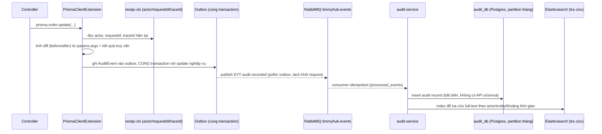

# Observability

Bốn trụ: **log ứng dụng**, **metric**, **trace phân tán**, **audit log nghiệp vụ**. Bốn thứ này phục vụ bốn câu hỏi
khác nhau và **không được gộp làm một** — bản gốc gộp audit vào log ứng dụng (`AuditLogInterceptor` ghi ra file log),
kết quả là audit trail không tra cứu được và không sống sót qua việc xoay vòng log.

| Trụ | Trả lời câu hỏi | Ai đọc | Giữ bao lâu |
|---|---|---|---|
| Log ứng dụng | "Lúc lỗi xảy ra, hệ thống đang làm gì?" | Người vận hành, lúc debug | 14–30 ngày |
| Metric | "Hệ thống có khoẻ không, ngay bây giờ?" | Dashboard, cảnh báo | 13 tháng (giảm độ phân giải theo thời gian) |
| Trace | "Request này đi qua những service nào, chỗ nào chậm?" | Người vận hành, lúc điều tra hiệu năng | 7–14 ngày |
| **Audit log** | "Ai đã làm gì, với bản ghi nào, lúc nào, thay đổi ra sao?" | Admin, pháp lý, hỗ trợ tranh chấp | ≥ 2 năm, **bất biến** |

---

## 1. Log ứng dụng

- Thư viện: `pino` + `pino-http`, JSON structured log, không dùng `console.log` (chặn bằng ESLint `no-console`).
- Mức log: `error` (cần hành động), `warn` (bất thường không chặn), `info` (sự kiện nghiệp vụ mức cao: tạo đơn, thanh
  toán), `debug` (chỉ bật khi điều tra, tắt ở production theo mặc định).
- **Redact bắt buộc** các trường: `password`, `token`, `authorization`, `refreshToken`, `vnp_SecureHash`, `cardNumber`,
  `otp`, `email` (băm một chiều nếu cần đối chiếu) — danh sách đầy đủ ở `docs/01-architecture/security.md` §T11.
- Mọi dòng log phải có `requestId`, `traceId`, `userId` (nếu có) để nối với trace và audit.
- Thu gom bằng sink tương thích Loki/CloudWatch tuỳ hạ tầng triển khai — không chốt cứng nhà cung cấp ở tài liệu này,
  chốt ở `docs/05-infra/kubernetes.md`.
- Lỗi chưa bắt (`unhandledRejection`, exception filter) gửi thêm về **Sentry** — đã có sẵn ở bản gốc
  (`timmyhub-nextjs` dùng Sentry), giữ lại nhưng **DSN và token phải xoay** (xem `docs/08-handoff/migration-from-legacy.md`).

## 2. Metric

- `prom-client` ở mỗi service, expose `/metrics`, Prometheus scrape theo chu kỳ 15s.
- Bắt buộc có: tỉ lệ lỗi theo route (`http_requests_total{status}`), độ trễ p50/p95/p99
  (`http_request_duration_seconds`), độ sâu hàng đợi BullMQ, số kết nối DB đang dùng/còn trống.
- Mỗi service tự định nghĩa thêm metric nghiệp vụ quan trọng của mình (vd `order_created_total`,
  `media_transcode_duration_seconds`) — không bắt buộc, khuyến khích khi domain đó có SLO riêng.
- Ngân sách cảnh báo (ngưỡng cụ thể theo route) nằm ở `docs/06-quality/performance.md`, không lặp lại ở đây.

## 3. Trace phân tán

- `OpenTelemetry` (`@opentelemetry/sdk-node` + auto-instrumentation cho HTTP, Prisma, RabbitMQ, Redis).
- `traceId` sinh ở `api-gateway`, truyền qua header `traceparent` (chuẩn W3C) xuyên mọi service, xuống cả job BullMQ
  (đính vào payload job) và event RabbitMQ (đính vào message header).
- **`traceId` phải nối được vào audit record** — khi tra một hành động khả nghi, người vận hành đi từ audit log sang
  trace để xem toàn bộ request đã chạm những gì.
- Backend xuất trace qua OTLP tới collector; nhà cung cấp lưu trữ trace (Tempo, Honeycomb, …) chốt ở
  `docs/05-infra/environments.md`, không chốt ở đây để tránh khoá công nghệ quá sớm.

## 4. Audit log nghiệp vụ

### 4.1 Vấn đề của bản gốc

`AuditLogInterceptor` + `AuditHelperService` ghi audit **bằng cách gọi thủ công trong từng controller** muốn được ghi.
Hệ quả: audit thiếu — bất kỳ controller nào quên gắn decorator thì hành động đó không có vết; audit ghi ra cùng chỗ
với log ứng dụng nên bị xoay vòng mất sau vài tuần; không có diff trước/sau, chỉ có mô tả dạng chuỗi.

### 4.2 So sánh phương án

| # | Phương án | Ưu | Nhược | Khuyến nghị |
|---|---|---|---|---|
| 1 | **`nestjs-cls` (AsyncLocalStorage giữ actor/requestId/traceId) + Prisma Client Extension (`$extends`) tự sinh audit record → publish qua outbox → `audit-service` ghi Postgres (partition theo tháng) + index Elasticsearch** | Không phụ thuộc thư viện dễ bị bỏ rơi; bắt được **mọi** thay đổi qua Prisma kể cả ở nơi quên gắn decorator; diff chính xác vì lấy trực tiếp từ `params.args` của Prisma; tách khỏi log ứng dụng nên không bị xoay vòng | Phải tự viết extension, tự định nghĩa danh sách model/action nào cần audit (không phải mọi bảng đều cần) | **Chọn** |
| 2 | `@nestjs-cls/transactional` | Gắn audit vào cùng transaction nghiệp vụ, tránh audit "ma" khi transaction rollback | Chỉ giải quyết một phần (transaction boundary), vẫn cần #1 làm nền | Dùng **kèm** #1 |
| 3 | Decorator thủ công kiểu bản gốc (`@AuditAction` gọi tay ở từng controller) | Đơn giản, dễ hiểu | Chính là lỗi đã gặp: dễ quên, không bắt được thay đổi ngoài controller (job, consumer, script vận hành) | Không dùng làm cơ chế chính — giữ `@AuditAction` như một **override tên hành động** cho case đặc biệt, lớp dưới vẫn là #1 |
| 4 | `audit-log-nestjs`, `typeorm-auditing`, `prisma-audit` (thư viện cộng đồng) | Cài nhanh | `typeorm-auditing`/`prisma-audit` sai stack ORM hoặc gần như không còn bảo trì; `audit-log-nestjs` ít sao, không có bản tương thích Nest 11 | **Không khuyến nghị** |
| 5 | PostgreSQL `pgaudit` (audit ở tầng DB) | Bắt được cả truy vấn không qua Prisma (migration tay, `psql` trực tiếp) | Log ở tầng câu SQL thô, không có ngữ nghĩa nghiệp vụ; khó gắn `actor` là user cuối vì kết nối DB dùng chung 1 service account | Bổ sung **tuỳ chọn** cho bảng cực nhạy cảm (`wallet_transactions`), không thay thế #1 |
| 6 | Bảng append-only + hash chain (mỗi record hash luôn record trước, phát hiện sửa xoá) | Chống sửa/xoá kể cả bởi người có quyền truy cập DB trực tiếp | Phức tạp vận hành, chỉ cần khi có yêu cầu tuân thủ nghiêm | Cân nhắc **sau MVP** nếu `wallet-settlement` bị yêu cầu tuân thủ tài chính chặt hơn dự kiến |

Quyết định đầy đủ và lý do: `docs/01-architecture/adr/ADR-0011-audit-log-strategy.md`.

### 4.3 Kiến trúc

### 4.4 Cấu trúc bản ghi audit

| Trường | Kiểu | Ghi chú |
|---|---|---|
| `id` | uuid | |
| `actorId`, `actorType` | string, enum(`user`,`system`,`impersonation`) | Mạo danh ghi **cả hai** danh tính — xem `rbac-advanced.md` |
| `action` | string | `<domain>.<entity>.<verb>`, vd `order.status.update` |
| `entityType`, `entityId` | string | |
| `before`, `after` | jsonb | Chỉ trường thay đổi, không dump cả record |
| `requestId`, `traceId` | string | Nối sang log và trace |
| `ip`, `userAgent` | string | |
| `createdAt` | timestamptz | Partition key theo tháng |

- **Không có endpoint `UPDATE`/`DELETE`** trên bảng audit — chỉ `INSERT` qua consumer, đọc qua API riêng có phân quyền.
- Retention: mặc định 2 năm nóng (Postgres + ES), sau đó nguội hoá (export Parquet lên object storage), **không xoá**
  trừ khi có yêu cầu pháp lý xoá dữ liệu cá nhân — trường hợp đó chỉ xoá `before`/`after` chứa PII, giữ nguyên
  metadata hành động.
- Danh sách model/action nào bắt buộc audit nằm trong từng `design.md` domain (cột "Audit" trong bảng API).

## 5. Health check

- Mỗi service expose `/health` (liveness — process còn sống) và `/health/ready` (readiness — DB/RMQ/Redis kết nối
  được), theo chuẩn `@nestjs/terminus`.
- Kubernetes probe dùng hai endpoint này riêng biệt — xem `docs/05-infra/kubernetes.md`. Không gộp chung một endpoint:
  liveness lỗi thì pod bị restart, readiness lỗi thì pod chỉ bị rút khỏi load balancer; gộp chung sẽ restart nhầm khi
  chỉ là DB chậm tạm thời.

## 6. Tự kiểm

- [ ] Không dùng `console.log`; mọi log đi qua `pino`, có redact
- [ ] Metric bắt buộc (`http_requests_total`, độ trễ, hàng đợi) có ở mọi service
- [ ] `traceId` xuyên suốt: gateway → service → job BullMQ → event RabbitMQ → audit record
- [ ] Audit ghi qua Prisma Client Extension + outbox, **không** gọi thủ công trong controller làm cơ chế chính
- [ ] Bảng audit không có API sửa/xoá
- [ ] Sentry DSN/token đã xoay so với bản gốc (không tái dùng giá trị cũ)
