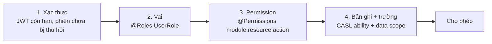

# RBAC nâng cao

> [roles-and-permissions.md](../00-overview/roles-and-permissions.md) định nghĩa vai và danh mục permission.
> Tài liệu này nói về phần khó: **quyền trên từng bản ghi, từng trường, từng phạm vi dữ liệu**, cách trao quyền tạm thời,
> cách vô hiệu hoá cache quyền, và cách kiểm chứng phân quyền bằng test.
>
> Lỗi nghiêm trọng nhất của bản cũ nằm đúng ở đây: `mapSubject` có nhánh mặc định nuốt mọi subject lạ, khiến toàn bộ
> rule lấy từ database trở nên vô hiệu; và nhiều permission không được seed nên endpoint tương ứng không ai gọi được.

---

## 1. Bốn lớp kiểm quyền, nối bằng AND



Một request phải qua **cả bốn**. Không lớp nào được phép "bù" cho lớp khác.

```ts
@Patch(':id')
@Roles(UserRole.SELLER, UserRole.ADMIN)
@Permissions(PERMISSIONS.CATALOG.PRODUCTS.UPDATE)
@CheckPolicies((ab: AppAbility, req) => ab.can('update', subject('Product', req.resource)))
async update(@Param('id') id: string, @Body() dto: UpdateProductDto, @CurrentUser() user: AuthUser) { … }
```

---

## 2. Quy ước đặt tên permission

```
<module>:<resource>:<action>[:<scope>]
```

| Thành phần | Giá trị hợp lệ |
|---|---|
| `module` | `catalog`, `order`, `payment`, `content`, `rbac`, `admin`, … (đúng bằng tên domain) |
| `resource` | số nhiều: `products`, `orders`, `vouchers` |
| `action` | `create`, `read`, `update`, `delete`, `approve`, `export`, `refund`, `impersonate` |
| `scope` | bỏ trống = **chỉ dữ liệu của mình**; `:any` = trên toàn sàn |

Cặp `order:orders:read` và `order:orders:read:any` là hai permission **khác nhau**. Seller có cái đầu, nhân viên vận hành
có cái sau. Không có `scope` nào ngầm hiểu — phải khai rõ.

**Kiểm tra nhất quán lúc khởi động** (`FEAT-RBAC-011`): mỗi service quét toàn bộ metadata `@Permissions` của mình,
đối chiếu với hằng `PERMISSIONS` trong `@timmyhub/contracts` và với bảng `Permission` trong DB. Thiếu bất kỳ đâu thì
**service từ chối khởi động** kèm danh sách cụ thể. Đây là cách chặn vĩnh viễn lớp lỗi "endpoint tồn tại nhưng không ai
gọi được" của bản cũ.

---

## 3. Phạm vi dữ liệu (data scope)

Câu hỏi thật sự không phải "được đọc đơn hàng không" mà là "**những đơn nào**".

```ts
export type DataScope =
    | { kind: 'own'; userId: string }
    | { kind: 'shop'; shopIds: string[] }
    | { kind: 'assigned'; ticketIds: string[] }
    | { kind: 'all' }
```

Phạm vi được dịch thẳng thành mệnh đề `where` của Prisma, **không** lọc sau khi đã lấy dữ liệu:

❌ **BAD** — lấy hết rồi lọc ở ứng dụng: rò rỉ qua tổng số bản ghi, qua phân trang, qua thời gian phản hồi:

```ts
const orders = await prisma.order.findMany({ where: { status } })
return orders.filter((o) => o.sellerId === user.sellerId)
```

✅ **GOOD** — phạm vi đi vào truy vấn:

```ts
const scope = scopeFor(user, 'order:orders:read')
const orders = await prisma.order.findMany({
    where: { status, ...whereForScope(scope) },   // { sellerId: { in: [...] } }
    take: pagination.limit,
})
```

Quy tắc bắt buộc: **mọi truy vấn danh sách đều phải đi qua `whereForScope`**. Có test lint riêng bắt lỗi
`findMany` trong controller/service nghiệp vụ mà không kèm phạm vi.

Sai lầm hay gặp là tin vào tham số client gửi lên:

```ts
// ❌ BAD: ai cũng đổi được sellerId trên URL
findAll(@Query('sellerId') sellerId: string) { … }

// ✅ GOOD: danh tính lấy từ token đã xác thực
findAll(@CurrentUser() user: AuthUser) { const scope = scopeFor(user, …) }
```

---

## 4. Quyền theo từng trường (field-level)

Cùng một bản ghi, mỗi vai thấy một tập trường khác nhau.

| Thực thể | Người mua | Seller sở hữu | Nhân viên hỗ trợ | Admin |
|---|---|---|---|---|
| `Order` | không thấy `internalNote`, `riskScore` | thấy `buyerPhone` đã che 4 số cuối | thấy đủ khi đang xử lý ticket của đơn đó | đủ |
| `User` | chỉ hồ sơ mình | không thấy email người mua | thấy khi có ticket | đủ |
| `Payout` | không thấy | thấy của shop mình | không thấy | đủ |

Thực thi ở **tầng serialize**, không ở tầng component:

```ts
export const ORDER_FIELD_POLICY: FieldPolicy<Order> = {
    internalNote: (ab) => ab.can('read', 'Order', 'internalNote'),
    buyerPhone: (ab, o) => (ab.can('read', 'Order', 'buyerPhone') ? o.buyerPhone : maskPhone(o.buyerPhone)),
}
```

Che ở frontend là **không** phải bảo mật — dữ liệu vẫn nằm trong response và bất kỳ ai mở tab Network đều thấy.

---

## 5. Trao quyền tạm thời, uỷ quyền và mạo danh

| Cơ chế | Dùng khi | Ràng buộc |
|---|---|---|
| **Permission tạm thời** (`UserPermission.expiresAt`) | Nhân viên trực thay trong kỳ nghỉ | Bắt buộc có hạn ≤ 30 ngày; hết hạn tự rơi |
| **Uỷ quyền shop** (`ShopMember` với vai riêng) | Seller thuê nhân viên quản lý shop | Chủ shop không uỷ quyền được quyền rút tiền |
| **Break-glass** (nâng quyền khẩn cấp) | Sự cố sản xuất cần truy cập dữ liệu | Cần 2 người phê duyệt, tự hết sau 60 phút, ghi audit mức `CRITICAL`, gửi cảnh báo cho cả đội |
| **Mạo danh (impersonation)** | Hỗ trợ tái hiện lỗi của người dùng | Chỉ đọc, cấm thao tác tiền; banner đỏ hiện suốt phiên; mọi request mang `X-Impersonated-By`; audit ghi cả hai danh tính |

Mạo danh là quyền nguy hiểm nhất trong hệ thống. Nó phải là permission riêng (`admin:users:impersonate`), không bao giờ
gói trong vai `ADMIN` mặc định, và phải xuất hiện trong báo cáo định kỳ gửi cho chủ sản phẩm.

---

## 6. Cache quyền và vô hiệu hoá

Permission **không** nằm trong JWT — nếu nằm trong đó thì thu hồi quyền phải đợi token hết hạn.

| Hạng mục | Cách làm |
|---|---|
| Nơi lưu | Redis `perm:{userId}` — tập permission đã tính sẵn, TTL 15 phút |
| Cache cục bộ trong pod | LRU 30 giây, để chịu được lúc Redis chậm |
| Vô hiệu hoá | Consumer của `EVT-rbac.permissions.changed`, `EVT-user.role-granted/revoked`, `EVT-user.locked` xoá khoá tương ứng |
| Đổi định nghĩa vai | Xoá theo mẫu `perm:*` của mọi user mang vai đó — làm theo lô, không `KEYS` trên Redis sản xuất |
| Khi Redis hỏng | Đọc thẳng DB, **không** mặc định cho qua |

❌ **BAD**: `if (!cached) return allow()` — một sự cố Redis biến thành mở toang phân quyền.
✅ **GOOD**: cache lỗi thì đi đường chậm; quá tải thì suy giảm dịch vụ, không suy giảm an toàn.

---

## 7. Quản trị quyền

- **Ai được cấp quyền gì**: người cấp không bao giờ được cấp quyền mà chính họ không có (không tự nâng cấp).
- **Vai hệ thống không sửa được**: `SUPER_ADMIN` và các permission lõi có cờ `isSystem`, chặn sửa/xoá ở cả API lẫn trigger DB.
- **Mọi thay đổi quyền đều là sự kiện audit** với diff trước/sau và lý do bắt buộc nhập.
- **Rà soát định kỳ**: báo cáo hằng quý liệt kê tài khoản có quyền cao, quyền tạm thời chưa thu hồi, tài khoản không đăng nhập > 90 ngày.
- **Tách nhiệm vụ**: người duyệt yêu cầu rút tiền không được là người tạo yêu cầu; ràng buộc kiểm trong nghiệp vụ, không chỉ bằng quy trình.

---

## 8. Kiểm chứng bằng test

Phân quyền là phần **phải** có test tự động, vì lỗi ở đây không gây crash nên không tự lộ ra.

| Loại test | Nội dung | Ngưỡng |
|---|---|---|
| Ma trận vai × endpoint | Sinh tự động từ metadata: mỗi endpoint × mỗi vai → mong đợi `200/403` | Phủ 100% endpoint |
| Rò rỉ theo phạm vi | Seller A gọi mọi endpoint đọc với id tài nguyên của seller B | Luôn `403/404`, không bao giờ `200` |
| Rò rỉ theo trường | So response của từng vai với chính sách trường | Không trường nào ngoài danh sách cho phép |
| Vô hiệu hoá cache | Thu hồi quyền → gọi lại trong 1 giây | Đã bị chặn |
| Nhất quán seed | Kiểm tra lúc khởi động | Không service nào boot được khi thiếu permission |

Quy ước trả mã: tài nguyên **tồn tại nhưng không thuộc phạm vi** trả `404`, không trả `403` — trả `403` là vô tình xác
nhận tài nguyên đó có thật.

---

## 9. Checklist

- [ ] Không có endpoint nào chỉ dựa vào `@Roles`
- [ ] Mọi `findMany` nghiệp vụ đi qua `whereForScope`
- [ ] Không có tham số định danh chủ sở hữu nào nhận từ query/body
- [ ] Permission mới đã vào `PERMISSIONS` const + seed + test ma trận
- [ ] CASL `mapSubject` **không** có nhánh mặc định nuốt subject lạ — subject lạ phải ném lỗi
- [ ] Quyền tạm thời đều có `expiresAt`
- [ ] Mạo danh chỉ đọc, có banner, có audit hai danh tính
- [ ] Cache quyền hỏng thì chặn, không mở
