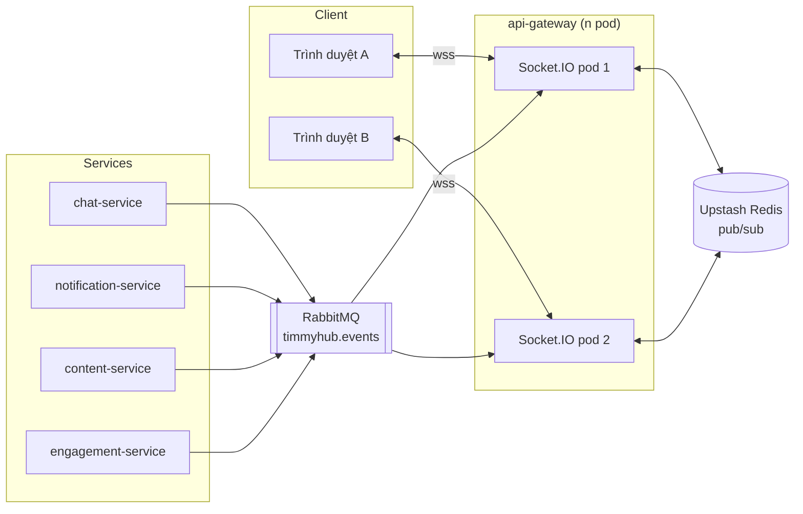
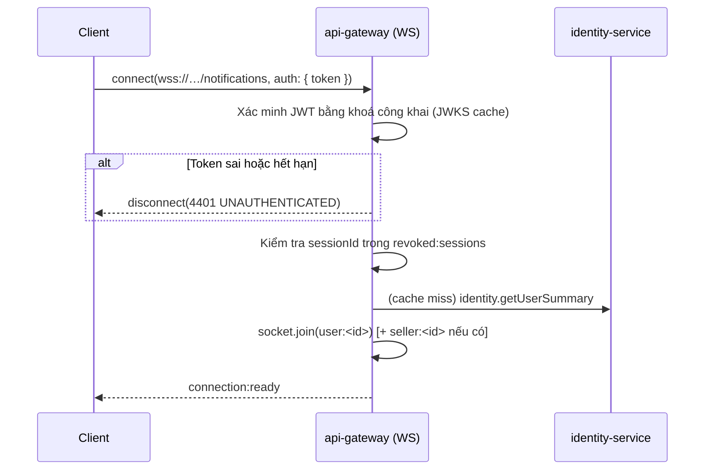
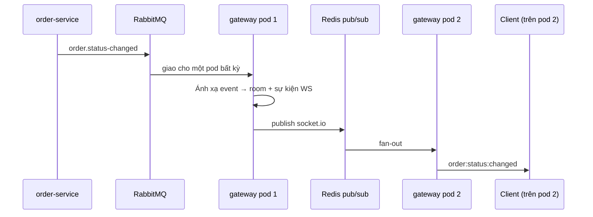

# Realtime (WebSocket)

## 1. Tổng quan



Nguyên tắc:

1. **Chỉ `api-gateway` giữ kết nối WebSocket.** Service nghiệp vụ không mở cổng WS riêng.
2. Service muốn đẩy dữ liệu realtime thì **phát domain event**; gateway là một consumer như mọi consumer khác.
3. Nhiều pod gateway đồng bộ qua `@socket.io/redis-adapter` trên Upstash Redis (kết nối TCP).
4. WebSocket là kênh **bổ trợ**. Mọi dữ liệu đẩy realtime đều phải lấy được qua REST; mất kết nối không làm hỏng nghiệp vụ.

> **Khác bản cũ:** bản cũ có 4 gateway rời rạc (`chat`, `notifications`, `posts`, `reviews`) nằm trong monolith,
> mỗi cái tự đặt tên room và tự phát sự kiện. Bản mới gom về một điểm với quy ước đặt tên thống nhất, nhưng
> **giữ nguyên ngữ nghĩa** để không mất tính năng nào.

## 2. Namespace

| Namespace | Mục đích | Yêu cầu xác thực |
|---|---|---|
| `/notifications` | Thông báo cá nhân, cập nhật số đếm chưa đọc | Bắt buộc |
| `/chat` | Hội thoại user ↔ seller ↔ admin, ticket hỗ trợ | Bắt buộc |
| `/feed` | Bình luận, lượt thích trên post/video; đếm người xem | Tuỳ chọn (khách xem được) |
| `/product` | Đánh giá mới, cập nhật điểm trung bình, tồn kho flash sale | Tuỳ chọn |
| `/admin` | Hàng chờ kiểm duyệt, cảnh báo hệ thống | Bắt buộc, chỉ `ADMIN`/`SUPER_ADMIN` |

Namespace tách theo miền quan tâm, không tách theo service. Một client thường mở đồng thời `/notifications`
và một namespace ngữ cảnh.

## 3. Đặt tên room

```
<loại>:<id>
```

| Room | Ai vào | Ai đẩy |
|---|---|---|
| `user:<userId>` | Chính người dùng (mọi thiết bị) | notification, order, payment, chat |
| `seller:<sellerId>` | Chủ shop + nhân viên shop | order, catalog, wallet, ads |
| `conversation:<conversationId>` | Thành viên hội thoại | chat |
| `post:<postId>` | Người đang xem bài | content, engagement |
| `product:<productId>` | Người đang xem sản phẩm | engagement, inventory |
| `admin:moderation` | Admin có quyền kiểm duyệt | content, catalog, seller |
| `admin:system` | Admin | audit, cảnh báo hạ tầng |

❌ **BAD** — cú pháp không thống nhất, nhìn không biết loại:

```ts
socket.join(`user_${userId}`)        // bản cũ: chat dùng dấu gạch dưới
socket.join(`post:${postId}`)        // bản cũ: post dùng dấu hai chấm
socket.join(productId)               // bản cũ: review dùng thẳng id
```

✅ **GOOD**

```ts
socket.join(roomFor.user(userId))            // 'user:ckx1'
socket.join(roomFor.post(postId))            // 'post:ckx9'
socket.join(roomFor.product(productId))      // 'product:ckxa'
```

`roomFor` là helper duy nhất được phép sinh tên room, khai báo trong `@timmyhub/contracts`.

## 4. Đặt tên sự kiện

```
<miền>:<đối tượng>:<hành động>
```

Dùng `camelCase` cho mỗi phần, thì quá khứ cho hành động đã xảy ra.

| Quy tắc | ❌ BAD | ✅ GOOD |
|---|---|---|
| Đủ ba phần | `notification:new` | `notification:item:created` |
| Thì quá khứ | `post:like` | `post:reaction:updated` |
| Không trộn dấu | `chat:send` / `join:product` | `chat:message:created` / `product:subscribe` |
| Lệnh từ client dùng động từ nguyên thể | `post:new_comment` | `comment:create` |

**Client → server** dùng động từ (`chat:message:send`, `post:subscribe`), **server → client** dùng thì quá khứ
(`chat:message:created`, `post:comment:created`).

## 5. Danh mục sự kiện

### 5.1 `/notifications`

| Hướng | Sự kiện | Payload | Nguồn |
|---|---|---|---|
| S→C | `notification:item:created` | `{ id, type, title, body, linkUrl, createdAt }` | `EVT-notification.created` |
| S→C | `notification:unread:changed` | `{ unreadCount }` | `EVT-notification.read`, `EVT-notification.created` |
| C→S | `notification:read` | `{ notificationId }` | — |
| C→S | `notification:read-all` | `{}` | — |

### 5.2 `/chat`

| Hướng | Sự kiện | Payload | Nguồn |
|---|---|---|---|
| C→S | `conversation:subscribe` | `{ conversationId }` | — |
| C→S | `conversation:unsubscribe` | `{ conversationId }` | — |
| C→S | `chat:message:send` | `{ conversationId, content, attachments?, clientMessageId }` | — |
| C→S | `chat:typing` | `{ conversationId, isTyping }` | — |
| C→S | `chat:read` | `{ conversationId, lastReadMessageId }` | — |
| S→C | `chat:message:created` | `{ id, conversationId, senderId, content, attachments, createdAt, clientMessageId? }` | `EVT-chat.message-sent` |
| S→C | `chat:message:delivered` | `{ clientMessageId, id, createdAt }` | xác nhận ghi thành công |
| S→C | `chat:typing:changed` | `{ conversationId, userId, isTyping }` | — |
| S→C | `chat:read:changed` | `{ conversationId, userId, lastReadMessageId }` | `EVT-chat.read` |
| S→C | `chat:conversation:assigned` | `{ conversationId, agentId }` | `EVT-chat.ticket-assigned` |

`clientMessageId` do client sinh, server trả lại nguyên vẹn — dùng để khớp tin nhắn lạc quan và khử trùng lặp khi
client gửi lại sau mất mạng.

Trợ lý `ai-assistant-bot` của bản cũ được giữ: khi hội thoại có `type = SUPPORT` và chưa có nhân viên nhận,
bot trả lời tự động; khi nhân viên nhận (`chat:conversation:assigned`) thì bot ngừng.

### 5.3 `/feed`

| Hướng | Sự kiện | Payload | Nguồn |
|---|---|---|---|
| C→S | `post:subscribe` / `post:unsubscribe` | `{ postId }` | — |
| S→C | `post:comment:created` | `{ postId, comment }` | `EVT-content.comment-created` |
| S→C | `post:comment:deleted` | `{ postId, commentId }` | `EVT-content.comment-deleted` |
| S→C | `post:reaction:updated` | `{ postId, likeCount, reactedByMe? }` | `EVT-content.reaction-changed` |
| S→C | `post:viewer:changed` | `{ postId, viewerCount }` | đếm trong room |

### 5.4 `/product`

| Hướng | Sự kiện | Payload | Nguồn |
|---|---|---|---|
| C→S | `product:subscribe` / `product:unsubscribe` | `{ productId }` | — |
| S→C | `review:item:created` | `{ productId, review }` | `EVT-engagement.review-created` |
| S→C | `review:comment:created` | `{ reviewId, comment }` | `EVT-engagement.review-comment-created` |
| S→C | `product:rating:updated` | `{ productId, averageRating, reviewCount }` | `EVT-engagement.rating-recalculated` |
| S→C | `product:stock:changed` | `{ productId, variantId, availableStock }` | `EVT-inventory.changed` (chỉ trong flash sale) |

`product:stock:changed` chỉ phát khi sản phẩm thuộc campaign đang chạy — ngoài ra lưu lượng sẽ quá lớn mà giá trị thấp.

### 5.5 `/admin`

| Hướng | Sự kiện | Payload | Nguồn |
|---|---|---|---|
| S→C | `moderation:queue:changed` | `{ queue, pendingCount }` | `EVT-content.submitted`, `EVT-product.submitted`, `EVT-seller.applied` |
| S→C | `system:alert` | `{ level, code, message, occurredAt }` | cảnh báo nội bộ |

### 5.6 Sự kiện hệ thống (mọi namespace)

| Hướng | Sự kiện | Ý nghĩa |
|---|---|---|
| S→C | `connection:ready` | Bắt tay xong, kèm `{ socketId, serverTime }` |
| S→C | `session:revoked` | Phiên bị thu hồi → client đăng xuất và ngắt kết nối |
| S→C | `error` | `{ code, message }` theo đúng danh mục mã lỗi ở [api-conventions §5](api-conventions.md) |

## 6. Bắt tay và xác thực



| Quy tắc | Chi tiết |
|---|---|
| Truyền token | Qua `auth.token` khi handshake, **không** qua query string (query lọt vào log truy cập) |
| Kiểm tra quyền vào room | Ở handler `subscribe`, gọi lại kiểm tra quyền — không tin client |
| Token hết hạn giữa chừng | Client tự refresh rồi gửi `auth:refresh`; server xác minh lại, không cần nối lại |
| Vượt hạn | Sau 30 phút không xác minh lại được → ngắt với mã `4401` |

| Mã đóng | Ý nghĩa |
|---|---|
| `4401` | Chưa xác thực / token hết hạn |
| `4403` | Không đủ quyền vào namespace |
| `4429` | Vượt giới hạn tần suất |
| `4500` | Lỗi server |

❌ **BAD**

```ts
const socket = io(`${API_URL}/notifications?token=${accessToken}`)
```

✅ **GOOD**

```ts
const socket = io(`${WS_URL}/notifications`, {
    auth: { token: accessToken },
    transports: ['websocket'],
    withCredentials: true,
})
```

> **Lỗi bản cũ phải tránh:** `useNotificationSocket` ghép URL thành `…/api/api/notifications` (lặp `/api`), khiến
> kết nối luôn thất bại trong im lặng. Bản mới có một hằng số `WS_URL` duy nhất và một test kiểm tra URL sinh ra.

## 7. Từ domain event tới client



Gateway có một **bảng ánh xạ duy nhất** từ domain event sang sự kiện WS:

```ts
export const REALTIME_MAP: RealtimeMapping[] = [
    {
        event: 'order.status-changed',
        rooms: (e) => [roomFor.user(e.data.buyerId), roomFor.seller(e.data.sellerId)],
        emit: 'order:status:changed',
        payload: (e) => pick(e.data, ['orderId', 'orderCode', 'status', 'changedAt']),
    },
    // …
]
```

Bảng này là nơi duy nhất quyết định "sự kiện nào đẩy cho ai", nên rà soát rò rỉ dữ liệu chỉ cần đọc một file.
`payload` luôn dùng danh sách trường trắng — không đẩy nguyên payload domain event ra client.

## 8. Vận hành

| Hạng mục | Giá trị |
|---|---|
| Transport | `websocket` trước, `polling` dự phòng cho mạng chặn WS |
| Heartbeat | `pingInterval` 25 s, `pingTimeout` 20 s |
| Nối lại | Lùi theo cấp số nhân 1 → 30 s, jitter ngẫu nhiên, không giới hạn số lần |
| Đồng bộ sau khi nối lại | Client gọi REST để lấy lại trạng thái, **không** dựa vào việc phát lại sự kiện |
| Sticky session | Không cần (đã có Redis adapter), nhưng Ingress vẫn bật để giảm nối lại |
| Giới hạn kết nối | 5 socket đồng thời / người dùng; vượt thì đóng socket cũ nhất |
| Giới hạn tin nhắn | 30 sự kiện / 10 giây / socket; vượt thì `4429` |
| Kích thước payload | Tối đa 64 KB / sự kiện |
| Số kết nối đồng thời mục tiêu | ≥ 5.000 ([NFR-010](system-architecture.md)) |
| Tắt máy êm | Phát `connection:draining`, chờ 10 s cho client nối sang pod khác rồi mới đóng |

### Không đảm bảo giao hàng

WebSocket là **at-most-once**. Client mất kết nối trong lúc sự kiện phát đi sẽ không nhận được. Vì vậy:

- Thông báo luôn được ghi vào `notification_db` trước, WS chỉ để hiển thị ngay.
- Tin nhắn chat luôn được ghi vào `chat_db`; khi nối lại client tải lại theo con trỏ.
- Không có nghiệp vụ nào **chỉ** chạy khi client nhận được sự kiện WS.

## 9. Phía frontend

| Hạng mục | Quy ước |
|---|---|
| Khởi tạo | Một instance Socket.IO cho mỗi namespace, đặt trong React context ở tầng layout |
| Truy cập | Hook `useRealtime(namespace)`; component **không** tự gọi `io()` |
| Cập nhật dữ liệu | Sự kiện WS gọi `queryClient.setQueryData` hoặc `invalidateQueries`, không giữ state song song |
| Trạng thái kết nối | Store zustand `connectionStatus`; hiện dải băng "Đang kết nối lại" khi mất quá 5 giây |
| Dọn dẹp | Huỷ đăng ký trong `useEffect` cleanup; rời room khi rời trang |

❌ **BAD** — nhận sự kiện rồi tự ghép vào state cục bộ, dữ liệu lệch với cache:

```ts
socket.on('post:comment:created', (c) => setComments((prev) => [...prev, c]))
```

✅ **GOOD**

```ts
socket.on('post:comment:created', ({ postId, comment }) => {
    queryClient.setQueryData(queryKeys.post.comments(postId), (old) =>
        old ? { ...old, items: [comment, ...old.items] } : old,
    )
})
```

## 10. Checklist thêm sự kiện realtime

- [ ] Có domain event tương ứng trong [event-catalog.md](event-catalog.md) (không đẩy trực tiếp từ controller)
- [ ] Đăng ký trong `REALTIME_MAP` với danh sách trường trắng
- [ ] Tên namespace, room, sự kiện theo §3 và §4
- [ ] Kiểm tra quyền ở handler `subscribe`
- [ ] Payload ≤ 64 KB, không chứa PII ngoài phạm vi người nhận
- [ ] Có đường REST tương đương để lấy cùng dữ liệu
- [ ] Client xử lý được trường hợp nhận sự kiện trùng
- [ ] Bổ sung vào bảng §5 của tài liệu này
