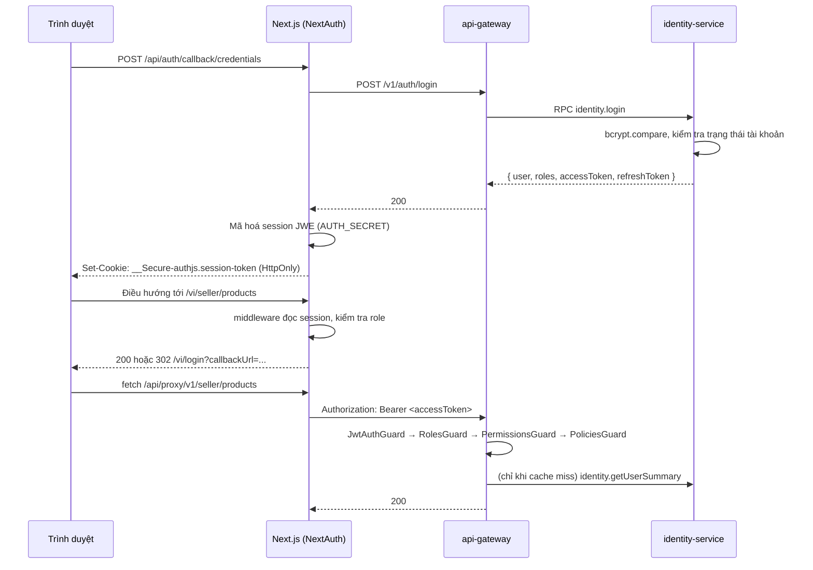
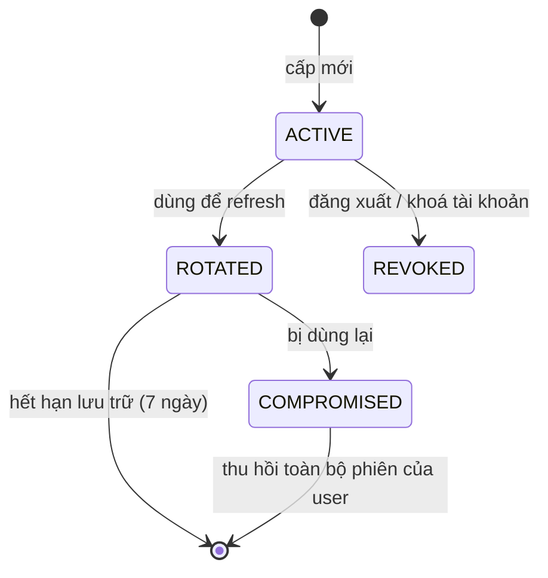
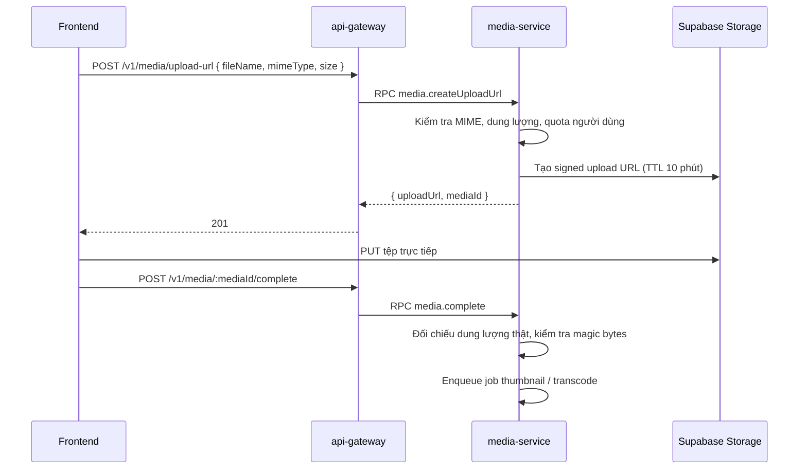

# Bảo mật

## 1. Mô hình mối đe doạ

| # | Mối đe doạ | Tác động | Biện pháp |
|---|---|---|---|
| T1 | Đánh cắp token qua XSS | Chiếm phiên | Cookie `HttpOnly`, không lưu token trong `localStorage`, CSP chặt |
| T2 | CSRF trên endpoint ghi | Thao tác thay mặt nạn nhân | `SameSite=Lax`, CSRF token của NextAuth, kiểm tra `Origin` |
| T3 | Dò mật khẩu | Chiếm tài khoản | Rate limit theo IP+email, khoá tạm 15 phút sau 5 lần sai, bcrypt cost 12 |
| T4 | Leo thang đặc quyền qua IDOR | Đọc/sửa dữ liệu người khác | CASL theo bản ghi, mọi truy vấn lọc theo chủ sở hữu |
| T5 | Giả mạo IPN VNPay | Đơn được đánh dấu đã trả mà không có tiền | Xác minh `vnp_SecureHash`, danh sách IP, đối soát hằng ngày |
| T6 | Seller xem dữ liệu shop khác | Rò rỉ dữ liệu kinh doanh | `sellerId` lấy từ token, **không bao giờ** từ body/query |
| T7 | Upload file độc hại | RCE, phát tán mã độc | Signed URL, giới hạn MIME + dung lượng, kiểm tra magic bytes, phục vụ từ domain riêng |
| T8 | SQL injection | Rò rỉ toàn bộ DB | Prisma tham số hoá; `$queryRaw` chỉ dùng `Prisma.sql` |
| T9 | Lộ bí mật trong repo | Chiếm hạ tầng | Secret scanning ở CI, không commit `.env`, xoay khoá định kỳ |
| T10 | Lạm dụng tài nguyên | Ngừng dịch vụ | Rate limit, quota upload, giới hạn kích thước body |
| T11 | Log chứa dữ liệu nhạy cảm | Rò rỉ PII | `pino` redact, chuẩn hoá danh sách trường nhạy cảm |
| T12 | Người dùng bị khoá vẫn dùng token cũ | Truy cập trái phép | TTL access token 15 phút + danh sách thu hồi ở Redis |

## 2. Luồng xác thực



Trình duyệt **không bao giờ** cầm `accessToken` dưới dạng JavaScript đọc được. Token backend nằm trong session
NextAuth đã mã hoá; route handler của Next.js gắn nó vào header khi gọi gateway.

> **Khác bản cũ:** bản cũ `js-cookie` ghi `access_token`, `user_roles`, `user_permissions` dưới dạng cookie
> **không HttpOnly**, và `proxy.ts` phân quyền ở edge bằng chính các cookie đó — bất kỳ script nào cũng sửa được
> `user_roles` để vượt qua guard phía client. Bản mới loại bỏ hoàn toàn ba cookie này
> ([FEAT-DEP-002](../00-overview/feature-inventory.md), [ADR-0005](adr/ADR-0005-nextauth.md)).

## 3. Token

| Token | TTL | Nơi lưu | Nội dung |
|---|---|---|---|
| Access token (JWT) | 15 phút | Session NextAuth (mã hoá) | `sub`, `email`, `roles[]`, `sellerId?`, `sessionId`, `iat`, `exp` |
| Refresh token | 30 ngày | Cookie HttpOnly riêng + hash trong `identity_db` | Chuỗi ngẫu nhiên 256 bit |
| Email verification | 24 giờ | DB (đã hash) | Dùng một lần |
| Password reset | 1 giờ | DB (đã hash) | Dùng một lần, huỷ mọi phiên khi dùng xong |

JWT ký bằng **RS256**. `identity-service` giữ khoá riêng; các service khác xác minh bằng khoá công khai lấy từ
endpoint JWKS (cache 1 giờ). Đổi khoá theo kiểu chồng lấn: phát hành bằng khoá mới, vẫn chấp nhận khoá cũ đến khi
mọi access token cũ hết hạn.

**Payload JWT không chứa `permissions[]`.** Danh sách permission thay đổi thường xuyên; đưa vào token khiến việc
thu hồi chỉ có hiệu lực sau khi token hết hạn, và làm token phình to. Gateway tra permission từ cache Redis
(TTL 15 phút, xoá ngay khi `rbac.permissions-changed` hoặc `user.locked` được phát).

### Xoay refresh token



Mỗi lần refresh sinh token mới và đánh dấu token cũ là `ROTATED`. Nếu một token `ROTATED` được dùng lại, đó là dấu
hiệu token đã bị đánh cắp → thu hồi **toàn bộ** phiên của người dùng, trả `401 REFRESH_TOKEN_REUSED`, gửi email cảnh báo.

### Thu hồi tức thì

Khi khoá tài khoản hoặc đăng xuất khỏi mọi thiết bị, `sessionId` được thêm vào Redis set `revoked:sessions`
(TTL 15 phút — bằng TTL access token). Guard kiểm tra set này ở mỗi request. Sau 15 phút mọi token liên quan đã tự hết hạn.

## 4. Mật khẩu

| Quy tắc | Giá trị |
|---|---|
| Thuật toán | `bcrypt`, cost 12 |
| Độ dài tối thiểu | 8 ký tự |
| Yêu cầu | Có chữ và số; không ép ký tự đặc biệt |
| Chặn mật khẩu yếu | Đối chiếu danh sách 10.000 mật khẩu phổ biến |
| Đổi mật khẩu | Yêu cầu mật khẩu hiện tại, huỷ mọi phiên khác |
| Lịch sử | Không cho dùng lại 3 mật khẩu gần nhất |
| Không ép đổi định kỳ | Theo khuyến nghị NIST SP 800-63B |

❌ **BAD**

```ts
if (!user) throw new NotFoundException('Email không tồn tại')
if (!match) throw new UnauthorizedException('Sai mật khẩu')   // giúp kẻ tấn công dò email
```

✅ **GOOD**

```ts
const user = await this.users.findByEmail(email)
const hash = user?.password ?? DUMMY_HASH          // luôn so sánh để tránh rò rỉ qua thời gian phản hồi
const ok = await bcrypt.compare(password, hash)
if (!user || !ok) throw new ApiError(API_ERROR.INVALID_CREDENTIALS)
```

## 5. SSO Google / Facebook

| Bước | Xử lý |
|---|---|
| 1 | NextAuth chạy OAuth 2.0 + PKCE với provider |
| 2 | Next.js gửi hồ sơ đã xác minh sang `POST /v1/auth/sso` kèm `state` |
| 3 | `identity-service` tìm `Account(provider, providerAccountId)` |
| 4 | Chưa có và email **đã xác minh** trùng tài khoản sẵn có → liên kết vào tài khoản đó |
| 5 | Chưa có và email **chưa xác minh** → **không** tự liên kết, yêu cầu đăng nhập rồi liên kết thủ công |
| 6 | Không có tài khoản nào → tạo mới, `emailVerified` theo provider, gán role `USER` |

Bước 5 chặn kiểu tấn công chiếm tài khoản bằng email chưa xác minh. Người dùng chỉ đăng nhập bằng SSO sẽ không có
`password`; muốn dùng mật khẩu phải đi qua luồng "đặt mật khẩu" (gửi mail xác nhận).

## 6. Phân quyền

Ba tầng, **ghép bằng AND** — chi tiết ở [roles-and-permissions.md](../00-overview/roles-and-permissions.md).

```ts
@Post(':id/approval')
@Roles(UserRole.ADMIN)                                   // 1. vai trò
@Permissions(PERMISSIONS.CATALOG.PRODUCTS.APPROVE)       // 2. permission
@CheckPolicies((ab: AppAbility) => ab.can('approve', 'Product'))   // 3. CASL theo bản ghi
approve(@Param('id') id: string, @CurrentUser() user: AuthUser) { /* … */ }
```

Nguyên tắc bất di bất dịch cho dữ liệu có chủ sở hữu:

❌ **BAD**

```ts
@Get('products')
list(@Query('sellerId') sellerId: string) {              // client tự khai mình là shop nào
    return this.svc.findBySeller(sellerId)
}
```

✅ **GOOD**

```ts
@Get('products')
list(@CurrentUser() user: AuthUser) {
    return this.svc.findBySeller(user.sellerId)          // danh tính lấy từ token đã ký
}
```

Khi người gọi không được phép biết một tài nguyên tồn tại (đơn hàng của người khác, sản phẩm nháp của shop khác),
trả `404` chứ không phải `403`.

## 7. Bảo vệ ở tầng vận chuyển và trình duyệt

### Helmet

```ts
app.use(helmet({
    contentSecurityPolicy: false,   // CSP do Next.js đặt, tránh đặt hai nơi mâu thuẫn
    crossOriginResourcePolicy: { policy: 'cross-origin' },
    hsts: { maxAge: 31_536_000, includeSubDomains: true, preload: true },
    referrerPolicy: { policy: 'strict-origin-when-cross-origin' },
    frameguard: { action: 'deny' },
}))
```

### CSP (đặt ở Next.js)

| Chỉ thị | Giá trị |
|---|---|
| `default-src` | `'self'` |
| `script-src` | `'self'` + nonce theo request (không `unsafe-inline`, không `unsafe-eval`) |
| `style-src` | `'self' 'unsafe-inline'` (Tailwind sinh style inline cho một số tiện ích) |
| `img-src` | `'self' data: blob:` + domain Supabase Storage |
| `media-src` | `'self'` + domain Supabase Storage |
| `connect-src` | `'self'` + domain API + domain WebSocket + Sentry |
| `frame-ancestors` | `'none'` |
| `form-action` | `'self'` + domain VNPay |
| `upgrade-insecure-requests` | bật |

### CORS

Chỉ cho phép danh sách origin cấu hình sẵn (`CORS_ORIGINS`), `credentials: true`, phương thức
`GET, POST, PATCH, PUT, DELETE, OPTIONS`. **Không** dùng `origin: true` hay `*` ở bất kỳ môi trường nào — kể cả dev.

### Cookie

| Cookie | Thuộc tính |
|---|---|
| `__Secure-authjs.session-token` | `HttpOnly; Secure; SameSite=Lax; Path=/` |
| `__Host-refresh-token` | `HttpOnly; Secure; SameSite=Strict; Path=/api/auth` |
| `__Host-authjs.csrf-token` | `HttpOnly; Secure; SameSite=Lax; Path=/` |

Không có cookie nào chứa dữ liệu phân quyền mà client đọc được.

## 8. Đầu vào và đầu ra

| Hạng mục | Quy tắc |
|---|---|
| Validate | zod ở cả gateway và service ([api-conventions §9](api-conventions.md)) |
| Kích thước body | Tối đa 1 MB (JSON); upload đi qua signed URL |
| Truy vấn thô | Chỉ `Prisma.sql` tham số hoá; ESLint chặn template string trong `$queryRawUnsafe` |
| HTML do người dùng nhập | Mô tả sản phẩm và bài viết được làm sạch bằng `sanitize-html` với danh sách thẻ trắng, **ở phía server** |
| Render phía FE | Không dùng `dangerouslySetInnerHTML` với dữ liệu chưa làm sạch |
| Tên file upload | Sinh lại bằng cuid; **không** dùng tên gốc trong đường dẫn lưu trữ |
| Chuyển hướng | `callbackUrl` phải là đường dẫn tương đối hoặc thuộc danh sách host trắng |

❌ **BAD**

```ts
const products = await prisma.$queryRawUnsafe(`SELECT * FROM products WHERE name LIKE '%${q}%'`)
```

✅ **GOOD**

```ts
const products = await prisma.$queryRaw(Prisma.sql`SELECT * FROM products WHERE name ILIKE ${`%${q}%`}`)
```

## 9. Upload tệp



| Loại | MIME cho phép | Tối đa |
|---|---|---|
| Ảnh | `image/jpeg`, `image/png`, `image/webp` | 5 MB |
| Video | `video/mp4`, `video/webm` | 50 MB (200 MB cho video quảng cáo) |
| Tài liệu (hồ sơ seller) | `application/pdf` | 10 MB |

Không tin `mimeType` client khai — kiểm tra magic bytes sau khi tải lên. Tệp phục vụ từ domain riêng
(`cdn.timmyhub.vn`) với `Content-Disposition: attachment` cho loại không phải ảnh/video, để tệp độc hại không chạy
trong ngữ cảnh domain chính.

## 10. Bảo mật thanh toán

| Điểm | Yêu cầu |
|---|---|
| Không lưu dữ liệu thẻ | Toàn bộ nhập liệu thẻ diễn ra trên trang VNPay |
| Chữ ký | `vnp_SecureHash` HMAC-SHA512 với `VNPAY_HASH_SECRET`; so sánh theo thời gian hằng định |
| IPN là nguồn sự thật | `payment.succeeded` **chỉ** phát từ IPN, **không bao giờ** từ return URL |
| Idempotent | Khử trùng lặp theo `vnp_TxnRef` bằng `processed_events`; IPN có thể đến nhiều lần và đến **trước** return URL |
| Số tiền | So khớp `vnp_Amount` với số tiền đơn hàng; lệch → `MANUAL_REVIEW`, không tự động xử lý |
| Đối soát | Job hằng ngày đối chiếu giao dịch nội bộ với báo cáo VNPay; NFR yêu cầu 0 chênh lệch |
| Ghi log | Lưu nguyên văn IPN vào `SystemLog` **trước** khi xử lý |
| Rút tiền | Bắt buộc OTP qua email; hạn mức ngày; admin duyệt với khoản vượt ngưỡng; ghi audit đầy đủ |

## 11. Quản lý bí mật

| Môi trường | Nơi lưu |
|---|---|
| local | `.env.local` (đã gitignore), sinh từ `.env.example` |
| CI | GitHub Actions Secrets |
| staging / production | Kubernetes Secret, đồng bộ từ kho bí mật (External Secrets Operator) |

Quy tắc:

- `.env.example` chỉ chứa **tên biến**, không chứa giá trị — kể cả giá trị mẫu trông vô hại.
- Bật secret scanning + push protection trên repo; thêm `gitleaks` vào CI.
- Xoay khoá định kỳ 90 ngày: `JWT_PRIVATE_KEY`, `AUTH_SECRET`, `VNPAY_HASH_SECRET`, token dịch vụ Supabase.
- Bí mật lộ ra ngoài → **xoay ngay**, coi như đã bị dùng; xoá khỏi lịch sử git là việc phụ, không thay thế việc xoay.

> ⚠️ **Nợ bảo mật kế thừa — xử lý trước khi tái sử dụng bất kỳ giá trị nào từ repo cũ:**
>
> | Vị trí ở repo cũ | Nội dung lộ | Việc phải làm |
> |---|---|---|
> | `timmyhub-nextjs/.env` (đã commit) | `SENTRY_AUTH_TOKEN`, `NEXT_PUBLIC_SENTRY_DSN` | Xoay token Sentry, tạo DSN mới |
> | `.kiro/settings/mcp.json` | Chuỗi kết nối Supabase pooler kèm thông tin đăng nhập, `VERCEL_TOKEN` dạng rõ | Đổi mật khẩu DB, thu hồi Vercel token |
> | `.cursor/mcp.json` (**không** gitignore) | Google `X-Goog-Api-Key` dạng rõ | Thu hồi và tạo khoá mới, giới hạn theo referrer |
>
> Ghi lại trong [migration-from-legacy.md](../08-handoff/migration-from-legacy.md).

## 12. Dữ liệu cá nhân

| Loại | Xử lý |
|---|---|
| Mật khẩu | bcrypt, không bao giờ log, không trả về API |
| Email, số điện thoại | Lưu dạng rõ (cần cho vận hành), che khi hiển thị cho vai không đủ quyền (`ng***@gmail.com`) |
| Địa chỉ | Chỉ hiện đầy đủ cho chủ sở hữu, seller của đơn liên quan, và admin |
| Giấy tờ định danh seller | Bucket riêng, không công khai, chỉ truy cập qua signed URL TTL ngắn |
| Payload event | Chỉ mang trường công khai — `user.profile-updated` **không** chứa email/phone |
| Log ứng dụng | `pino` redact: `password`, `token`, `authorization`, `refreshToken`, `vnp_SecureHash`, `cardNumber`, `otp` |

Xoá tài khoản: ẩn danh hoá `User`/`Profile` (email → `deleted-<cuid>@timmyhub.invalid`, xoá tên, ảnh, điện thoại);
**giữ nguyên** `Order`, `Payment`, `AuditLog` vì nghĩa vụ kế toán và chống gian lận. Chi tiết ở
[data-architecture.md](data-architecture.md).

## 13. Bảo mật nội bộ giữa các service

| Hạng mục | Quy tắc |
|---|---|
| Truy cập | Service **chỉ** phơi ra qua RabbitMQ, không có Ingress công khai; NetworkPolicy chặn lưu lượng ngoài namespace |
| Tin cậy | Service **không** tin gateway vô điều kiện — vẫn parse lại payload và kiểm tra `actor` trong metadata |
| RabbitMQ | Mỗi service một user riêng, cấp quyền tối thiểu trên đúng exchange/queue của mình |
| Postgres | Mỗi service một user riêng, chỉ được truy cập database của chính nó |
| Redis | Tiền tố khoá theo service, giới hạn lệnh nguy hiểm (`FLUSHDB`, `KEYS`) |
| Ảnh container | Chạy non-root, filesystem chỉ đọc, quét lỗ hổng (Trivy) trong CI, chặn merge nếu có lỗ hổng HIGH |

## 14. Checklist bảo mật trước khi phát hành

- [ ] Không có bí mật trong repo (gitleaks sạch)
- [ ] Mọi endpoint mới có guard phù hợp; endpoint công khai đánh dấu `@Public()` **có chủ đích**
- [ ] Mọi truy vấn dữ liệu có chủ sở hữu đều lọc theo danh tính từ token
- [ ] Rate limit đã khai báo cho endpoint ghi và endpoint tốn tài nguyên
- [ ] Không có `$queryRawUnsafe`, không có `dangerouslySetInnerHTML` với dữ liệu chưa làm sạch
- [ ] Header bảo mật kiểm tra bằng `securityheaders.com` đạt hạng A
- [ ] Phụ thuộc: `pnpm audit` không còn lỗ hổng HIGH/CRITICAL
- [ ] Ảnh container quét sạch
- [ ] Audit log ghi đủ cho mọi thao tác ghi mới
- [ ] Thông báo lỗi không tiết lộ tồn tại tài nguyên hay chi tiết nội bộ
