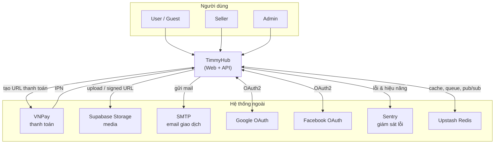
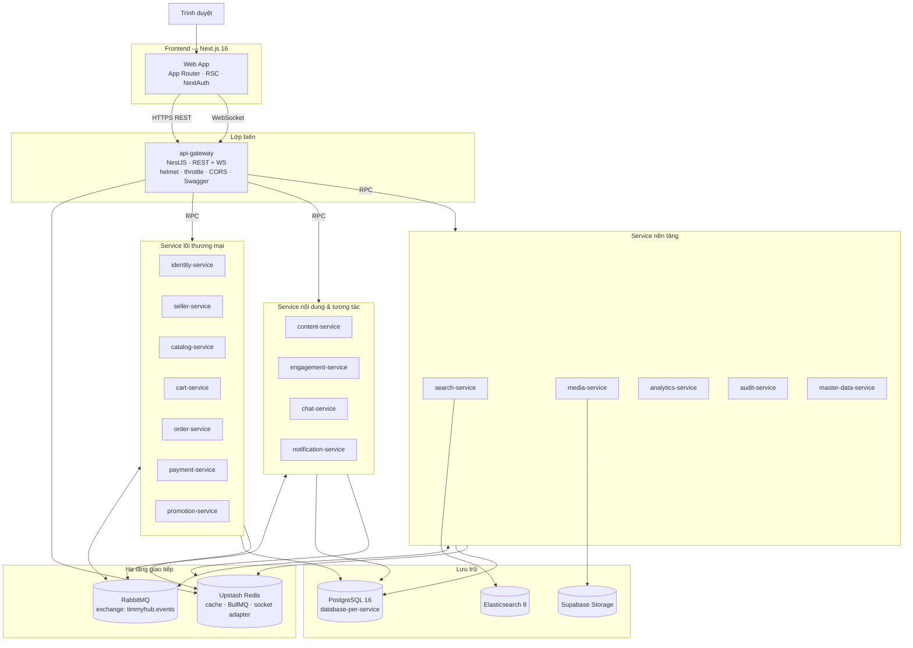
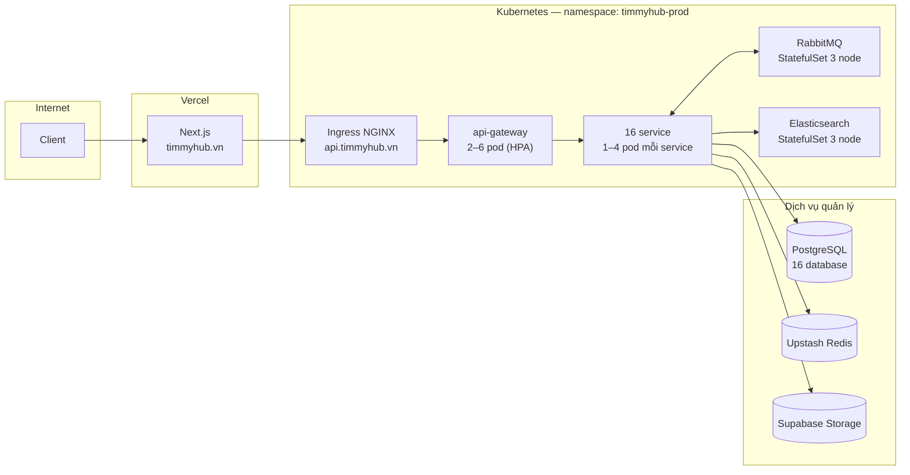
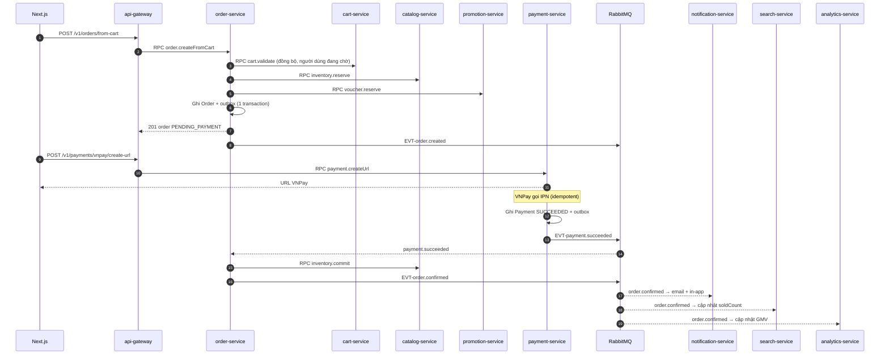

# Kiến trúc hệ thống

## 1. Bối cảnh (C4 — Level 1)

## 2. Container (C4 — Level 2)

## 3. Nguyên tắc kiến trúc

| # | Nguyên tắc | Hệ quả bắt buộc |
|---|---|---|
| 1 | **Một điểm vào duy nhất** | Chỉ `api-gateway` mở ra Internet; service khác không có Ingress |
| 2 | **Database-per-service** | Không service nào có chuỗi kết nối tới DB của service khác; không `JOIN` xuyên service |
| 3 | **Event là hợp đồng công khai** | Đổi payload event là thay đổi phá vỡ (breaking); phải lên phiên bản — xem [event-catalog.md](event-catalog.md) |
| 4 | **Bất đồng bộ là mặc định** | Chỉ dùng RPC đồng bộ khi người dùng đang chờ kết quả ngay |
| 5 | **Nguồn sự thật nằm ở service sở hữu** | Bản sao ở service khác là read model, chấp nhận nhất quán cuối cùng |
| 6 | **Idempotent ở mọi ranh giới** | Mọi consumer và mọi webhook ngoài phải chịu được gọi lặp |
| 7 | **Ghi trước, phát sau** | Domain event luôn qua outbox trong cùng transaction nghiệp vụ |
| 8 | **Không tin dữ liệu vào** | Validate bằng zod tại gateway **và** tại service |
| 9 | **Mọi thay đổi dữ liệu đều có dấu vết** | Audit log tự động, `traceId` xuyên suốt |
| 10 | **Hỏng một phần, không hỏng toàn bộ** | Timeout, circuit breaker, suy giảm có kiểm soát (xem §7) |

## 4. Tầng và trách nhiệm

| Tầng | Thành phần | Trách nhiệm | **Không** làm |
|---|---|---|---|
| Trình bày | Next.js | Render, điều hướng, trạng thái UI, phiên NextAuth | Logic nghiệp vụ, truy cập DB |
| Biên | `api-gateway` | Xác thực, RBAC lớp 1–2, rate limit, helmet, CORS, tổng hợp Swagger, chuyển WS | Logic nghiệp vụ, giữ dữ liệu bền vững |
| Nghiệp vụ | 16 service | Quy tắc nghiệp vụ, sở hữu dữ liệu, phát/nhận event, job nền | Gọi trực tiếp service khác qua HTTP |
| Dữ liệu | PostgreSQL, Elasticsearch, Supabase Storage | Lưu trữ | — |
| Hạ tầng giao tiếp | RabbitMQ, Redis | Truyền event, cache, hàng đợi job, pub/sub socket | — |

## 5. Bản đồ triển khai

Chi tiết manifest, probe, HPA, secret: [kubernetes.md](../05-infra/kubernetes.md).

## 6. Luồng xuyên suốt tiêu biểu — checkout

Chi tiết saga và các hành động bù trừ: [communication-patterns.md §5](communication-patterns.md#5-saga-checkout).

## 7. Chiến lược suy giảm có kiểm soát

Khi một thành phần hỏng, hệ thống **không được sập toàn bộ**. Bảng dưới là hợp đồng: mỗi hàng phải có test tương ứng
trong bộ test khả chịu lỗi.

| Thành phần hỏng | Hành vi bắt buộc | Chức năng mất |
|---|---|---|
| `search-service` / Elasticsearch | Quay về truy vấn `catalog-service` bằng Postgres `ILIKE` | Facet, gợi ý, chịu lỗi chính tả |
| `content-service` | Trang sản phẩm vẫn render, khối nội dung hiển thị trạng thái rỗng | Feed, quảng cáo |
| `analytics-service` | Dashboard hiện dữ liệu tổng hợp gần nhất + cảnh báo "dữ liệu tạm cũ" | Số liệu thời gian thực |
| `notification-service` | Event nằm lại hàng đợi, gửi bù khi service sống lại | Thông báo tức thời |
| `chat-service` | FE hiện "mất kết nối", tự kết nối lại có backoff | Chat realtime |
| `media-service` | Upload báo lỗi rõ ràng; ảnh đã có vẫn phục vụ từ Supabase | Tải tệp mới |
| Redis | Cache miss xuống DB; rate limit chuyển sang bộ đếm cục bộ | Hiệu năng, giới hạn chính xác toàn cục |
| RabbitMQ | Ghi nghiệp vụ **vẫn thành công** (outbox giữ event), phát lại khi phục hồi | Cập nhật xuyên service tức thời |
| `payment-service` | Không cho tạo đơn mới cần thanh toán online; COD vẫn chạy | Thanh toán VNPay |
| `identity-service` | **Không suy giảm** — toàn hệ thống từ chối yêu cầu cần xác thực | Mọi thứ cần đăng nhập |

`identity-service` và `order-service` là hai service **không có phương án suy giảm**; chúng phải chạy tối thiểu 2 replica
và có PodDisruptionBudget.

## 8. Chỉ tiêu phi chức năng

| ID | Chỉ tiêu | Mục tiêu | Đo bằng |
|---|---|---|---|
| NFR-001 | p95 API đọc | ≤ 300 ms | Prometheus histogram tại gateway |
| NFR-002 | p95 API ghi | ≤ 800 ms | như trên |
| NFR-003 | p99 tìm kiếm | ≤ 500 ms | `search-service` |
| NFR-004 | Uptime gateway | ≥ 99,5%/tháng | Probe ngoài |
| NFR-005 | Độ trễ phát tán event (p95) | ≤ 5 giây từ commit tới consumer | Metric outbox |
| NFR-006 | RPO | ≤ 15 phút | Backup Postgres (PITR) |
| NFR-007 | RTO | ≤ 60 phút | Diễn tập khôi phục hằng quý |
| NFR-008 | Đồng thời WebSocket | ≥ 5.000 kết nối | Test tải |
| NFR-009 | Thông lượng đơn | ≥ 50 đơn/phút ở giờ cao điểm | Test tải |
| NFR-010 | Sai lệch đối soát thanh toán | 0 giao dịch | Job đối soát hằng ngày |
| NFR-011 | Thời gian khởi động một service | ≤ 30 giây tới trạng thái ready | Readiness probe |
| NFR-012 | Độ phủ test service lõi | ≥ 70% dòng | CI |
| NFR-013 | Kích thước bundle FE (route chính, gzip) | ≤ 250 KB | `next build` |
| NFR-014 | Lighthouse Performance (trang sản phẩm, mobile) | ≥ 85 | CI |
| NFR-015 | Khả năng truy cập | WCAG 2.2 AA | axe + kiểm thủ công |

## 9. Chi phí phải trả của kiến trúc này

Trung thực về đánh đổi (chi tiết trong [ADR-0001](adr/ADR-0001-microservices.md)):

| Cái được | Cái mất |
|---|---|
| Mở rộng và triển khai độc lập từng miền | Không còn transaction ACID xuyên miền → phải dùng saga |
| Ranh giới sở hữu dữ liệu rõ ràng | Truy vấn xuyên miền phải dựng read model, dữ liệu trùng lặp |
| Hỏng cục bộ không lan | Vận hành phức tạp hơn nhiều: 17 pipeline, 16 DB, 1 message broker phải trông |
| Đội có thể làm song song | Dev local nặng hơn, cần compose nhiều container |
| Công nghệ theo miền | Gỡ lỗi xuyên service cần tracing, không thể đọc một stack trace là xong |

**Điều kiện dừng:** nếu sau 6 tháng số service hoạt động thực sự độc lập < 5, xem xét gộp lại thành modular monolith.
Tiêu chí đánh giá ghi trong [risks.md](../07-plan/risks.md).
