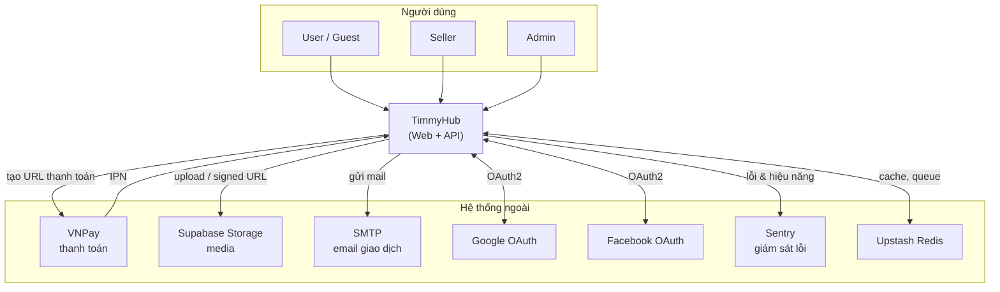
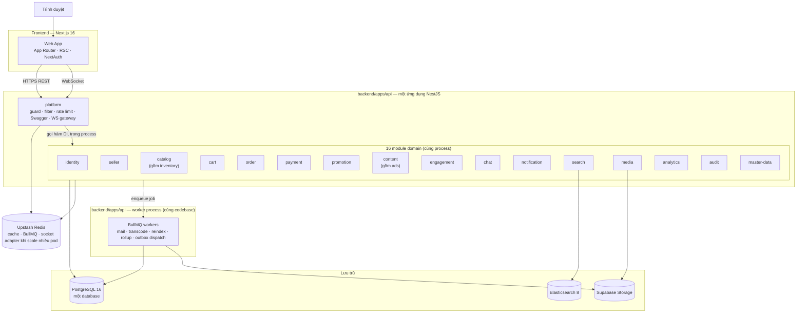
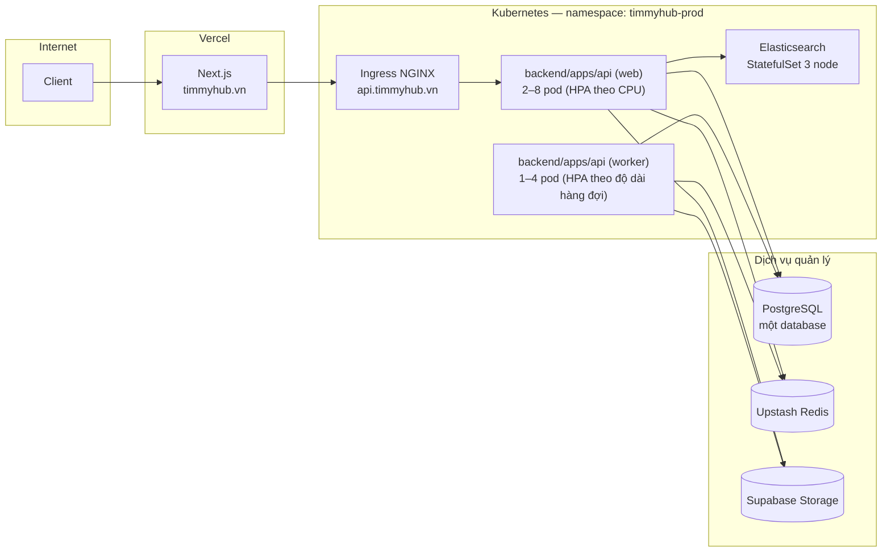
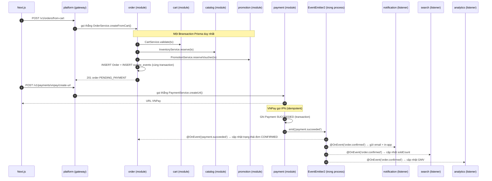

# Kiến trúc hệ thống

> Trước ngày 2026-09-19, tài liệu này mô tả kiến trúc full microservices (16 service độc lập, database-per-service,
> RabbitMQ). Theo [ADR-0015](adr/ADR-0015-modular-monolith.md), kiến trúc đã chuyển sang **modular monolith**: một
> ứng dụng NestJS (`backend/apps/api`), một database Postgres, các domain là module trong cùng process. Tài liệu này
> đã cập nhật theo quyết định mới; xem [ADR-0001](adr/ADR-0001-microservices.md) nếu cần đối chiếu kiến trúc cũ.

## 1. Bối cảnh (C4 — Level 1)

Tầng này không đổi so với bản cũ — hệ thống ngoài không quan tâm backend là microservices hay monolith.

## 2. Container (C4 — Level 2)

Không còn "hạ tầng giao tiếp" RabbitMQ ở giữa các khối — module gọi nhau trực tiếp trong cùng process (§3 của
[communication-patterns.md](communication-patterns.md)). `worker` là một entry point khác của **cùng codebase**, chạy
như process riêng để BullMQ job nặng (transcode, mail, reindex, dispatch outbox) không chiếm CPU của process phục vụ
HTTP — đây không phải service khác, chỉ là scale process độc lập trong cùng đơn vị triển khai.

## 3. Nguyên tắc kiến trúc

| # | Nguyên tắc | Hệ quả bắt buộc |
|---|---|---|
| 1 | **Một điểm vào duy nhất** | Chỉ `backend/apps/api` (qua module `platform`) mở ra Internet; `worker` không nhận traffic ngoài |
| 2 | **Một database, ranh giới module bằng code** | Không module nào import Prisma model/repository của module khác — chỉ gọi qua service đã export (ESLint boundary rule) |
| 3 | **Event trong process là hợp đồng nội bộ** | Payload event vẫn theo quy ước ở [event-catalog.md](event-catalog.md), nhưng không cần version song song như khi phát qua broker liên service |
| 4 | **Đồng bộ là mặc định trong luồng chính** | Module gọi module khác bằng hàm trực tiếp; chỉ tách bất đồng bộ khi phản ứng không cần chặn luồng hiện tại hoặc phụ thuộc hệ thống ngoài |
| 5 | **Giao dịch xuyên domain dùng `$transaction` thật** | Không dùng saga/compensating action cho case trong process — xem [communication-patterns.md §2](communication-patterns.md#2-giao-dịch-xuyên-module) |
| 6 | **Idempotent ở ranh giới hệ thống ngoài** | Webhook (IPN VNPay), outbox worker phải chịu được gọi lặp; lời gọi nội bộ giữa module không cần vì đã trong một transaction |
| 7 | **Outbox chỉ cho hệ quả ra ngoài process** | Email, webhook, audit log — không dùng cho domain event nội bộ (dùng `EventEmitter2`) |
| 8 | **Không tin dữ liệu vào** | Validate bằng zod tại module `platform` **và** tại service của từng module |
| 9 | **Mọi thay đổi dữ liệu đều có dấu vết** | Audit log tự động qua Prisma Client Extension, `traceId` xuyên suốt request (AsyncLocalStorage) |
| 10 | **Hỏng một phần, không hỏng toàn ứng dụng nghiệp vụ** | Timeout khi gọi hệ thống ngoài, suy giảm có kiểm soát cho phụ thuộc ngoài (Elasticsearch, VNPay...) — xem §7 |

## 4. Tầng và trách nhiệm

| Tầng | Thành phần | Trách nhiệm | **Không** làm |
|---|---|---|---|
| Trình bày | Next.js | Render, điều hướng, trạng thái UI, phiên NextAuth | Logic nghiệp vụ, truy cập DB |
| Biên | Module `platform` | Xác thực, RBAC lớp 1–2, rate limit, helmet, CORS, Swagger, giữ kết nối WS | Logic nghiệp vụ, truy cập Prisma model của module khác |
| Nghiệp vụ | 16 module domain | Quy tắc nghiệp vụ, sở hữu bảng của domain mình, phát/nhận event nội bộ, enqueue job | Import Prisma/repository của module khác |
| Nền | BullMQ worker (cùng codebase) | Job nặng CPU/IO, dispatch outbox | Nhận request HTTP trực tiếp |
| Dữ liệu | PostgreSQL (một database), Elasticsearch, Supabase Storage | Lưu trữ | — |
| Hạ tầng phụ trợ | Redis (Upstash) | Cache, hàng đợi BullMQ, socket adapter khi scale nhiều pod | Không còn vai trò "event bus" — đã bỏ RabbitMQ |

## 5. Bản đồ triển khai

Chi tiết manifest, probe, HPA, secret: [kubernetes.md](../05-infra/kubernetes.md) (cần cập nhật số lượng Deployment
từ 17 xuống 2: `api` và `worker`, cùng image, khác entrypoint/command).

## 6. Luồng xuyên suốt tiêu biểu — checkout

Không còn bước "RPC inventory.commit" riêng vì tồn kho đã được giữ (reserve) trong cùng transaction lúc tạo đơn —
xem [communication-patterns.md §4](communication-patterns.md#4-việc-bất-đồng-bộ-chờ-hệ-thống-ngoài--checkout-chờ-thanh-toán).

## 7. Chiến lược suy giảm có kiểm soát

Với modular monolith, phần lớn "service khác chết" không còn là kịch bản hợp lệ (mọi module sống/chết cùng nhau vì
cùng process). Suy giảm có kiểm soát giờ áp dụng cho **phụ thuộc bên ngoài** (Elasticsearch, VNPay, SMTP, Redis) —
đây mới là các thành phần có thể chết độc lập với app.

| Phụ thuộc ngoài hỏng | Hành vi bắt buộc | Chức năng mất |
|---|---|---|
| Elasticsearch | Module `search` quay về truy vấn Postgres `ILIKE` qua `catalog` | Facet, gợi ý, chịu lỗi chính tả |
| Redis (Upstash) | Cache miss xuống DB; rate limit chuyển sang bộ đếm cục bộ trong process; BullMQ job không enqueue được → log cảnh báo, business logic chính vẫn chạy | Hiệu năng, giới hạn chính xác toàn cục, job nền tạm hoãn |
| VNPay | Không tạo được URL thanh toán mới; COD vẫn chạy; đơn đang chờ IPN giữ nguyên trạng thái tới khi hết hạn | Thanh toán online |
| SMTP | Outbox giữ bản ghi `PENDING`, worker retry theo backoff, cảnh báo khi `FAILED` | Gửi email đúng lúc (không mất, chỉ trễ) |
| Supabase Storage | Upload báo lỗi rõ ràng; ảnh/video đã có vẫn phục vụ qua CDN | Tải tệp mới |
| Postgres | **Không suy giảm** — toàn ứng dụng trả `503`, health check fail | Toàn bộ tính năng |

Vì `identity`, `order`, `payment` đều là module trong cùng process với các module khác, không còn khái niệm
"identity-service không suy giảm trong khi search-service suy giảm được" — nếu process web còn sống, toàn bộ module
đều còn sống; nếu process chết, toàn bộ chức năng cần request HTTP đều mất. Vì vậy quy định **≥ 2 replica** áp dụng
cho **cả process web**, không phải cho từng module riêng lẻ.

## 8. Chỉ tiêu phi chức năng

| ID | Chỉ tiêu | Mục tiêu | Đo bằng |
|---|---|---|---|
| NFR-001 | p95 API đọc | ≤ 300 ms | Prometheus histogram tại `platform` |
| NFR-002 | p95 API ghi | ≤ 800 ms | như trên |
| NFR-003 | p99 tìm kiếm | ≤ 500 ms | Module `search` |
| NFR-004 | Uptime API | ≥ 99,5%/tháng | Probe ngoài |
| NFR-005 | Độ trễ xử lý outbox (p95) | ≤ 5 giây từ commit tới khi worker gửi ra ngoài | Metric outbox |
| NFR-006 | RPO | ≤ 15 phút | Backup Postgres (PITR) |
| NFR-007 | RTO | ≤ 60 phút | Diễn tập khôi phục hằng quý |
| NFR-008 | Đồng thời WebSocket | ≥ 5.000 kết nối | Test tải |
| NFR-009 | Thông lượng đơn | ≥ 50 đơn/phút ở giờ cao điểm | Test tải |
| NFR-010 | Sai lệch đối soát thanh toán | 0 giao dịch | Job đối soát hằng ngày |
| NFR-011 | Thời gian khởi động process | ≤ 30 giây tới trạng thái ready | Readiness probe |
| NFR-012 | Độ phủ test module lõi (`order`, `payment`, `catalog`) | ≥ 70% dòng | CI |
| NFR-013 | Kích thước bundle FE (route chính, gzip) | ≤ 250 KB | `next build` |
| NFR-014 | Lighthouse Performance (trang sản phẩm, mobile) | ≥ 85 | CI |
| NFR-015 | Khả năng truy cập | WCAG 2.2 AA | axe + kiểm thủ công |

## 9. Chi phí phải trả của kiến trúc này

Trung thực về đánh đổi (chi tiết trong [ADR-0015](adr/ADR-0015-modular-monolith.md)):

| Cái được | Cái mất |
|---|---|
| Vận hành đơn giản: 1 Dockerfile, 1–2 Deployment (web + worker), 1 database | Không scale độc lập theo domain — `media-transcode` cần nhiều CPU vẫn phải scale cả app (bù lại: transcode chạy trên worker process riêng) |
| Giao dịch xuyên domain là `$transaction` ACID thật, không cần saga | Một lỗi nghiêm trọng (memory leak, deadlock) có thể ảnh hưởng toàn app, không còn cô lập theo service |
| Không cần dựng/vận hành RabbitMQ, tracing phân tán "từ ngày đầu" | Đội làm song song trên nhiều module dễ đụng merge conflict hơn |
| Dev local nhẹ hơn hẳn — không cần compose 17 container | Ranh giới module chỉ được giữ bằng kỷ luật code + lint, không phải bằng hạ tầng — cần review nghiêm khi thêm import xuyên module |
| Debug dễ hơn — một stack trace là đủ, không cần nối trace qua nhiều service | Không đúng với hình dung ban đầu "10+ service" trong kế hoạch gốc — cần thống nhất lại với mọi tài liệu tham chiếu số liệu cũ |

**Điều kiện xem lại:** tách một module cụ thể ra service riêng khi đo được nhu cầu scale độc lập, đội riêng phụ
trách, hoặc yêu cầu cô lập bắt buộc (ví dụ `payment`) — xem [ADR-0015 §Điều kiện xem lại](adr/ADR-0015-modular-monolith.md#điều-kiện-xem-lại).
