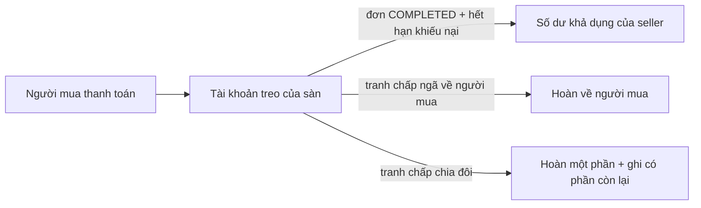
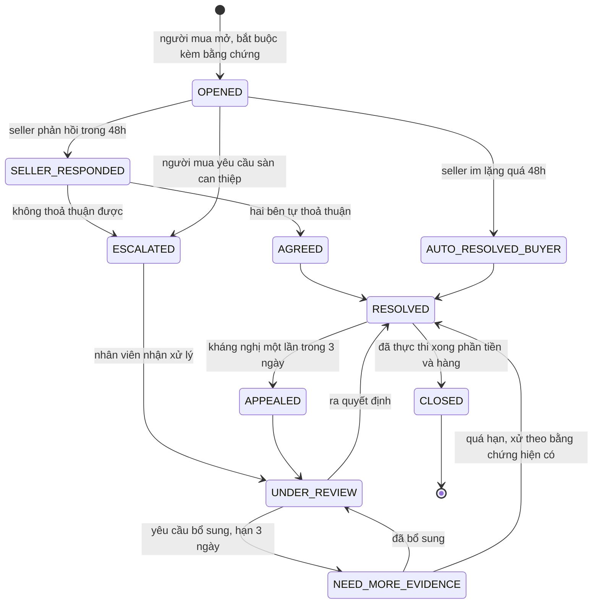
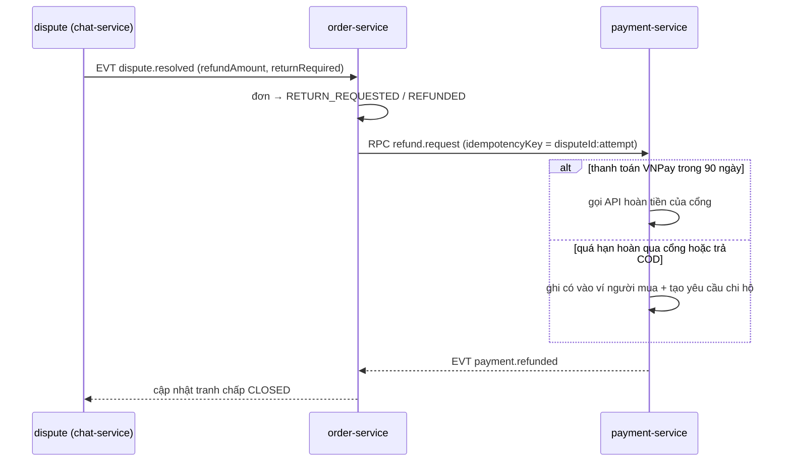

# Tranh chấp đơn hàng, trả hàng và hoàn tiền

> Đây là phần quyết định người mua có quay lại hay không, và là phần dễ bị lạm dụng nhất từ **cả hai phía**.
> Nguyên tắc thiết kế: **tiền của người mua bị giữ lại chứ không chuyển cho seller cho tới khi hết thời hạn khiếu nại**,
> và mọi bước đều có hạn chót — quá hạn thì hệ thống tự quyết theo luật đã công bố, không để treo vô thời hạn.

---

## 1. Ai giữ tiền và giữ tới khi nào

| Mốc | Thời hạn mặc định | Cấu hình ở |
|---|---|---|
| Tự động hoàn tất đơn sau khi giao | 7 ngày | `ORDER_AUTO_COMPLETE_DAYS` |
| Thời hạn mở khiếu nại sau khi giao | 7 ngày (hàng dễ hỏng: 2 ngày) | `RETURN_WINDOW_DAYS` + ghi đè theo danh mục |
| Seller phải phản hồi khiếu nại | 48 giờ | `masterdata_db.SystemConfig` |
| Người mua gửi hàng trả về | 5 ngày kể từ khi duyệt trả | " |
| Sàn phân xử sau khi đủ bằng chứng | 3 ngày làm việc | " |
| Tiền về số dư khả dụng của seller | sau khi `COMPLETED` + `WALLET_HOLD_DAYS` | `WALLET_HOLD_DAYS` |

**Quá hạn thì sao** — phải trả lời được cho mọi mốc, nếu không hệ thống sẽ có đơn treo vĩnh viễn:

| Ai quá hạn | Hệ quả |
|---|---|
| Người mua không xác nhận nhận hàng | Tự động `COMPLETED` |
| Người mua không mở khiếu nại trong thời hạn | Mất quyền khiếu nại; tiền về seller |
| Seller không phản hồi trong 48 giờ | Mặc định **ngã về người mua**, hoàn tiền, ghi một điểm vi phạm cho shop |
| Người mua được duyệt trả nhưng không gửi hàng | Huỷ yêu cầu trả, tiền về seller |
| Sàn quá hạn phân xử | Leo thang lên quản lý, phát `EVT-ticket.sla-breached` |

---

## 2. Vòng đời tranh chấp

Mỗi lần chuyển trạng thái ghi `DisputeEvent` bất biến: ai, lúc nào, làm gì, kèm ảnh chụp bằng chứng tại thời điểm đó.
Đây vừa là nhật ký vận hành vừa là bằng chứng nếu tranh chấp đi ra ngoài sàn.

---

## 3. Lý do khiếu nại và hướng xử lý mặc định

| Mã lý do | Mô tả | Ai chịu phí ship trả | Bằng chứng bắt buộc |
|---|---|---|---|
| `NOT_RECEIVED` | Chưa nhận được hàng | — | Mã vận đơn, tra cứu hãng vận chuyển |
| `DAMAGED` | Hàng vỡ, hỏng | Seller | ≥ 2 ảnh + video mở hộp |
| `WRONG_ITEM` | Giao sai phân loại/sản phẩm | Seller | Ảnh sản phẩm + ảnh nhãn SKU |
| `MISSING_PART` | Thiếu phụ kiện | Seller | Ảnh toàn bộ hàng nhận |
| `NOT_AS_DESCRIBED` | Khác mô tả | Seller | Ảnh + trích dẫn phần mô tả |
| `COUNTERFEIT` | Nghi hàng giả | Seller + khoá sản phẩm | Ảnh tem nhãn; chuyển đội kiểm duyệt |
| `CHANGED_MIND` | Đổi ý | **Người mua** | Hàng còn nguyên tem |

Bốn kết cục có thể có của một tranh chấp, và hệ thống phải thực thi được cả bốn:

1. **Hoàn toàn phần cho người mua** — hoàn 100% tiền hàng + phí ship; hàng có thể phải trả hoặc không.
2. **Hoàn một phần** — người mua giữ hàng, được hoàn X%. Đây là kết cục **hay dùng nhất** trong thực tế và bản cũ
   không hỗ trợ.
3. **Ngã về seller** — không hoàn; đơn chuyển `COMPLETED`.
4. **Hoàn và trả hàng** — tiền chỉ được hoàn khi seller xác nhận đã nhận hàng về, hoặc quá 7 ngày kể từ khi hãng
   vận chuyển báo giao thành công về kho seller.

---

## 4. Ràng buộc kỹ thuật

| Ràng buộc | Cách làm |
|---|---|
| Mỗi `OrderItem` chỉ có một tranh chấp đang mở | Unique partial index `WHERE status NOT IN ('CLOSED')` |
| Số tiền hoàn ≤ số tiền đã thu của các dòng liên quan | `CHECK` + kiểm lại trong transaction hoàn tiền |
| Hoàn tiền là idempotent | Khoá theo `disputeId` + `refundAttemptNo`; gọi lại không sinh bút toán mới |
| Mọi biến động tiền là bút toán sổ cái kép | Không `UPDATE balance` trực tiếp ở bất kỳ đâu |
| Bằng chứng không sửa được sau khi nộp | File lưu ở bucket riêng, chỉ đọc, có hash; nộp thêm thì tạo bản ghi mới |
| Ảnh bằng chứng có quyền xem hẹp | Chỉ hai bên trong tranh chấp + nhân viên được phân công; URL ký có hạn 10 phút |
| Không tự động hoàn tiền ngoài giờ nếu > ngưỡng | Số tiền > `DISPUTE_AUTO_REFUND_LIMIT` bắt buộc có người duyệt |

Luồng hoàn tiền bám theo cách đã thanh toán:

---

## 5. Chống lạm dụng từ cả hai phía

| Hành vi | Dấu hiệu | Phản ứng |
|---|---|---|
| Người mua khiếu nại hàng loạt để lấy hàng miễn phí | Tỷ lệ khiếu nại > 30% số đơn trong 90 ngày | Cờ theo dõi; khiếu nại tiếp theo bắt buộc qua người duyệt |
| Người mua dùng ảnh bằng chứng cũ | Hash ảnh trùng với bằng chứng của đơn khác | Cảnh báo cho nhân viên xử lý |
| Seller ép người mua rút khiếu nại | Phát hiện qua từ khoá trong chat + báo cáo của người mua | Ghi vi phạm, khoá tính năng chat của shop |
| Seller giao hàng rỗng rồi lấy mã vận đơn làm bằng chứng | Trọng lượng vận đơn lệch nhiều so với tổng trọng lượng variant | Đưa vào diện kiểm tra |
| Cả hai bên thông đồng rửa đơn | Cùng thiết bị/IP, hoàn tiền vòng lặp | Khoá cả hai, chuyển đội rủi ro |

Chỉ số sức khoẻ shop công khai với seller và dùng để xếp hạng tìm kiếm: tỷ lệ tranh chấp, tỷ lệ thua tranh chấp,
thời gian phản hồi trung bình, tỷ lệ huỷ do seller.

---

## 6. Trải nghiệm ba vai

| Vai | Cần thấy gì |
|---|---|
| Người mua | Một dòng thời gian duy nhất: đã làm gì, đang chờ ai, hạn chót còn bao lâu, bước tiếp theo là gì |
| Seller | Hàng đợi khiếu nại sắp hết hạn xếp lên đầu, kèm cảnh báo "còn 6 giờ" và hệ quả nếu im lặng |
| Admin | Bảng phân xử: hai cột bằng chứng đối chiếu, lịch sử hai bên, gợi ý kết cục theo lý do, nút ra quyết định kèm ô ghi lý do bắt buộc |

Mọi thông báo về hạn chót gửi qua cả in-app, push và email — mất đơn vì không ai đọc thông báo là lỗi của thiết kế,
không phải lỗi người dùng.

---

## 7. Checklist

- [ ] Mọi mốc thời gian đều có hành vi khi quá hạn, không có nhánh nào treo
- [ ] Bốn kết cục (hoàn toàn phần / hoàn một phần / ngã về seller / hoàn kèm trả hàng) đều thực thi được
- [ ] Hoàn tiền idempotent và đi qua sổ cái kép
- [ ] Bằng chứng bất biến, quyền xem hẹp, URL ký có hạn
- [ ] Có báo cáo tỷ lệ tranh chấp theo shop và theo lý do
- [ ] Nhân viên xử lý không xem được tranh chấp mình không được phân công (kiểm ở tầng record-level, xem [rbac-advanced.md](../01-architecture/rbac-advanced.md))
