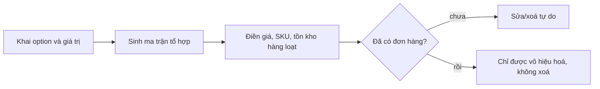

# Mô hình sản phẩm và biến thể

> Biến thể là trục xương sống của cả sàn: giá, tồn kho, ảnh, giỏ hàng, đơn hàng, khuyến mãi và tìm kiếm đều gắn vào
> **variant**, không gắn vào product. Bản cũ gắn giá và tồn kho thẳng vào `Product` nên không bán được "áo thun đen size L"
> — đây là thay đổi mô hình lớn nhất so với bản cũ.

---

## 1. Khái niệm

| Thuật ngữ | Nghĩa | Ví dụ |
|---|---|---|
| **Product** | Đơn vị hiển thị và kiểm duyệt, thứ người mua thấy trên trang chi tiết | "Áo thun cotton basic" |
| **Option** | Một trục lựa chọn của product, có thứ tự | `Màu sắc`, `Kích cỡ` |
| **OptionValue** | Một giá trị trên trục đó | `Đen`, `Trắng` / `S`, `M`, `L` |
| **Variant** | Tổ hợp cụ thể — đơn vị **bán và trừ kho** | "Áo thun cotton basic / Đen / L" |
| **SKU** | Mã định danh variant do seller đặt, duy nhất trong một shop | `AT-BASIC-DEN-L` |
| **InventoryItem** | Số tồn của một variant tại một kho | `onHand = 40`, `reserved = 3` |

Quy tắc bất di bất dịch:

1. **Mọi product đều có ít nhất một variant.** Sản phẩm "không có phân loại" vẫn có đúng một variant mặc định
   (`isDefault = true`, không có option). Không có nhánh code riêng cho trường hợp này.
2. **Giá và tồn kho chỉ tồn tại ở variant.** `Product.minPrice` / `maxPrice` là **trường dẫn xuất** (denormalized) phục
   vụ hiển thị và lọc, được tính lại mỗi khi variant đổi giá, không ai được ghi tay.
3. **Tối đa 3 option, mỗi option tối đa 30 giá trị, tối đa 200 variant/product.** Giới hạn ép ở cả zod lẫn `CHECK`.

---

## 2. Mô hình dữ liệu

```prisma
model Product {
    id          String        @id @default(uuid())
    shopId      String
    categoryId  String
    name        String
    slug        String
    description String
    status      ResourceStatus @default(DRAFT)
    // trường dẫn xuất — chỉ được ghi bởi ProductPriceRecalculator
    minPrice    Decimal?      @db.Decimal(14, 2)
    maxPrice    Decimal?      @db.Decimal(14, 2)
    totalStock  Int           @default(0)
    version     Int           @default(0)

    options  ProductOption[]
    variants ProductVariant[]

    @@unique([shopId, slug])
    @@index([categoryId, status])
}

model ProductOption {
    id        String @id @default(uuid())
    productId String
    name      String              // "Màu sắc"
    position  Int                 // 0, 1, 2 — quyết định thứ tự hiển thị và thứ tự khoá tổ hợp
    values    ProductOptionValue[]

    @@unique([productId, name])
    @@unique([productId, position])
}

model ProductOptionValue {
    id       String @id @default(uuid())
    optionId String
    value    String              // "Đen"
    position Int
    imageId  String?             // ảnh đại diện cho giá trị này (thường dùng cho màu)

    @@unique([optionId, value])
}

model ProductVariant {
    id        String  @id @default(uuid())
    productId String
    sku       String
    // khoá tổ hợp đã chuẩn hoá: id các OptionValue nối bằng ":" theo position tăng dần
    optionKey String
    price         Decimal  @db.Decimal(14, 2)
    compareAtPrice Decimal? @db.Decimal(14, 2)   // giá gạch ngang, phải > price
    weightGram    Int
    imageId       String?
    isDefault     Boolean  @default(false)
    isActive      Boolean  @default(true)
    version       Int      @default(0)

    inventory InventoryItem?

    @@unique([productId, optionKey])
    @@unique([productId, sku])
    @@index([productId, isActive])
}

model InventoryItem {
    id        String @id @default(uuid())
    variantId String @unique
    warehouseId String
    onHand    Int    @default(0)
    reserved  Int    @default(0)
    lowStockThreshold Int @default(5)
    // available = onHand - reserved, KHÔNG lưu cột riêng để không có hai nguồn sự thật
}
```

Ràng buộc viết tay trong migration (Prisma chưa sinh được):

```sql
ALTER TABLE "InventoryItem"
    ADD CONSTRAINT inv_non_negative CHECK ("onHand" >= 0 AND "reserved" >= 0 AND "reserved" <= "onHand");

ALTER TABLE "ProductVariant"
    ADD CONSTRAINT variant_price_positive CHECK ("price" > 0),
    ADD CONSTRAINT variant_compare_price CHECK ("compareAtPrice" IS NULL OR "compareAtPrice" > "price");

-- mỗi product có đúng một variant mặc định
CREATE UNIQUE INDEX variant_one_default ON "ProductVariant" ("productId") WHERE "isDefault";
```

### 2.1 Vì sao có `optionKey`

Tìm variant theo tổ hợp lựa chọn là thao tác chạy nhiều nhất trên trang chi tiết sản phẩm.

❌ **BAD** — bảng nối `VariantOptionValue` rồi tự ghép:

```ts
// N+1 và phải join 3 bảng chỉ để biết người dùng đang chọn variant nào
const variants = await prisma.variant.findMany({ include: { optionValues: true } })
const found = variants.find((v) => selected.every((s) => v.optionValues.some((o) => o.id === s)))
```

✅ **GOOD** — chuẩn hoá tổ hợp thành một chuỗi, tra một phát:

```ts
export function buildOptionKey(valueIds: string[], positions: Map<string, number>): string {
    return [...valueIds].sort((a, b) => positions.get(a)! - positions.get(b)!).join(':')
}

const variant = await prisma.productVariant.findUnique({
    where: { productId_optionKey: { productId, optionKey: buildOptionKey(selectedValueIds, positions) } },
})
```

Bảng nối vẫn tồn tại cho việc lọc theo thuộc tính (facet), nhưng đường đọc nóng đi qua `optionKey`.

---

## 3. Sinh và sửa ma trận biến thể

Seller khai option trước, hệ thống sinh sẵn tổ hợp, seller điền giá/tồn cho từng dòng.



| Thao tác | Khi chưa có đơn nào tham chiếu | Khi đã có đơn |
|---|---|---|
| Thêm giá trị option mới | Sinh thêm variant, mặc định `isActive = false` cho tới khi có giá | Như bên trái |
| Đổi tên option/giá trị | Cho phép | Cho phép — đơn cũ đã snapshot tên riêng |
| Xoá giá trị option | Xoá variant liên quan | **Chặn**: chỉ được `isActive = false` |
| Xoá variant | Cho phép | **Chặn** (`409 VARIANT_IN_USE`) |
| Đổi giá | Cho phép | Cho phép — không ảnh hưởng đơn cũ |

Sửa hàng loạt (đặt giá cho cả dòng "màu Đen", cộng 10% cho tất cả) là một endpoint riêng chạy trong một transaction,
tối đa 200 variant một lần, có xem trước (preview) trước khi áp dụng.

---

## 4. Ảnh chụp (snapshot) tại thời điểm đặt hàng

Người mua phải thấy đúng thứ họ đã mua, kể cả sau khi seller đổi tên hoặc gỡ sản phẩm.

```prisma
model OrderItem {
    id        String @id @default(uuid())
    orderId   String
    // tham chiếu để truy vết, KHÔNG dùng để hiển thị
    productId String
    variantId String
    // snapshot — bất biến, không bao giờ cập nhật lại
    productName  String
    variantLabel String       // "Đen / L"
    sku          String
    imageUrl     String
    unitPrice    Decimal @db.Decimal(14, 2)
    quantity     Int
    lineTotal    Decimal @db.Decimal(14, 2)
}
```

❌ **BAD** — hiển thị đơn hàng bằng cách join sang catalog: đổi tên sản phẩm là lịch sử đơn hàng đổi theo, và
xoá sản phẩm là đơn hàng trống trơn.

✅ **GOOD** — trang chi tiết đơn đọc **hoàn toàn** từ `OrderItem`; link sang sản phẩm là tuỳ chọn và có thể 404.

`order-service` không được gọi `catalog-service` để dựng màn hình đơn hàng. Ranh giới này còn giúp lịch sử đơn hàng
vẫn xem được khi `catalog-service` sập.

---

## 5. Giá: thứ tự áp dụng

Một variant có thể chịu nhiều lớp giá cùng lúc. Thứ tự tính toán là cố định và được viết trong một hàm duy nhất
`resolvePrice(variant, context)`:

```
1. price gốc của variant
2. → giá campaign/flash sale (nếu variant nằm trong campaign đang ACTIVE)
3. → giá bậc số lượng (mua 3 tặng 1, mua từ 10 giảm 5%)
4. → voucher của shop
5. → voucher của sàn
6. → phí vận chuyển và mã giảm phí ship (tính tách, không trộn vào giá hàng)
```

Mỗi bước ghi lại vào `PriceBreakdown` trả về cho FE, để người mua thấy rõ vì sao ra con số đó, và để đối soát sau này
không phải đoán. Tổng tiền cuối cùng **luôn được tính lại ở backend** khi đặt hàng; giá FE gửi lên chỉ dùng để so sánh,
lệch thì trả `409 PRICE_CHANGED` kèm giá mới.

---

## 6. Ảnh hưởng tới các phần khác

| Phần | Ảnh hưởng |
|---|---|
| Giỏ hàng | `CartItem` khoá theo `variantId`, không phải `productId`; unique `(cartId, variantId)` |
| Tìm kiếm | Index Elasticsearch theo **product**, nhưng có trường lồng `variants[]` để lọc theo giá và thuộc tính |
| Khuyến mãi | Campaign gắn tới variant, có hạn mức riêng cho từng variant |
| Đánh giá | Review gắn với `OrderItem` nên biết người viết đã mua phân loại nào — hiển thị "Đã mua: Đen / L" |
| Analytics | Doanh số tổng hợp theo cả `productId` và `variantId`; báo cáo "phân loại bán chạy" là yêu cầu có thật của seller |
| Vận chuyển | Trọng lượng và kích thước ở mức variant, dùng để tính phí ship chính xác |

---

## 7. Checklist khi làm việc với variant

- [ ] Không có API nào nhận `productId` để bán hàng — luôn là `variantId`
- [ ] `Product.minPrice/maxPrice/totalStock` chỉ được ghi bởi bộ tính lại, có test chứng minh không lệch
- [ ] Sinh ma trận có giới hạn 200 tổ hợp, vượt thì `422`
- [ ] Không xoá cứng variant đã có đơn
- [ ] `OrderItem` snapshot đủ để dựng màn hình mà không cần catalog
- [ ] Giá cuối cùng tính ở backend, FE chỉ hiển thị
- [ ] Có test đồng thời cho `reserve` trên variant cuối cùng (xem [concurrency-and-consistency.md](../01-architecture/concurrency-and-consistency.md))
