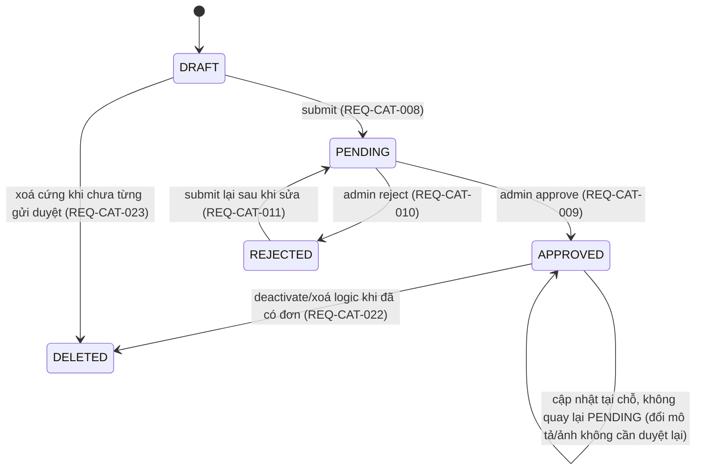
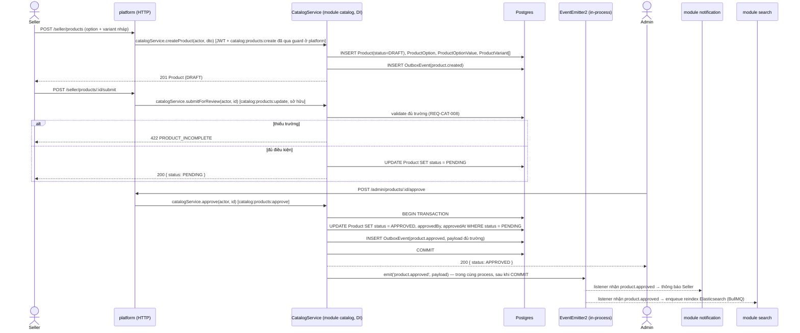

# Design — `catalog-product`

Module sở hữu: `catalog` (`backend/apps/api/src/modules/catalog`), dùng chung một Postgres database với toàn bộ
module khác theo [ADR-0015](../../01-architecture/adr/ADR-0015-modular-monolith.md). Domain này chỉ phủ `Category`
và luồng CRUD/kiểm duyệt `Product`. Tồn kho (`InventoryItem`, `InventoryLedger`, reserve/commit/release) nằm trong
cùng database nhưng là **module `inventory` riêng** trong Prisma multi-file schema
(`prisma/schema/inventory.prisma`) — ranh giới giữa `inventory` và `catalog` là ranh giới **module** (thư mục +
ESLint boundary rule), không phải ranh giới database như ADR-0002 (đã bị ADR-0015 supersede). Module `inventory`
chỉ được nhắc tới ở đây khi cần link chéo, xem `docs/03-specs/inventory/`.

## 1. Mô hình dữ liệu

Nguồn sự thật cho `Product`, `ProductOption`, `ProductOptionValue`, `ProductVariant`, `InventoryItem` là
[product-variant.md §2](../../02-domain/product-variant.md#2-mô-hình-dữ-liệu) — **không lặp lại field ở đây**. Bản
tóm tắt quan hệ và các model domain này bổ sung (không có trong product-variant.md):

```prisma
model Category {
    id          String     @id @default(uuid())
    parentId    String?
    name        String
    slug        String     @unique
    image       String?
    description String?
    position    Int        @default(0)
    isActive    Boolean    @default(true)
    parent      Category?  @relation("CategoryToCategory", fields: [parentId], references: [id])
    children    Category[] @relation("CategoryToCategory")

    @@index([slug])
    @@index([parentId])
}

/// [MỚI] Lịch sử slug cũ — phục vụ REQ-CAT-006 (redirect 301)
model ProductSlugHistory {
    id        String   @id @default(uuid())
    productId String
    shopId    String
    oldSlug   String
    createdAt DateTime @default(now())

    @@unique([shopId, oldSlug])
    @@index([productId])
}

// ProductPriceHistory — đã có ở docs/02-domain/schemas/catalog-service.prisma.md, tham chiếu, không lặp lại.
```

Quan hệ trong phần schema module `catalog`: `Category` 1—N `Product`, `Product` 1—N `ProductOption` 1—N
`ProductOptionValue`, `Product` 1—N `ProductVariant`, `ProductVariant` 1—N `ProductPriceHistory`, `Product` 1—N
`ProductSlugHistory`. `Product.shopId` tham chiếu logic tới `seller-service.SellerProfile.id` (không FK vật lý dù
cùng một Postgres — ranh giới module là quy ước code, không tự ý join/FK chéo phần schema, luật #2 CLAUDE.md).

`Product.status` dùng chung enum `ResourceStatus` (`DRAFT` không nằm trong enum gốc `catalog-service.prisma.md` —
domain này bổ sung `DRAFT` vào đầu enum để hỗ trợ REQ-CAT-020, vì bản gốc chỉ có `PENDING/APPROVED/REJECTED/DELETED`):

```prisma
enum ResourceStatus {
    DRAFT     // [MỚI trong domain catalog-product] — chưa gửi duyệt, chỉ seller sở hữu xem được
    PENDING
    APPROVED
    REJECTED
    DELETED
}
```

Máy trạng thái hợp lệ:



> Ghi chú phạm vi: sản phẩm `APPROVED` bị sửa giá/tên KHÔNG tự động quay lại `PENDING` trong bản này — kiểm duyệt
> lại nội dung đã duyệt là một chính sách riêng, chưa có FEAT tương ứng trong inventory hiện tại nên không đặc tả.

## 2. API

Tiền tố route: `/categories`, `/products`, `/seller/products`. Toàn bộ theo 4 lớp phân quyền ở
[rbac-advanced.md](../../01-architecture/rbac-advanced.md) — lớp 4 (phạm vi dữ liệu) lọc bằng `whereForScope` ngay
trong câu truy vấn Prisma, không `.filter()` sau khi lấy về (luật #7 CLAUDE.md).

| Method | Route | Permission | Phạm vi | REQ |
|---|---|---|---|---|
| `POST` | `/categories` | `catalog:categories:create` | Admin, toàn sàn | REQ-CAT-001 |
| `PATCH` | `/categories/:id` | `catalog:categories:update` | Admin, toàn sàn | REQ-CAT-001 |
| `PATCH` | `/categories/reorder` | `catalog:categories:update` | Admin, toàn sàn | REQ-CAT-001 |
| `DELETE` | `/categories/:id` | `catalog:categories:delete` | Admin, toàn sàn | REQ-CAT-002 |
| `GET` | `/categories/tree` | — (public) | — | REQ-CAT-001 |
| `POST` | `/seller/products` | `catalog:products:create` | Seller, tạo dưới `shopId` của chính mình | REQ-CAT-003, REQ-CAT-004 |
| `PATCH` | `/seller/products/:id` | `catalog:products:update` | Seller, chỉ khi `product.shopId === user.sellerProfileId` (CASL) | REQ-CAT-005, REQ-CAT-006, REQ-CAT-021 |
| `PATCH` | `/seller/products/:id` (any) | `catalog:products:update:any` | Admin, toàn sàn | — |
| `DELETE` | `/seller/products/:id` | `catalog:products:delete` | Seller, sở hữu | REQ-CAT-023 |
| `POST` | `/seller/products/:id/submit` | `catalog:products:update` | Seller, sở hữu | REQ-CAT-008, REQ-CAT-011 |
| `POST` | `/seller/products/:id/deactivate` | `catalog:products:update` | Seller, sở hữu | REQ-CAT-022 |
| `POST` | `/seller/products/:id/duplicate` | `catalog:products:create` | Seller, sở hữu bản gốc | REQ-CAT-019 |
| `GET` | `/seller/products` | `catalog:products:list` (ngầm định qua sở hữu) | Seller, chỉ `shopId` của mình | REQ-CAT-012 |
| `GET` | `/seller/products` (toàn sàn, kể cả chưa duyệt) | `catalog:products:list:any` | Admin | REQ-CAT-012 |
| `POST` | `/admin/products/:id/approve` | `catalog:products:approve` | Admin, toàn sàn | REQ-CAT-009 |
| `POST` | `/admin/products/:id/reject` | `catalog:products:reject` | Admin, toàn sàn | REQ-CAT-010 |
| `POST` | `/seller/products/import` | `catalog:products:import` | Seller, tạo dưới `shopId` của mình | REQ-CAT-017, REQ-CAT-018 |
| `GET` | `/seller/products/import/:jobId` | `catalog:products:import` | Seller, sở hữu job | REQ-CAT-017, REQ-CAT-018 |
| `GET` | `/products` | — (public) | Chỉ `APPROVED` + shop không `SUSPENDED` | REQ-CAT-013 |
| `GET` | `/products/:slug` | — (public); thêm `catalog:products:update` để seller xem trước `DRAFT/PENDING` của mình | Public: chỉ `APPROVED`. Chủ sở hữu: mọi trạng thái của shop mình | REQ-CAT-014, REQ-CAT-015, REQ-CAT-016 |

Ví dụ `whereForScope` cho `GET /seller/products` (luật #7):

```ts
// scope = scopeFor(user, 'catalog:products:list')
async function listSellerProducts(user: AuthUser, query: ListProductsQuery) {
    const scope = scopeFor(user, 'catalog:products:list')
    return prisma.product.findMany({
        where: { status: query.status, ...whereForScope(scope) }, // { shopId: user.sellerProfileId }
        skip: query.offset,
        take: query.limit,
    })
}
```

Tài nguyên ngoài phạm vi (ví dụ Seller B gọi `PATCH /seller/products/:id` với `id` thuộc Seller A) trả **`404`**,
không phải `403` (luật #8 — `403` rò rỉ sự tồn tại của bản ghi).

## 3. Event

### Phát (transactional outbox — cùng transaction với thay đổi trạng thái, luật #3)

| Event | Khi nào | REQ |
|---|---|---|
| `EVT-category.updated` | Tạo/sửa/xoá/reorder category | REQ-CAT-001, REQ-CAT-002 |
| `EVT-product.created` | Tạo `Product` (kể cả `DRAFT`) | REQ-CAT-003 |
| `EVT-product.updated` | Sửa product/variant đã `APPROVED` (giá, tên, ảnh...) | REQ-CAT-005, REQ-CAT-006, REQ-CAT-021 |
| `EVT-product.approved` | `PENDING → APPROVED` | REQ-CAT-009 |
| `EVT-product.rejected` | `PENDING → REJECTED` | REQ-CAT-010 |
| `EVT-product.deactivated` | Ngừng kinh doanh (`APPROVED → DELETED` khi đã có đơn) | REQ-CAT-022 |

Schema payload đầy đủ của `product.approved` đã định nghĩa ở
[event-catalog.md § EVT-product.approved](../../01-architecture/event-catalog.md#evt-productapproved) — dùng lại,
không định nghĩa lại. Điểm bắt buộc: `minPrice`/`maxPrice` là **chuỗi**, không phải `number` (luật #1).

### Nghe

| Event | Xử lý | Idempotent qua |
|---|---|---|
| `EVT-seller.shop.suspended` | Ẩn toàn bộ sản phẩm của shop khỏi danh sách công khai (không đổi `status`, chỉ thêm điều kiện lọc theo `shopId` bị suspend qua bảng cache trạng thái shop) | `processed_events` |
| `EVT-order.completed` | Tăng `Product.soldCount` bằng `UPDATE ... SET "soldCount" = "soldCount" + $qty WHERE id = $productId` (nguyên tử, không đọc-rồi-ghi — luật #4) | `processed_events` |
| `EVT-campaign.activated` | Gắn giá chiến dịch hiển thị (đọc, không sửa `ProductVariant.price` gốc) — chi tiết thuộc domain `campaign-flashsale` | `processed_events` |

## 4. Sequence — tạo sản phẩm → gửi duyệt → admin duyệt → published

Theo [ADR-0015](../../01-architecture/adr/ADR-0015-modular-monolith.md), module `platform` là điểm vào HTTP duy nhất
và gọi trực tiếp `CatalogService` qua NestJS DI trong cùng process — không còn khung RPC qua mạng. Domain event phát
ra cho module khác (`notification`, `search`) dùng `EventEmitter2` trong process; chỉ `outbox_events` (do BullMQ
worker xử lý) là còn thật sự bất đồng bộ, dành cho hệ quả cần chắc chắn xảy ra dù process crash (ví dụ index lại
Elasticsearch, gửi thông báo email).



## 5. Trường hợp biên

- **Gửi duyệt hai lần liên tiếp (double click)**: `UPDATE Product SET status = PENDING WHERE id = $1 AND status =
  'DRAFT'` — nếu 0 dòng bị ảnh hưởng thì trả `409 ALREADY_PENDING` thay vì đọc trạng thái trước rồi mới ghi (tránh
  race giữa hai request cùng lúc, luật #4).
- **Admin duyệt đúng lúc Seller đang sửa `PENDING`**: khoá lạc quan bằng `Product.version` — cập nhật kèm `WHERE
  version = $expected`, version không khớp trả `409 STALE_UPDATE`, FE tự tải lại.
- **Slug đụng độ do hai request tạo đồng thời cùng tên**: `@@unique([shopId, slug])` ở DB là chốt chặn cuối; nếu
  insert vi phạm unique, catch `P2002` rồi thử lại với hậu tố tiếp theo (retry tối đa 3 lần).
- **Category cha bị xoá trong khi sản phẩm đang gán category con**: kiểm tra đệ quy toàn bộ cây con trong cùng
  transaction với `DELETE`, không kiểm tra rồi xoá tách rời hai bước.

## 6. Ảnh hưởng tới domain khác

| Domain | Ảnh hưởng |
|---|---|
| `inventory` (`INV`) | Mỗi `ProductVariant` có đúng một `InventoryItem`; domain `catalog-product` chỉ tạo/xoá `InventoryItem` rỗng khi tạo/xoá variant, không tự ý sửa `onHand`/`reserved` — xem `docs/03-specs/inventory/` |
| `cart-checkout` | Nghe `product.updated`/`product.deactivated` để đánh dấu `CartItem` không còn hợp lệ |
| `search-discovery` | Nghe toàn bộ `product.*`/`category.updated` để dựng chỉ mục Elasticsearch — chỉ mục dẫn xuất, không phải nguồn sự thật |
| `content-post` | `PostProduct` tham chiếu `Product.id` (không FK) — sản phẩm `deactivated` phải được post ẩn theo |
| `promotion-voucher`, `campaign-flashsale` | Gắn campaign/voucher theo `Product.id`/`ProductVariant.id`, đọc snapshot giá qua gọi trực tiếp `CatalogService` (DI), không tự import Prisma model của module `catalog` (ranh giới ép bằng ESLint boundary rule) |
| `order-fulfillment` | `OrderItem` snapshot toàn bộ dữ liệu hiển thị tại thời điểm mua — không bao giờ gọi ngược `catalog-service` để dựng màn hình đơn hàng, xem [product-variant.md §4](../../02-domain/product-variant.md#4-ảnh-chụp-snapshot-tại-thời-điểm-đặt-hàng) |

## 7. Quy tắc dễ làm sai

❌ **BAD** — tính khoảng giá lọc bằng `number`, và trả giá trong response API bằng số thô:

```ts
// mất chính xác dấu phẩy động, và FE nhận number nên không biết currency
async function filterByPrice(min: number, max: number) {
    const products = await prisma.product.findMany()
    return products.filter((p) => p.minPrice * 1 >= min && p.maxPrice * 1 <= max) // lọc sau khi lấy về — vi phạm luật #7
}

return { price: product.variants[0].price.toNumber() } // FE nhận 199000, không biết là VND hay xu
```

✅ **GOOD** — lọc bằng `Prisma.Decimal` ngay trong câu truy vấn, trả chuỗi + `currency`:

```ts
async function filterByPrice(minPrice: string, maxPrice: string, scope: Scope) {
    return prisma.product.findMany({
        where: {
            status: 'APPROVED',
            minPrice: { gte: new Prisma.Decimal(minPrice) },
            maxPrice: { lte: new Prisma.Decimal(maxPrice) },
            ...whereForScope(scope),
        },
    })
}

return {
    price: { amount: variant.price.toFixed(2), currency: 'VND' as const },
}
```

FE nhận `{ amount: "199000.00", currency: "VND" }` rồi dựng `dinero.js` — không bao giờ nhân/cộng bằng `number` thô
(luật #1 CLAUDE.md).
