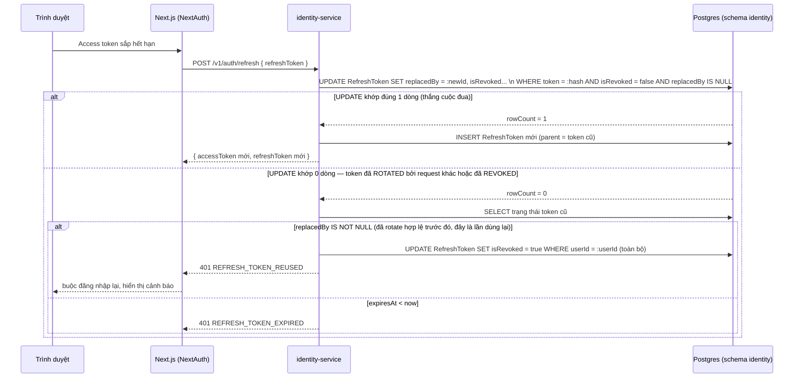

# Design — identity-auth (`IDN`)

Từ [ADR-0015](../../01-architecture/adr/ADR-0015-modular-monolith.md), toàn bộ logic nghiệp vụ nằm trong module
`identity` (`backend/apps/api/src/modules/identity/`, thư mục con `auth/`, `users/`, `rbac/`, `casl/` — theo
`docs/01-architecture/service-catalog.md`, đọc như bản đồ module chứ không còn là bản đồ service riêng), cùng một
database Postgres với các module khác. Module `platform` chỉ xác thực JWT + RBAC lớp 1–2 rồi gọi trực tiếp (DI) vào
module `identity` tương ứng — không còn "định tuyến" theo nghĩa network; Next.js (NextAuth) là lớp quản lý phiên phía
FE, không tự giữ nguồn sự thật về user/role.

## 1. Mô hình dữ liệu

Trích từ `docs/02-domain/schemas/identity-service.prisma.md` — chỉ các model liên quan trực tiếp tới đăng ký/đăng
nhập/phiên/reset mật khẩu. Không lặp lại `SystemRole`/`Permission`/`RolePermission`/`UserPermission` (thuộc spec
`rbac-permission`, xem `docs/03-specs/rbac-permission/design.md`).

```prisma
model User {
    id                  String                @id @default(cuid())
    email               String                @unique
    phone               String?               @unique
    passwordHash        String?
    googleId            String?               @unique
    facebookId          String?               @unique
    roles               UserRole[]            @default([USER])
    isEmailVerified     Boolean               @default(false)
    isPhoneVerified     Boolean               @default(false)
    isActive            Boolean               @default(true)
    isBanned            Boolean               @default(false)
    banReason           String?
    twoFactorEnabled    Boolean               @default(false)
    twoFactorSecret     String?
    failedLoginCount    Int                   @default(0)
    lockedUntil         DateTime?
    lastLoginAt         DateTime?
    lastLoginIp         String?
    deletedAt           DateTime?
    devices             Device[]
    refreshTokens       RefreshToken[]
    passwordResetTokens PasswordResetToken[]
}

model Device {
    id           String         @id @default(cuid())
    userId       String
    userAgent    String?
    ip           String?
    deviceName   String?
    isActive     Boolean        @default(true)
    lastActiveAt DateTime       @updatedAt
    refreshTokens RefreshToken[]
}

model RefreshToken {
    id         String    @id @default(cuid())
    userId     String
    deviceId   String?
    token      String    @unique   // lưu dạng hash SHA-256, không lưu rõ
    replacedBy String?             // trỏ token kế tiếp trong chuỗi rotation — chốt cho REQ-IDN-005/006
    expiresAt  DateTime
    isRevoked  Boolean   @default(false)
    revokedAt  DateTime?
}

model PasswordResetToken {
    id        String   @id @default(cuid())
    userId    String
    token     String   @unique   // hash, không lưu rõ
    expiresAt DateTime
    used      Boolean  @default(false)
}
```

### Đề xuất bổ sung field (chưa có trong schema đã review — cần đi qua `prisma-schema` skill trước khi migrate)

`docs/02-domain/schemas/identity-service.prisma.md` chưa có model riêng cho token xác minh email
(FEAT-IDN-016/REQ-IDN-026), trong khi `security.md §3` đã liệt kê "Email verification | 24 giờ | DB (đã hash)" như
một loại token độc lập với password reset. Thay vì thêm hẳn một model `EmailVerificationToken` mới (trùng lặp toàn
bộ field với `PasswordResetToken`), đề xuất:

```prisma
enum OneTimeTokenPurpose {
    PASSWORD_RESET
    EMAIL_VERIFICATION
}

model PasswordResetToken {
    // ...các field hiện có...
    purpose PasswordResetTokenPurpose @default(PASSWORD_RESET)   // field mới
}
```

**Lý do:** hai loại token giống hệt nhau về hình dạng (token hash, `expiresAt`, `used`, gắn `userId`), chỉ khác TTL
(15 phút vs 24 giờ, đọc từ config theo `purpose`) và hành vi sau khi dùng (reset mật khẩu thu hồi mọi phiên; xác
minh email thì không). Thêm một field thay vì một bảng song song tránh trùng lặp cấu trúc + index. Đây là đề xuất,
**không tự áp dụng** — phải đi qua skill `prisma-schema` để tạo migration trước khi code dùng field này.

2FA (REQ-IDN-030/031) **không** cần bảng mới: `challengeId` là khoá tạm thời trong Redis (TTL 5 phút, giá trị =
`userId` + số lần thử), không phải dữ liệu bền vững — chỉ `twoFactorSecret`/`twoFactorEnabled` trên `User` (đã có
sẵn trong schema) là bền vững.

## 2. API endpoint

Tiền tố `/v1/auth/*` là công khai (guest gọi được một số route), `/v1/admin/auth/*` yêu cầu role `ADMIN`+. "Phạm vi"
ghi cách lọc dữ liệu theo chủ sở hữu — không có nghĩa là bỏ qua bước xác thực.

| Method | Path | Permission | Phạm vi | Idempotency-Key |
|---|---|---|---|---|
| `POST` | `/v1/auth/register` | Public | — | **Bắt buộc** (REQ-IDN-001) |
| `POST` | `/v1/auth/login` | Public | — | Không (không tạo tài nguyên bền vững ngoài `RefreshToken`, có rate limit riêng) |
| `POST` | `/v1/auth/refresh` | Public (cầm refresh token hợp lệ) | Token tự mang danh tính | Không |
| `POST` | `/v1/auth/logout` | Đã xác thực | Chính chủ (`userId` từ token) | Không |
| `POST` | `/v1/auth/logout-all` | Đã xác thực | Chính chủ | Không |
| `GET` | `/v1/auth/devices` | Đã xác thực | `WHERE userId = current` | — |
| `DELETE` | `/v1/auth/devices/:id` | Đã xác thực | `WHERE userId = current AND id = :id` → 404 nếu không khớp | Không |
| `GET` | `/v1/admin/users/:userId/devices` | `identity:devices:list:any` | Toàn bộ theo `:userId` | — |
| `DELETE` | `/v1/admin/users/:userId/devices/:id` | `identity:devices:revoke:any` | Toàn bộ | Không |
| `POST` | `/v1/auth/forgot-password` | Public | — | Không (rate limit theo REQ-IDN-012) |
| `POST` | `/v1/auth/reset-password` | Public (cầm token hợp lệ) | Token tự mang danh tính | **Bắt buộc** (đổi mật khẩu) |
| `PATCH` | `/v1/auth/password` | Đã xác thực | Chính chủ | **Bắt buộc** |
| `GET` | `/v1/auth/verify-email` | Public (cầm token hợp lệ) | Token tự mang danh tính | Không |
| `POST` | `/v1/auth/verify-email/resend` | Đã xác thực | Chính chủ | Không |
| `POST` | `/v1/auth/sso` | Public (NextAuth server-side gọi) | — | **Bắt buộc** (tạo user) |
| `POST` | `/v1/auth/sso/link` | Đã xác thực | Chính chủ | Không |
| `DELETE` | `/v1/auth/sso/:provider` | Đã xác thực | Chính chủ | Không |
| `POST` | `/v1/auth/2fa/enable` | Đã xác thực + role `ADMIN`/`SUPER_ADMIN` | Chính chủ | Không |
| `POST` | `/v1/auth/2fa/confirm` | Đã xác thực + role `ADMIN`/`SUPER_ADMIN` | Chính chủ | Không |
| `POST` | `/v1/auth/2fa/verify` | Public (cầm `challengeId` tạm) | `challengeId` tự mang danh tính | Không |
| `GET` | `/v1/admin/auth/sessions/stats` | `identity:sessions:stats` | Toàn hệ thống (dữ liệu tổng hợp, không gắn chủ sở hữu → `403` khi thiếu quyền, không phải `404`) | — |

Gọi trực tiếp qua NestJS DI giữa module (module khác import service đã export của module `identity` qua `index.ts`,
không qua HTTP): `identity.register`, `identity.login`, `identity.refresh`, `identity.logout`,
`identity.getEffectivePermissions`, `identity.getUserSummary` (theo `service-catalog.md`) — các tên này vẫn là tên
method/API logic, chỉ đổi khung giao tiếp so với bản RPC network cũ.

## 3. Event

### Phát (qua `OutboxEvent`, cùng transaction với thay đổi `User`/`RefreshToken`)

| Event | Khi nào | Payload chính |
|---|---|---|
| `EVT-user.registered` | Sau REQ-IDN-001 / REQ-IDN-017 / REQ-IDN-019 tạo `User` mới | `userId`, `email`, `registeredVia` |
| `EVT-user.email-verified` | Sau REQ-IDN-026 | `userId` |
| `EVT-user.locked` | Sau REQ-IDN-004 (kịch bản 3) / REQ-IDN-028 | `userId`, `lockedUntil`, `reason` |
| `EVT-user.role-granted` / `EVT-user.role-revoked` | Ngoài phạm vi domain này — thuộc `rbac-permission` (gán role không phải chức năng auth) | — |
| `EVT-rbac.permissions.changed` | Ngoài phạm vi domain này | — |
| `EVT-user.profile-updated` | Ngoài phạm vi domain này (thuộc `user-profile`), chỉ nêu vì cùng service | — |

### Nghe

| Event | Xử lý |
|---|---|
| `seller.application.approved` | Gán `UserRole.SELLER` vào `User.roles` (idempotent — kiểm `ProcessedEvent` trước khi ghi) |

Không có event nào của domain khác ảnh hưởng trực tiếp tới đăng nhập/refresh/reset mật khẩu — các luồng này tự
đóng trong `identity-service`.

## 4. Sequence — Đăng nhập

```mermaid
sequenceDiagram
    participant B as Trình duyệt
    participant N as Next.js (NextAuth)
    participant Api as backend/apps/api (module platform)
    participant Auth as AuthService (module identity)

    B->>N: POST /api/auth/callback/credentials { email, password }
    N->>Api: POST /v1/auth/login
    Api->>Auth: authService.login(...) (gọi trực tiếp qua DI, không phải RPC)
    Auth->>Auth: user = findByEmail(email); hash = user?.passwordHash ?? DUMMY_HASH
    Auth->>Auth: bcrypt.compare(password, hash)
    alt sai thông tin / khoá / banned
        Auth-->>Api: 401 INVALID_CREDENTIALS | 423 ACCOUNT_LOCKED | 403 ACCOUNT_BANNED
        Api-->>N: lỗi tương ứng
        N-->>B: hiển thị lỗi chung, không phân biệt "sai email" hay "sai mật khẩu"
    else hợp lệ, twoFactorEnabled = true
        Auth-->>Api: 202 TWO_FACTOR_REQUIRED { challengeId }
        Api-->>N: 202
        N-->>B: yêu cầu nhập mã TOTP → POST /v1/auth/2fa/verify (không vẽ lại ở đây)
    else hợp lệ, không 2FA
        Auth->>Auth: upsert Device, tạo RefreshToken (hash), ký access token RS256
        Auth->>Auth: failedLoginCount = 0, lastLoginAt = now
        Auth-->>Api: { user, roles, accessToken, refreshToken }
        Api-->>N: 200
        N->>N: mã hoá session JWE (AUTH_SECRET)
        N-->>B: Set-Cookie __Secure-authjs.session-token (HttpOnly) + __Host-refresh-token
    end
```

## 5. Sequence — Refresh token rotation (kèm race condition)



Câu `UPDATE ... WHERE token = ? AND isRevoked = false AND replacedBy IS NULL` là **atomic compare-and-swap** — đây
là cách duy nhất chốt REQ-IDN-005 kịch bản 2 (hai request refresh đồng thời): chỉ một transaction thắng, transaction
thua đọc lại trạng thái mới nhất thay vì tự ý cấp token thứ hai.

## 6. Trường hợp biên

| Trường hợp | Xử lý |
|---|---|
| Refresh token bị tái sử dụng (đã `ROTATED`) | REQ-IDN-006 — thu hồi toàn bộ phiên của user, không chỉ token đó, vì không biết token cũ đã bị lộ từ khi nào |
| Hai tab trình duyệt cùng gọi `/v1/auth/refresh` gần như đồng thời | UPDATE nguyên tử ở mục 5 đảm bảo đúng một tab thắng; tab thua nên tự động thử lấy session mới từ NextAuth thay vì báo lỗi cứng, vì đây là race hợp lệ (không phải tấn công) — phân biệt bằng việc token thua **không** có `replacedBy` cũ trỏ về nó khi request tới nơi (tức đây là race, không phải reuse thật) — **lưu ý vận hành:** ở race hợp lệ hai request đến gần như cùng lúc nên request thua vẫn nhận đúng nhánh "đã `ROTATED`"; để không phạt oan, FE nên có cơ chế mutex refresh phía client (chỉ một request refresh tại một thời điểm) thay vì dựa hoàn toàn vào BE phân biệt |
| Đổi mật khẩu (REQ-IDN-015) trong khi có refresh request đang bay | Thu hồi diễn ra sau khi transaction đổi mật khẩu commit; request refresh đến sau đó sẽ thấy `isRevoked = true` và nhận `401 REFRESH_TOKEN_EXPIRED`-tương đương (không phải `REUSED`, vì đây là thu hồi chủ động, không phải dấu hiệu bị đánh cắp) — dùng mã lỗi riêng `401 SESSION_REVOKED` để tránh kích hoạt cảnh báo "tài khoản bị xâm nhập" nhầm |
| Đăng ký + xác minh email trùng lúc với đăng nhập SSO cùng email | Chặn ở REQ-IDN-002/REQ-IDN-018 — không tự động gộp tài khoản khi email chưa xác minh |
| Gỡ liên kết SSO cuối cùng | REQ-IDN-021 — `409 LAST_AUTH_METHOD`, kiểm tra trong cùng transaction với `UPDATE User` để tránh TOCTOU (hai request gỡ hai provider gần như đồng thời) |

## 7. Ảnh hưởng tới domain khác

| Domain/service | Cách phụ thuộc |
|---|---|
| Module `platform` | `JwtAuthGuard` xác minh access token bằng public key (JWKS), tra cache permission Redis; không tự xử lý login/refresh — gọi trực tiếp `AuthService`/`IdentityService` (DI) khi cần |
| `rbac-permission` | Dùng chung `User.roles`, nghe `user.role-granted`/`user.role-revoked` (`EventEmitter2` trong process, không thuộc domain này) để đồng bộ CASL ability |
| Module `seller` | Nghe `user.registered`/`user.role-granted` gián tiếp qua module `identity` nghe `seller.application.approved` (chiều ngược) |
| Mọi module khác (`seller`, `order`, `cart`, `payment`, `promotion`, `content`, `engagement`, `chat`, `notification`, `media`) | Chỉ giữ `userId` dạng tham chiếu logic, gọi trực tiếp `IdentityService.getUserSummary()` qua DI khi cần hiển thị tên/avatar — **không** tự import Prisma model của module `identity` (ranh giới ép bằng ESLint boundary rule, luật cứng #2 CLAUDE.md) |
| Module `notification` | Nghe `user.registered` (mail `welcome`), tự gửi mail xác minh/quên mật khẩu do chính module `identity` enqueue qua BullMQ (chạy ở worker process, không phải qua event bus vì là hành động của chính module phát sinh, theo `service-catalog.md` mục Job) |
| Module `audit` | Nghe `user.locked`, ghi `AuditLog` cho mọi thao tác khoá/mở khoá/gán role admin |

## 8. ❌ BAD / ✅ GOOD

Đọc-rồi-ghi khi xoay refresh token là lỗi dễ mắc nhất trong domain này — vi phạm luật cứng #4 (CLAUDE.md) và mở ra
đúng lỗ hổng mà REQ-IDN-005/006 phải chặn.

❌ **BAD** — đọc token, kiểm tra ở application code, rồi ghi riêng — có khoảng hở giữa đọc và ghi để hai request
cùng "thắng":

```ts
const token = await prisma.refreshToken.findUnique({ where: { token: hash } })
if (!token || token.isRevoked || token.replacedBy) {
    throw new UnauthorizedException('REFRESH_TOKEN_REUSED')
}
const next = await prisma.refreshToken.create({ data: { userId: token.userId, token: newHash, expiresAt } })
await prisma.refreshToken.update({ where: { id: token.id }, data: { replacedBy: next.id } })
// ← giữa 3 câu lệnh trên, một request khác có thể đã đọc cùng `token` và cũng đi qua nhánh hợp lệ
```

✅ **GOOD** — một `UPDATE ... WHERE` nguyên tử làm luôn vai trò khoá:

```ts
const result = await prisma.refreshToken.updateMany({
    where: { token: hash, isRevoked: false, replacedBy: null },
    data: { replacedBy: pendingNextId },
})
if (result.count === 0) {
    // đã bị rotate hoặc revoke bởi request khác — đọc lại để phân biệt REUSED vs EXPIRED
    return this.handleRefreshConflict(hash)
}
const next = await prisma.refreshToken.create({ data: { id: pendingNextId, userId, token: newHash, expiresAt } })
```
