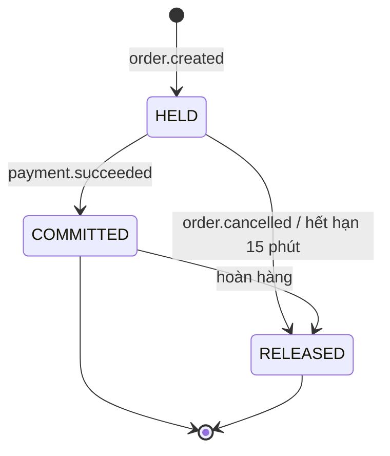
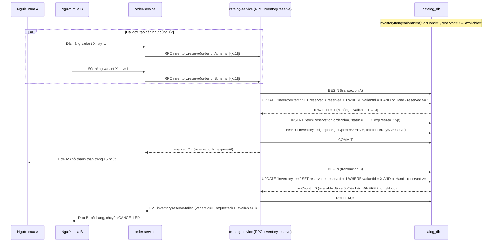

# Design — `inventory`

> Domain nằm trong `catalog-service` (`catalog_db`). Không có service riêng — xem lý do ở
> [ADR-0002](../../01-architecture/adr/ADR-0002-database-per-service.md) và
> [service-catalog.md §3](../../01-architecture/service-catalog.md#3-catalog-service).
> Nguyên tắc bắt buộc xuyên suốt tài liệu này: **mọi phép trừ tồn kho là `UPDATE … WHERE` nguyên tử + ràng buộc
> `CHECK`, không dùng khoá Redis cho tồn kho** — xem
> [concurrency-and-consistency.md §2.1](../../01-architecture/concurrency-and-consistency.md#21-vì-sao-không-dựa-vào-khoá-redis-cho-tồn-kho).

---

## 1. Mô hình dữ liệu

`InventoryItem` và `InventoryLedger` đã có sẵn, trích nguyên văn từ nguồn sự thật — không định nghĩa lại field ở
đây.

### 1.1 `InventoryItem` (nguồn: [product-variant.md §2](../../02-domain/product-variant.md#2-mô-hình-dữ-liệu))

```prisma
model InventoryItem {
    id        String @id @default(uuid())
    variantId String @unique
    warehouseId String
    onHand    Int    @default(0)
    reserved  Int    @default(0)
    lowStockThreshold Int @default(5)
    // available = onHand - reserved, KHÔNG lưu cột riêng để không có hai nguồn sự thật
}
```

```sql
ALTER TABLE "InventoryItem"
    ADD CONSTRAINT inv_non_negative CHECK ("onHand" >= 0 AND "reserved" >= 0 AND "reserved" <= "onHand");
```

### 1.2 `InventoryLedger` (nguồn: [catalog-service.prisma.md](../../02-domain/schemas/catalog-service.prisma.md))

```prisma
/// Nhật ký biến động tồn kho — bất biến, FEAT-INV-005
model InventoryLedger {
    id          String   @id @default(uuid())
    variantId   String
    // RESERVE | COMMIT | RELEASE | ADJUST_MANUAL | ADJUST_RECONCILE
    changeType  String
    onHandDelta   Int
    reservedDelta Int
    onHandAfter   Int
    reservedAfter Int
    referenceKey  String   // vd orderId:reserve, orderId:commit — idempotency của thao tác nguồn
    reason        String?
    actorId       String?
    createdAt     DateTime @default(now())

    @@unique([variantId, referenceKey, changeType])
    @@index([variantId, createdAt])
}
```

### 1.3 `StockReservation` / `StockReservationItem` — **mới, bổ sung bởi spec này**

Được nhắc tới ở [project-plan.md phụ lục E.4](../../00-overview/project-plan.md) và
[concurrency-and-consistency.md §3](../../01-architecture/concurrency-and-consistency.md#3-giữ-tồn-kho-khi-đặt-hàng)
nhưng chưa có field cụ thể — định nghĩa chính thức thuộc về spec `inventory`, cần được bổ sung vào khối `prisma`
của `catalog-service.prisma.md` khi hiện thực.

```prisma
model StockReservation {
    id        String   @id @default(uuid())
    orderId   String   @unique          // một đơn chỉ có đúng một reservation đang hiệu lực
    // HELD | COMMITTED | RELEASED
    status    String   @default("HELD")
    expiresAt DateTime
    createdAt DateTime @default(now())
    updatedAt DateTime @updatedAt

    items StockReservationItem[]

    @@index([status, expiresAt])
}

model StockReservationItem {
    id            String @id @default(uuid())
    reservationId String
    variantId     String
    quantity      Int

    reservation StockReservation @relation(fields: [reservationId], references: [id])

    @@unique([reservationId, variantId])
    @@index([variantId])
}
```

```sql
ALTER TABLE "StockReservationItem" ADD CONSTRAINT reservation_qty_positive CHECK ("quantity" > 0);
ALTER TABLE "StockReservation" ADD CONSTRAINT reservation_status_enum
    CHECK ("status" IN ('HELD', 'COMMITTED', 'RELEASED'));
```

Trạng thái (khớp [project-plan.md phụ lục E.4](../../00-overview/project-plan.md)):



---

## 2. API

Reserve/commit/release là **RPC nội bộ** do `order-service` gọi, xác thực bằng service-to-service auth (mTLS/service
token nội bộ), không đi qua permission người dùng. Các endpoint còn lại là HTTP, có `@Permissions`.

| Method & path | Mô tả | Permission | Phạm vi |
|---|---|---|---|
| RPC `inventory.reserve` | Giữ chỗ tồn kho khi tạo đơn | *(service-to-service)* | — |
| RPC `inventory.commit` | Trừ vĩnh viễn khi thanh toán thành công | *(service-to-service)* | — |
| RPC `inventory.release` | Giải phóng khi huỷ/hết hạn/hoàn tiền | *(service-to-service)* | — |
| RPC `inventory.getSnapshot` | Tồn hiện tại theo shop, phục vụ báo cáo | *(service-to-service)* | — |
| `GET /inventory/:variantId` | Xem tồn kho một variant | `catalog:inventory:read` | Variant thuộc shop của seller (`whereForScope: variant.product.shopId = ctx.shopId`) |
| `GET /inventory` | Danh sách tồn kho của shop, lọc sắp hết hàng | `catalog:inventory:read` | Theo `shopId` |
| `GET /admin/inventory` | Danh sách tồn kho toàn sàn | `catalog:inventory:read:any` | Không giới hạn |
| `PATCH /inventory/:variantId/adjust` | Điều chỉnh tồn thủ công kèm `reason` | `catalog:inventory:adjust` | Variant thuộc shop của seller |
| `GET /inventory/:variantId/ledger` | Lịch sử biến động của một variant | `catalog:inventory:read` | Variant thuộc shop của seller |

Ngoài phạm vi trả **`404`**, không phải `403` (luật cứng #8). `PATCH .../adjust` nhận body theo schema Zod dùng
chung `@timmyhub/contracts`:

```ts
export const adjustInventorySchema = z.object({
    delta: z.number().int().refine((v) => v !== 0, 'delta không được bằng 0'),
    reason: z.string().min(5).max(500),
})
```

---

## 3. Event

### 3.1 Phát (producer: `catalog-service`)

| Event | Khi nào | Consumer |
|---|---|---|
| `inventory.reserved` | Reserve thành công (REQ-INV-002) | ORD, ANA |
| `inventory.reserve-failed` | Reserve thất bại do thiếu hàng/variant ngừng bán (REQ-INV-003) | ORD |
| `inventory.committed` | Commit khi thanh toán thành công (REQ-INV-007) | ORD, SRC, ANA |
| `inventory.released` | Release do huỷ/hết hạn/hoàn tiền (REQ-INV-005, REQ-INV-009) | ORD, ANA |
| `inventory.adjusted` | Điều chỉnh thủ công hoặc đối soát (REQ-INV-012) | ANA, AUD |
| `inventory.low-stock` | `available` chạm `lowStockThreshold` (REQ-INV-014) | NTF |

Payload `inventory.reserved` / `inventory.reserve-failed` lấy nguyên văn từ
[event-catalog.md](../../01-architecture/event-catalog.md#evt-inventoryreserved--evt-inventoryreserve-failed):

```ts
export const inventoryReservedPayloadSchema = z.object({
    reservationId: z.string().cuid(),
    orderId: z.string().cuid(),
    expiresAt: z.string().datetime(),
    items: z.array(z.object({
        variantId: z.string().cuid(),
        quantity: z.number().int().positive(),
    })),
})

export const inventoryReserveFailedPayloadSchema = z.object({
    orderId: z.string().cuid(),
    reason: z.enum(['OUT_OF_STOCK', 'VARIANT_INACTIVE', 'PRODUCT_UNAVAILABLE']),
    failedItems: z.array(z.object({
        variantId: z.string().cuid(),
        requested: z.number().int(),
        available: z.number().int(),
    })),
})
```

Payload bổ sung cho `committed` / `released` / `adjusted` / `low-stock`, theo cùng quy ước (`Ver: 1`):

```ts
export const inventoryCommittedPayloadSchema = z.object({
    reservationId: z.string().cuid(),
    orderId: z.string().cuid(),
    items: z.array(z.object({
        variantId: z.string().cuid(),
        quantity: z.number().int().positive(),
        onHandAfter: z.number().int(),
    })),
})

export const inventoryReleasedPayloadSchema = z.object({
    reservationId: z.string().cuid(),
    orderId: z.string().cuid(),
    // HELD → RELEASED: reserved trở về; COMMITTED → RELEASED: onHand cộng lại
    releasedFrom: z.enum(['HELD', 'COMMITTED']),
    items: z.array(z.object({
        variantId: z.string().cuid(),
        quantity: z.number().int().positive(),
    })),
})

export const inventoryAdjustedPayloadSchema = z.object({
    variantId: z.string().cuid(),
    changeType: z.enum(['ADJUST_MANUAL', 'ADJUST_RECONCILE']),
    onHandDelta: z.number().int(),
    onHandAfter: z.number().int(),
    reason: z.string(),
    actorId: z.string().cuid().nullable(),
})

export const inventoryLowStockPayloadSchema = z.object({
    variantId: z.string().cuid(),
    shopId: z.string().cuid(),
    available: z.number().int(),
    lowStockThreshold: z.number().int(),
})
```

### 3.2 Nghe (consumer: `catalog-service`)

| Event | Xử lý | Idempotent qua |
|---|---|---|
| `seller.shop.suspended` | Ẩn sản phẩm, tồn kho vẫn giữ nguyên số liệu | `ProcessedEvent` |
| `order.completed` | Tăng `Product.soldCount` (không đụng `InventoryItem` — đã commit từ trước) | `ProcessedEvent` |
| `campaign.activated` | Gắn giá chiến dịch, không tự tạo giữ chỗ tồn kho riêng | `ProcessedEvent` |

`catalog-service` **không** nghe trực tiếp `order.cancelled` hay `payment.refunded` — `order-service` là nơi
điều phối vòng đời đơn, gọi RPC `inventory.release` tường minh sau khi đã xử lý xong logic huỷ/hoàn tiền của
chính nó. Cách này tránh hai service cùng suy luận trạng thái đơn từ hai nguồn khác nhau.

---

## 4. Sequence diagram — reserve lúc checkout, hai request cạnh tranh



Một transaction, một câu `UPDATE`, không có khoảng trống giữa đọc và ghi — quyết định "ai thắng" hoàn toàn nằm ở
Postgres, không phụ thuộc thứ tự request tới ứng dụng hay khoá phân tán nào có thể hết hạn giữa chừng.

---

## 5. ❌ BAD / ✅ GOOD — reserve tồn kho

❌ **BAD** — đọc trước rồi ghi, hoặc dùng khoá Redis để bảo vệ:

```ts
async function reserveBad(variantId: string, qty: number) {
    const lock = await redlock.acquire([`stock:${variantId}`], 5000)
    try {
        const item = await prisma.inventoryItem.findUnique({ where: { variantId } })
        const available = item.onHand - item.reserved
        if (available < qty) throw new ConflictException('OUT_OF_STOCK')
        await prisma.inventoryItem.update({
            where: { variantId },
            data: { reserved: item.reserved + qty },
        })
    } finally {
        await lock.release()
    }
}
```

Sai vì: (1) khoảng trống giữa `findUnique` và `update` là chỗ hai transaction đọc cùng giá trị cũ; (2) khoá Redis
hết hạn giữa chừng không có fencing token, mất khoá là bán vượt tồn ngay đúng lúc quan trọng nhất — xem
[concurrency-and-consistency.md §2.1](../../01-architecture/concurrency-and-consistency.md#21-vì-sao-không-dựa-vào-khoá-redis-cho-tồn-kho).

✅ **GOOD** — một câu `UPDATE … WHERE` nguyên tử, DB tự quyết định ai thắng:

```ts
async function reserveGood(tx: Prisma.TransactionClient, orderId: string, items: { variantId: string; quantity: number }[]) {
    const sorted = [...items].sort((a, b) => a.variantId.localeCompare(b.variantId))
    for (const { variantId, quantity } of sorted) {
        const n = await tx.$executeRaw`
            UPDATE "InventoryItem"
            SET "reserved" = "reserved" + ${quantity}
            WHERE "variantId" = ${variantId}
              AND "onHand" - "reserved" >= ${quantity}
        `
        if (n === 0) throw new ConflictException('OUT_OF_STOCK')
        await tx.inventoryLedger.create({
            data: {
                variantId,
                changeType: 'RESERVE',
                onHandDelta: 0,
                reservedDelta: quantity,
                referenceKey: `${orderId}:reserve`,
                /* onHandAfter, reservedAfter đọc lại trong cùng transaction để ghi ledger chính xác */
            },
        })
    }
}
```

Khoá theo `variantId` tăng dần chống deadlock chéo khi đơn có nhiều dòng; ràng buộc `CHECK inv_non_negative` ở
migration là lớp chặn cuối nếu logic ứng dụng có sai sót.

---

## 6. Trường hợp biên

| # | Tình huống | Xử lý |
|---|---|---|
| 1 | Reserve một phần thành công rồi dòng thứ hai thiếu hàng | Toàn bộ transaction rollback — không có "reserve một nửa đơn" |
| 2 | Job hết hạn chạy đúng lúc `inventory.commit` đang chạy trên cùng reservation | Cả hai dùng điều kiện `WHERE status = 'HELD'`/`status = 'HELD'`; chỉ một trong hai khớp, bên kia no-op (REQ-INV-006) |
| 3 | Điều chỉnh thủ công làm `onHand < reserved` của đơn đang giữ chỗ | Chặn bởi `CHECK`, trả `409 INVENTORY_ADJUST_INVALID` (REQ-INV-013) |
| 4 | Hoàn hàng một phần sau khi đã commit | Release cộng lại `onHand` theo đúng số lượng hoàn, không đổi `reserved` (đã về 0 từ lúc commit) |
| 5 | Variant bị xoá/ngừng bán khi đang có `StockReservation` `HELD` | Vẫn cho phép commit/release bình thường — không xoá cứng `InventoryItem` khi còn reservation đang mở |

---

## 7. Điểm tranh chấp đồng thời

Áp dụng trực tiếp [concurrency-and-consistency.md §1](../../01-architecture/concurrency-and-consistency.md#1-bản-đồ-điểm-tranh-chấp), dòng #1 và #2:

- **Hai người mua cùng variant cuối cùng** → `UPDATE … WHERE available >= qty` nguyên tử + `CHECK` (§4, §5 ở trên).
- **Flash sale nghìn người cùng lúc** → tồn kho campaign lọc ở Redis `DECR` trước (thuộc `promotion-service`), chỉ
  phần lọt qua mới chạm `inventory.reserve` của domain này — xem REQ-INV-015. `catalog-service` không tự triển
  khai lớp Redis riêng cho tồn kho thường, vì tồn kho thường không có lưu lượng cấp flash sale.
- **Job hết hạn chạy trên nhiều pod** → dùng BullMQ repeatable job với `jobId` cố định (`inventory:expire-reservations`),
  tránh hai pod cùng release một reservation — dù có chạy trùng thì `UPDATE … WHERE status = 'HELD'` vẫn chỉ khớp
  một lần.
- **Thời gian sống transaction reserve/commit/release ≤ 3 giây**, không gọi HTTP/RPC/mail bên trong transaction —
  đúng quy tắc chung ở §9 của concurrency-and-consistency.md.

---

## 8. Ảnh hưởng tới domain khác

| Domain | Quan hệ |
|---|---|
| `order` (`order-service`) | Gọi RPC `inventory.reserve` khi tạo đơn, `inventory.commit` sau `payment.succeeded`, `inventory.release` khi huỷ/hoàn tiền — điều phối trạng thái đơn dựa trên kết quả RPC và `EVT-inventory.reserve-failed` |
| `cart` (`cart-service`) | Chỉ đọc `available` để hiển thị/kiểm tra trước checkout (không reserve ở bước thêm giỏ hàng), qua RPC `catalog.getVariantSnapshot`, không gọi `inventory.reserve` |
| `promotion` (`promotion-service`) | Sở hữu hạn mức flash sale (`Campaign.soldQty`) — lớp lọc đứng trước `inventory.reserve` (REQ-INV-015), không chia sẻ database |
| `search` (`search-service`) | Nghe `inventory.committed` để cập nhật cờ "còn hàng"/số lượng đã bán trong chỉ mục |
| `notification` (`notification-service`) | Nghe `inventory.low-stock`, gửi template `low-stock-alert` cho seller |
| `analytics` (`analytics-service`) | Nghe `inventory.committed` / `inventory.released` / `inventory.adjusted`, gọi RPC `inventory.getSnapshot` cho báo cáo tồn kho (REQ-INV-017), không query chéo `catalog_db` |
| `audit` (`audit-service`) | Nghe `inventory.adjusted` để ghi log điều chỉnh tồn thủ công (ai, khi nào, lý do) |
