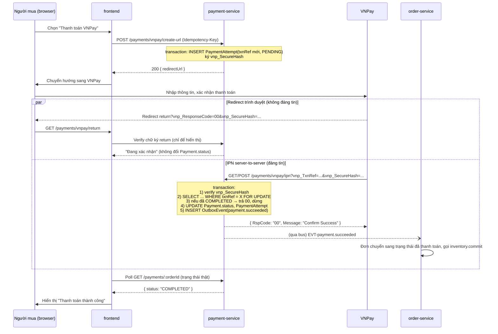

# Design — `payment-vnpay` (mã `PAY`)

Service sở hữu: `payment-service` (`payment_db`, port `3106`). Phạm vi tài liệu này chỉ gồm luồng VNPay
(`create-url` → `return` → `ipn`), COD, hoàn tiền và đối soát. Ví seller/buyer, sổ giao dịch ví
(`WalletTransaction`), rút tiền (`Withdrawal`) và hoa hồng thuộc domain `wallet-settlement` (mã `WAL`) —
xem `docs/00-overview/feature-inventory.md` §10, spec riêng sau. Model `Wallet`/`WalletTransaction`/`Withdrawal`
chỉ được nhắc tới ở đây khi cần giải thích consumer của `EVT-payment.*`, không đặc tả hành vi của chúng.

## 1. Mô hình dữ liệu

Trích từ [`payment-service.prisma.md`](../../02-domain/schemas/payment-service.prisma.md) — chỉ phần liên quan tới
domain này:

```prisma
enum PaymentStatus {
    PENDING
    PROCESSING
    COMPLETED
    FAILED
    REFUNDED
    PARTIALLY_REFUNDED
}

model Payment {
    id           String        @id @default(uuid())
    orderId      String        @unique
    method       String
    status       PaymentStatus @default(PENDING)
    amount       Decimal       @db.Decimal(14, 2)
    currency     String        @default("VND")
    vnpayTxnRef  String?       @unique
    vnpayTransNo String?
    paidAt       DateTime?
    expiresAt    DateTime?
    metadata     Json?
    createdAt    DateTime      @default(now())
    updatedAt    DateTime      @updatedAt
    attempts     PaymentAttempt[]

    @@index([orderId])
    @@index([vnpayTxnRef])
}

/// [MỚI] Mỗi lần thử thanh toán riêng khỏi Payment cuối cùng — FEAT-PAY-011, theo dõi IPN đến nhiều lần
model PaymentAttempt {
    id            String        @id @default(uuid())
    paymentId     String
    provider      String        // VNPAY | COD | WALLET
    // vnp_TxnRef của lần này — khoá idempotent cho IPN (REQ-PAY-005)
    txnRef        String        @unique
    status        PaymentStatus @default(PENDING)
    ipnPayload    Json?
    ipnReceivedAt DateTime?
    createdAt     DateTime      @default(now())
    payment       Payment       @relation(fields: [paymentId], references: [id], onDelete: Cascade)

    @@index([paymentId])
}
```

Hai unique quan trọng nhất của domain này:

- `Payment.orderId @unique` — một đơn chỉ có một `Payment` (REQ-PAY-005 trong `requirements.md` của
  `order-fulfillment`; ở domain này là `FEAT-PAY-005`).
- `PaymentAttempt.txnRef @unique` — **là lớp chặn cuối cho IPN trùng lặp** (REQ-PAY-005). Không đọc trước
  rồi mới quyết định có xử lý hay không; `INSERT`/`UPDATE` va vào ràng buộc này là tín hiệu duy nhất đáng tin.

## 2. API

| Endpoint | Method | Permission | Phạm vi | Ghi chú |
|---|---|---|---|---|
| `/payments/vnpay/create-url` | `POST` | `payment:payment:create` | Chỉ đơn của chính `userId` gọi (`whereForScope: { order.userId = currentUser.id }`) | Bắt buộc `Idempotency-Key` (REQ-PAY-013) |
| `/payments/vnpay/return` | `GET` | Public (không cần JWT, nhưng verify `vnp_SecureHash`) | — | Chỉ đọc + hiển thị, không ghi (REQ-PAY-002) |
| `/payments/vnpay/ipn` | `GET`/`POST` (theo cấu hình VNPay) | Public, xác thực bằng `vnp_SecureHash`, không qua JWT | — | Không đi qua `api-gateway` RBAC lớp 1–3 — tự xác thực bằng chữ ký (REQ-PAY-003, REQ-PAY-004) |
| `/payments/cod/confirm` | `POST` | `payment:payment:update` (nội bộ, gọi khi `order-service` xác nhận đã thu COD) | RPC nội bộ hoặc consumer event, không phải endpoint public | REQ-PAY-008 |
| `/payments/:paymentId/refund` | `POST` | `payment:payment:refund` | Chỉ admin, không giới hạn theo chủ sở hữu (`:any` ngầm định vì admin xử lý mọi đơn) | Bắt buộc `Idempotency-Key`, REQ-PAY-009 |
| `/payments/attempts` | `GET` | `payment:attempt:read:any` | Admin xem mọi `PaymentAttempt` | REQ-PAY-011 |
| `/payments/:paymentId/retry` | `POST` | `payment:payment:create` | Chỉ chủ đơn | Bắt buộc `Idempotency-Key`, REQ-PAY-012 |

Tài nguyên ngoài phạm vi (đơn không thuộc về người gọi) trả `404`, không phải `403` — luật cứng #8. Riêng
`/payments/attempts` là kiểm tra permission thuần (thiếu quyền `read:any`), nên `403` ở đây đúng ngữ nghĩa — không
phải rò rỉ sự tồn tại của một bản ghi cụ thể.

## 3. Event

### Phát (outbox, trong cùng transaction với thay đổi `Payment`)

| Event | Khi nào | Payload chính |
|---|---|---|
| `EVT-payment.succeeded` | IPN xác nhận `vnp_ResponseCode = 00`, hoặc COD xác nhận đã thu tiền | `paymentId`, `orderId`, `userId`, `provider`, `providerTxnRef`, `providerTxnNo`, `amount` (chuỗi), `currency`, `paidAt`, `bankCode` — schema đầy đủ ở [event-catalog.md §EVT-payment.succeeded](../../01-architecture/event-catalog.md) |
| `EVT-payment.failed` | IPN báo `vnp_ResponseCode ≠ 00`, hoặc đơn COD bị huỷ trước giao | `paymentId`, `orderId`, `reason` |
| `EVT-payment.expired` | Job hết hạn 15 phút không nhận IPN (REQ-PAY-007) | `paymentId`, `orderId` |
| `EVT-payment.refunded` | Admin duyệt hoàn tiền (một phần/toàn phần) | `paymentId`, `orderId`, `amount` (chuỗi), `refundType: 'FULL' \| 'PARTIAL'` |

> **Quan trọng:** `EVT-payment.succeeded` chỉ được phát từ luồng **IPN**, không bao giờ từ `return`. Đây là quy tắc
> cứng nhất của domain này — xem §6.

### Nghe

| Event | Từ đâu | Xử lý |
|---|---|---|
| `order.created` | `order-service` | Tạo `Payment` (`PENDING`) tương ứng `orderId`, chưa tạo `PaymentAttempt` cho tới khi người dùng chọn VNPay |
| `order.cancelled` | `order-service` | Nếu `Payment` đang `PENDING`, chuyển `FAILED`, huỷ `PaymentAttempt` đang chờ (idempotent qua `processed_events`) |

`order.completed` (ghi có ví seller) thuộc phạm vi `wallet-settlement`, không nằm trong tài liệu này.

## 4. Sequence — luồng chính



## 5. Trường hợp biên

| Trường hợp | Xử lý | REQ liên quan |
|---|---|---|
| Người dùng đóng tab trước khi `return` tải | IPN vẫn tới độc lập, trạng thái chốt đúng khi người dùng quay lại xem đơn | REQ-PAY-006 |
| IPN tới **trước** `return` (rất phổ biến) | Bình thường — `return` chỉ đọc trạng thái hiện có, không cần chờ theo thứ tự | REQ-PAY-002, REQ-PAY-003 |
| IPN gửi trùng nhiều lần (retry của VNPay) | Khoá theo `txnRef`, kiểm trạng thái đã xử lý trước khi ghi | REQ-PAY-005 |
| Chữ ký IPN sai | Từ chối ngay, không chạm DB nghiệp vụ | REQ-PAY-004 |
| Quá 15 phút không có IPN | Job hết hạn chuyển `FAILED`, phát `payment.expired`, phối hợp huỷ đơn + release tồn | REQ-PAY-007 |
| IPN trễ tới sau khi đã hết hạn/huỷ | Ghi log bất thường, xử lý thủ công qua đối soát, không tự cộng tiền | REQ-PAY-007 |
| Số tiền IPN khác `Payment.amount` | Từ chối chốt, trả `RspCode = 04`, cờ cảnh báo đối soát | REQ-PAY-003 |

## 6. Điểm tranh chấp đồng thời

Xem thêm hàng #5 trong [concurrency-and-consistency.md §1](../../01-architecture/concurrency-and-consistency.md#1-bản-đồ-điểm-tranh-chấp)
("IPN VNPay gửi lại nhiều lần" → "Unique `vnp_TxnRef` + `processed_events`").

Domain này có **hai** điểm chặn độc lập cho IPN trùng, cả hai bắt buộc:

1. **Ràng buộc DB**: `PaymentAttempt.txnRef @unique`. Một `INSERT` hai lần với cùng `txnRef` sẽ bắn `P2002` — nhánh
   thua coi như "đã xử lý", trả `RspCode = 00` mà không ghi gì thêm.
2. **Kiểm trạng thái trong transaction**: trước khi `UPDATE`, đọc `PaymentAttempt` theo `txnRef` (có thể
   `SELECT ... FOR UPDATE` nếu hai IPN trùng đến cùng lúc cho cùng `txnRef` đã tồn tại), nếu `ipnReceivedAt` đã có
   giá trị thì dừng, không ghi lại.

❌ **BAD** — tin vào `return` URL để xác nhận đơn:

```ts
// return.controller.ts — SAI, đừng làm thế này
@Get('vnpay/return')
async handleReturn(@Query() query: VnpayReturnDto) {
    const isValidSignature = verifySignature(query, process.env.VNP_HASH_SECRET)
    if (isValidSignature && query.vnp_ResponseCode === '00') {
        // SAI: return có thể bị người dùng replay URL, sửa query param trên trình duyệt,
        // hoặc không bao giờ được tải nếu người dùng đóng tab.
        await this.paymentService.markCompleted(query.vnp_TxnRef)
        return { message: 'Thanh toán thành công' }
    }
}
```

Tham số trên `return` đi qua trình duyệt của người dùng — hoàn toàn có thể bị chỉnh sửa thủ công (đổi
`vnp_ResponseCode` trên URL) trước khi tải trang. Coi đây là nguồn sự thật là lỗ hổng cho phép "thanh toán giả".

✅ **GOOD** — chỉ tin IPN đã verify checksum, `return` chỉ đọc trạng thái đã chốt:

```ts
// return.controller.ts
@Get('vnpay/return')
async handleReturn(@Query() query: VnpayReturnDto) {
    verifySignature(query, process.env.VNP_HASH_SECRET) // chỉ để không hiển thị rác nếu bị sửa URL
    const payment = await this.paymentService.findByTxnRef(query.vnp_TxnRef)
    // Trạng thái luôn đọc từ Payment.status do IPN ghi, KHÔNG ghi gì ở đây
    return { status: payment.status, orderId: payment.orderId }
}

// ipn.controller.ts
@Post('vnpay/ipn')
async handleIpn(@Body() body: VnpayIpnDto) {
    if (!verifySignature(body, process.env.VNP_HASH_SECRET)) {
        return { RspCode: '97', Message: 'Invalid signature' }
    }
    return this.paymentService.processIpnIdempotent(body) // transaction: khoá theo txnRef, ghi + outbox
}
```

## 7. Ảnh hưởng tới domain khác

| Domain | Ảnh hưởng |
|---|---|
| `order-fulfillment` (`ORD`) | Nghe `payment.succeeded`/`payment.failed`/`payment.expired` để chuyển trạng thái đơn và gọi `inventory.commit`/`inventory.release` qua `catalog-service` |
| `inventory` (trong `catalog-service`) | Gián tiếp qua `order-service`: hết hạn thanh toán (REQ-PAY-007) là một trong các lý do `inventory.release` được gọi |
| `notification` (`NTF`) | Nghe `payment.succeeded`/`payment.failed` để gửi in-app + email theo `event-catalog.md` §3 |
| `analytics-sales` (`ANA`) | Nghe toàn bộ `payment.*` cho báo cáo doanh thu/GMV |
| `audit-log` (`AUD`) | Nghe `payment.succeeded`/`payment.refunded` để ghi nhật ký bất biến |
| `wallet-settlement` (`WAL`, spec sau) | Nghe `payment.succeeded` (ghi có tạm giữ) và `payment.refunded` (ghi nợ hoàn tiền) để tạo `WalletTransaction` — **ngoài phạm vi tài liệu này** |
