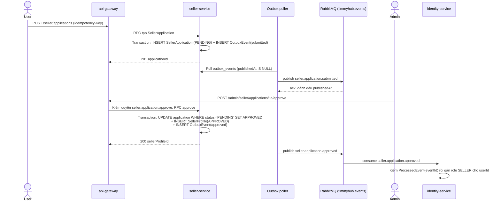
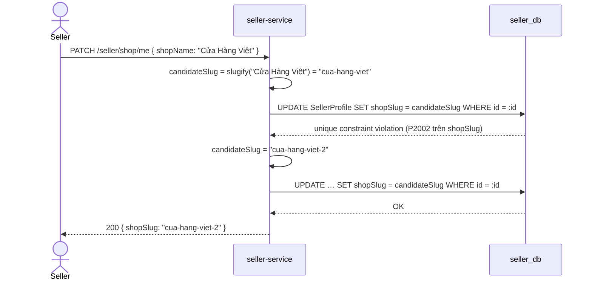

# Thiết kế — seller-onboarding (`SEL`)

Service sở hữu: `seller-service` (`seller_db`, cổng `3102`). Xem
[requirements.md](requirements.md) cho danh sách `REQ-SEL-*` đầy đủ.

## 1. Mô hình dữ liệu

Trích từ [seller-service.prisma.md](../../02-domain/schemas/seller-service.prisma.md) — chỉ giữ các trường liên quan
tới spec này:

```prisma
enum ResourceStatus {
    PENDING
    APPROVED
    REJECTED
    DELETED
}

model SellerProfile {
    id                String         @id @default(uuid())
    userId            String         @unique   // tham chiếu logic sang identity-service
    shopName          String
    shopSlug          String         @unique
    shopLogo          String?
    shopBanner        String?
    description       String?
    warehouseAddressLine String?
    provinceCode      String?
    districtCode      String?
    wardCode          String?
    status            ResourceStatus @default(PENDING)
    isVerified        Boolean        @default(false)
    verifiedAt        DateTime?
    isSuspended       Boolean        @default(false)
    suspendedReason   String?
    rating            Float          @default(0)
    cancelRate        Float          @default(0)   // FEAT-SEL-008, event order.completed
    avgResponseHours  Float          @default(0)   // FEAT-SEL-008
    returnPolicyDays  Int            @default(7)    // FEAT-SEL-009
    prepTimeHours     Int            @default(24)   // FEAT-SEL-009
    createdAt         DateTime       @default(now())
    updatedAt         DateTime       @updatedAt
    application       SellerApplication?
    brandProfile       BrandProfile?
    followers          ShopFollow[]                 // FEAT-USR-010, không thuộc phạm vi spec này

    @@index([shopSlug])
    @@index([status])
}

model SellerApplication {
    id              String         @id @default(uuid())
    userId          String
    sellerProfileId String?        @unique
    shopName        String
    shopDescription String?
    idDocumentUrl   String
    taxCode         String?
    status          ResourceStatus @default(PENDING)
    reviewNote      String?
    reviewedById    String?
    reviewedAt      DateTime?
    createdAt       DateTime       @default(now())
    updatedAt       DateTime       @updatedAt
    sellerProfile   SellerProfile? @relation(fields: [sellerProfileId], references: [id])

    @@index([userId])
    @@index([status])
}

model BrandProfile {
    id              String        @id @default(uuid())
    sellerProfileId String        @unique
    userId          String
    brandName       String        @unique
    brandSlug       String        @unique
    brandLogo       String?
    description     String?
    isVerified      Boolean       @default(false)
    createdAt       DateTime      @default(now())
    updatedAt       DateTime      @updatedAt
    sellerProfile   SellerProfile @relation(fields: [sellerProfileId], references: [id], onDelete: Cascade)

    @@index([brandSlug])
}

/// FEAT-USR-010 — nằm trong cùng service (seller_db) nhưng thuộc domain user-profile, tham chiếu ở đây
/// chỉ vì SellerProfile.followers trỏ tới model này, không đặc tả lại yêu cầu ở spec này.
model ShopFollow {
    id              String        @id @default(uuid())
    userId          String
    sellerProfileId String
    createdAt       DateTime      @default(now())
    sellerProfile   SellerProfile @relation(fields: [sellerProfileId], references: [id], onDelete: Cascade)

    @@unique([userId, sellerProfileId])
    @@index([sellerProfileId])
}

model OutboxEvent {
    id            String    @id @default(uuid())
    aggregateType String
    aggregateId   String
    eventType     String
    payload       Json
    createdAt     DateTime  @default(now())
    publishedAt   DateTime?

    @@index([publishedAt])
    @@map("outbox_events")
}

model ProcessedEvent {
    eventId      String   @id
    consumerName String
    processedAt  DateTime @default(now())

    @@map("processed_events")
}
```

Quan hệ 1-1 `SellerApplication.sellerProfileId → SellerProfile.id` chỉ được điền **khi đơn được duyệt** — đơn
`PENDING`/`REJECTED` không có `sellerProfileId`. Một user có thể có nhiều `SellerApplication` theo thời gian (lịch
sử nộp lại — `REQ-SEL-004`) nhưng tối đa **một** `SellerProfile` (`userId @unique`).

## 2. API

Mọi endpoint đi qua `api-gateway`, xác thực JWT + `@Roles` + `@Permissions` + `whereForScope` (bốn lớp, xem
[rbac-advanced.md](../../01-architecture/rbac-advanced.md)). Quy ước tên permission `module:resource:action[:scope]`.
Nhóm `application` giữ số ít để khớp với ví dụ đã chốt ở `rbac-advanced.md` (`seller:application:approve`); nhóm
`shop`/`brand` dùng số nhiều theo quy ước chung.

| Endpoint | Method | Permission | Phạm vi | Ref |
|---|---|---|---|---|
| `/seller/applications` | POST | `seller:application:create` | own (user tự nộp cho chính mình) | `REQ-SEL-001`, `REQ-SEL-002`, `REQ-SEL-003` |
| `/seller/applications/me` | GET | `seller:application:read` | own | `REQ-SEL-004` |
| `/admin/seller/applications` | GET | `seller:application:read:any` | all, lọc theo `status` | `REQ-SEL-006`, `REQ-SEL-007` |
| `/admin/seller/applications/:id/approve` | POST | `seller:application:approve` | all | `REQ-SEL-006`, `REQ-SEL-008` |
| `/admin/seller/applications/:id/reject` | POST | `seller:application:reject` | all | `REQ-SEL-007`, `REQ-SEL-008` |
| `/seller/shop/me` | GET | `seller:shops:read` | own | `REQ-SEL-020` |
| `/seller/shop/me` | PATCH | `seller:shops:update` | own | `REQ-SEL-009`, `REQ-SEL-010`, `REQ-SEL-021`, `REQ-SEL-022` |
| `/shops/:slug` | GET | — (public, guest) | `status = APPROVED AND isSuspended = false` lọc trong query | `REQ-SEL-011`, `REQ-SEL-012` |
| `/admin/seller/shops/:id/verify` | POST | `seller:shops:verify` | all | `REQ-SEL-015` |
| `/admin/seller/shops/:id/suspend` | POST | `seller:shops:suspend` | all | `REQ-SEL-016` |
| `/admin/seller/shops/:id/restore` | POST | `seller:shops:restore` | all | `REQ-SEL-017` |
| `/seller/brand` | POST | `seller:brands:create` | own | `REQ-SEL-013`, `REQ-SEL-014` |
| `/seller/brand` | PATCH | `seller:brands:update` | own | `REQ-SEL-013`, `REQ-SEL-014` |

Thao tác tạo đơn (`POST /seller/applications`) và duyệt/từ chối nhận `Idempotency-Key` (luật cứng #5). Danh sách
đơn cho admin (`GET /admin/seller/applications`) **luôn** đi qua `whereForScope(scope)` — không `.filter()` sau khi
lấy về (luật cứng #7).

## 3. Sự kiện

Chỉ dùng tên đã có ở [event-catalog.md](../../01-architecture/event-catalog.md) mục `seller`.

### Phát (producer)

| Event | Khi nào | Payload chính | Consumer |
|---|---|---|---|
| `seller.application.submitted` | Sau `INSERT SellerApplication` (nộp mới hoặc nộp lại) | `applicationId`, `userId`, `shopName` | NTF, AUD |
| `seller.application.approved` | Sau khi `SellerApplication → APPROVED` và tạo `SellerProfile` trong cùng transaction | `applicationId`, `sellerProfileId`, `userId`, `shopSlug` | IDN (gán role `SELLER`), NTF, SRC, ANA, AUD |
| `seller.application.rejected` | Sau `SellerApplication → REJECTED` | `applicationId`, `userId`, `reviewNote` | NTF, AUD |
| `seller.shop.updated` | Sau `PATCH` hồ sơ shop, khôi phục shop tạm ngưng | `sellerProfileId`, `shopSlug`, các trường đổi | CAT, SRC, ORD *(read model)* |
| `seller.shop.suspended` | Sau tạm ngưng shop | `sellerProfileId`, `suspendedReason` | CAT, CNT, SRC, NTF, AUD |

Tất cả phát **chỉ** qua `OutboxEvent` — ghi trong cùng transaction Prisma với thay đổi nghiệp vụ, một poller riêng
đọc bảng, publish lên `timmyhub.events`, đánh dấu `publishedAt` (đúng pattern đã chốt ở
[ADR-0002](../../01-architecture/adr/ADR-0002-database-per-service.md)). Không có đường phát event nào bỏ qua outbox.

### Nghe (consumer)

| Event | Xử lý | Ref |
|---|---|---|
| `order.completed` | `UPDATE SellerProfile SET cancelRate = …, avgResponseHours = … WHERE id = :sellerProfileId` nguyên tử | `REQ-SEL-018` |
| `review.created` | `UPDATE SellerProfile SET rating = …` nguyên tử | `REQ-SEL-019` |

Cả hai consumer kiểm tra `ProcessedEvent(eventId)` trước khi xử lý — idempotent theo luật cứng #3.

## 4. Sequence diagram — nộp đơn → duyệt → tạo shop



## 5. Trường hợp biên

### 5.1 Nộp lại đơn sau khi bị từ chối

Không sửa đè `SellerApplication` bị `REJECTED` — luôn `INSERT` bản ghi mới, giữ bản cũ làm lịch sử tra cứu
(`reviewNote` cũ vẫn còn để user xem lý do lần trước). Ràng buộc chặn spam: `REQ-SEL-005` (24 giờ từ
`reviewedAt`). Truy vấn "đơn đang chờ của user" luôn lấy bản ghi mới nhất theo `createdAt` với `status = PENDING`,
không giả định chỉ có một bản ghi cho `userId`.

### 5.2 Đổi tên shop trùng slug



Vòng lặp thử hậu tố (`-2`, `-3`, …) dựa vào **bắt lỗi vi phạm ràng buộc `@unique` của DB**, không phải
`SELECT … rồi kiểm tra rồi UPDATE` — tránh race giữa hai request đổi tên cùng lúc (đọc-rồi-ghi sẽ cho cả hai cùng
thấy slug "trống" rồi cùng ghi, một trong hai lỗi 500 ở tầng DB thay vì tự khắc phục).

## 6. Điểm tranh chấp đồng thời

| Điểm tranh chấp | Cách xử lý |
|---|---|
| Hai admin duyệt cùng một đơn gần như đồng thời | `UPDATE SellerApplication SET status='APPROVED' WHERE id=:id AND status='PENDING'` — request thứ hai nhận 0 dòng bị ảnh hưởng → map sang `409`, không tạo `SellerProfile` thứ hai |
| Hai request đổi `shopName` cùng lúc dẫn tới cùng `shopSlug` | Ràng buộc `@unique(shopSlug)` ở DB + retry với hậu tố, xem §5.2 |
| `userId` cố nộp hai đơn cùng lúc | Ràng buộc nghiệp vụ kiểm `PENDING`/`APPROVED` hiện có trong cùng transaction tạo đơn (`SELECT … FOR UPDATE` theo `userId` hoặc unique index có điều kiện qua ứng dụng) trước khi `INSERT` |

## 7. Ảnh hưởng tới domain khác

- `identity-service`: nghe `seller.application.approved` để gán role `SELLER` — không đọc thẳng `seller_db`.
- `catalog-service`: nghe `seller.shop.suspended`/`seller.shop.updated` để ẩn/hiện sản phẩm của shop — không query
  chéo `seller_db`.
- `search-service`, `analytics-service`, `notification-service`: dựng read model riêng từ các event `seller.*`,
  không JOIN qua ranh giới service (luật cứng #2, ADR-0002).
- `order-service` dùng `seller.shop.updated` như read model không chuẩn hoá để hiển thị tên shop trên đơn hàng mà
  không cần gọi RPC đồng bộ mỗi lần render.

## 8. ❌ BAD / ✅ GOOD

**Kiểm tra `shopSlug` trùng trước khi ghi (đọc-rồi-ghi) thay vì dựa vào ràng buộc DB:**

❌ BAD:

```ts
const existing = await prisma.sellerProfile.findUnique({ where: { shopSlug: candidateSlug } })
if (existing) candidateSlug = `${candidateSlug}-2`
await prisma.sellerProfile.update({ where: { id }, data: { shopSlug: candidateSlug } })
// Giữa lúc findUnique và update, request khác có thể đã chiếm candidateSlug → vẫn dính lỗi @unique
// hoặc tệ hơn, nếu @unique không có, tạo ra hai shop trùng slug thật sự.
```

✅ GOOD:

```ts
async function updateShopWithUniqueSlug(id: string, candidateSlug: string, attempt = 1): Promise<SellerProfile> {
    try {
        return await prisma.sellerProfile.update({ where: { id }, data: { shopSlug: candidateSlug } })
    } catch (e) {
        if (isUniqueConstraintError(e, 'shopSlug') && attempt <= 5) {
            return updateShopWithUniqueSlug(id, `${baseSlug}-${attempt + 1}`, attempt + 1)
        }
        throw e
    }
}
```

**Duyệt đơn: phát event trước khi commit transaction DB:**

❌ BAD:

```ts
await eventBus.publish('seller.application.approved', payload) // publish trước
await prisma.$transaction([
    prisma.sellerApplication.update({ where: { id }, data: { status: 'APPROVED' } }),
    prisma.sellerProfile.create({ data: sellerProfileData }),
])
// Nếu transaction rollback sau khi publish thành công, identity-service đã gán role SELLER
// cho một user chưa hề có SellerProfile — dữ liệu hai service lệch nhau vĩnh viễn.
```

✅ GOOD:

```ts
await prisma.$transaction([
    prisma.sellerApplication.update({ where: { id, status: 'PENDING' }, data: { status: 'APPROVED' } }),
    prisma.sellerProfile.create({ data: sellerProfileData }),
    prisma.outboxEvent.create({ data: { eventType: 'seller.application.approved', payload, aggregateId: sellerProfileId } }),
])
// Poller riêng đọc outbox_events sau khi transaction đã commit thành công, publish rồi mới đánh dấu publishedAt.
```
