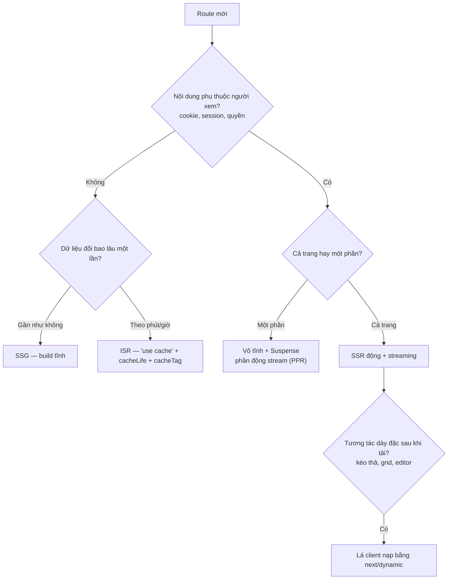

# Chiến dịch tối ưu tốc độ tải trang

> Ngân sách (LCP, INP, CLS, KB JS) đã chốt ở [performance.md](performance.md). Tài liệu này là **lộ trình** đưa
> frontend hiện tại về ngân sách đó: chọn chiến lược render cho từng route, dọn gói JS, và thứ tự làm.
> Căn cứ: đợt rà soát mã `frontend/` ngày 2026-09-25, Next.js 16.3 (App Router, React 19, React Compiler).
> Tài liệu Next đi kèm dự án nằm ở `frontend/node_modules/next/dist/docs/` — đọc ở đó trước khi áp một API mới.

---

## 1. Thứ tự ưu tiên

Làm theo thứ tự, không nhảy cóc sang tối ưu vi mô khi mục trên còn hỏng:

1. Giao diện đúng và dùng tốt trên di động.
2. Đủ trạng thái đang tải, lỗi, rỗng, đang gửi form.
3. Bàn phím, focus, label.
4. Kiểm quyền phía server.
5. Đo Web Vitals rồi sửa điểm nghẽn lớn nhất.
6. Sau cùng mới tối ưu vi mô hoặc thêm abstraction.

---

## 2. Chọn chiến lược render

| Loại trang | Chiến lược | Ví dụ |
|---|---|---|
| Nội dung công khai ít đổi | SSG | giới thiệu, chính sách, trang lỗi |
| Công khai, đổi định kỳ | ISR qua `'use cache'` + `cacheLife('hours')` + `cacheTag` | trang chủ, danh mục, chi tiết sản phẩm, trang shop |
| Công khai nhưng có phần cá nhân | Vỏ tĩnh + `<Suspense>` cho phần đọc cookie (PPR) | header có giỏ hàng/tài khoản trên trang sản phẩm |
| Cá nhân, cần đăng nhập | SSR động + streaming (`loading.tsx`, `<Suspense>` từng khối) | dashboard, đơn hàng, quản trị user |
| Tương tác nặng | Server render khung, lá client nạp động | AG Grid, trình soạn bài, upload video, biểu đồ |

Quy tắc đi kèm:

- **Server Component mặc định.** `'use client'` chỉ ở lá cần state, sự kiện hoặc API trình duyệt. Truyền dữ liệu đã
  fetch xuống lá dưới dạng props, không để lá tự fetch trong `useEffect`.
- **Fetch gần chỗ render**, mỗi khối độc lập bọc `<Suspense>` riêng để khối chậm không chặn khối nhanh.
- **Cache là opt-in** (Next 16, `cacheComponents: true`): hàm/component đọc dữ liệu công khai đánh `'use cache'`,
  khai `cacheLife` và `cacheTag`; thao tác ghi gọi `updateTag`/`revalidateTag` đúng tag. Không `revalidatePath('/',
  'layout')` — nó xoá cache cả site.
- **Đọc cookie/header chặn Suspense gần nhất**, không đọc ở root layout nếu không bắt buộc.
- **Thao tác ghi chạy trên server** (Server Action hoặc route BE), validate bằng zod từ `@timmyhub/contracts` và kiểm
  quyền trước khi ghi.

---

## 3. Hiện trạng và chiến lược đích theo route

| Route | Hiện tại | Đích | Ghi chú |
|---|---|---|---|
| `/` | Trang demo, động vì root layout đọc locale từ cookie | ISR (vỏ tĩnh + khối sản phẩm `'use cache'`) | Thay nội dung demo khi có storefront |
| `/login` | Động (cùng lý do) | SSG | Form là lá client |
| `/dashboard` | Động, layout tự bọc `NavLayout` | SSR + streaming | `noindex` |
| `/users` | Động, grid tải cùng bundle trang | SSR khung + grid nạp động | `noindex`; dữ liệu phân trang phía server khi có API |

---

## 4. Hạng mục công việc

Mức ảnh hưởng: **Cao** = đổi hẳn LCP/JS của mọi trang; **Vừa** = một nhóm trang; **Thấp** = dọn dẹp.

### 4.1 Giai đoạn 1 — nền tảng render

| ID | Việc | Mức | Tiêu chí xong |
|---|---|---|---|
| `TASK-PERF-001` | Tạo `app/(protected)/layout.tsx` chứa `NavLayout`, bỏ việc mỗi page tự bọc — sidebar không remount khi chuyển trang | Cao | Chuyển `/dashboard` ↔ `/users` không mount lại sidebar (React DevTools Profiler) |
| `TASK-PERF-002` | Chốt chiến lược locale: segment `[locale]` + `proxy.ts`, `localePrefix: 'as-needed'` cho trang công khai; root layout không đọc cookie | Cao | `next build` báo `/` và `/login` là tĩnh (○) |
| `TASK-PERF-003` | Bật `cacheComponents`, áp `'use cache'`/`cacheLife`/`cacheTag`; thay `revalidatePath('/', 'layout')` ở `services/locale.service.ts` | Cao | Không còn `revalidatePath` toàn site; build không cảnh báo dynamic ngoài Suspense |
| `TASK-PERF-004` | Thêm `loading.tsx`, `error.tsx`, `not-found.tsx`, `global-error.tsx` theo nhóm route; skeleton đúng kích thước | Vừa–Cao | Mỗi nhóm route có đủ bốn file; CLS ≤ 0,1 khi tải chậm |

### 4.2 Giai đoạn 2 — giảm JS gửi xuống

| ID | Việc | Mức | Tiêu chí xong |
|---|---|---|---|
| `TASK-PERF-005` | Font: `preload: false` cho 7 font không mặc định ở `constants/theme/fonts.ts`; khai báo đủ `--font-geist-mono` | Cao | Trang đầu chỉ preload 1–2 file font |
| `TASK-PERF-006` | Barrel: code server import lá; `"sideEffects": ["*.css"]` trong `package.json`; `optimizePackageImports` cho `radix-ui`, `@base-ui/react`, `react-day-picker`, `ag-grid-*` | Cao | `next experimental-analyze` cho thấy chunk chung giảm; ghi số trước/sau vào PR |
| `TASK-PERF-007` | Nạp động `ThemeCustomizer`, `Calendar` (chỉ khi mở popover) | Vừa | Hai module không có trong chunk trang đầu |
| `TASK-PERF-008` | AG Grid: chỉ đăng ký module cần dùng thay `AllCommunityModule`; nạp locale theo ngôn ngữ đang chọn; grid nạp bằng `next/dynamic` | Vừa | JS trang `/users` ≤ 300 KB gzip |
| `TASK-PERF-009` | Chỉ truyền namespace thông điệp cần thiết vào `NextIntlClientProvider` | Thấp | Payload RSC không chứa toàn bộ catalog |
| `TASK-PERF-010` | Gỡ dependency npm `cn`, dùng `cn` của `@/utils` | Thấp | `cn` không còn trong `package.json` |
| `TASK-PERF-011` | `AppSidebar` thành Server Component, chỉ phần tương tác là lá client | Thấp | File sidebar gốc không còn `'use client'` |

### 4.3 Giai đoạn 3 — tài nguyên, metadata, đo đạc

| ID | Việc | Mức | Tiêu chí xong |
|---|---|---|---|
| `TASK-PERF-012` | Metadata: `metadataBase`, `title.template`, Open Graph mặc định, `robots: noindex` cho nhóm protected, `sitemap.ts`, `robots.ts`; chuỗi qua `next-intl` | Vừa | Mọi route có title/description riêng; Lighthouse SEO ≥ 95 ở trang công khai |
| `TASK-PERF-013` | `next.config.ts`: `images.formats` avif/webp, `remotePatterns` cho CDN media; thay `priority` bằng `preload`/`fetchPriority` | Vừa | Không còn `priority` trong mã; ảnh LCP được preload |
| `TASK-PERF-014` | Đo thật: Lighthouse CI trên 4 route, gửi Web Vitals (LCP, INP, CLS) người dùng thật qua `useReportWebVitals` về observability | Vừa | Dashboard có p75 theo route |

---

## 5. Checklist cho từng PR giao diện

- [ ] Component mới là Server Component, trừ khi cần state/sự kiện/API trình duyệt — lá client nhỏ nhất có thể.
- [ ] Không fetch trong `useEffect`; dữ liệu đến qua props hoặc Suspense.
- [ ] Thư viện nặng hoặc phần chỉ hiện khi mở dùng `next/dynamic`; không import cả thư viện để lấy một hàm.
- [ ] Ảnh qua `next/image` có `sizes`; chỉ ảnh LCP được `preload`.
- [ ] Font qua `next/font`, font phụ không preload.
- [ ] Danh sách dài phân trang hoặc ảo hoá; state cập nhật hẹp, zustand đọc qua selector.
- [ ] Có `loading`/`error`/rỗng/404 riêng; metadata và Open Graph của trang.
- [ ] Không bí mật trong biến `NEXT_PUBLIC_*`.
- [ ] PR đổi phụ thuộc hoặc import lớn thì ghi kích thước chunk trước/sau.

---

## 6. Cách đo

| Đo gì | Công cụ | Khi nào |
|---|---|---|
| Kích thước chunk, module nào kéo vào | `next experimental-analyze`, `size-limit` | Mỗi PR đổi dependency/import |
| Loại render của từng route (○ tĩnh, ◐ PPR, ƒ động) | output của `next build` | Mỗi PR đổi route/layout |
| LCP, INP, CLS phòng lab | Lighthouse CI; Chrome DevTools MCP (`performance_start_trace`, `lighthouse_audit`) | Mỗi PR giao diện |
| Web Vitals người dùng thật | `useReportWebVitals` → observability | Liên tục, xem p75 hằng tuần |
| Render thừa | React DevTools Profiler, `next-devtools` MCP | Khi INP vượt ngân sách |
