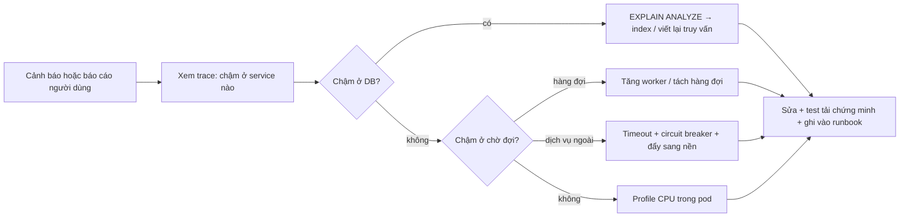

# Hiệu năng

> Hiệu năng không phải việc làm cuối dự án. Nó là **ngân sách bị vi phạm thì CI đỏ**, giống như test.
> Tài liệu này chốt ngân sách, cách đo tự động, và danh mục lỗi hiệu năng hay gặp kèm cách sửa.

---

## 1. Ngân sách

### 1.1 Frontend (đo trên thiết bị mô phỏng Moto G Power, mạng 4G chậm)

| Trang | LCP | INP | CLS | JS lần đầu (gzip) |
|---|---|---|---|---|
| Trang chủ | ≤ 2,0 s | ≤ 200 ms | ≤ 0,1 | ≤ 160 KB |
| Chi tiết sản phẩm | ≤ 2,5 s | ≤ 200 ms | ≤ 0,1 | ≤ 180 KB |
| Danh sách/tìm kiếm | ≤ 2,5 s | ≤ 200 ms | ≤ 0,1 | ≤ 180 KB |
| Giỏ hàng, thanh toán | ≤ 2,0 s | ≤ 150 ms | ≤ 0,05 | ≤ 200 KB |
| Bảng điều khiển seller/admin | ≤ 3,0 s | ≤ 300 ms | ≤ 0,1 | ≤ 300 KB |

Vượt ngân sách JS thì `size-limit` làm CI đỏ. Vượt chỉ số Web Vitals ba lần chạy liên tiếp trên Lighthouse CI thì
chặn phát hành, không chặn merge.

### 1.2 Backend

| Chỉ số | Ngưỡng |
|---|---|
| p95 API đọc | < 300 ms (đo ở gateway, không tính mạng người dùng) |
| p95 API ghi | < 500 ms |
| p99 bất kỳ endpoint nào | < 1,5 s |
| Truy vấn DB đơn lẻ | < 50 ms; > 200 ms bị ghi log cảnh báo kèm câu truy vấn |
| Số truy vấn cho một request | ≤ 10; > 20 là CI đỏ ở test |
| Độ trễ tiêu thụ event | p95 < 5 s từ lúc phát |
| Độ sâu hàng đợi BullMQ | < 1.000; vượt thì cảnh báo |
| Tỷ lệ lỗi 5xx | < 0,1% |

### 1.3 Tải mục tiêu (dùng để kiểm bằng k6)

| Kịch bản | Mục tiêu |
|---|---|
| Duyệt sản phẩm | 500 RPS trong 10 phút, p95 < 300 ms |
| Đặt hàng | 50 đơn/giây bền vững |
| Flash sale | 2.000 người dùng ảo trong 30 giây, bán đúng số lượng, không 5xx |
| WebSocket | 5.000 kết nối đồng thời, gửi 1.000 sự kiện/giây |

---

## 2. Cách đo

| Lớp | Công cụ | Chạy khi nào |
|---|---|---|
| Web Vitals thật của người dùng | `web-vitals` → Sentry/PostHog | Liên tục trên sản xuất |
| Web Vitals phòng thí nghiệm | Lighthouse CI trên 5 route chính | Mỗi PR |
| Kích thước gói | `size-limit` + `@next/bundle-analyzer` | Mỗi PR |
| Hiệu năng component | React DevTools Profiler, `<Profiler>` trong Storybook | Khi nghi ngờ |
| API | Prometheus RED metrics (rate, error, duration) theo route | Liên tục |
| Truy vấn DB | `pg_stat_statements` + log truy vấn chậm + `EXPLAIN (ANALYZE, BUFFERS)` | Hằng tuần rà soát top 20 |
| Đếm truy vấn mỗi request | Prisma middleware đếm và gắn vào header ở môi trường dev/test | Mỗi test tích hợp |
| Tải | k6 | Hằng đêm trên staging + trước mỗi mốc |
| Trace xuyên service | OpenTelemetry → Tempo | Khi điều tra |

Quy tắc: **đo trước khi sửa**. Không tối ưu dựa trên cảm giác — mọi PR về hiệu năng phải kèm số trước/sau.

---

## 3. Lỗi hiệu năng backend hay gặp

### 3.1 N+1 truy vấn

❌ **BAD**:

```ts
const orders = await prisma.order.findMany({ where })
for (const o of orders) {
    o.items = await prisma.orderItem.findMany({ where: { orderId: o.id } })   // N truy vấn
}
```

✅ **GOOD**:

```ts
const orders = await prisma.order.findMany({
    where,
    select: { id: true, code: true, total: true, items: { select: { productName: true, quantity: true } } },
})
```

Test tích hợp khẳng định số truy vấn: `expect(queryCount).toBeLessThanOrEqual(3)`. Đây là cách duy nhất ngăn N+1
bò lại sau vài tháng.

### 3.2 Đếm tổng số bản ghi tốn kém

`COUNT(*)` trên bảng vài triệu dòng có lọc là truy vấn chậm nhất của phần lớn trang danh sách.

| Trường hợp | Cách làm |
|---|---|
| Danh sách công khai (sản phẩm, bài đăng) | **Phân trang theo con trỏ (cursor)**, không trả tổng số |
| Bảng quản trị cần số trang | Đếm ước lượng từ `pg_class.reltuples` khi > 50.000 dòng, hiển thị "khoảng N" |
| Bộ lọc hẹp | `COUNT` thật, có index phủ |

### 3.3 Chọn quá nhiều cột

Đường đọc nóng không bao giờ `SELECT *`. Cột `description`, `content`, JSONB lớn chỉ lấy ở trang chi tiết.

### 3.4 Thiếu index hoặc index sai thứ tự

- Index tổ hợp phải theo thứ tự: cột lọc bằng `=` trước, cột sắp xếp sau (`(shopId, status, createdAt DESC)`).
- Index từng phần cho truy vấn chỉ chạm một phần dữ liệu: `WHERE status = 'PENDING'`.
- Mọi khoá ngoại dùng để lọc đều phải có index — Postgres **không** tự tạo.
- Mỗi migration thêm index phải kèm `EXPLAIN` trước/sau trong mô tả PR.

### 3.5 Làm việc nặng trên đường request

Gửi mail, index Elasticsearch, sinh thumbnail, gọi API bên thứ ba — đẩy hết sang BullMQ/event. Request chỉ ghi dữ liệu
và phát sự kiện.

### 3.6 Cache đặt sai chỗ

| Dữ liệu | Cache | TTL |
|---|---|---|
| Cây danh mục, cấu hình, feature flag | Redis + cache cục bộ trong pod | 5–15 phút, xoá theo sự kiện |
| Permission của user | Redis | 15 phút, xoá theo sự kiện |
| Chi tiết sản phẩm | Redis, khoá theo `productId:version` | 5 phút |
| Kết quả tìm kiếm | Không cache ở ứng dụng | — |
| Tồn kho, giá cuối cùng, số dư ví | **Không bao giờ cache** | — |

Chống "giẫm đạp cache" (cache stampede) bằng khoá một-người-tính (single-flight) và TTL có nhiễu ngẫu nhiên ±10%.

---

## 4. Lỗi hiệu năng frontend hay gặp

| Triệu chứng | Nguyên nhân thường gặp | Cách sửa |
|---|---|---|
| LCP chậm | Ảnh chính không `priority`, không đặt `sizes`, font chặn render | `next/image` có `priority` + `sizes`; `next/font` với `display: swap` |
| CLS cao | Ảnh/banner/quảng cáo không đặt trước kích thước | Luôn khai `width`/`height` hoặc `aspect-ratio` |
| INP kém | Handler nặng, render lại cả cây | Chia `useTransition`, ảo hoá danh sách, để React Compiler lo memo |
| Gói JS phình | Import cả thư viện để dùng một hàm; AG Grid nạp ở trang không cần | `import` động, `next/dynamic` cho biểu đồ và grid |
| Bảng 10.000 dòng giật | Render hết | TanStack Virtual |
| Gõ tìm kiếm giật | Gọi API mỗi ký tự | Debounce 300 ms + `keepPreviousData` |
| Thác nước dữ liệu | Component con tự fetch sau khi cha xong | Lấy dữ liệu song song ở server, truyền xuống |

Ba thư viện nặng nhất phải nạp động, không bao giờ nằm trong gói chung: AG Grid, Recharts, trình soạn thảo TipTap.

---

## 5. Hiệu năng ở tầng dữ liệu và hạ tầng

- **Pool kết nối**: `connection_limit` mỗi service tính theo `max_connections / tổng số pod`, đi qua PgBouncer chế độ transaction.
- **Bảng lớn**: `audit_log`, `ad_impression`, `notification` phân mảnh theo tháng; dữ liệu cũ chuyển sang lưu trữ lạnh.
- **Đọc/ghi tách**: báo cáo và analytics đọc từ replica, không chạm bản chính.
- **Bảng tổng hợp**: dashboard doanh số đọc từ bảng đã tổng hợp theo ngày, không tính trực tiếp trên `Order`.
- **Elasticsearch**: `refresh_interval` 30 s khi reindex hàng loạt; ghi theo lô 1.000 document.
- **HPA**: kích hoạt theo p95 độ trễ và độ sâu hàng đợi, không chỉ theo CPU.

---

## 6. Quy trình khi phát hiện chậm



Mỗi sự cố hiệu năng kết thúc bằng: một test tải tái hiện được vấn đề, và một mục trong runbook.

---

## 7. Checklist khi review PR về hiệu năng

- [ ] Có số đo trước/sau, cùng điều kiện
- [ ] Truy vấn mới có `EXPLAIN` và index tương ứng
- [ ] Số truy vấn mỗi request không tăng (có test đếm)
- [ ] Không thêm việc nặng nào vào đường request
- [ ] Kích thước gói JS không vượt ngân sách
- [ ] Cache mới có chiến lược xoá rõ ràng, không cache tiền và tồn kho
- [ ] Không tối ưu sớm làm code khó đọc mà không có số chứng minh
